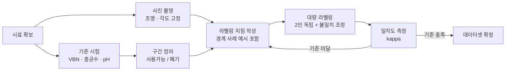

## "AI로 신선도를 판정한다"가 요구하는 것

이 문장은 기획서에 쉽게 들어간다. 그런데 이 문장을 시스템으로 만들려면 먼저 답해야 하는 질문이 있다.

**신선한지 아닌지의 정답을 누가 정하는가.**

고양이와 강아지를 구분하는 문제에는 이 질문이 없다. 사진을 보면 누구나 안다. 하지만 "이 식재료가 아직 쓸 수 있는가", "이 설비가 곧 고장 날 것인가", "이 상황이 위험한가" 같은 문제에는 정답이 자연 상태로 존재하지 않는다. 정답도 만들어야 한다.

이 글은 그 정답을 만드는 설계를 다룬다. 모델 구조를 고르는 것보다 먼저 하는 일이고, 여기서 잘못하면 뒤의 모든 작업이 무의미해진다.

> **라벨이 60% 신뢰도로 붙어 있으면 그 데이터로 학습한 모델의 상한도 60%다. 아키텍처를 바꿔도 넘지 못한다.**

## 정답의 세 가지 출처

정답을 만드는 방법은 크게 셋이고, 각각 비용과 신뢰도가 다르다.

| 출처 | 방법 | 신뢰도 | 비용 | 한계 |
|---|---|---|---|---|
| 기준 시험 | 실험실 측정으로 물리·화학·생물 지표를 잰다 | 높음 | 높음 (건당 수만 원, 며칠) | 표본 수가 제한된다. 파괴 검사면 그 개체는 사라진다 |
| 전문가 라벨 | 사람이 보고 판정한다 | 중간 | 중간 | 사람마다 다르다. 일치도를 재야 한다 |
| 사후 결과 | 나중에 실제로 벌어진 일을 정답으로 쓴다 | 상황에 따라 | 낮음 (이미 있는 기록) | 관측되지 않은 사건이 빠진다 |

세 번째가 매력적이다. 이미 쌓인 기록을 쓰면 되니까. 하지만 여기에 함정이 있다. **기록되지 않은 일은 없었던 일이 된다.** 폐기 기록으로 부패를 학습시키면, 폐기하지 않고 그냥 쓴 부패 식재료는 정상으로 라벨링된다. 고장 이력으로 예지보전을 학습시키면, 고장 나기 전에 교체한 부품은 정상으로 들어간다. 이 편향은 데이터를 아무리 늘려도 사라지지 않는다.

## 기준 시험 - 판정의 앵커를 실측에 건다

가장 신뢰할 수 있는 정답은 실험실 측정이다. 식품 부패를 예로 들면 지표가 정해져 있다.

| 지표 | 무엇을 재나 | 참고 기준 |
|---|---|---|
| VBN (휘발성염기질소) | 단백질 분해로 생기는 암모니아·아민류 | 식품공전 기준으로 20mg% 이상이면 부패육 판정. 어육은 5~10 신선, 15~25 보통, 30~40 초기부패, 50 이상 부패 |
| 총균수 | 시료 1g당 생균수 (CFU/g) | 품목별 기준이 다름. 부패 미생물 증식 정도 |
| pH | 산도 변화 | 품목별 정상 범위에서 이탈 여부 |
| 관능 검사 | 훈련된 패널의 색·냄새·조직감 평가 | 척도와 패널 구성에 따라 다름 |

여기서 설계 판단이 하나 필요하다. **모델이 예측할 대상을 이 지표 중 무엇으로 삼을 것인가.**

카메라로 찍은 사진이 VBN 값을 직접 담고 있지는 않다. 표면 변색과 VBN 상승 사이에 상관은 있지만 일대일 대응은 아니다. 그러니 "사진에서 VBN을 회귀 예측한다"는 목표는 대개 무리다. 현실적인 설계는 이렇다.

1. 기준 시험으로 **구간을 나눈다** (예: VBN 20mg% 미만 = 사용 가능, 이상 = 폐기)
2. 그 구간을 사진에 **라벨로 붙인다**
3. 모델은 사진에서 **구간을 분류**한다
4. 성능은 그 구간 분류의 재현율·정밀도로 잰다

이렇게 하면 기준 시험이 "정답의 정의"를 담당하고, 사람 라벨이 "정답의 확장"을 담당한다. 기준 시험은 비싸서 수백 건밖에 못 하지만, 그 수백 건이 라벨링 지침의 근거가 되고 나머지 수만 건은 지침에 따라 붙인다.

*그림. 비싼 기준 시험이 정의를 만들고, 그 정의로 대량 라벨링을 통제한다.*

## 라벨링 프로토콜 - 지침이 없으면 라벨도 없다

"이 사진들 보고 정상/불량 표시해 주세요"라고 하면 결과는 라벨러마다 다르다. 필요한 건 지침서다. 최소한 이 항목이 들어간다.

- **판정 대상**: 사진 안에 여러 개가 있으면 무엇을 판정하는가. 전체인가 개별인가
- **클래스 정의**: 각 클래스가 무엇인지 문장으로, 그리고 대표 사진으로
- **경계 사례**: 가장 중요한 부분이다. 애매한 사진 20~30장을 골라 "이건 A, 이건 B"를 미리 정해 둔다. 지침서의 품질은 경계 사례의 개수와 구체성으로 결정된다
- **판정 불가**: 흐리거나 가려져서 판정할 수 없는 사진을 억지로 분류시키지 않는다. `unknown` 클래스를 두고 학습에서 제외하거나 별도로 다룬다. 이걸 안 두면 애매한 사진이 임의로 한쪽에 몰려 모델이 이상해진다
- **메타데이터**: 촬영 시각, 조명 조건, 장소, 개체 식별자. 나중에 분할과 편향 분석에 반드시 필요하다

## 일치도 - 사람끼리 안 맞으면 모델도 못 맞춘다

라벨링의 품질은 감으로 판단하지 않는다. 같은 데이터를 두 사람 이상에게 독립적으로 라벨링시키고 일치도를 잰다.

| 상황 | 지표 |
|---|---|
| 라벨러 2인, 범주형 | Cohen's kappa |
| 라벨러 3인 이상, 범주형 | Fleiss' kappa |
| 라벨러 수가 다르거나 결측이 있는 경우 | Krippendorff's alpha |
| 연속값 평가 | ICC (급내상관계수) |

단순 일치율을 쓰지 않는 이유는 우연 일치 때문이다. 불량률 1%인 데이터에서 두 사람이 전부 "정상"이라고 찍으면 일치율은 99%인데 정보량은 0이다. kappa 계열은 우연히 맞을 확률을 빼고 계산한다.

해석은 Landis와 Koch의 관례적 구간이 널리 쓰인다. 0.21~0.40 fair, 0.41~0.60 moderate, 0.61~0.80 substantial, 0.81~1.00 almost perfect. 이건 통계적 근거가 있는 절대 기준이 아니라 관례이므로, 과제 성격에 따라 필요 수준을 따로 정해야 한다.

kappa가 낮게 나왔을 때 하는 일은 라벨러를 바꾸는 게 아니라 **지침서를 고치는 것**이다. 불일치가 난 사례를 모아서 보면 대개 지침이 다루지 않은 상황이 나온다. 그걸 경계 사례로 추가하고 다시 잰다. 이 반복이 데이터셋 구축의 본체다.

## 클래스 불균형 - 정확도라는 함정

현장 데이터는 거의 항상 한쪽으로 쏠려 있다. 불량률 1%, 고장률 0.1%, 위험 상황 0.01%.

이 상태에서 "정확도 99%"는 아무것도 안 하고 전부 정상이라고 답해도 나오는 숫자다. 그런데 제안서와 보고서에는 이 숫자가 자주 등장한다.

불균형 데이터에서 봐야 할 지표는 이렇다.

| 지표 | 의미 | 언제 쓰나 |
|---|---|---|
| 재현율 (recall) | 실제 불량 중 잡아낸 비율 | 놓치면 큰일 나는 문제 |
| 정밀도 (precision) | 불량이라 한 것 중 진짜 비율 | 오경보 비용이 큰 문제 |
| PR-AUC | 정밀도-재현율 곡선 아래 면적 | 불균형에서 ROC-AUC보다 변별력이 높다 |
| 특정 정밀도에서의 재현율 | "오경보 5% 이하로 유지하면서 몇 % 잡나" | 운영 조건을 그대로 반영 |

마지막 형태가 실무에서 가장 유용하다. 운영자가 감당할 수 있는 오경보 수준이 먼저 있고, 그 조건에서 얼마나 잡는지가 실제 가치이기 때문이다. "AUC 0.92"보다 "일 평균 오경보 3건 이하 조건에서 재현율 78%"가 훨씬 많은 것을 말한다.

## 데이터 분할 - 누수가 성능을 부풀린다

학습·검증·시험 데이터를 무작위로 나누면 안 되는 경우가 많다. 같은 것이 양쪽에 들어가면 모델이 외운 것을 시험하는 꼴이 된다.

| 누수 유형 | 상황 | 대응 |
|---|---|---|
| 개체 누수 | 같은 물건을 여러 각도로 찍은 사진이 학습과 시험에 나뉨 | 개체 ID 기준 그룹 분할 |
| 장소 누수 | 같은 지점의 사진이 양쪽에 있어 조명·배경을 외움 | 지점 기준 분할. 미설치 지점 일반화 성능을 보려면 필수 |
| 시간 누수 | 미래 데이터로 학습해 과거를 예측 | 시간 기준 분할. 운영에서는 항상 과거로 미래를 예측한다 |
| 전처리 누수 | 정규화 통계를 전체 데이터로 계산 | 학습 데이터로만 계산해 나머지에 적용 |

세 번째가 특히 중요한데 자주 놓친다. 예지보전이나 수요 예측처럼 시계열 성격이 있는 문제에서 무작위 분할을 하면 성능이 크게 부풀려진다. 운영 환경은 언제나 "지금까지 본 것으로 아직 안 본 것을 맞히는" 조건이므로, 평가도 그 조건이어야 한다.

## 데이터 규모는 기준 시험 예산이 정한다

여기가 기획 단계에서 가장 자주 빠지는 계산이다.

기준 시험 1건에 5만 원과 3일이 든다고 하자. 예산 1,000만 원이면 200건이다. 그러면 정답의 앵커는 200개이고, 클래스가 4개면 클래스당 50개다. 이 숫자로 무엇을 검증할 수 있는지가 성능 목표의 상한을 정한다.

그래서 순서가 이렇다.

1. 기준 시험 예산과 소요 기간을 먼저 확정한다
2. 그것이 몇 건인지 계산한다
3. 그 건수로 통계적으로 말할 수 있는 것이 무엇인지 정한다
4. 그 다음에 성능 목표를 쓴다

거꾸로 하면, 즉 성능 목표를 먼저 쓰고 나중에 검증하려 들면 검증할 데이터가 없어서 목표를 증명하지 못한다. 계획서에 "정확도 95% 달성"이라고 써 놓고 그걸 확인할 정답 데이터를 만들 예산이 없는 상황이 실제로 생긴다.

파괴 검사인 경우 제약이 하나 더 붙는다. VBN을 재려면 시료를 갈아야 하므로, 그 개체의 "그 이후"는 관측할 수 없다. 시간에 따른 변화를 보려면 같은 조건의 개체를 여러 개 준비해 시점별로 하나씩 소모해야 하고, 그러면 필요 시료 수가 시점 수만큼 곱해진다.

## 도구가 라벨링 도구를 짜 주는 시대에 남는 일

라벨링 웹 도구를 만드는 일, kappa를 계산하는 스크립트, 그룹 분할 코드는 지시하면 도구가 짠다. 데이터 증강도, 불균형 보정 샘플링도 마찬가지다.

도구가 못 하는 건 이것들이다.

무엇을 정답으로 삼을지 정하는 일. VBN 20mg%라는 선을 이 사업의 판정 기준으로 채택할지, 아니면 현장 운영 기준을 따를지 결정하는 일. 경계 사례 30장을 실제로 골라 "이건 A"라고 판정하는 일. kappa 0.55가 나왔을 때 지침의 어느 문장이 모호했는지 찾아내는 일. 기준 시험 200건으로 무엇을 주장할 수 있고 무엇은 주장하면 안 되는지 아는 일.

이건 전부 판단이고, 판단의 근거는 도메인과 예산과 운영 조건에 있다.

> **모델을 학습시키기 전에 정답을 정의해야 한다. 정답을 정의하는 일은 자동화되지 않고, 그 정의가 틀리면 그 위에 쌓은 모든 성능 수치가 틀린 것을 재게 된다.**

도구가 코드를 짜 줄수록 데이터 프로젝트의 무게중심은 모델링에서 **정답 설계와 그 정답의 신뢰도 검증**으로 옮겨간다. 성능 지표를 쓰기 전에 그 지표가 무엇에 대한 지표인지 먼저 쓰는 습관이 여기서 나온다.

---

## 참고

- 식품의약품안전처 식품공전 (VBN 부패 판정 기준), <https://various.foodsafetykorea.go.kr/fsd/#/>
- Landis, J. R., Koch, G. G., "The Measurement of Observer Agreement for Categorical Data", Biometrics 33(1), 1977 (kappa 해석 구간의 출처)
- Krippendorff, K., "Content Analysis: An Introduction to Its Methodology" (alpha 계수)
- 어육 VBN 신선도 구간 참고: 한국식품저장유통학회 관련 문헌, <https://www.ekosfop.or.kr/>

*※ VBN 20mg% 부패 판정과 어육 신선도 구간(5~10 / 15~25 / 30~40 / 50 이상)은 식품공전 및 관련 문헌 기준으로 확인한 값이다. 기준 시험 단가 5만 원·3일은 규모 감각을 위한 예시이며 실제 시험 항목·기관에 따라 다르다. 라벨링 프로토콜 항목 구성과 누수 유형 분류는 내가 실무에서 쓰는 정리 방식이다.*
