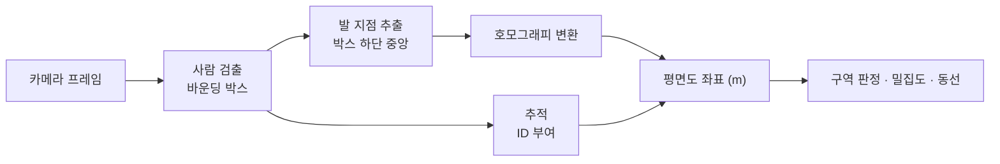

## "영상으로 이용자 행동을 분석한다"가 요구하는 것

이 요구사항을 받으면 대부분 모델 이야기부터 시작한다. 어떤 검출기를 쓸지, 추적 알고리즘은 무엇으로 할지. 그런데 이 단계에서 결과를 사실상 결정해 버리는 요인은 따로 있다.

**카메라가 어디에 어떻게 달려 있는가.**

천장 4미터에 아래를 향해 달린 카메라와 벽 2.5미터에 비스듬히 달린 카메라는 완전히 다른 문제를 만든다. 전자는 사람이 서로 안 겹치는 대신 얼굴이 안 보이고, 후자는 겹침이 심한 대신 자세를 볼 수 있다. 같은 모델을 써도 성능이 두 배 차이 난다.

이 글은 그 순서를 바로잡는 설계를 다룬다. 모델 선택은 세 번째 문제다.

> **영상 분석 프로젝트의 성능은 모델을 바꿔서 올리는 것보다 카메라를 20센티미터 올려서 올리는 게 빠른 경우가 많다.**

## 1단계 - 무엇을 셀 것인지부터 정의한다

지표 정의가 애매하면 그 뒤의 모든 검증이 불가능해진다. 자주 쓰이는 지표와 그 정의의 함정을 정리하면 이렇다.

| 지표 | 정의해야 할 것 | 흔한 함정 |
|---|---|---|
| 방문자 수 | 같은 사람이 나갔다 들어오면 1인가 2인가 | 재입장 판정 기준이 없으면 숫자가 매일 다르다 |
| 체류 시간 | 구역 안에 있던 시간. 잠깐 가려졌던 구간은 포함인가 | 가림으로 추적이 끊기면 한 사람이 두 명이 된다 |
| 동선 | 몇 초 간격의 위치를 잇는가 | 샘플링 간격에 따라 경로 길이가 달라진다 |
| 대기열 길이 | 줄에 서 있는 것과 근처에 있는 것을 어떻게 구분하는가 | 사람 사이 간격 기준이 없으면 판정이 안 된다 |
| 밀집도 | 면적당 인원. 그 면적은 어디인가 | 화면 픽셀 면적과 실제 바닥 면적이 다르다 |

마지막 항목이 특히 중요하다. 화면 아래쪽의 1픽셀과 위쪽의 1픽셀은 실제 바닥에서 전혀 다른 넓이다. 이걸 보정하지 않으면 밀집도는 카메라에서 먼 쪽이 과대평가된다.

## 2단계 - 카메라 설계, DORI로 결정한다

영상 감시 분야에는 목적별로 필요한 화질을 규정한 표준이 있다. IEC/EN 62676-4의 DORI 기준이다. 대상 인물의 세로 방향 미터당 픽셀 수(px/m)로 표현한다.

| 등급 | 픽셀/미터 | 무엇이 가능한가 |
|---|---|---|
| Detect (탐지) | 25 px/m | 사람이 있다는 것을 안다 |
| Observe (관찰) | 62 px/m | 어떤 행동을 하는지 대략 본다 |
| Recognize (인식) | 125 px/m | 아는 사람인지 알아본다 |
| Identify (식별) | 250 px/m | 모르는 사람의 신원을 특정한다 |

이 표가 설계에 주는 것은 명확한 계산식이다. 1080p 카메라의 세로 해상도가 1080픽셀이고, 화각 안에 들어오는 세로 실측 거리가 10미터라면 108 px/m다. 탐지와 관찰은 되고 인식은 안 된다. 사람을 세는 것은 되고 특정하는 것은 안 된다는 뜻이다.

거꾸로도 쓴다. 인식 등급이 필요하면 같은 카메라의 커버 범위를 8.6미터 이하로 줄이거나 해상도를 올려야 한다. 그러면 필요 카메라 대수가 늘고 그게 예산이다. **화질 요구사항이 곧 대수이고 곧 단가다.**

설치 각도와 높이는 겹침(occlusion)을 결정한다.

| 배치 | 장점 | 단점 |
|---|---|---|
| 천장 수직 (top-down) | 겹침이 거의 없다. 계수 정확도가 높다 | 사람의 외형 정보가 적어 재식별이 어렵다. 커버 면적이 좁다 |
| 경사 설치 (30~45도) | 커버 면적이 넓고 외형이 보인다 | 밀집하면 뒷사람이 가려진다 |
| 벽면 수평 | 얼굴·자세가 잘 보인다 | 겹침이 가장 심하다. 계수에 부적합 |

계수와 밀집도가 목적이면 천장 수직, 동선과 재식별이 목적이면 경사 설치가 기본이다. 둘 다 필요하면 카메라를 두 종류 놓는 것이 한 카메라로 둘 다 하려는 것보다 싸게 먹힌다.

조명도 설계 항목이다. 출입구 쪽으로 향한 카메라는 역광에서 실루엣만 잡히고, 저조도 시간대에는 노이즈가 검출기를 망친다. 야간 운용이 있으면 IR 조명과 그때의 화질을 별도로 검증해야 한다.

## 3단계 - 좌표를 평면도로 옮긴다

영상 좌표(픽셀)를 그대로 쓰면 앞의 밀집도 문제가 생긴다. 바닥 평면과 영상 사이의 사상을 구해 두면 이 문제가 사라진다.

바닥처럼 평면인 대상은 호모그래피(homography) 하나로 변환된다. 바닥에서 서로 다른 지점 4개의 실제 좌표와 영상 좌표를 짝지어 주면 3x3 행렬이 나오고, 그 뒤로는 사람 발 위치를 평면도 좌표로 바꿀 수 있다. 실무에서는 바닥 타일 격자나 기둥 위치를 기준점으로 쓴다.

이걸 해 두면 얻는 것이 여럿이다.

- 밀집도를 실제 제곱미터 기준으로 계산할 수 있다
- 구역(zone)을 평면도 위에 그릴 수 있다. 카메라를 옮겨도 구역 정의가 유지된다
- 여러 카메라의 결과를 하나의 좌표계로 합칠 수 있다
- 동선 길이와 이동 속도가 미터·초 단위로 나온다

*그림. 검출 결과를 바로 쓰지 않고 평면 좌표로 바꾼 뒤 지표를 계산한다.*

## 4단계 - 그제서야 모델을 고른다

### 검출

| 계열 | 대표 | 특징 |
|---|---|---|
| YOLO 계열 | YOLOv8, YOLO11 (Ultralytics) | n/s/m/l 크기 선택지가 넓다. 엣지 배포 도구가 잘 갖춰져 있다 |
| DETR 계열 | RT-DETR | NMS 후처리가 없다. 밀집 장면에서 유리한 경우가 있다 |
| 밀집 계수 전용 | CSRNet 등 밀도 맵 방식 | 개체를 구분하지 않고 인원수만 추정. 매우 혼잡한 장면에서 검출 방식보다 낫다 |

주의할 점은 공개 데이터셋 기준 성능이 현장 성능을 예측하지 못한다는 것이다. COCO의 person 클래스는 대부분 정면·측면 사진이고, 천장에서 내려다본 사람은 거의 없다. 천장 수직 설치를 하기로 했다면 **그 각도의 데이터로 다시 학습하거나 최소한 다시 평가해야 한다.** 이 확인을 안 하면 "논문에서 mAP 0.53"이라는 숫자를 믿고 배포했다가 현장에서 절반도 못 잡는다.

### 추적

검출은 프레임마다 독립이고, 그걸 이어 붙여 같은 사람에게 같은 ID를 주는 것이 추적이다.

| 방식 | 특징 |
|---|---|
| ByteTrack | 낮은 신뢰도 검출까지 2단계로 매칭한다. 가려졌다 나오는 경우에 강하다 |
| BoT-SORT | 카메라 움직임 보상과 외형 특징을 결합 |
| OC-SORT | 가림 구간의 관측 중심 보정 |
| DeepSORT | 외형 임베딩을 쓰는 고전 방식 |

추적 품질 지표는 MOTA, IDF1, HOTA를 쓴다. 이 중 실무에서 가장 의미 있는 건 IDF1과 HOTA다. MOTA는 검출 성능에 크게 좌우되어, 검출이 좋으면 ID가 자주 바뀌어도 점수가 높게 나온다. **체류 시간과 동선은 ID 유지에 의존하므로 ID 전환이 곧 지표 오차다.**

### 재식별(ReID)

카메라 사이를 오가거나 오래 사라졌다 나타난 사람을 이어 붙이는 문제다. 외형 임베딩을 만들어 비교한다.

여기서 반드시 짚어야 할 것이 있다. 재식별 벡터는 **개인을 구별하기 위한 표현**이다. 이름이 없더라도 특정 개인을 지속적으로 추적하는 데 쓰인다. 뒤에 나올 개인정보 항목에서 가장 민감한 부분이 여기다.

## 5단계 - 밀집도와 안전

밀집도를 다룰 때 참고할 고전이 Fruin의 보행 서비스 수준(Level of Service)이다. 1인당 점유 면적으로 A부터 F까지 등급을 나눈다. 대기 공간 기준으로 A는 1인당 약 1.2제곱미터 이상, 등급이 내려갈수록 좁아져 F는 0.2제곱미터 수준이다. 이 값을 뒤집으면 제곱미터당 인원이 되고, 5인/제곱미터를 넘어가는 구간은 개인이 이동을 제어할 수 없는 상태로 본다.

시스템 설계에서 이 기준을 쓸 때 조심할 점이 있다.

- **면적 정의**: 벽·기둥·집기를 뺀 유효 보행 면적으로 계산해야 한다. 전체 바닥 면적으로 나누면 위험이 과소평가된다
- **순간값이 아니라 추세**: 순간 밀집도보다 상승 속도가 위험 신호다. 같은 4인/제곱미터라도 유지 중인 것과 3분 만에 도달한 것은 다르다
- **경보 예산**: 앞서 위험도 설계에서 다룬 문제가 그대로 적용된다. 임계 밀집도를 낮게 잡으면 경보가 하루 종일 뜬다

## 6단계 - 개인정보를 설계에 넣는다

영상은 개인정보다. 이 전제를 설계 단계에서 반영하지 않으면 만들고 나서 못 쓴다. 개인정보보호법은 영상정보처리기기의 설치·운영에 별도의 제한을 두고 있고, 목적 외 이용과 무단 열람을 금지한다.

기술 설계에서 할 수 있는 대응은 이렇다.

| 방법 | 내용 | 대가 |
|---|---|---|
| 온디바이스 처리 | 영상을 서버로 보내지 않고 카메라·엣지 박스에서 처리해 결과 수치만 전송 | 엣지 하드웨어 비용, 모델 개선 시 원본이 없어 재학습이 어렵다 |
| 원본 미저장 | 프레임을 버리고 좌표·카운트만 남긴다 | 오탐 원인 분석이 불가능해진다 |
| 비식별 처리 | 얼굴·번호판을 흐리게 처리한 뒤 저장 | 처리 부하. 흐림 처리 실패 시 그대로 노출 |
| 보관 기간 제한 | 며칠 뒤 자동 삭제 | 장기 분석 불가 |
| 접근 통제·감사 | 열람 권한 분리, 열람 이력 기록 | 운영 절차 필요 |

가장 자주 선택되는 조합은 온디바이스 처리와 원본 미저장이다. 그런데 이 조합에는 숨은 비용이 있다. **모델이 틀렸을 때 왜 틀렸는지 볼 수 없다.** 그래서 실무에서는 운영 초기 일정 기간만 검증용 표본을 별도 동의·절차로 보관하고, 안정화 이후 원본 미저장으로 전환하는 방식을 쓴다. 이 전환 계획을 처음부터 문서에 넣어야 한다.

## 7단계 - 엣지에 몇 채널을 태울 것인가

현장 처리를 하기로 했으면 박스 하나가 카메라 몇 대를 감당하는지가 대수와 단가를 정한다. 계산 방식은 단순하다.

1. 채널당 목표 처리율을 정한다. 사람 계수는 대개 10~15fps면 충분하고, 빠른 이동을 다루면 더 필요하다
2. 대상 하드웨어에서 선택한 모델의 실측 추론 시간을 잰다. 공개 벤치마크가 아니라 그 보드에서 그 해상도로 직접 잰다
3. 전처리·후처리·인코딩까지 포함한 파이프라인 전체 시간으로 나눈다
4. 여기서 나온 값의 60~70%만 쓴다. 나머지는 피크와 다른 프로세스 몫이다

3번과 4번을 빼먹는 것이 흔한 실수다. 모델 추론만 재서 "채널당 20ms니까 8채널"이라고 계산하면, 실제로는 디코딩과 전처리에서 시간을 다 쓴다. 다중 채널에서는 비디오 디코딩이 병목이 되는 경우가 많아 하드웨어 디코더 지원 여부를 먼저 확인해야 한다.

## 도구가 파이프라인을 짜 주는 시대에 남는 일

검출기 학습, 추적기 연결, 호모그래피 계산, 구역 판정 로직은 전부 지시하면 도구가 짠다. 나도 이런 파이프라인의 골격은 Claude Code에게 만들게 한다. 실시간 처리 최적화도 요구하면 붙는다.

도구가 못 하는 건 그 앞이다.

카메라를 어디에 몇 도로 달 것인지 정하는 일. DORI 기준으로 필요한 화질을 계산해 대수를 산출하는 일. 천장 각도 데이터가 없으니 현장에서 수집해 다시 평가해야 한다고 판단하는 일. 밀집도 임계값을 몇으로 두고 그 경보를 누가 받을지 정하는 일. 원본을 언제까지 보관하고 언제 끊을지 정하는 일.

특히 첫 번째와 마지막이 그렇다. 카메라 위치는 시스템 성능의 상한을 정하고, 개인정보 처리 방침은 시스템의 존속 가능성을 정한다. 둘 다 코드 밖에 있다.

> **영상 분석에서 사람의 일은 모델을 고르는 게 아니라, 이 공간에서 무엇을 측정할 수 있고 무엇은 측정하면 안 되는지를 카메라를 달기 전에 확정하는 것이다.**

카메라를 달고 나면 각도는 다시 못 바꾼다. 그 전에 답해야 하는 질문의 목록을 만드는 일이 설계다.

---

## 참고

- IEC/EN 62676-4, 영상감시시스템 응용 지침 (DORI 기준), <https://webstore.iec.ch/publication/7203>
- Fruin, J. J., "Pedestrian Planning and Design", 1971 (보행 서비스 수준 LOS)
- Zhang, Y. 외, "ByteTrack: Multi-Object Tracking by Associating Every Detection Box", ECCV 2022, <https://arxiv.org/abs/2110.06864>
- Luiten, J. 외, "HOTA: A Higher Order Metric for Evaluating Multi-Object Tracking", IJCV 2021, <https://arxiv.org/abs/2009.07736>
- Ultralytics YOLO 문서, <https://docs.ultralytics.com/>
- 개인정보보호법 (영상정보처리기기 설치·운영 제한), <https://www.law.go.kr/>

*※ DORI의 25 / 62 / 125 / 250 px/m는 IEC/EN 62676-4 기준값이다. Fruin의 LOS 구간은 1971년 원문 기준의 관례적 인용값이며 적용 상황(보행로·대기공간·계단)에 따라 값이 다르다. 엣지 채널 수 산정의 60~70% 여유율과 카메라 배치 비교표는 내가 설계에 쓰는 기준이며 규격이 아니다.*
