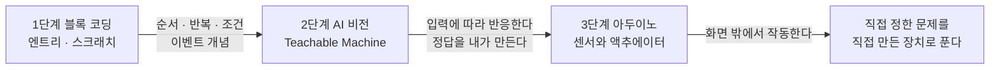

## 왜 순서를 먼저 정하는가

아이에게 코딩을 가르치겠다고 마음먹으면 재료는 넘친다. 엔트리도 있고, 스크래치도 있고, 파이썬 교재도 있고, 아두이노 키트도 인터넷에 널려 있다. 문제는 그것들을 아무 순서로나 시작하면 대개 중간에 멈춘다는 것이다.

멈추는 이유는 대개 셋이다.

- 배운 것이 다음 것으로 이어지지 않아서, 매번 처음부터 시작하는 느낌이 든다
- 결과물이 자기 것 같지 않아서 흥미가 안 붙는다. 교재를 그대로 따라 하면 완성품은 교재의 것이다
- 어른이 준비할 게 많아서 어른이 먼저 지친다

이 시리즈는 그래서 커리큘럼부터 짠다. 세 단계를 놓고, 각 단계가 다음 단계에 무엇을 넘겨주는지를 먼저 정한다.

> **가르치는 순서를 정하는 일은 아이에게 무엇을 시킬지 정하는 일이 아니라, 아이가 다음 단계에서 쓸 수 있는 무엇을 남겨 줄지 정하는 일이다.**

## 세 단계와 그 사이의 다리

*그림. 각 단계가 다음 단계에 넘겨주는 것.*

| 단계 | 무엇을 배우나 | 다음 단계에 넘기는 것 | 권장 시기 |
|---|---|---|---|
| 1. 블록 코딩 | 순서·반복·조건·이벤트. 화면 안의 것을 움직인다 | "컴퓨터는 내가 시킨 순서대로만 한다"는 감각 | 초등 저학년부터 |
| 2. AI 비전 | 예시를 모아 분류기를 만들고, 그 결과로 화면을 바꾼다 | "정답은 주어지는 게 아니라 내가 정한다"는 경험 | 1단계 이후 |
| 3. 아두이노 | 센서로 읽고 부품을 움직인다. 회로와 코드가 만난다 | "화면 밖 세상도 같은 규칙으로 움직인다" | 2단계 이후 또는 병행 |

### 왜 이 순서인가

**블록 코딩이 먼저인 이유**는 오타가 없기 때문이다. 텍스트 코딩을 처음 시작하면 아이가 부딪히는 벽의 대부분은 논리가 아니라 세미콜론과 대괄호다. 블록은 문법 오류가 원천적으로 안 생기므로, 틀렸을 때 "내 생각이 틀렸구나"로 바로 간다. 배우려는 게 논리인데 문법에서 막히는 낭비를 없애는 것이 목적이다.

**AI 비전이 두 번째인 이유**는 이 단계에서 아이가 처음으로 "정답을 만드는 쪽"에 서기 때문이다. 블록 코딩까지는 정답이 명확하다. 고양이가 오른쪽으로 가면 성공이다. 그런데 이미지 분류기를 만들면 상황이 달라진다. 어떤 사진을 "캔"으로 볼지 아이가 정해야 하고, 애매한 사진이 나오면 판단해야 하고, 잘못 분류되면 자기가 모은 예시를 의심해야 한다.

이 경험이 이 시리즈 전체에서 가장 중요하다. 도구가 결과를 만들어 주는 시대에 사람이 하는 일이 정확히 그것이기 때문이다.

**아두이노가 세 번째인 이유**는 물리적 실패가 추가되기 때문이다. 코드가 맞아도 선이 빠져 있으면 안 된다. 이 단계에서 아이는 "안 되는 이유가 여러 층에 있을 수 있다"는 것을 배운다. 앞의 두 단계가 없으면 코드를 의심할지 배선을 의심할지 판단할 근거가 없다.

## 각 단계에서 무엇을 평가하는가

시험을 보라는 뜻이 아니다. 이 단계를 넘어가도 되는지 보호자가 판단할 기준이다. 완성한 작품의 화려함이 아니라 다음 세 가지를 본다.

| 관점 | 확인 질문 |
|---|---|
| 정의력 | 만들기 전에 "무엇을 만들 건지" 자기 말로 설명할 수 있는가 |
| 검증력 | 완성한 뒤 "제대로 되는지" 스스로 확인해 보는가. 어른이 물어봐야 확인하는가 |
| 복구력 | 안 될 때 어디부터 볼지 스스로 정하는가 |

세 번째가 특히 실력이다. 안 될 때 무작정 처음부터 다시 만드는 아이와, "여기까지는 됐으니 그 다음부터 보자"고 하는 아이는 다른 단계에 있다.

## 실습을 고르는 원칙

교재의 예제를 그대로 따라 하면 배운 게 안 남는다. 그렇다고 "네가 만들고 싶은 거 만들어 봐"라고 하면 시작을 못 한다. 그 사이가 필요하다.

내가 쓰는 방식은 **뼈대는 주고 대상은 아이가 고르게 하는 것**이다.

- "무언가를 세 종류로 분류하는 프로그램을 만든다"는 뼈대를 준다
- 무엇을 분류할지는 아이가 고른다. 자기 레고 색깔, 젤리 종류, 가족 얼굴, 뭐든지
- 세 종류가 무엇인지 아이가 정의하고, 그 정의를 종이에 적게 한다

마지막 항목이 핵심이다. 종이에 적으면 나중에 결과와 대조할 수 있다. "빨간 레고를 빨강으로 분류한다"고 적어 뒀는데 주황 레고가 빨강으로 나오면, 아이가 자기가 적은 문장을 다시 본다. 이게 검증이다.

## 어른이 준비할 것

교육 과정을 짤 때 자주 빠지는 계산이 어른의 준비 시간이다. 매번 한 시간씩 준비해야 하는 과정은 지속되지 않는다.

| 단계 | 준비물 | 준비 부담 |
|---|---|---|
| 블록 코딩 | 인터넷이 되는 컴퓨터 한 대. 계정 하나 | 거의 없음. 브라우저만 열면 된다 |
| AI 비전 | 웹캠(노트북 내장 가능). 분류할 물건 몇 개 | 낮음. 물건 준비가 전부 |
| 아두이노 | 보드, 브레드보드, 점퍼선, 저항, 센서 몇 종 | 중간. 부품 준비와 배선 확인이 필요 |

3단계에서 부담이 뛴다. 그래서 아두이노는 부품을 한 번에 다 사지 않고, 한 회차에 쓸 것만 사서 그 회차가 끝난 뒤 다음을 정하는 편이 낫다. 큰 키트를 사면 대부분의 부품이 상자 안에서 늙는다.

## 이 시리즈에서 쓰지 않을 것

몇 가지는 의도적으로 뺀다.

- **성적과 진도**: 진도를 정해 놓으면 못 따라온 날이 실패가 된다. 한 주제를 몇 주 하든 상관없게 둔다
- **자격증과 대회**: 목표가 밖에 생기면 만드는 이유가 밖으로 나간다
- **어른이 대신 고쳐 주기**: 막혔을 때 어른이 코드를 고쳐 주면 그 순간은 넘어가는데 다음에 같은 곳에서 또 막힌다. 어디를 볼지 질문으로 좁혀 주는 데까지만 한다

마지막 항목이 제일 어렵다. 5분이면 고칠 걸 30분 지켜보는 일이다. 그런데 그 30분이 배우는 시간이다.

## 다음 글

이어지는 세 편은 각 단계의 교재편이다. 회차 구성, 실습 과제, 자주 막히는 지점, 그리고 그 단계에서 어른이 물어볼 질문 목록을 담는다.

- 1단계 블록 코딩편
- 2단계 AI 비전편
- 3단계 아두이노편

> **아이에게 가르치려는 건 코드를 쓰는 법이 아니다. 만들고 싶은 것을 말로 정확히 옮기는 법과, 만들어진 것이 그 말과 같은지 확인하는 법이다.**

도구가 코드를 대신 써 주는 환경에서 사람에게 남는 일이 정확히 그 둘이다. 그러니 지금 아이에게 연습시킬 것도 그 둘이다.

---

## 참고

- 엔트리 (네이버 커넥트재단), <https://playentry.org/>
- Scratch (MIT Media Lab), <https://scratch.mit.edu/>
- Teachable Machine (Google), <https://teachablemachine.withgoogle.com/>
- Arduino 공식 문서, <https://docs.arduino.cc/>

*※ 3단계 구성과 단계별 평가 관점(정의력·검증력·복구력)은 표준 커리큘럼이 아니라 내가 정리한 방식이다. 권장 시기는 아이마다 다르므로 나이보다 앞 단계의 완료 여부를 기준으로 본다.*
