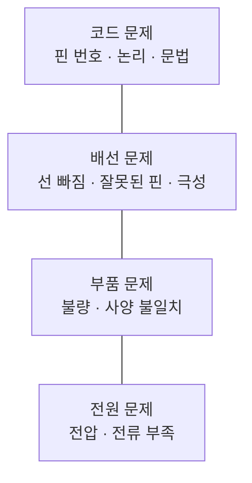

## 이 단계가 어려워지는 지점

앞의 두 단계에서 안 되는 이유는 하나였다. 코드가 틀렸다.

아두이노부터는 층이 늘어난다.


*그림. 안 될 때 의심해야 하는 네 층.*

그래서 이 단계의 학습 목표는 부품 사용법이 아니라 **어느 층을 먼저 볼지 정하는 능력**이다. 앞 단계에서 디버깅 습관을 들여 놓은 아이는 여기서 훨씬 수월하다.

> **화면 안에서는 코드만 의심하면 됐다. 화면 밖으로 나오면 무엇을 의심할지부터 정해야 한다.**

## 보드 고르기

| | UNO R3 | UNO R4 Minima / WiFi |
|---|---|---|
| MCU | ATmega328P, 8비트, 16MHz | Renesas RA4M1, Arm Cortex-M4, 48MHz |
| 플래시 | 32KB | 256KB |
| SRAM | 2KB | 32KB |
| 동작 전압 | 5V | 5V |
| 무선 | 없음 | R4 WiFi에 ESP32-S3 탑재 (Wi-Fi·Bluetooth) |
| 그 외 | 자료가 압도적으로 많다 | R4 WiFi는 12x8 LED 매트릭스 내장 |

처음 배울 때는 자료가 많은 쪽이 유리하다. 검색하면 나오는 예제가 R3 기준인 경우가 많다. 다만 R4는 메모리가 훨씬 넉넉해서 나중에 무선이나 조금 큰 프로그램으로 갈 때 여유가 있다. 둘 중 어느 쪽이든 핀 배치와 기본 코드는 같아서 배운 것이 그대로 넘어간다.

호환 보드(정품이 아닌 같은 회로의 보드)를 써도 학습에는 문제가 없다. 다만 드라이버가 달라 컴퓨터가 못 알아보는 경우가 있으니, 인식이 안 되면 그건 코드 문제가 아니라 드라이버 문제라는 걸 알아 둔다.

## 부품은 한 번에 사지 않는다

큰 키트를 사면 대부분의 부품이 상자에서 늙는다. 회차별로 필요한 것만 준비한다.

| 회차 | 필요한 것 |
|---|---|
| 1 | 보드, USB 케이블 (LED는 보드 내장 13번 사용) |
| 2 | 브레드보드, 점퍼선, LED 몇 개, 220옴 저항 |
| 3 | 푸시버튼, 10K옴 저항 (또는 내부 풀업 사용) |
| 4 | 조도센서(CDS)와 10K옴, 또는 DHT11 온습도 센서 |
| 5 | SG90 서보모터 |
| 6 | 앞의 것 조합 |

## 여섯 회차 구성

| 회차 | 주제 | 만드는 것 | 새로 나오는 것 |
|---|---|---|---|
| 1 | 출력 | 내장 LED 깜빡이기 | setup / loop, 디지털 출력, 시간 |
| 2 | 회로 | 외부 LED 여러 개 제어 | 브레드보드, 저항, 극성 |
| 3 | 입력 | 버튼으로 LED 켜기 | 디지털 입력, 풀업, 채터링 |
| 4 | 센서 | 밝기나 온도 읽어 표시 | 아날로그 입력, 시리얼 모니터 |
| 5 | 움직임 | 서보모터 각도 제어 | 라이브러리, 전류와 전원 |
| 6 | 통합 | 센서 값에 따라 움직이는 장치 | 앞의 전부 + 조건 |

## 1회차 - 출력

첫 코드는 보드에 내장된 LED를 깜빡이는 것이다. 부품이 필요 없어서 배선 문제가 끼어들지 않는다. **첫 회차에서 배선 문제를 만나면 아이가 코드와 회로를 구분하지 못한 채 좌절한다.** 그래서 일부러 내장 LED로 시작한다.

```cpp
void setup() {
  pinMode(LED_BUILTIN, OUTPUT);   // 내장 LED 핀을 출력으로 쓰겠다고 선언
}

void loop() {
  digitalWrite(LED_BUILTIN, HIGH); // 켜기
  delay(1000);                     // 1000밀리초 = 1초 기다림
  digitalWrite(LED_BUILTIN, LOW);  // 끄기
  delay(1000);
}
```

블록 코딩을 거친 아이는 `loop`가 반복 블록이라는 걸 바로 안다. `setup`이 시작할 때 한 번만 도는 것도 설명하면 이해한다.

**어른의 질문**:
- "delay 값을 100으로 바꾸면 어떻게 될까?" (예측 먼저)
- "1로 바꾸면?" (너무 빨라 계속 켜진 것처럼 보이는 현상을 직접 본다)

## 2회차 - 회로

외부 LED를 붙인다. 여기서 처음으로 물리 규칙이 들어온다.

- **극성**: LED는 다리 길이가 다르다. 긴 쪽이 플러스(애노드)다. 거꾸로 꽂으면 아무 일도 안 일어난다
- **저항**: LED에 저항 없이 5V를 걸면 과전류로 망가진다. 5V 회로에서 일반 LED에는 220옴 정도를 직렬로 넣는다
- **브레드보드**: 구멍이 안에서 어떻게 이어져 있는지 먼저 그림으로 확인한다. 세로줄이 이어져 있고 가운데 홈에서 끊긴다는 것을 모르면 아무리 코드를 고쳐도 안 된다

이 회차에서 반드시 겪게 해야 할 것이 **안 되는 경험**이다. 일부러 LED를 거꾸로 꽂아 보게 하고, 저항 없이 잠깐 연결해 보는 건 하지 않되 왜 안 되는지 설명한다. "선이 빠져 있어도 코드는 오류를 안 낸다"는 사실을 여기서 각인시킨다.

**어른의 질문**:
- "코드는 그대로인데 안 켜져. 뭘 먼저 볼까?"

## 3회차 - 입력

버튼을 붙인다. 여기서 두 가지 개념이 나온다.

**풀업**: 버튼을 안 눌렀을 때 그 핀의 값은 정해져 있지 않다. 주변 전기 잡음에 따라 0과 1을 오간다. 그래서 안 눌렀을 때 확실히 한쪽 값이 되도록 저항으로 끌어당긴다. 아두이노는 내부 풀업 저항이 있어서 `INPUT_PULLUP`으로 선언하면 외부 저항 없이 된다. 대신 논리가 뒤집힌다. 누르면 LOW다.

```cpp
const int BTN = 2;

void setup() {
  pinMode(BTN, INPUT_PULLUP);      // 내부 풀업 사용
  pinMode(LED_BUILTIN, OUTPUT);
}

void loop() {
  // 풀업이라 누르면 LOW가 된다
  if (digitalRead(BTN) == LOW) {
    digitalWrite(LED_BUILTIN, HIGH);
  } else {
    digitalWrite(LED_BUILTIN, LOW);
  }
}
```

**채터링**: 버튼은 눌리는 순간 접점이 여러 번 튄다. 그래서 한 번 눌렀는데 여러 번 눌린 것으로 읽힌다. 카운터를 만들어 보면 1이 아니라 3이 올라가는 걸 직접 본다. 해결은 짧은 지연을 주거나 마지막 변화 시각을 기억하는 방식이다. 이 문제를 겪게 한 다음 고치는 순서가 좋다.

## 4회차 - 센서

아날로그 입력을 배운다. 조도센서나 온습도센서 중 하나를 고른다.

조도센서는 회로가 간단하고 원리가 직관적이다. 빛이 밝으면 저항이 낮아지고, 그걸 10K옴 저항과 나눠 걸어 중간 전압을 읽는다. `analogRead`는 0~1023 사이 값을 준다.

여기서 시리얼 모니터를 처음 쓴다. 이게 이 단계에서 가장 중요한 도구다.

```cpp
const int SENSOR = A0;

void setup() {
  Serial.begin(9600);              // 컴퓨터와 통신 시작
}

void loop() {
  int v = analogRead(SENSOR);      // 0 ~ 1023
  Serial.println(v);               // 컴퓨터 화면에 값 출력
  delay(200);
}
```

블록 코딩 5회차에서 "변수를 화면에 띄워서 보기"를 했다면 그것과 같은 일이다. **값이 보이면 문제의 절반이 풀린다.** 손으로 센서를 가려 보고 숫자가 어떻게 변하는지 아이가 직접 확인한다.

그 다음 임계값을 정한다. "어두우면 LED를 켠다"고 할 때 얼마부터 어두운 것인가. 아이가 시리얼 모니터를 보면서 자기 방 기준으로 숫자를 정한다. 이게 앞 단계의 "기준 정하기"와 같은 일이다.

## 5회차 - 움직임

서보모터를 붙인다. SG90 같은 소형 서보는 0~180도 범위를 각도로 지시할 수 있다.

```cpp
#include <Servo.h>               // 라이브러리 불러오기
Servo myservo;

void setup() {
  myservo.attach(9);             // 9번 핀에 서보 연결
}

void loop() {
  myservo.write(0);              // 0도
  delay(1000);
  myservo.write(90);             // 90도
  delay(1000);
}
```

여기서 전원 이야기가 처음 나온다. 서보 한 개는 USB 전원으로 대개 돌아가지만, 여러 개를 붙이거나 부하가 걸리면 전류가 모자라 보드가 재부팅된다. 증상이 특이하다. **코드가 이상해진 것처럼 보이는데 사실은 전원 문제다.** 이 경험이 앞의 4층 그림을 실감하게 만든다.

대응은 서보에 별도 전원을 주고 그라운드를 아두이노와 공통으로 묶는 것이다. 이 "그라운드를 공통으로"는 이후 모든 확장에서 계속 나오는 규칙이므로 여기서 확실히 짚는다.

## 6회차 - 통합

아이가 만들 것을 정한다. 조건은 셋이다.

1. 센서 입력이 하나 이상 있을 것
2. 움직이거나 빛나거나 소리 나는 출력이 하나 이상 있을 것
3. 임계값을 아이가 정할 것

시작 전에 종이에 적는다.

- 무엇을 감지하나
- 어떤 값이 되면 반응하나
- 무엇이 일어나나

블록 코딩 6회차와 같은 구조다. 만든 뒤 이 종이로 확인한다.

## 앞 단계와 이어 붙이기

AI 비전편에서 만든 분류기와 연결하면 이 시리즈가 하나로 이어진다. 브라우저에서 Chrome의 Web Serial API를 쓰면 웹페이지가 USB로 연결된 아두이노에 직접 값을 보낼 수 있다.

구조는 이렇다.


*그림. 앞 단계의 분류기가 이 단계의 장치를 움직인다.*

브라우저 쪽 코드는 어른이 도구에게 만들게 해도 된다. 아두이노 쪽은 시리얼로 들어온 문자 하나를 읽어 동작을 고르면 된다.

```cpp
void loop() {
  if (Serial.available() > 0) {
    char c = Serial.read();
    if (c == 'A') { myservo.write(0); }    // 왼쪽으로
    if (c == 'B') { myservo.write(180); }  // 오른쪽으로
  }
}
```

여기서 아이가 정하는 것은 **어떤 판정에 어떤 동작을 붙일지**다. 코드가 아니라 대응 규칙이 아이의 몫이다.

## 안 될 때 보는 순서

이 표를 벽에 붙여 둔다.

| 순서 | 확인 | 방법 |
|---|---|---|
| 1 | 보드가 컴퓨터에 인식되나 | 포트 목록에 보이는지. 안 보이면 케이블이나 드라이버 |
| 2 | 코드가 올라갔나 | 업로드 완료 메시지 확인 |
| 3 | 값이 들어오나 | 시리얼 모니터로 센서 값 출력 |
| 4 | 선이 제대로 꽂혔나 | 한 줄씩 손으로 짚으며 확인 |
| 5 | 극성이 맞나 | LED 다리 길이, 서보 선 색 |
| 6 | 전원이 충분한가 | 부품을 하나만 남기고 돌려 본다 |

3번을 먼저 하는 게 요령이다. 값이 들어오면 문제는 출력 쪽에 있고, 안 들어오면 입력 쪽에 있다. 문제를 반으로 자르는 방법이 여기서도 그대로 쓰인다.

## 이 단계를 마쳤다고 볼 기준

- 안 될 때 코드부터 고치지 않고 어느 층인지 먼저 판단한다
- 시리얼 모니터로 값을 찍어 보는 걸 스스로 한다
- 자기가 정한 임계값을 이유와 함께 설명한다

> **아이가 배우는 건 부품을 연결하는 법이 아니라, 결과가 안 나올 때 원인이 여러 층에 있을 수 있다는 사실과 그중 어디를 먼저 볼지 정하는 방법이다.**

이 시리즈 세 단계를 지나면 아이 손에 남는 건 만든 작품 몇 개가 아니다. 무엇을 만들지 말로 정하고, 만들어진 것이 그 말과 같은지 확인하고, 다르면 어디를 볼지 정하는 습관이다. 도구가 코드를 대신 써 주는 시대에 남는 일이 정확히 그 셋이다.

---

## 참고

- Arduino UNO R3 제품 문서, <https://docs.arduino.cc/hardware/uno-rev3>
- Arduino UNO R4 WiFi 제품 문서, <https://docs.arduino.cc/hardware/uno-r4-wifi>
- Arduino Servo 라이브러리, <https://docs.arduino.cc/libraries/servo/>
- MDN, Web Serial API, <https://developer.mozilla.org/docs/Web/API/Web_Serial_API>

*※ 보드 사양(ATmega328P 16MHz·플래시 32KB·SRAM 2KB, RA4M1 48MHz·플래시 256KB·SRAM 32KB)은 Arduino 공식 문서 기준이다. LED 저항 220옴과 풀업 10K옴은 5V 회로의 일반적인 관례값이며 부품 사양에 따라 달라진다. 여섯 회차 구성과 점검 순서표는 내가 정리한 진행안이다. Web Serial API는 Chromium 계열 브라우저에서 동작한다.*
