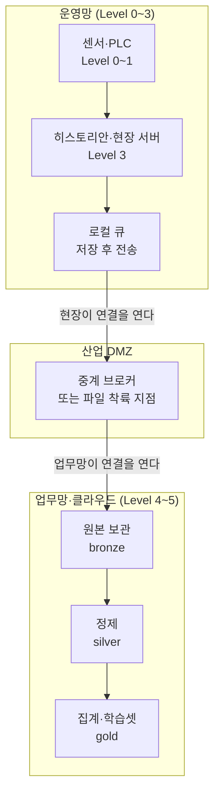

## 현장 서버에 쌓인 데이터의 두 가지 문제

"현장 데이터에서 학습 데이터까지" 시리즈 2편이다. 1편은 엣지 장비가 센서와 카메라에서 값을 모으는 단계를 다룬다. 이 글은 그다음, 공장이나 시설 안에 둔 서버에 이미 데이터가 모여 있을 때 그것을 본사나 클라우드로 꺼내는 길과, 받은 쪽에서 쌓는 모양을 다룬다.

여기에는 성격이 다른 질문 두 개가 섞여 있다. 하나는 경계다. 현장 네트워크는 설비 제어망과 붙어 있고, 그 망은 밖에서 들어오는 연결을 원칙적으로 막는다. 다른 하나는 저장이다. 시계열 DB에 넣을지, 객체 저장소에 파일로 쌓을지, 원본을 얼마나 둘지에 따라 3~5편의 정제와 학습 데이터 구축 난이도가 정해진다.

이종 시스템 연계 전반(접근 등급, CDC 설정, 표준화)은 [시스템 34개를 하나로 묶는다는 말의 실제](/posts/arch-01-legacy-integration/)에서, 장비 수백 대의 신원과 오프라인 버퍼는 [장비 1대는 되는데 300대는 안 되는 이유](/posts/arch-02-edge-fleet-control/)에서 다뤘다. 이 글은 현장 서버 한 대에서 중앙 저장소까지의 구간만 본다.

> **현장 데이터 반출 설계는 경계를 어느 방향으로 넘는지, 중복과 유실을 어디서 흡수하는지, 원본을 어디에 남기는지 세 가지를 정하는 일이다.**

## 경계의 지도: Purdue 계층과 산업 DMZ

NIST SP 800-82 Rev.3(운영기술 보안 가이드, 2023)은 OT 네트워크 분할의 기준으로 Purdue 모델, ISA-95 계층, IIoT 3계층 구조를 제시하고, 그림 16에서 Purdue 계층에 DMZ를 끼운 예를 보여 준다.

| 계층 | NIST 그림 16의 명칭 | 이 글에서의 데이터 |
|---|---|---|
| Level 5 | Enterprise | 클라우드, 본사 분석 환경 |
| Level 4 | Business Planning / Logistics | ERP 등 업무 시스템 |
| DMZ | DMZ | 반출 중계 서버, 복제본 |
| Level 3 | Operations / Control | 현장 서버, 히스토리안 |
| Level 2 | Area Control (HMI) | HMI, SCADA |
| Level 1 | Controller Network | PLC, 제어기 |
| Level 0 | Field I/O Devices | 센서, 구동기 |

반출 설계에 걸리는 규칙은 두 가지다. 방화벽은 인접 계층 사이 연결만 허용한다(NIST는 Level 4 장치가 Level 2·1·0과 직접 통신하지 못하게 하라고 적는다). 그리고 업무 계층과 운영 관리 계층 사이 통신은 모두 DMZ 안의 서비스를 거친다. 그러면 본사 분석 서버가 현장 서버(Level 3)에 직접 접속하는 구조는 빠진다. 현장 서버가 DMZ의 중계 지점에 데이터를 놓고, 업무망은 DMZ에서 가져간다.


*그림. 운영망은 DMZ로 연결을 열어 내려놓고, 업무망은 DMZ에서 가져간다. 운영망 안으로 들어오는 연결은 없다.*

## zone과 conduit: 경로마다 보안 요구를 붙인다

Purdue 모델이 기능에 따른 층이라면, IEC 62443(ISA-62443) 계열은 보안 요구에 따라 자산을 묶는다. 본문은 유료지만 ISA가 공개한 ISA-62443-3-2(시스템 설계를 위한 보안 위험 평가) 미리보기에서 정의를 확인할 수 있다. conduit는 "공통 보안 요구사항을 공유하며 둘 이상의 zone을 연결하는 통신 채널의 논리적 묶음"이다. 이 문서의 범위는 대상 시스템을 zone과 conduit로 나누고, 각각의 위험을 평가하고, 각각에 목표 보안 수준(SL-T)을 정하는 일이다. zone 개념은 ISA-62443-1-1에서 도입했다고 밝힌다.

이 개념을 쓰면 "현장 서버에서 클라우드로 보낸다"는 한 줄이 반출 경로별 conduit 목록으로 바뀐다. 각 conduit에는 출발·도착 zone, 프로토콜과 포트, 세션을 여는 쪽, 목표 보안 수준이 붙는다. 경로를 하나 추가하는 일은 위험 평가 대상이 하나 느는 일이 된다.

## 바깥으로만 여는 연결

경계를 넘는 방향에서 실무 원칙은 "안쪽에서 바깥쪽으로만 세션을 연다"이다. 운영망 쪽에 들어오는 포트를 열지 않고, 현장 서버나 게이트웨이가 바깥의 중계 지점으로 접속해 데이터를 밀어 낸다.

제품 수준의 예가 Azure IoT Edge의 계층형 게이트웨이다. 문서는 ISA-95를 따르는 네트워크처럼 인터넷 연결 수를 줄이려는 구조에서, 최상위 계층 장치만 클라우드에 직접 연결하고 하위 계층 장치는 부모·자식하고만 통신하게 구성할 수 있다고 설명한다. 운영자에게 요구하는 방화벽 설정도 outbound뿐이다. 최상위 장치는 IoT Hub로, 하위 장치는 부모 게이트웨이로 443(HTTPS)과 5671(AMQP)의 outbound를 허용한다.

NIST는 여기에 경고를 덧붙인다. 하위 계층의 outbound도 관리하지 않으면 큰 위험이 될 수 있으니 inbound만큼 엄격하게 규칙을 만들라는 것이다. outbound-only는 목적지와 포트를 하나씩 지정한 outbound만 연다는 뜻이다.

이 원칙은 도구의 권장 배치와 부딪히기도 한다. Kafka MirrorMaker 2 문서는 프로듀서가 불안정하거나 지연이 큰 네트워크에서 컨슈머보다 더 어려움을 겪으므로 MirrorMaker를 대상 클러스터 가까이 두라고 권한다. 대상이 클라우드면 클라우드의 MirrorMaker가 현장 Kafka에 접속해야 하고, 이는 운영망으로 들어오는 연결이다. 현장 쪽 Kafka를 DMZ에 두거나, MirrorMaker를 현장에 두고 권장 배치를 포기하는 선택을 conduit 설계에 명시해야 한다.

## 단방향 전송: 데이터 다이오드의 원리와 대가

가장 엄격한 경계에는 방화벽 대신 단방향 게이트웨이(데이터 다이오드)가 들어간다. NIST SP 800-82 Rev.3 용어집의 정의로는 하드웨어와 소프트웨어의 조합이다. 하드웨어는 데이터를 한 방향으로 흘리지만 원천 네트워크로는 어떤 정보도 물리적으로 되돌려 보낼 수 없고, 소프트웨어는 데이터베이스를 복제하고 프로토콜 서버와 장치를 흉내 낸다. 방화벽과 달리 하드웨어가 불가능하므로 양방향으로 설정할 수 없다. NIST는 Level 2와 3 사이에 두면 Level 3·4·5의 사고로부터 Level 0~2를 보호할 수 있다는 예를 든다.

Chan과 Zhou(2022)는 레거시 SCADA 보호 전략으로 다이오드를 분석하며 구현 원리를 정리했다. 대개 광 결합기에서 한쪽의 송신부와 반대쪽의 수신부를 제거해 만든다. Modbus/TCP나 DNP3 같은 TCP 프로토콜을 통과시키려면 양쪽 소프트웨어가 핸드셰이크와 ACK를 흉내 낸다. 송신 측 프록시가 TCP 서버인 척 장치에 ACK를 돌려주고, 수신 측 프록시가 TCP 클라이언트인 척한다. 그 사이의 프로토콜 브레이커가 캡슐화와 암호화, 순방향 오류 정정(FEC)을 맡는다. 이 구조의 한계는 반출 설계로 그대로 옮겨진다.

| 한계 | 원인 | 설계 대응 |
|---|---|---|
| 재전송 요청 불가 | 수신 측이 "못 받았다"를 보낼 길이 없다 | FEC, 같은 데이터 중복 송신, 순번으로 결손 기록 |
| 송신 측은 성공을 모른다 | ACK는 송신 측 프록시가 만든 것이다 | 수신 측 결손 보고를 별도 경로(사람·별도 채널)로 |
| 흐름 제어 없음 | 수신 측이 느려져도 송신 측에 알릴 수 없다 | 수신 측 처리 용량을 송신 최대치 이상으로 설계 |
| 역방향 명령 불가 | 설정 변경·재요청을 보낼 수 없다 | 피드백은 사람이 전달 (논문의 표현) |

마지막 항목은 논문이 명시한다. 분석 결과 SCADA 쪽 조치가 필요하면 피드백은 사람의 소통으로 전달된다. 역방향 채널을 붙이는 제안도 있지만, 그러면 다이오드가 방화벽보다 나은 점이 유지되는지 불확실하다고 적는다. 데이터 설계로 옮기면, 단방향 구간을 지나는 데이터에는 수신 측이 혼자 결손을 판정할 원천별 일련번호와 체크섬이 들어 있어야 한다.

## 전송 방식 비교

경계 방향이 정해지면 무엇에 실어 보낼지를 고른다. 대표적인 네 가지를 같은 기준으로 놓으면 다음과 같다.

| 방식 | 전달 단위 | 지연 | 연결 방향 | 중복·유실 특성 | 맞는 경우 |
|---|---|---|---|---|---|
| 배치 파일 전송 (SFTP, 객체 업로드) | 파일 (예: 1시간치 Parquet) | 분~시간 | 현장이 업로드하면 outbound | 같은 파일 재업로드 가능, 파일 단위로 판정 | 학습·분석용, 단방향 구간 |
| MQTT 브리지 | 메시지 | 초 이하 | 로컬 브로커가 원격 브로커에 접속 | QoS 1은 최소 한 번 | 텔레메트리, 이벤트 |
| Kafka 미러링 (MirrorMaker 2) | 레코드 스트림 | 초 | 권장 배치는 대상 쪽에서 원천을 소비 | 전용 MirrorMaker 클러스터는 3.5.0부터 정확히 한 번 지원 | 현장에 이미 Kafka가 있을 때 |
| DB 복제·CDC | 행 변경 | 초~분 | 도구마다 다름 | Debezium은 장애 시 최소 한 번 | 현장 DB 테이블을 그대로 옮길 때 |

Mosquitto 브리지는 `topic` 항목에 방향을 `out`, `in`, `both`로 지정하고 생략하면 `out`이다. 로컬 브로커가 원격 브로커 주소로 접속하는 구조라 outbound-only와 맞는다. `cleansession` 기본값 `false`는 끊겨도 원격 브로커의 구독을 유지한다. 브로커의 클라이언트별 QoS 1·2 대기 메시지 상한 `max_queued_messages`의 기본값은 1000이고, 장시간 단절에서는 이 상한이 실제 보존량을 정한다. MirrorMaker 2는 복제 토픽 이름을 기본으로 `{source}.{source_topic_name}`으로 바꾸므로, 여러 현장을 모아도 출처가 이름에 남는다.

DB 복제는 NIST가 위험 요소로 적어 둔 항목이다. 히스토리안 같은 OT 저장소를 데이터베이스 링크로 다른 DB에 자동 복제하면, 설정이 잘못됐을 때 무단 접근이나 조작의 통로가 될 수 있다. CDC의 원천 설정은 앞의 연계 글로 넘기고 전달 보장만 짚으면, Debezium FAQ는 정상 운영에서는 이벤트를 정확히 한 번 보지만 장애가 나면 최소 한 번이 되고 그 중복이 하위 애플리케이션에 보인다고 쓴다.

## 저장 후 전송과 중복 제거

네 방식 모두 회선이 끊긴 동안 현장 쪽에 데이터를 들고 있어야 한다. 이것이 저장 후 전송(store-and-forward)이다. Azure IoT Edge 문서는 오프라인 동안 IoT Edge 허브가 상위로 갈 메시지를 저장했다가 재연결 시 저장된 순서대로 전달한다고 설명한다. 같은 문서의 메시지 TTL 기본값은 7,200초(2시간)다. 그대로 두면 2시간을 넘는 단절에서 메시지가 만료되고, 문서도 오래 오프라인이 될 장치는 TTL과 디스크를 늘리라고 권한다. 버퍼 크기와 보존 시간은 현장의 최대 단절 시간에서 거꾸로 계산할 값이다.

저장 후 전송은 거의 항상 최소 한 번 전달을 만든다. 송신 측이 성공을 확인하지 못한 채 끊기면 재연결 뒤 같은 데이터를 다시 보낸다. MQTT 5.0 명세도 QoS 1을 메시지가 최소 한 번 도착함을 보장하는 수준으로 정의한다. 중복은 받는 쪽에서 흡수해야 한다.

Delta Lake 논문(Armbrust 외, 2020)은 외부 저장소를 갱신하는 스트림 처리 시스템이 장애 후 중복 쓰기를 피하려면 쓰기를 멱등하게 만들어야 한다고 쓰고 두 방법을 든다. 레코드마다 고유 키를 두는 방법, 그리고 "마지막으로 쓴 버전" 기록을 쓰기와 함께 원자적으로 갱신해 더 새로운 변경만 쓰는 방법이다. Delta Lake는 후자를 위해 트랜잭션마다 `(appId, version)` 쌍을 갱신하게 한다.

Kafka 프로듀서의 `enable.idempotence`(현재 기본값 true)는 범위가 좁다. 문서 설명대로 브로커 장애 등으로 인한 프로듀서 재시도의 중복을 막는 장치다. 현장 큐가 재연결 후 같은 데이터를 새 메시지로 다시 보내는 경우는 범위 밖이므로, 업무 의미를 가진 키가 따로 있어야 한다. 가장 간단한 방법은 현장에서 결정적 ID를 붙여, 같은 측정이면 몇 번을 다시 보내도 같은 ID가 나오게 하는 것이다.

```python
# 원리 설명용 예시: 현장에서 결정적 이벤트 ID를 만들고, 받는 쪽은 그 ID로 중복을 버린다
import hashlib, sqlite3

def event_id(site, asset, tag, ts_utc, seq):
    # 같은 측정이면 재전송해도 같은 ID가 나온다 (수신 시각은 넣지 않는다)
    raw = f"{site}|{asset}|{tag}|{ts_utc}|{seq}"
    return hashlib.sha256(raw.encode()).hexdigest()[:32]

db = sqlite3.connect("bronze.db")
db.execute("""CREATE TABLE IF NOT EXISTS raw_events(
    id TEXT PRIMARY KEY, site TEXT, asset TEXT, tag TEXT,
    ts_utc TEXT, seq INTEGER, value REAL, received_at TEXT)""")

def ingest(ev):
    eid = event_id(ev["site"], ev["asset"], ev["tag"], ev["ts_utc"], ev["seq"])
    # 이미 있는 ID면 무시한다: 최소 한 번 전달을 정확히 한 번 적재로 바꾸는 지점
    db.execute("INSERT OR IGNORE INTO raw_events VALUES (?,?,?,?,?,?,?,datetime('now'))",
               (eid, ev["site"], ev["asset"], ev["tag"], ev["ts_utc"], ev["seq"], ev["value"]))
```

`seq`는 원천별 일련번호다. 단방향 구간에서 결손을 판정할 때 쓰는 그 번호이고, 같은 시각에 같은 태그 값이 두 번 정상 발생하는 경우를 구분하는 역할도 한다. 수신 시각은 ID에 넣지 않는다. 넣으면 재전송마다 다른 ID가 되어 중복 제거가 무력해진다.

## 저장 구조: 현장 히스토리안과 중앙 저장소

받은 데이터를 쌓는 자리는 용도에 따라 갈린다.

NIST SP 800-82는 데이터 히스토리안을 통계적 공정 관리 기법으로 데이터 분석을 지원하는 중앙 데이터베이스로 정의하고, SCADA 구성에서 HMI·엔지니어링 워크스테이션과 함께 제어 센터 LAN에 두는 구성 요소로 설명한다. 운영망 안의 저장소이므로, 분석 환경이 히스토리안에 직접 질의하는 구조는 앞의 Purdue 규칙과 충돌한다. 히스토리안 데이터를 위 경로로 반출해 중앙에 사본을 만드는 것이 기본이다. 중앙의 선택지는 다음과 같다.

| 저장소 | 데이터 모델 | 분할 단위 | 맞는 질의 |
|---|---|---|---|
| InfluxDB | measurement, tag, field | 시계열(series) | 최근 구간 대시보드, 태그별 조회 |
| TimescaleDB | PostgreSQL 테이블 (hypertable) | 시간 기준 청크 | SQL 조인이 필요한 운영 분석 |
| 객체 저장소 + Parquet (+ 테이블 포맷) | 열 지향 파일 | 디렉터리 파티션, 파일 | 장기 보관, 대량 스캔, 학습셋 추출 |

InfluxDB 문서는 tag 값은 인덱싱되고 field 값은 인덱싱되지 않는다고 쓰고, 여러 데이터 포인트가 공유하는 메타데이터는 tag로, 고유하거나 자주 바뀌는 값은 field로 두라고 권한다. 좋은 스키마가 높은 시리즈 카디널리티를 막는다고도 적는다. 설비 ID는 tag, 측정값과 이벤트 ID는 field가 된다.

TimescaleDB의 hypertable은 시계열 데이터를 시간(그리고 선택적으로 다른 차원) 기준으로 자동 분할하는 PostgreSQL 테이블이다. 기본 청크 간격은 7일이고, 현재 적재 중인 청크의 인덱스가 메인 메모리의 25% 안에 들어가도록 간격을 정하라는 것이 문서의 권장이다.

장기 원본과 학습용 데이터는 객체 저장소가 맡는다. 다만 파일 묶음으로만 쓰면 문제가 있다. Delta Lake 논문은 객체 저장소가 여러 객체에 걸친 쓰기를 원자적으로 처리하지 못해 부분 쓰기가 보일 수 있고, 목록 조회가 비싸다고 정리한다. S3 LIST는 호출당 최대 1000개 키를 돌려주고 호출마다 수십~수백 밀리초가 걸려, 객체 수백만 개를 순차로 나열하면 몇 분이 걸린다. Lakehouse 논문(Armbrust 외, 2021)의 해법은 Parquet 같은 표준 포맷으로 객체 저장소에 데이터를 두고, 어떤 객체가 테이블의 어느 버전에 속하는지 정의하는 트랜잭션 메타데이터 계층을 얹는 것이다. Delta Lake와 Apache Iceberg가 이 방식이다.

## 메달리온 구조와 원시 데이터 보존

객체 저장소 위에서 데이터를 정제 단계별로 나누는 구조로 Databricks 문서의 메달리온 아키텍처가 있다.

| 계층 | 문서의 설명 | 현장 데이터에서의 내용 |
|---|---|---|
| bronze | 검증되지 않은 원시 데이터, 원천의 원래 형식 유지, 점진적으로 추가, 전체 이력을 보존해 재처리와 감사 가능 | 수신한 그대로의 이벤트, 수신 시각, 출처 |
| silver | 검증·정제·보강된 데이터, 정제·중복 제거·정규화 수행 | 단위 통일, 중복 제거, 결측 표시 |
| gold | 분석과 보고에 맞춘 집계 데이터, 업무 로직에 맞춤 | 설비별 집계, 학습셋 |

앞의 중복 제거 코드는 bronze 적재 지점에 두었지만, 수신한 것을 모두 남기고 중복 제거는 silver에서 하는 편이 문서의 정의에 더 가깝다. 어느 쪽이든 bronze는 지우지 않는다. 정제 규칙이 나중에 틀린 것으로 드러나면 원본이 있어야 silver와 gold를 다시 만들 수 있다. 3편의 센서 정제 규칙(이상치 임계값, 보간 방법)도 이 재처리 가능성에 기댄다.

## 파티셔닝과 Parquet

객체 저장소에 쌓을 때 마지막으로 정할 것이 파일의 모양과 디렉터리 배치다.

Parquet은 열 지향 파일 포맷이다. 데이터를 행 그룹(row group)으로 가로로 나누고, 행 그룹 안에 열마다 연속된 열 청크(column chunk)를 둔다. 압축과 인코딩의 최소 단위는 페이지이고, 메타데이터는 데이터 뒤에 기록해 한 번의 순차 쓰기로 파일을 만든다. 공식 문서는 512MB~1GB의 큰 행 그룹과 8KB 페이지를 권장한다. 객체 저장소가 바이트 범위 읽기를 지원하므로 필요한 열 청크만 가져올 수 있다.

디렉터리는 PyArrow 문서가 Apache Hive 방식이라고 부르는 `/key=value/` 형태로 나눈다. 현장 데이터에서 떠올리기 쉬운 키는 시간과 설비다.

```python
# 원리 설명용 예시: 날짜와 현장으로 Hive 방식 파티션을 만든다
import pyarrow as pa, pyarrow.parquet as pq

table = pa.table({
    "site": ["s01", "s01"], "dt": ["2026-10-22", "2026-10-22"],
    "asset": ["press-07", "press-08"],          # 설비 ID는 파티션이 아니라 열로 둔다
    "ts_utc": ["2026-10-22T01:00:00Z", "2026-10-22T01:00:00Z"],
    "tag": ["temp", "temp"], "value": [61.2, 59.8],
})
# 결과 경로 예: bronze/sensor/site=s01/dt=2026-10-22/xxx.parquet
pq.write_to_dataset(table, "bronze/sensor", partition_cols=["site", "dt"])
```

설비 ID를 파티션 키에서 뺀 이유는 파일 크기다. Databricks 파티션 지침은 1TB 미만 테이블은 파티션하지 말고, 파티션을 쓴다면 파티션마다 최소 1GB가 되게 하라고 적는다. 날짜처럼 카디널리티가 낮거나 알려진 열은 파티션에 맞고 타임스탬프처럼 높은 열은 맞지 않는다고도 쓴다. 설비 수백 대를 날짜와 곱하면 파티션마다 작은 파일만 남아 앞의 LIST 비용과 작은 파일 문제가 커진다. 같은 문서는 Delta Lake의 파티션 없는 테이블이 적재 시각 기준 클러스터링을 자동으로 쓰며 100TB 미만 테이블은 대부분 파티션이 필요 없다고 안내한다. 파티션은 날짜 정도로 거칠게 두고 설비는 열로 처리하는 쪽이 문서의 권장에 가깝다.

## 도구에 맡길 것과 사람이 정할 것

Mosquitto 브리지 설정, Kafka 프로듀서 옵션, 결정적 ID를 붙이는 수집기, Parquet로 떨구는 배치 작업은 요구사항을 적으면 Claude Code가 골격을 만든다. conduit 목록이 있으면 방화벽 규칙 초안도 도구가 정리한다.

사람이 정의하고 검증해야 하는 것은 그 요구사항 자체다.

- 반출 경로를 conduit로 나열하고 각 경로의 연결 방향을 정하는 일. MirrorMaker 권장 배치와 outbound-only가 충돌할 때 어느 쪽을 택할지는 문서가 정해 주지 않는다
- 단방향 구간을 둘지 판단하고, 둔다면 결손을 누가 어떤 경로로 알릴지 정하는 일
- 현장 최대 단절 시간을 숫자로 정하고 그로부터 TTL, 큐 상한, 디스크 용량을 계산하는 일. 기본값(7,200초, 1000건)이 그 숫자를 대신하지 않는다
- 중복 판정 키에 무엇을 넣고 무엇을 뺄지 정하는 일. 수신 시각을 넣는 실수는 코드가 문법적으로 맞아도 중복 제거를 무력하게 만든다
- bronze 보존 기간과 파티션 키를 정하는 일. 이 결정이 3~5편의 재처리 비용을 정한다

> **반출 파이프라인은 도구가 짜지만, 어느 쪽이 연결을 여는지와 무엇을 같은 데이터로 볼지는 사람이 정해 두어야 한다.**

다음 편은 이렇게 bronze에 쌓인 센서 데이터를 silver로 올리는 정제 단계를 다룬다.

---

## 참고

- Stouffer, K., Pease, M., Tang, C., Zimmerman, T., Pillitteri, V., Lightman, S., Hahn, A., Saravia, S., Sherule, A., Thompson, M. (2023). Guide to Operational Technology (OT) Security. NIST Special Publication 800-82 Rev. 3. <https://doi.org/10.6028/NIST.SP.800-82r3>
- ISA (2020). ANSI/ISA-62443-3-2-2020, Security for industrial automation and control systems Part 3-2: Security risk assessment for system design (preview). ISA. <https://www.isa.org/getmedia/661c718f-8e64-446d-acf9-2c6286db1b33/isa-62443-3-2-preview.pdf>
- Chan, A. C-F., Zhou, J. (2022). Toward Safe Integration of Legacy SCADA Systems in the Smart Grid. arXiv:2107.05863v2. <https://arxiv.org/abs/2107.05863>
- Armbrust, M. 외 (2020). Delta Lake: High-Performance ACID Table Storage over Cloud Object Stores. PVLDB 13(12). <https://www.vldb.org/pvldb/vol13/p3411-armbrust.pdf>
- Armbrust, M., Ghodsi, A., Xin, R., Zaharia, M. (2021). Lakehouse: A New Generation of Open Platforms that Unify Data Warehousing and Advanced Analytics. CIDR 2021. <https://www.cidrdb.org/cidr2021/papers/cidr2021_paper17.pdf>
- OASIS (2019). MQTT Version 5.0, 4.3.2 QoS 1. OASIS Standard. <https://docs.oasis-open.org/mqtt/mqtt/v5.0/os/mqtt-v5.0-os.html>
- Microsoft (2026). How to create nested Azure IoT Edge device hierarchies. Microsoft Learn. <https://learn.microsoft.com/en-us/azure/iot-edge/how-to-connect-downstream-iot-edge-device>
- Microsoft (2026). Operate Azure IoT Edge devices offline. Microsoft Learn. <https://learn.microsoft.com/en-us/azure/iot-edge/offline-capabilities>
- Eclipse Mosquitto. mosquitto.conf(5) man page 원본. GitHub. <https://github.com/eclipse-mosquitto/mosquitto/blob/master/man/mosquitto.conf.5.xml>
- Apache Kafka. Geo-Replication (Cross-Cluster Data Mirroring), Producer Configs. Apache Kafka 문서. <https://kafka.apache.org/documentation/>
- Debezium. Frequently Asked Questions. Debezium 문서. <https://debezium.io/documentation/faq/>
- Databricks. What is the medallion lakehouse architecture?; When to partition tables on Databricks. Databricks 문서. <https://docs.databricks.com/aws/en/lakehouse/medallion>, <https://docs.databricks.com/aws/en/tables/partitions>
- InfluxData. InfluxDB schema design. InfluxDB v2 문서. <https://docs.influxdata.com/influxdb/v2/write-data/best-practices/schema-design/>
- Tiger Data. Hypertables; Improve hypertable and query performance. TimescaleDB 문서. <https://www.tigerdata.com/docs/use-timescale/latest/hypertables>
- Apache Parquet. Overview; Concepts; File Format; Configurations. Parquet 문서. <https://parquet.apache.org/docs/>
- Apache Arrow. Tabular Datasets. PyArrow 문서. <https://arrow.apache.org/docs/python/dataset.html>
