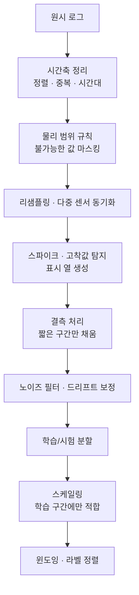

## 센서 로그는 그대로 학습에 넣을 수 없다

"현장 데이터에서 학습 데이터까지" 시리즈 3편이다. 1편은 엣지에서 데이터를 모으는 일, 2편은 그 데이터를 밖으로 내보내 저장하는 일을 다뤘다. 이 글은 저장소에 쌓인 센서 시계열을 모델이 먹을 수 있는 형태로 바꾸는 단계, 즉 정제를 정리한 스터디 노트다.

센서 로그에는 센서마다 다른 샘플링 주기, 통신 단절로 생긴 빈 구간, 튀는 값과 멈춘 값, 측정 잡음과 서서히 어긋나는 영점이 섞여 있다. 각 기법은 잘 알려져 있고, 어려운 쪽은 순서와 경계다. 보간을 이상치 처리보다 먼저 하면 튄 값이 주변으로 번진다. 스케일러를 전체 데이터에 맞추면 시험 구간 정보가 학습에 샌다. "이상한 값"을 지우는 처리가 모델이 찾아야 할 이상 현상까지 지울 수도 있다.

> **센서 정제의 결과물은 깨끗한 값만이 아니다. 무엇을 고쳤고 무엇을 비워 두었는지 기록한 표시 열이 같이 나와야 한다.**

## 정제 파이프라인의 순서

각 단계는 앞 단계의 결과를 전제로 한다. 시간축이 맞아야 결측을 셀 수 있고, 튄 값을 걸러야 보간이 오염되지 않는다. 분할이 정해져야 스케일러를 적합할 구간이 정해진다.


*그림. 센서 시계열 정제의 단계 순서. 분할은 스케일링보다 앞에 온다.*

## 시간축 맞추기 - 리샘플링과 동기화

### 다운샘플링과 집계 함수

센서가 100Hz로 찍는데 모델은 1초 단위로 보면 된다면 다운샘플링한다. pandas에서는 `resample("1s")` 뒤에 집계 함수를 붙인다. 여기서 집계 함수 선택이 의미를 바꾼다.

| 집계 | 맞는 신호 | 잃는 것 |
|---|---|---|
| mean | 온도·압력처럼 연속적으로 변하는 물리량 | 짧은 피크 |
| max / min | 진동 피크, 과전류처럼 극값이 의미인 신호 | 평균 수준 |
| last | 설정값·상태 코드처럼 마지막 값이 현재 상태인 신호 | 구간 내 변화 |
| sum | 유량 적산, 이벤트 횟수 | 시점 정보 |
| count | 데이터가 얼마나 들어왔는지 (품질 지표) | 값 자체 |

집계는 여러 개를 같이 만들어도 된다. 진동 센서라면 mean과 max를 함께 두고, count를 남기면 뒤에서 결측 판단에 쓴다.

구간 경계도 확인한다. pandas `resample`의 `closed`와 `label`은 대부분의 주기에서 기본값이 'left'이고, 월말·분기말·연말·주 단위 같은 일부 주기에서만 'right'다. "12:00:00" 라벨이 12:00~12:01 구간을 뜻하는지 11:59~12:00 구간을 뜻하는지가 여기서 갈리고, 라벨 정렬에서 1칸 어긋남의 원인이 된다.

고주파 신호를 필터 없이 솎아 내면 앨리어싱(나이퀴스트 주파수보다 높은 성분이 낮은 주파수로 접혀 들어오는 현상)이 생긴다. SciPy `decimate`는 저역통과 필터를 먼저 걸고 샘플을 줄이며, 기본은 8차 Chebyshev I형 IIR 필터와 `zero_phase=True`다. 진동처럼 주파수 내용이 중요한 신호에 맞다.

반대로 1분 주기 센서를 1초 격자에 맞추는 업샘플링은 새 칸이 비므로 결측 처리 문제가 된다. 보간으로 59개 값이 생겨도 정보량은 그대로이므로 원래 관측 시점 표시 열을 같이 둔다.

### 다중 센서 동기화

센서 여러 개를 한 행으로 묶으려면 같은 격자로 리샘플링해 조인하거나, 기준 센서 시각마다 다른 센서의 가까운 값을 붙인다. 후자가 pandas `merge_asof`다. 같은 키가 아니라 가장 가까운 키로 매칭하는 왼쪽 조인이고, 양쪽 모두 키로 정렬되어 있어야 한다.

핵심 선택은 `direction`이다. 기본값 'backward'는 기준 시각 이하의 가장 최근 값을, 'forward'는 이상의 가장 이른 값을, 'nearest'는 가장 가까운 값을 고른다. 'forward'나 'nearest'를 쓰면 실시간 추론에서는 아직 존재하지 않는 미래 값이 학습 행에 들어올 수 있으므로 'backward'가 기본이다. `tolerance`로 허용 거리도 둔다. 10분 전 마지막 보고값을 현재 값으로 붙이는 것은 틀린 동기화다.

## 결측 - 왜 비었는지가 처리 방법을 정한다

### Rubin의 세 범주

Rubin은 1976년 논문에서 결측 데이터 문제를 분류했고, 이후 MCAR·MAR·MNAR 세 범주로 정리되어 쓰인다. van Buuren의 『Flexible Imputation of Missing Data』 1.2절 정의로 옮기면 이렇다.

- MCAR(완전 무작위 결측): 결측 확률이 모든 사례에서 같다
- MAR(무작위 결측): 결측 확률이 관측된 데이터로 정의한 집단 안에서만 같다
- MNAR(비무작위 결측): 둘 다 아닌 경우

Rubin의 원 논문 초록은 결측을 일으킨 과정을 무시하고 추론해도 되는 조건으로 "missing at random"을 제시한다. 뒤집어 말하면 MNAR에서는 결측 과정을 무시한 대치가 편향을 만든다.

센서에 대입하면 무선 패킷이 무작위로 떨어진 것은 MCAR에 가깝다. 고부하일 때만 로그가 빠지고 부하를 다른 열로 관측하고 있다면 MAR이다. 온도가 측정 범위를 넘어 센서가 값을 내지 않았다면 MNAR이고, 이 빈칸을 주변 평균으로 채우면 가장 극단적인 순간이 평범한 값으로 바뀐다.

### 처리 기법

| 기법 | 원리 | 쓰는 경우 | 피할 경우 |
|---|---|---|---|
| 전방 채움 (ffill) | 마지막 관측값을 이어 쓴다 | 상태 코드·설정값처럼 바뀔 때만 기록되는 신호 | 연속 물리량의 긴 공백 |
| 선형 보간 | 양 끝 값을 직선으로 잇는다 | 짧은 공백, 완만한 신호 | 공백 사이에 피크가 있었을 신호 |
| 스플라인 보간 | 구간별 다항식을 매끄럽게 잇는다 | 곡률이 있는 완만한 신호 | 공백이 길거나 끝점이 튈 때 (과진동) |
| 모델 기반 대치 | 다른 열로 빈 열을 예측한다 | 센서 간 상관이 강하고 MAR로 볼 근거가 있을 때 | 상관 센서도 같이 빠졌을 때 |

pandas `interpolate`의 `method="linear"`는 인덱스를 무시하고 등간격을 가정하므로, 불규칙 간격이면 시간 간격을 반영하는 `method="time"`을 쓴다. 'spline'과 'polynomial'은 `order`를 지정해야 하고 SciPy 보간 함수를 호출한다.

모델 기반 대치의 표준 구현은 scikit-learn `IterativeImputer`다. 결측이 있는 각 특징을 나머지 특징의 함수로 돌아가며 모델링한다. 기본 추정기는 `BayesianRidge`, 반복 10회이고, 실험적 기능이라 `enable_iterative_imputer`를 명시적으로 불러와야 한다. 시차 특징에 미래 시점을 넣으면 `merge_asof`와 같은 누수가 생긴다.

### 긴 공백은 채우지 않고 표시한다

공백이 길어지면 보간은 추측이 된다. 기준 길이보다 짧은 공백만 채우고, 긴 공백은 비워 둔 채 표시 열을 남긴다. 모델 쪽에서는 그 구간을 윈도에서 빼거나 표시 열을 입력으로 넣는다.

pandas `limit`만으로는 이게 안 된다. 문서대로 연속 결측이 `limit`보다 길면 일부만 채워진다. 30칸 공백에 `limit=5`를 주면 앞 5칸이 채워지고 25칸이 남으므로, 공백 길이를 따로 계산해 되돌려야 한다. `limit_area="inside"`는 양쪽에 관측값이 있는 공백만 채워 앞뒤 끝의 외삽을 막는다. 아래 코드는 이 되돌림과 표시 열 생성을 보이기 위한 것이다.

```python
import numpy as np
import pandas as pd

s = raw["temp"].sort_index()          # 불규칙 간격 온도 센서
s1 = s.resample("1s").mean()          # 1초 격자, 구간 평균

gap = s1.isna()
s2 = s1.interpolate(method="time",    # 시간 간격을 반영한 선형 보간
                    limit=5, limit_area="inside")

# limit을 넘는 공백은 앞쪽 5칸이 채워져 버리므로 길이로 다시 판정한다
run_id = (gap != gap.shift()).cumsum()
run_len = gap.groupby(run_id).transform("size")
long_gap = gap & (run_len > 5)

s2[long_gap] = np.nan                 # 긴 공백은 비워 두고
flags = pd.DataFrame({"long_gap": long_gap,
                      "imputed": gap & ~long_gap})  # 무엇을 채웠는지 기록
```

## 이상치 - 지울 것과 남길 것

### 제거와 보존의 구분

"이상치"라는 말에는 서로 다른 두 가지가 섞여 있다.

- 측정 오류: 센서 고장, 통신 비트 오류, 단위 변환 실수. 현실에서 일어나지 않은 값이므로 고치거나 지운다
- 이상 현상: 설비가 실제로 비정상적으로 동작한 순간. 값은 맞다. 이상탐지나 고장 예측 모델이 배워야 할 대상이므로 지우면 안 된다

같은 스파이크가 어느 쪽인지는 통계만으로 가려지지 않는다. 물리적으로 가능한지, 다른 센서도 반응했는지, 정비 기록이 있는지를 같이 본다. 그래서 탐지의 출력은 표시 열이고, 지울지 남길지는 그 다음 결정이다.

### 탐지 기법

| 기법 | 원리 | 파라미터 예 | 한계 |
|---|---|---|---|
| 물리 범위 규칙 | 센서 사양·물리 법칙상 불가능한 값 | 측정 범위, 최대 변화율 | 범위 안의 오류는 못 잡는다 |
| IQR 울타리 | Q1 - 1.5 IQR, Q3 + 1.5 IQR 밖이면 경미, 3 IQR 밖이면 극단 | 1.5, 3.0 | 추세가 있는 신호에 전역 적용하면 오탐 |
| Z-score | 평균에서 표준편차 몇 배 떨어졌나 | 3 | 평균과 표준편차가 이상치에 끌려간다 |
| 수정 Z-score (MAD) | 0.6745(x - 중앙값) / MAD | 절대값 3.5 초과 | 값의 절반 이상이 같으면 MAD가 0 |
| Hampel 필터 | 이동 창의 중앙값과 MAD로 국소 판정, 벗어나면 중앙값으로 대체 | 창 반폭 K, 임계 t | 연속된 이상 구간은 창을 넘으면 못 잡는다 |
| Isolation Forest | 무작위 분할로 고립시키는 데 필요한 경로 길이가 짧으면 이상 | 트리 100개, 부표본 256 | 시간 순서를 모른다. 윈도 특징을 따로 만들어 넣어야 한다 |

몇 가지를 보충한다.

IQR 울타리 계수 1.5와 3은 NIST/SEMATECH 통계 핸드북 7.1.6절의 정의다. 수정 Z-score와 3.5 기준은 같은 핸드북 1.3.5.17절이 Iglewicz와 Hoaglin의 권고로 소개한다. 같은 절은 일반 Z-score의 최댓값이 표본 크기 n에 대해 (n - 1)/√n을 넘지 못하므로 표본이 작을 때 오해를 부를 수 있다고 적는다. 표본 10개면 최대 Z가 약 2.85라서, 3을 기준으로 잡으면 어떤 값도 걸리지 않는다.

Hampel 필터는 Pearson 등(2016)의 정의로 창 중앙값 m_k와 MAD 척도 S_k = 1.4826 × median|x_(k-j) - m_k|를 구해, |x_k - m_k| > t·S_k이면 x_k를 m_k로 바꾼다. 1.4826은 가우시안 데이터에서 MAD를 표준편차의 불편추정량으로 만드는 계수다. t = 0이면 메디안 필터와 같고 t가 클수록 덜 공격적이다. 이 논문은 "implosion"도 다룬다. 창 안에 K + 1개 이상 같은 값이 있으면 S_k = 0이 되어 임계값과 무관하게 출력이 중앙값이 된다.

Isolation Forest(Liu, Ting, Zhou, 2008)는 정상 데이터의 분포를 모델링하는 대신 이상치를 직접 고립시킨다. 이상치는 "적고 다르기" 때문에 무작위 분할에서 더 빨리 고립되고 경로 길이가 짧다. 점수는 s(x, n) = 2^(-E(h(x))/c(n))이고, c(n) = 2H(n - 1) - 2(n - 1)/n은 이진 탐색 트리의 실패 탐색 평균 경로 길이다. 평균 경로가 c(n)에 가까우면 s는 0.5, 0에 가까우면 1로 간다. 논문은 부표본 크기 256과 트리 100개를 기본값으로 썼고, scikit-learn 구현도 `n_estimators=100`, `max_samples="auto"`(= min(256, 표본 수))를 기본으로 한다.

### 벤치마크 점수를 그대로 믿지 않는 이유

Wu와 Keogh(2021)는 Yahoo·Numenta·NASA 등 널리 쓰이는 시계열 이상탐지 벤치마크 대부분이 네 가지 결함 중 하나 이상을 가진다고 주장했다. 결함은 자명함(triviality), 비현실적인 이상 밀도, 잘못된 정답 라벨, run-to-failure 편향이다.

자명함의 기준은 "MATLAB 표준 함수 한 줄로 풀리는가"였다. 이들은 Yahoo 벤치마크 367개 시계열 중 316개(86.1%)가 차분과 이동 평균·이동 표준편차 정도의 한 줄 식으로 풀린다고 보고했다. 일부 데이터는 시험 구간의 절반 이상이 연속된 이상으로 표시되어 있었고, run-to-failure 편향 때문에 마지막 점을 이상으로 찍기만 해도 맞힐 확률이 높았다. 그래서 이들은 시험 시계열 하나에 이상이 정확히 하나만 있는 UCR Time Series Anomaly Archive를 새로 제시했다.

정제 단계의 교훈은 복잡한 탐지기 전에 차분 임계값 같은 한 줄 기준선을 먼저 돌려 보고, 자체 이상 라벨도 같은 결함을 가질 수 있다고 의심하는 것이다. 라벨 만드는 방법은 [그라운드 트루스 설계](/ax/arch-03-ground-truth-design/)에서 다뤘다.

## 스파이크와 고착값

센서 고장에서 가장 흔한 두 형태는 정반대 모양이다.

스파이크는 한두 샘플만 크게 튀었다 돌아오는 값이다. 1차 차분이 큰 양수 뒤에 바로 큰 음수가 오는 모양이 특징이고, Hampel 필터가 이 형태를 잡는 데 맞다. 창 반폭 K를 스파이크 폭보다 충분히 크게 잡아야 한다. 스파이크가 창의 절반 이상을 차지하면 중앙값 자체가 스파이크 쪽으로 끌려간다.

고착값(stuck value)은 센서가 같은 값을 계속 내보내는 상태다. 범위 안의 값이라 범위 규칙도 Z-score도 못 잡는다. 같은 값의 연속 길이(런 길이)를 세거나 이동 표준편차가 0인 구간을 찾는다. 느리게 변하고 분해능이 낮은 센서는 같은 값이 수십 초 이어지는 게 정상일 수 있으므로, 기준 길이는 정상 운전 구간의 런 길이 분포를 보고 정한다.

두 탐지는 순서가 엮인다. 앞서 본 implosion 때문에 고착 구간에서는 MAD가 0이 되어 Hampel 필터가 고착값을 정상으로 통과시키고, 고착 구간 끝의 정상적인 변화를 이상으로 잡을 수 있다. 고착값 탐지를 먼저 하고 그 구간을 마스킹한 뒤 Hampel 필터를 거는 편이 안전하다.

## 노이즈 필터 - 무엇을 남기고 무엇을 깎는가

필터는 측정 잡음을 줄이지만 신호의 어떤 성질을 대가로 치른다. 고르는 기준은 남겨야 할 성질이다.

| 필터 | 원리 | 남기는 것 | 깎는 것 | 대표 구현 |
|---|---|---|---|---|
| 이동평균 | 창 안의 산술 평균 | 느린 추세 | 피크 높이, 계단 모서리 | `rolling(w).mean()` |
| 메디안 필터 | 창 안의 중앙값 | 계단형 변화의 모서리 | 짧은 스파이크 (제거 대상이면 장점) | `scipy.signal.medfilt` |
| Savitzky-Golay | 창마다 저차 다항식을 맞춰 중앙 값을 다시 계산 | 피크 높이와 폭, 미분값 | 다항식 차수보다 빠른 변화 | `scipy.signal.savgol_filter` |
| 칼만 필터 | 상태 전이 모델의 예측과 관측을 공분산 비율로 섞어 순차 갱신 | 모델이 맞을 때 지연 없는 추정 | 모델이 틀리면 편향 | 상태 공간 모델 직접 구성 |

메디안 필터는 SciPy `medfilt`에서 커널 크기가 홀수여야 하고 기본값은 3이며, 배열 끝은 0으로 채워 계산한다. 끝 부분 값이 0 쪽으로 끌려가는 것을 감안해야 한다.

Savitzky-Golay 필터는 Savitzky와 Golay가 1964년 Analytical Chemistry에 발표한 방법이다. SciPy `savgol_filter`의 `polyorder`는 창 안 표본에 맞출 다항식 차수로 `window_length`보다 작아야 하고, `deriv`를 주면 평활화와 함께 미분값을 얻는다. 기본 모드 'interp'는 패딩 없이 가장자리 `window_length`개 값에 다항식을 맞춰 끝 `window_length // 2`개 출력을 계산한다.

칼만 필터는 Kalman(1960)이 필터링과 예측 문제를 상태 전이 관점에서 다시 정식화한 데서 나왔다. 원 논문은 최적 추정 오차의 공분산 행렬에 대한 차분(또는 미분) 방정식을 유도하고, 그 해에서 최적 선형 필터의 계수를 바로 얻는다. 새 관측마다 이전 추정만으로 갱신하므로 실시간 처리에 맞다. 대신 상태 전이 모델과 잡음 공분산을 사람이 정해야 하고, 이 값이 현실과 다르면 필터는 확신을 가지고 틀린다.

인과성도 본다. pandas `rolling`의 `center=True`는 창 라벨을 가운데에 두므로 현재 값 계산에 미래 샘플이 들어가고, 메디안·Savitzky-Golay 필터도 중심 창이다. 실시간 추론에서 같은 전처리를 할 수 없다면 학습도 과거 값만 쓰는 인과 창(`center=False`)이나 칼만 필터로 맞춰야 학습과 운영의 입력이 같아진다.

## 드리프트와 교정

센서 드리프트는 측정 대상은 그대로인데 출력이 서서히 이동하는 현상이다. 보정식 참값 ≈ a × 출력 + b에서 b가 움직이면 영점 드리프트, a가 움직이면 감도(이득) 드리프트다. 교정은 기준값을 아는 두 점(예: 영점과 정격점)에서 출력을 재 a와 b를 다시 구하는 일이다. 교정 이력이 있으면 교정 시점마다 보정식을 바꿔 적용하고, 구간별로 어떤 보정식을 썼는지 열로 남긴다.

교정 이력이 없으면 같은 물리량을 재는 센서 간 차이의 장기 추세나, 정지 운전처럼 참값을 아는 구간의 출력을 추적해 추정한다. 문제는 센서 드리프트와 설비의 실제 열화가 데이터상 같은 모양이라는 점이다. 서서히 오르는 진동값을 드리프트로 보고 빼면 고장 예측 모델이 배워야 할 열화 신호를 지운 셈이 된다. 이 판단은 교정 기록이나 이중화 센서 같은 외부 근거로만 내린다. 운영 중 모델 입력 분포의 변화 감시는 [위험도 점수 설계](/ax/arch-04-risk-scoring-design/)에서 다뤘고, 이 절은 그보다 앞의 센서 출력 보정 문제다.

## 정규화와 스케일링 - 학습 구간에서만 적합한다

센서마다 단위와 범위가 다르므로 대부분의 모델은 입력을 정규화한다. 방법 선택보다 중요한 것이 적합 구간이다. scikit-learn 문서의 "Common pitfalls" 12.2절은 시험 데이터에 `fit`을 호출하지 말라는 일반 규칙을 적고, 평균으로 나누는 정규화라면 그 평균은 전체 데이터가 아니라 학습 구간의 평균이어야 한다고 예를 든다.

시계열에서는 이 규칙이 분할 방식과 묶인다. 무작위 분할은 미래로 학습하고 과거로 평가하게 만든다. scikit-learn `TimeSeriesSplit`은 앞 구간을 학습, 뒤를 시험으로 쓰며 접(fold)마다 학습 구간이 커진다. `gap`은 학습 구간 끝과 시험 구간 사이에 비울 표본 수다. 아래는 적합 구간을 나누는 최소 형태다.

```python
from sklearn.preprocessing import StandardScaler

split = int(len(X) * 0.7)                        # 시간 순서 그대로 앞 70%
scaler = StandardScaler().fit(X[:split])         # 학습 구간에서만 평균·표준편차 계산
X_train = scaler.transform(X[:split])
X_test = scaler.transform(X[split:])             # 시험 구간은 변환만
```

이상치가 남은 열에 평균·표준편차 스케일링을 쓰면 극단값 하나가 척도를 바꾼다. 스케일링을 이상치 처리 뒤에 둔 이유다. 이상 현상을 보존한 열이라면 중앙값과 사분위 범위를 쓰는 로버스트 스케일링이 대안이다. 장비별로 따로 적합할 때도 각 장비의 학습 구간만 쓴다.

## 윈도잉과 라벨 정렬

모델 입력은 대개 길이 W, 이동 간격(stride) S로 자른 고정 길이 윈도다. 결정할 것은 네 가지다.

- W: 감지하려는 현상보다 길어야 한다. 1초 격자에서 30초짜리 패턴을 보려면 W > 30
- S: S < W면 윈도가 겹쳐 표본 수는 늘지만 인접 윈도를 독립 표본으로 셀 수 없다
- 라벨 위치: 윈도 끝 시점의 상태, 윈도 안 사건 유무(탐지), 윈도 이후 일정 기간 안 사건 발생(예측)
- 긴 공백 표시가 일정 비율 이상인 윈도를 뺄지

겹치는 윈도와 분할이 만나면 누수가 생긴다. 학습 구간 마지막 윈도와 시험 구간 첫 윈도가 샘플을 공유하기 때문이다. 윈도 단위 행에 `TimeSeriesSplit`을 쓴다면 `gap`을 W/S개 윈도 이상으로 두어야 공유가 사라진다. 예측 라벨이라면 예측 지평만큼 더 비워야 학습 라벨이 시험 구간의 사건을 미리 보지 않는다. 관측 창과 예측 지평 사이에 대응 시간을 두는 설계는 [위험도 점수 설계](/ax/arch-04-risk-scoring-design/)에서, 분할 단위를 장비나 지점으로 묶는 문제는 [그라운드 트루스 설계](/ax/arch-03-ground-truth-design/)에서 다뤘다.

정비 기록이나 작업자 입력 라벨은 사람이 기록한 시각이라 실제 사건보다 늦는 경우가 많고, 리샘플링 구간 라벨의 left/right까지 엮이면 한두 칸 밀린다. 라벨 시점의 신호를 몇 건 그려 사건이 라벨 앞에 있는지 눈으로 확인한다.

## 도구에 맡길 수 있는 것과 사람이 정할 것

이 글에 나온 처리는 거의 전부 pandas·SciPy·scikit-learn 함수 한두 줄이다. 원하는 동작을 말하면 Claude Code 같은 코딩 에이전트가 인수까지 붙여 코드를 만든다.

함수 인수에 들어갈 값은 데이터 바깥에서 와야 한다.

- 리샘플링 주기와 센서별 집계 함수. 그 센서에서 의미 있는 것이 평균인지 피크인지는 측정 대상을 아는 사람이 정한다
- 동기화 허용 거리(`tolerance`)와 방향. 운영에서 실제로 어떤 값이 가용한지가 기준이다
- 채울 공백과 비워 둘 공백의 경계 길이
- 물리 범위, 최대 변화율, 고착 판정 런 길이. 센서 사양서와 정상 운전 데이터에서 나온다
- 튄 값이 측정 오류인지 이상 현상인지의 판정. 다른 센서, 정비 기록, 현장 확인이 근거다
- 드리프트를 보정할지, 실제 열화로 남길지
- 윈도 길이, 라벨 위치, 분할 간격

검증도 사람 몫이다. 정제 전후 신호를 겹쳐 그리고, 표시 열 비율을 세고, 복잡한 탐지기 전에 한 줄 기준선부터 돌려 본다. Wu와 Keogh가 보였듯 복잡한 방법의 성능이 한 줄 식과 다르지 않을 수 있다.

## 참고

- Rubin, D. B. (1976). Inference and missing data. Biometrika, 63(3), 581-592. https://dash.harvard.edu/entities/publication/73120378-8764-6bd4-e053-0100007fdf3b (초록)
- van Buuren, S. Flexible Imputation of Missing Data (2nd ed.), 1.2 Concepts of MCAR, MAR and MNAR. https://stefvanbuuren.name/fimd/sec-MCAR.html
- Liu, F. T., Ting, K. M., & Zhou, Z.-H. (2008). Isolation Forest. 2008 Eighth IEEE International Conference on Data Mining, 413-422. https://doi.org/10.1109/ICDM.2008.17
- Wu, R., & Keogh, E. J. (2021). Current Time Series Anomaly Detection Benchmarks are Flawed and are Creating the Illusion of Progress. IEEE Transactions on Knowledge and Data Engineering. https://arxiv.org/abs/2009.13807
- Pearson, R. K., Neuvo, Y., Astola, J., & Gabbouj, M. (2016). Generalized Hampel Filters. EURASIP Journal on Advances in Signal Processing, 2016:87. https://doi.org/10.1186/s13634-016-0383-6
- Kalman, R. E. (1960). A New Approach to Linear Filtering and Prediction Problems. Transactions of the ASME, Journal of Basic Engineering, 82 (Series D), 35-45. https://doi.org/10.1115/1.3662552
- Savitzky, A., & Golay, M. J. E. (1964). Smoothing and Differentiation of Data by Simplified Least Squares Procedures. Analytical Chemistry, 36(8), 1627-1639. https://doi.org/10.1021/ac60214a047 (서지 정보만 확인)
- NIST/SEMATECH. e-Handbook of Statistical Methods, 1.3.5.17 Detection of Outliers. https://www.itl.nist.gov/div898/handbook/eda/section3/eda35h.htm
- NIST/SEMATECH. e-Handbook of Statistical Methods, 7.1.6 What are outliers in the data? https://www.itl.nist.gov/div898/handbook/prc/section1/prc16.htm
- pandas 문서: DataFrame.resample, DataFrame.interpolate, Series.ffill, Series.rolling, merge_asof. https://pandas.pydata.org/docs/reference/
- SciPy 문서: signal.savgol_filter, signal.medfilt, signal.decimate, stats.median_abs_deviation. https://docs.scipy.org/doc/scipy/reference/
- scikit-learn 문서: IsolationForest, IterativeImputer, TimeSeriesSplit, Common pitfalls and recommended practices. https://scikit-learn.org/stable/
