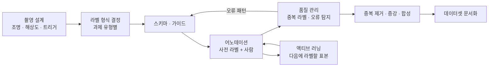
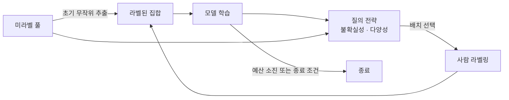

## 이 글의 범위

"현장 데이터에서 학습 데이터까지" 시리즈 4편이다. 1편은 엣지에서 데이터를 모으는 일, 2편은 그 데이터를 밖으로 내보내 저장하는 일, 3편은 센서 시계열을 정제하는 일을 다뤘다. 이번 편은 카메라 이미지를 비전 모델의 학습 데이터셋으로 만드는 절차를 정리한다. 5편은 이렇게 만든 데이터를 학습에 넣기 직전의 준비를 다룬다.

이 글은 관련 논문과 도구 문서를 읽으며 정리한 스터디 노트다. 정답 정의, 라벨링 지침의 경계 사례, kappa, 불균형 평가 지표, 누수 유형은 [정답이 없는 판정에 정답을 만드는 일 - 그라운드 트루스 설계](/ax/arch-03-ground-truth-design/)에서 다뤘으므로 여기서는 반복하지 않는다. 이상탐지 모델(PatchCore·PaDiM 등)의 비교는 [비전 기반 제조공정 에이전트](/ax/ax-01-manufacturing-vision-agent/)에, 학습된 모델을 장비에 넣는 경량화는 [온디바이스 비전 모델 개발 방법론](/ax/ax-05-ondevice-vision-dev-methodology/)에 있다.


*그림. 이미지 데이터셋 구축의 흐름. 품질 관리 결과는 가이드로 되돌아가고 액티브 러닝은 라벨 대상을 고른다.*

## 촬영 설계

이미지 데이터의 품질은 라벨링보다 촬영에서 먼저 정해진다. 조명이 흔들리는 사진에 아무리 정확한 라벨을 붙여도 모델은 조명 변화를 결함으로 배운다.

공개 데이터셋 중 촬영 조건을 가장 자세히 밝힌 예가 MVTec AD다. 2048x2048 산업용 RGB 센서에 배율 1:5와 1:1의 텔레센트릭 렌즈 두 종을 썼다. 텔레센트릭 렌즈는 물체와의 거리가 조금 달라져도 배율이 변하지 않는 렌즈다. 이미지는 700x700에서 1024x1024 사이로 잘랐고, grid·screw·zipper 세 카테고리는 흑백으로만 제공한다. 조명은 강하게 통제하되, 일부 클래스에서는 변동성을 주려고 일부러 조명을 바꿨다고 논문에 적혀 있다.

여기서 결정할 항목은 네 가지다.

| 항목 | 결정할 것 | 판단 기준 |
|---|---|---|
| 조명 | 링·돔·동축·백라이트 중 무엇, 고정인가 변동인가 | 결함이 표면 반사로 보이는지 윤곽으로 보이는지 |
| 해상도 | 픽셀당 실제 크기 | 가장 작은 결함이 몇 픽셀로 찍히는가 |
| 화각 | 한 장에 담을 범위, 렌즈 종류 | 물체 위치·거리 편차, 왜곡 허용치 |
| 트리거 | 무엇이 셔터를 누르는가 | 센서 신호(PLC·광센서), 주기, 수동 |

해상도는 산술로 먼저 확인한다. 화각 폭이 100mm이고 센서 가로가 2048픽셀이면 픽셀당 약 0.05mm다. 0.2mm 긁힘은 4픽셀 폭으로 찍힌다. 같은 센서로 화각을 400mm로 넓히면 그 긁힘은 1픽셀에 묻힌다. 모델이 볼 수 없는 결함은 라벨을 붙여도 학습되지 않는다.

트리거는 데이터 분포를 정한다. 광센서가 물체 도착을 감지해 찍으면 위치가 거의 같은 사진이 모이고, 일정 주기로 찍으면 빈 컨베이어나 반쯤 걸친 물체가 섞인다. 학습 데이터는 운영 때와 같은 트리거로 모은다.

촬영 조건은 메타데이터로 남긴다. EXIF에 노출 시간과 ISO 감도는 남지만 조명 설정, 트리거 출처, 스테이션, 렌즈 교체 이력은 남지 않는다. 이 값이 없으면 "특정 조명에서만 오검출이 난다" 같은 분석도, 분할 기준(5편)도 세울 수 없다.

```python
# 이미지 1장당 남기는 촬영 메타데이터 예시 (사이드카 JSON)
capture_meta = {
    "image_id": "st03_20261022_101530_0042",
    "station": "st03",              # 촬영 위치. 장소 기준 분할에 쓴다
    "camera_sn": "CAM-A17",
    "lens": "telecentric_x0.5",
    "lighting": {"type": "dome", "intensity_pct": 70},  # 조명 조건별 성능 분석용
    "exposure_us": 800, "gain_db": 0.0,
    "trigger": "photo_sensor",      # 주기 촬영과 섞이면 분포가 달라진다
    "mm_per_px": 0.049,             # 결함 최소 크기 판단 근거
    "object_id": "LOT2210-0042",    # 같은 개체의 여러 장을 묶는 키
}
```

## 과제 유형이 라벨 형식을 정한다

라벨 형식은 모델이 무엇을 출력해야 하는가에서 거꾸로 정해진다. 형식에 따라 1장당 라벨 비용이 크게 다르다.

| 과제 | 라벨 형식 | 라벨 비용 | 쓰는 경우 | 대표 내보내기 형식 |
|---|---|---|---|---|
| 분류 | 이미지당 클래스 1개(또는 다중) | 가장 낮음 | 양품/불량 판정만 필요, 위치 불필요 | ImageNet 폴더 구조, CSV |
| 검출 | 물체마다 사각형 + 클래스 | 중간 | 결함 위치·개수가 필요, 결함이 작고 여럿 | COCO, PASCAL VOC, YOLO |
| 분할 | 픽셀 단위 마스크 또는 폴리곤 | 가장 높음 | 결함 면적·형상이 판정 기준 | COCO(폴리곤/RLE), 마스크 PNG |
| 이상탐지 | 학습: 정상 이미지만, 라벨 없음. 평가: 결함 이미지 + 픽셀 마스크 | 학습은 거의 0, 평가셋은 높음 | 결함이 드물고 종류를 다 모을 수 없음 | 정상 이미지 + 평가용 마스크 PNG |

이상탐지 행은 비용 구조가 특이하다. 학습에는 정상 이미지만 있으면 되므로 라벨이 필요 없다. 대신 평가에는 결함 이미지와 정답 마스크가 있어야 한다. MVTec AD도 학습·검증용은 정상 3,629장뿐이고, 정답 영역 약 1,900개는 테스트셋 결함 이미지에만 붙어 있다. 라벨 예산이 평가셋에 몰리는 구조다.

형식은 위에서 아래로만 변환된다. 마스크에서 사각형을, 사각형에서 이미지 단위 분류 라벨을 계산할 수 있지만 반대는 다시 붙여야 한다. 나중에 위치가 필요할 수 있으면 처음부터 한 단계 위 형식으로 붙인다.

## 라벨 스키마와 가이드

가이드의 내용(클래스 정의, 경계 사례, 판정 불가 처리)은 앞 글에서 다뤘다. 여기서는 가이드를 도구가 읽는 스키마로 옮길 때 정할 것만 적는다.

- 클래스 목록과 고정 ID. 클래스를 추가해도 기존 ID는 바꾸지 않는다
- 클래스 계층. `scratch`를 `surface_defect` 아래에 두면 상위 클래스로 묶어 학습할 수 있다
- 속성. 심각도, 가림 여부처럼 클래스와 별개인 값
- 도형 규칙. 사각형에 여백을 두는가, 붙어 있는 결함 두 개는 하나인가
- 스키마 버전. 라벨마다 어느 버전으로 붙였는지 기록해, 규칙이 바뀌면 해당 라벨만 다시 본다

## 어노테이션 도구

오픈소스 어노테이션 도구 CVAT와 Label Studio의 공식 문서에서 확인한 기능이다.

| 항목 | CVAT | Label Studio |
|---|---|---|
| 도형 | 사각형, 폴리곤, 폴리라인, 점, 타원, 큐보이드, 스켈레톤, 브러시(마스크), 태그 | 설정 XML에서 RectangleLabels, PolygonLabels, BrushLabels, KeyPointLabels, Choices 등 태그로 조합 |
| 설정 방식 | 작업(task)에 라벨과 속성 정의 | XML 설정 파일. Object·Control·Visual 세 종류 태그 |
| 사전 라벨 | 사전학습 모델(detector, reidentifier)로 자동 주석, Nuclio 함수 지원 | ML 백엔드가 예측하고 사람이 검토 |
| 품질 관리 | Ground Truth 작업과 비교, Honeypot, IoU 임계값으로 매칭 | 이 글에서는 확인하지 않음 |
| 액티브 러닝 | 이 글에서는 확인하지 않음 | 자동 루프는 Enterprise 기능으로 안내 |

CVAT는 COCO, PASCAL VOC, YOLO, Ultralytics YOLO, Segmentation Mask, Datumaro 등으로 내보낸다. 품질 측정용 검증 데이터는 문서에 "전체의 5~15%면 대개 충분하다"고 적혀 있다.

사전 라벨은 속도를 올리지만 편향도 들여온다. 라벨러가 모델이 그린 사각형을 그대로 승인하면 모델이 틀리는 지점이 데이터셋에 고정된다. 일부 표본은 사전 라벨 없이 붙여 두 결과를 비교한다.

## 라벨 품질 관리

### 이중 라벨과 합의

같은 이미지를 두 명 이상이 독립적으로 라벨링하고 불일치 건만 합의나 제3자 판정으로 정한다. 전량 이중 라벨은 비용이 두 배라 일부만 겹친다. CVAT의 Honeypot은 정답이 확정된 검증 프레임을 일반 작업에 무작위로 섞는다. 검출·분할은 두 도형의 IoU(겹친 면적 / 합친 면적)가 임계값 이상이어야 같은 라벨로 본다.

### 라벨 오류를 모델로 찾기

사람이 전수 검토할 수 없는 규모에서는 모델의 예측을 이용해 오류 후보를 좁힌다. 대표 방법이 Northcutt, Jiang, Chuang의 confident learning(CL)이다.

CL은 라벨 노이즈가 참 클래스에만 의존한다고 가정한다(표범은 욕조보다 재규어로 잘못 붙기 쉽다). 이 가정 위에서 주어진 라벨과 참 라벨의 결합 분포를 직접 추정한다. 입력은 주어진 라벨과 교차검증으로 얻은 표본 외(out-of-sample) 예측 확률이다. 논문 실험은 4-fold를 썼다.

클래스 j의 임계값 t_j는 클래스 j로 라벨된 표본들이 클래스 j에 받은 예측 확률의 평균이다. 라벨이 i인 표본이 클래스 j에 t_j 이상을 받고 임계값을 넘은 클래스 중 j가 가장 높으면 "라벨 i, 실제 j" 칸에 센다. 이 행렬(confident joint)의 비대각 칸이 오류 후보다. 논문은 클래스별 임계값이 클래스 불균형과 클래스마다 다른 예측 확률 분포에 강건하게 하려는 장치라고 설명한다.

```python
import numpy as np

def confident_joint(labels, probs):
    # labels: (n,) 주어진 라벨, probs: (n, k) 교차검증 예측 확률
    k = probs.shape[1]
    t = np.array([probs[labels == j, j].mean() for j in range(k)])  # 클래스별 평균 자기확신도
    C = np.zeros((k, k), dtype=int)
    for y, p in zip(labels, probs):
        above = np.where(p >= t)[0]          # 임계값을 넘은 클래스들
        if len(above):
            j = above[np.argmax(p[above])]   # 그중 확률 최대 클래스
            C[y, j] += 1                     # 비대각 칸 = 오류 후보
    return C
```

실제 구현은 저자들이 공개한 cleanlab 라이브러리에 있다. 논문은 CL이 특정 데이터 형식이나 모델에 묶이지 않는다고 밝힌다.

### 오류는 테스트셋에도 있다

Northcutt, Athalye, Mueller(2021)는 CL을 널리 쓰는 벤치마크 10종의 테스트셋에 적용했다. 결과는 다음과 같다.

- 10개 데이터셋 평균 최소 3.3%가 라벨 오류로 추정됐다. ImageNet 검증셋은 2,916건, 약 6%다
- CL이 뽑은 후보는 Mechanical Turk 작업자 5명에게 독립적으로 보였고, 3명 미만이 기존 라벨에 동의하면 오류로 확정했다. 후보 중 실제 오류 비율은 데이터셋 평균 51%였다
- 교정된 라벨로 다시 평가하면 순위가 바뀐다. ImageNet에서 원래 오라벨이었던 테스트 표본의 비율이 6%만 늘어도 ResNet-18이 ResNet-50을 앞선다. CIFAR-10에서는 5% 늘면 VGG-11이 VGG-19를 앞선다

CL 후보의 절반가량은 오류가 아니므로 후보 목록은 검토 순서표로 쓰고 자동 삭제 목록으로 쓰지 않는다. 테스트셋 라벨 오류가 모델 간 성능 차이보다 크면 모델 선택이 뒤집히므로, 검수 예산은 테스트셋에 먼저 배정한다.

> **CL이 고른 라벨 오류 후보 중 사람이 실제 오류로 확인한 것은 평균 51%였다. 오류 탐지 도구는 검토 순서를 정해 줄 뿐이고, 고칠지 말지는 사람이 정한다.**

## 액티브 러닝으로 라벨 비용 줄이기

라벨을 붙이지 않은 이미지가 수만 장 쌓여 있고 라벨 예산은 수천 장분일 때, 어떤 이미지부터 붙일지를 모델이 고르게 하는 방법이다. Ren 등(2021)의 서베이는 액티브 러닝을 "가장 적은 표본에 라벨을 붙이면서 모델 성능 이득을 최대화하려는 것"으로 정의한다.


*그림. 풀 기반 액티브 러닝 순환. 초기 집합은 무작위로 뽑고 이후 질의 전략이 다음 배치를 고른다.*

질의 전략은 크게 셋이다.

| 전략 | 고르는 기준 | 식 또는 예 | 약점 |
|---|---|---|---|
| 불확실성 | 모델이 가장 헷갈리는 표본 | margin = P(y1\|x) - P(y2\|x)가 작은 것, 엔트로피가 큰 것 | 비슷한 표본만 몰려 분포를 대표하지 못함(샘플링 편향) |
| 다양성 | 특징 공간을 고르게 덮는 표본 | 코어셋, 클러스터 대표 | 정보량 낮은 표본까지 골라 비용 증가 |
| 혼합 | 두 기준을 함께 | BADGE(기울기 임베딩으로 불확실성과 다양성 자동 균형) | 계산량 |

서베이에 따르면 클래스 구성이 풍부하고 배치가 클수록 다양성 기반이, 배치가 작고 내용이 단순할수록 불확실성 기반이 유리하다. 딥러닝에서는 한 장씩 고르면 재학습이 너무 잦아 배치 단위로 고른다.

현장 이미지에서는 흐리거나 가려진 이미지도 모델에게는 불확실한 표본이다. 라벨러도 판정하지 못하는 이미지라면 비용만 쓰므로, 판정 불가 클래스를 스키마에 두고 순환마다 그 비율을 확인한다.

## 결함 희소성과 클래스 불균형

정상 이미지는 쉽게 모이고 결함 이미지는 거의 모이지 않는다. 이 비대칭을 데이터셋 설계에 반영한 대표 예가 MVTec AD다.

| 구분 | 수량 |
|---|---|
| 카테고리 | 15종(텍스처 5, 객체 10) |
| 전체 이미지 | 5,354장 |
| 학습·검증용 | 3,629장, 전부 정상 |
| 테스트셋 정상 | 467장 |
| 테스트셋 결함 | 1,258장 |
| 결함 유형 | 73종(카테고리당 평균 5종) |
| 픽셀 정답 영역 | 1,888개 |

데이터 구축 쪽에서 읽을 점이 있다. 학습셋에 결함이 없으므로 정상 데이터의 범위가 곧 모델의 정상 정의다. 허용되는 색 편차나 다른 로트의 원자재처럼 드문 정상 변형이 빠져 있으면 운영에서 오검출로 나온다. 결함은 평가용으로 따로 모으되, 종류별 검출 여부를 말하려면 종류마다 몇 장씩은 있어야 한다. 그리고 MVTec AD의 결함은 실제와 비슷하게 보이도록 사람이 일부러 만든 것이라고 논문에 적혀 있으므로, 실제 공정의 결함 분포와 다를 수 있다.

임계값용 데이터도 따로 둔다. MVTec AD 논문은 이상 점수 임계값을 학습에서 제외한 정상 검증 이미지로 추정한다. 학습에 쓴 이미지는 점수가 낮게 나오므로 임계값 추정에 쓰지 않는다.

## 증강과 주의점

증강은 기존 이미지를 변형해 학습 표본을 늘리는 방법이다. Shorten과 Khoshgoftaar(2019)의 서베이는 증강의 안전성(safety)을 변환 후에도 라벨이 유지될 가능성으로 정의한다. 고양이와 개를 구분할 때 회전·뒤집기는 안전하지만 숫자 6과 9를 구분할 때는 안전하지 않다. 어떤 변환이든 강도가 충분히 크면 라벨을 바꿀 수 있다는 점도 서베이가 짚는다.

| 증강 | 산업 이미지에서 라벨이 깨지는 예 |
|---|---|
| 뒤집기 | 좌우 비대칭 부품, 방향이 판정 기준인 조립 상태 |
| 회전 | 방향 표식, 결이 있는 표면(결 방향 자체가 불량 기준일 때) |
| 크롭 | 결함이 잘려 나가 "결함" 라벨이 붙은 정상 영역이 됨 |
| 밝기·색 변환 | 변색이 결함인 과제에서 색 변환이 결함을 만들거나 지움 |
| 블러·노이즈 | 미세 긁힘이 사라짐 |

MVTec AD 논문의 증강 설정이 이 원칙을 그대로 보여 준다. 객체 카테고리에는 무작위 이동과 회전을 적용하고, 미러링은 객체가 허용하는 경우에만 적용했다.

검출·분할에서는 이미지와 함께 사각형·마스크 좌표도 같은 변환을 받아야 한다. 그리고 증강은 학습·평가 분할 이후 학습셋에만 적용한다. 분할 전에 증강하면 한 원본의 변형이 양쪽에 들어가 누수가 된다(분할 규칙은 5편).

## 합성 데이터

결함 이미지를 모으기 어려울 때 합성으로 보충한다. 정상 이미지에 인공 결함을 붙이는 방식(DRAEM, CutPaste)과 도메인 갭 문제는 [비전 기반 제조공정 에이전트](/ax/ax-01-manufacturing-vision-agent/)에서 다뤘다. 여기서는 렌더링 기반 합성의 대표 원리 하나만 적는다.

Tobin 등(2017)의 도메인 무작위화(domain randomization)는 시뮬레이터에서 렌더링 조건을 크게 흔들어 현실이 모델에게 또 하나의 변형으로 보이게 만드는 방법이다. 이 논문은 물체 위치·텍스처, 카메라의 위치·방향·화각, 조명의 수·위치, 이미지 노이즈를 표본마다 무작위로 바꿨다. 비현실적인 무작위 텍스처의 시뮬레이터 이미지만으로 학습한 검출기가 실제 환경에서 1.5cm 정확도로 물체 위치를 찾았다.

합성 이미지에는 합성 여부와 생성 파라미터를 메타데이터로 달고, 평가셋에는 넣지 않는다. 그래야 실제 이미지만으로 합성의 기여를 잴 수 있다.

## 중복과 유사 이미지 제거

연속 촬영하는 현장 카메라는 거의 같은 이미지를 대량으로 만든다. 중복은 라벨 비용을 낭비하고, 학습셋과 테스트셋에 걸치면 성능을 부풀린다.

Barz와 Denzler(2019)는 CIFAR-10 테스트 이미지의 3.3%, CIFAR-100의 10%가 학습셋에 중복을 가진다는 것을 찾았다. 중복을 새 이미지로 바꾼 테스트셋(ciFAIR)에서 여러 모델의 분류 정확도가 원래 대비 상대적으로 9~14% 떨어졌다.

방법도 참고할 만하다. 픽셀 단위 비교만으로는 대비·색조·이동·늘림이 조금 다른 변형을 못 찾는다. 그래서 해당 데이터로 학습한 CNN의 전역 평균 풀링 층 특징을 L2 정규화하고, 테스트 이미지마다 학습셋에서 가장 가까운 이웃을 찾았다. 거리 임계값만 쓰면 오탐이 많아 거리순으로 정렬한 쌍을 사람이 보고 넷으로 나눴다.

| 분류 | 정의 |
|---|---|
| 완전 중복 | 거의 모든 픽셀이 같음 |
| 근사 중복 | 같은 촬영에서 나왔고 후처리(색, 이동, 크기)만 다름 |
| 매우 유사 | 내용은 다르지만 두 번 봐야 차이가 보임 |
| 다름 | 위 셋이 아님 |

현장 데이터에서는 해시로 완전 중복을 먼저 지우고, 임베딩 최근접 이웃으로 근사 중복 후보를 뽑아 사람이 판정한다. 근사 중복은 대표 1장만 라벨링하거나, 그룹 ID를 붙여 분할 때 같은 쪽에 둔다.

## 데이터셋 문서화

Gebru 등이 제안한 데이터시트(Datasheets for Datasets)는 전자부품마다 동작 특성·시험 결과·권장 용도를 적은 데이터시트가 붙는 것처럼 데이터셋에도 같은 문서를 붙이자는 제안이다. 질문은 데이터셋 생애주기를 따라 일곱 묶음으로 나뉜다. 동기, 구성, 수집 과정, 전처리·정제·라벨링, 용도, 배포, 유지보수다. 논문은 수집 과정 질문을 수집 전에 미리 읽어 문제를 짚고, 수집이 끝난 뒤 답을 채우라고 권한다.

이 글의 항목은 대부분 여기에 들어간다. 구성에는 클래스별 장수와 정상·결함·판정 불가·합성 비율, 수집 과정에는 촬영 메타데이터, 전처리·정제·라벨링에는 스키마 버전과 이중 라벨 비율, CL 검토 건수, 중복 제거 기준을 적는다.

## 도구에 맡길 것과 사람이 정할 것

이 절차의 상당 부분은 도구가 처리한다. 메타데이터 수집 스크립트, 오류 후보 추출, 근사 중복 검색 코드는 지시하면 코딩 에이전트가 짠다. 사람이 정할 것은 도구의 입력과 판정 기준이다.

| 도구가 하는 일 | 사람이 정할 것 |
|---|---|
| 촬영, 메타데이터 기록 | 최소 결함 크기에 맞춘 해상도, 조명 방식, 트리거 |
| 사전 라벨 | 라벨 형식, 스키마, 사전 라벨 편향 점검 방법 |
| 일치도·IoU 계산 | 이중 라벨 비율, IoU 임계값, 불일치 판정자 |
| CL 오류 후보 순위 | 후보 중 무엇이 실제 오류인지, 검토 범위 |
| 액티브 러닝 질의 | 초기 표본, 질의 전략, 종료 조건 |
| 증강 적용 | 이 과제에서 라벨이 유지되는 변환과 강도 |
| 근사 중복 후보 | 중복의 정의, 삭제할지 그룹으로 묶을지 |
| 데이터시트 서식 | 이 데이터를 쓰면 안 되는 범위 |

라벨 오류 연구에서도 알고리즘이 고른 후보의 절반가량만 실제 오류였고, 확정은 사람 5명의 판정으로 했다. 도구가 줄여 주는 것은 사람이 봐야 할 이미지의 수다. 무엇이 정답인지는 사람이 정한다.

---

## 참고

- Northcutt, C. G., Athalye, A., Mueller, J. (2021). Pervasive Label Errors in Test Sets Destabilize Machine Learning Benchmarks. NeurIPS 2021 Track on Datasets and Benchmarks. https://arxiv.org/abs/2103.14749
- Northcutt, C. G., Jiang, L., Chuang, I. L. (2021). Confident Learning: Estimating Uncertainty in Dataset Labels. Journal of Artificial Intelligence Research. https://arxiv.org/abs/1911.00068
- Bergmann, P., Fauser, M., Sattlegger, D., Steger, C. (2019). MVTec AD - A Comprehensive Real-World Dataset for Unsupervised Anomaly Detection. CVPR 2019. https://openaccess.thecvf.com/content_CVPR_2019/papers/Bergmann_MVTec_AD_--_A_Comprehensive_Real-World_Dataset_for_Unsupervised_Anomaly_CVPR_2019_paper.pdf
- Ren, P., Xiao, Y., Chang, X., Huang, P.-Y., Li, Z., Gupta, B. B., Chen, X., Wang, X. (2021). A Survey of Deep Active Learning. arXiv:2009.00236. https://arxiv.org/abs/2009.00236
- Barz, B., Denzler, J. (2019). Do we train on test data? Purging CIFAR of near-duplicates. arXiv:1902.00423. https://arxiv.org/abs/1902.00423
- Gebru, T., Morgenstern, J., Vecchione, B., Vaughan, J. W., Wallach, H., Daumé III, H., Crawford, K. (2021). Datasheets for Datasets. arXiv:1803.09010. https://arxiv.org/abs/1803.09010
- Shorten, C., Khoshgoftaar, T. M. (2019). A survey on Image Data Augmentation for Deep Learning. Journal of Big Data 6:60. https://journalofbigdata.springeropen.com/articles/10.1186/s40537-019-0197-0
- Tobin, J., Fong, R., Ray, A., Schneider, J., Zaremba, W., Abbeel, P. (2017). Domain Randomization for Transferring Deep Neural Networks from Simulation to the Real World. arXiv:1703.06907. https://arxiv.org/abs/1703.06907
- CVAT.ai (2026 열람). CVAT Documentation: Automatic annotation, Dataset formats, Auto QA. https://docs.cvat.ai/docs/
- HumanSignal (2026 열람). Label Studio Documentation: Labeling configuration, Tags, ML backend. https://labelstud.io/guide/
