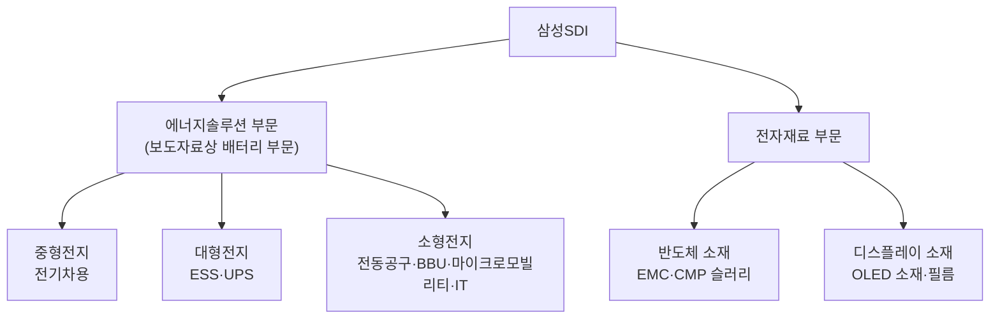
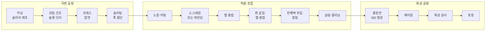

## 이 시리즈를 시작하며

산업에 AI를 붙이는 이야기를 하려면 그 산업이 무엇을 만들고 어떤 순서로 만드는지부터 알아야 한다. 공정을 모르면 데이터가 어디서 생기는지 모르고, 데이터가 어디서 생기는지 모르면 AI가 들어갈 자리를 고를 수 없다.

산업분석 시리즈의 첫 대상은 2차전지다. 그중 공시와 회사 발표가 잘 정리된 삼성SDI를 골라, 이 회사가 무엇을 만들고 어디서 어떤 라인으로 만드는지 공개 원문만으로 정리했다. 이 글은 공부하며 만든 스터디 노트다. 사업보고서(DART 제출본), 분기 실적 보도자료, 회사 뉴스룸의 공정 해설, 시장조사기관 보도자료를 직접 읽고, 원문에서 확인한 것만 적었다. 확인하지 못한 수치는 빈칸으로 두었다.

## 사업 구조: 배터리 하나에 매출의 93%

2025년 사업보고서(2026년 3월 제출)에서 회사는 사업을 두 부문으로 나눈다. 중·대형전지와 소형전지 등 리튬이온 2차전지를 만드는 에너지솔루션 부문, 반도체·디스플레이 소재를 만드는 전자재료 부문이다. 분기 실적 보도자료에서는 같은 에너지솔루션 부문을 "배터리 부문"이라고 부른다.

*그림. 사업보고서의 부문 구분을 제품군 단위까지 펼친 구조. 중형·대형·소형 구분은 사업보고서 표현을 따랐다.*

부문별 매출은 다음과 같다. 2026년 2분기 비중은 보도자료의 부문 매출을 전체 매출로 나눠 내가 계산한 값이다.

| 기간 | 전체 매출 | 에너지솔루션(배터리) | 전자재료 | 출처 |
|---|---|---|---|---|
| 2025년 연간 | 13조 2,667억원 | 12조 3,841억원 (93%) | 8,826억원 (7%) | 2025년 사업보고서 |
| 2026년 상반기 | - | 6조 8,734억원 (94%) | 4,718억원 (6%) | 2026년 반기보고서 |
| 2026년 2분기 | 3조 7,688억원 | 3조 5,190억원 (약 93.4%) | 2,498억원 (약 6.6%) | 2분기 실적 보도자료 |

2025년은 에너지솔루션 부문이 영업손실 1조 8,519억원을 낸 해였다. 2026년 2분기에는 배터리 부문이 영업이익 1,593억원으로 돌아섰고, 회사는 UPS·BBU·전동공구용 고출력 배터리와 유럽향 전기차 배터리 판매 증가, 미국 첨단제조생산세액공제(AMPC, 미국 내 생산 배터리에 주는 세액공제) 수혜를 이유로 들었다.

사업보고서는 중형·대형·소형 사이의 매출 분할을 공개하지 않는다. 그래서 전기차와 ESS 중 어느 쪽이 더 큰지는 공시 숫자로 말할 수 없다. 대신 소형전지는 생산능력과 실적을 개수로 공개한다. 천안과 톈진 등을 합친 소형전지 생산능력은 2025년 25억 2천만 개, 생산실적은 12억 6,900만 개로 가동률 50%였다. 2026년 상반기에는 생산능력 11억 7,800만 개 대비 8억 6천만 개를 만들어 가동률 73%로 올라왔다.

## 제품군: 폼팩터와 화학계의 조합

배터리 셀은 두 축으로 나눠 보면 정리가 쉽다. 하나는 외형(폼팩터)이다. 원통형은 금속 원통 캔, 각형은 알루미늄 육면체 캔, 파우치형은 알루미늄 적층 필름 봉투에 전극을 넣는다. 다른 하나는 양극 화학계다. NCA(니켈·코발트·알루미늄)는 니켈 함량을 높여 에너지 밀도를 끌어올리는 계열이고, LFP(리튬인산철)는 에너지 밀도는 낮지만 값이 싸고 열 안정성이 좋다. LMO(리튬망간산화물)는 출력 특성이 좋다.

삼성SDI가 공개한 제품을 이 두 축에 놓으면 다음과 같다.

| 용도 | 폼팩터 | 화학계 | 공개 제품·내용 |
|---|---|---|---|
| 전기차 | 각형 | NCA | 6세대 P6. 니켈 비중 91%, 독자 실리콘 음극. 헝가리 공장 생산 |
| 전기차 | 원통형 | NCA | 46파이(지름 46mm). 2025년 주요 자동차 고객 수주 완료 |
| 전기차 신제품 | 미공개 | LFP, 미드니켈 | 2026년 계획에 "수주 확대 추진"으로만 언급 |
| ESS | 각형, 20피트 컨테이너 | NCA | SBB 1.5, SBB 1.7(컨테이너당 6.14MWh, SBB 1.5 대비 약 17% 증가) |
| ESS | 각형, 20피트 컨테이너 | LFP | SBB 2.0. 2026년 미국 현지 양산 계획 |
| UPS | 각형 | LMO | U8A1. UL9540A 화재 시험 통과 |
| BBU·전동공구 | 원통형 | 미공개 | 탭리스 초고출력 원통형, 50A급 |
| IT 기기 | 파우치형 | 미공개 | 연구개발 과제에 "IT용 고안전성 파우치형 전지" |

원통형은 18650(지름 18mm, 높이 65mm)과 21700(지름 21mm, 높이 70mm)을 거쳐 46파이로 커지고 있다. 회사가 인터배터리 2025에서 공개한 46파이 라인업은 4680, 4695, 46100, 46120이다. 앞 두 자리가 지름, 뒤가 높이(mm)다. 4695 셀에는 하이니켈 NCA 양극과 SCN(Silicon Carbon Nanocomposite) 음극을 썼고, 전극 끝을 여러 탭으로 만드는 탭리스 구조로 내부 저항을 약 90% 낮췄다고 밝혔다. 21700 대비 에너지 용량은 약 6배 이상이다.

ESS 제품인 SBB(Samsung Battery Box)는 셀이 아니라 시스템 단위 제품이다. 20피트 컨테이너에 각형 셀, 모듈 안에 소화 약제를 직접 분사하는 EDI(Enhanced Direct Injection), 셀 이상 사전 진단과 수명 예측 알고리즘을 묶었다. 2026년 인터배터리에서는 AI 기반 화재 예방 소프트웨어 SBI(Samsung Battery Intelligence)를 처음 공개한다고 예고했다. 제조사가 셀을 넘어 운영 소프트웨어까지 제품에 넣고 있다는 점은 다음 글에서 다시 다룬다.

### 차세대: 전고체와 소듐이온

전고체 배터리는 액체 전해질을 고체로 바꾼 전지다. 회사 뉴스룸 해설(2024년 12월)에 따르면 삼성SDI는 독자 조성 고체 전해질과 무음극(anode-less) 기술을 적용해 900Wh/L를 목표로 하며, 이는 현재 양산 중인 각형보다 약 40% 높은 수준이다. 파일럿 라인 S라인은 2022년 3월 수원 연구소에 착공해 2023년 3월 준공했고, 2023년에 고객사에 샘플을 공급했다.

양산 일정은 문서마다 표현이 조금씩 다르다. 2024년 뉴스룸은 "2027년 상용화", 2026년 반기보고서는 "'27년 양산을 목표", 인터배터리 2026 보도자료는 "2027년 하반기 양산을 목표"라고 적는다. 2025년 10월에는 BMW와 전고체 실증 프로젝트 업무협약을 맺었다. 같은 반기보고서는 소듐(나트륨)이온 배터리도 개발과 양산을 추진한다고 밝혔고, 2분기 보도자료는 이를 UPS와 전력용 ESS 제품으로 개발 중이라고 설명한다.

## 생산거점: 어디서 무엇을 만드는가

사업보고서는 국내 사업장으로 기흥(본사), 울산, 천안, 구미, 청주, 수원을 들고, 해외로 미국, 헝가리, 오스트리아, 베트남, 말레이시아, 중국 법인을 든다. 법인별 주요 영업활동은 연결 종속기업 표에 나온다. 아래 표는 사업보고서, 회사 웹사이트의 글로벌 네트워크, 보도자료에서 확인한 내용만 모았다.

| 거점 | 생산 품목(원문 표현) | 상태와 근거 |
|---|---|---|
| 천안 | 소형 배터리 | 2000년 배터리동 양산 시작. 2018년 소형·중대형 마더라인(M Line) 가동. 46파이 4695 셀을 마더라인에서 생산 |
| 울산 | 전기차용 배터리, ESS | 2010년 11월 전기차 배터리 공장 준공, 2011년 양산 |
| 헝가리 괴드 | 자동차전지 | 2017년 5월 준공, 이듬해 양산. 현대차 유럽향 P6 공급(2026~2032년) 예정 |
| 중국 시안 | 자동차전지 | 지분율 65% 법인. 회사는 2015년 중국을 첫 해외 전기차 배터리 생산지로 소개 |
| 중국 톈진(2개 법인) | 2차전지 | 소형전지 생산능력 집계에 "천안, 톈진 등"으로 포함 |
| 말레이시아 스름반 | 2차전지 | 2022년 2공장 기공. 당시 발표는 21700 원통형, 2024년 첫 양산, 2025년 완공 계획 |
| 베트남 박닌 | 2차전지 | 천안에서 만든 4695 셀을 모듈로 조립해 2025년 3월 미국 고객 초도 출하 |
| 오스트리아 그라츠 | 자동차전지 | 사업보고서 종속기업 표에 "자동차전지 생산 및 판매" |
| 미국 코코모, StarPlus Energy | 자동차전지(법인 기준), ESS용 NCA·LFP 셀 | 스텔란티스 합작, 지분 51%. 1공장 2024년 12월 조기 가동. 2026년 3월 수주 ESS 배터리를 이 공장에서 생산 |
| 미국 뉴칼라일, SynergyCells | 자동차전지(법인 기준) | GM 합작으로 2024년 설립, 초기 연산 27GWh 계획. 2026년 8월 GM 지분 49.99% 전량 인수 결정, 공장 건설 중, ESS 라인 병설 계획 |

몇 가지는 원문에서 확인되지 않아 표에 넣지 않았다. 거점별 GWh 생산능력은 사업보고서가 공개하지 않는다. 회사가 공개한 숫자는 GM 합작 공장의 계획치(초기 27GWh, 향후 36GWh)뿐이다. StarPlus 2공장은 2023년 9월 건설 계약 공시까지만 확인했고 현재 공정률은 확인하지 못했다. 말레이시아 2공장의 실제 양산 개시 여부도 2022년 계획 발표 외의 원문을 찾지 못했다.

표에서 읽히는 구조는 두 가지다. 첫째, 신제품은 천안 마더라인에서 먼저 만들고 해외로 옮긴다. 회사는 2018년 M Line 구축 후 이를 수평 전개해 해외 어디서나 같은 품질로 생산한다고 설명한다. 둘째, 미국 거점의 용도가 바뀌고 있다. 법인 등록 업종은 자동차전지인데, 2025년 말부터 2026년까지 나온 수주와 계획은 ESS 셀 생산을 말한다. SNE리서치는 미국 연방 전기차 세액공제 종료 뒤 배터리 업체들이 전기차 라인을 ESS용으로 돌리는 움직임이 확산되고 있다고 적었다.

## 셀 제조 공정: 극판, 적층, 조립, 화성

회사 뉴스룸의 공정 해설과 공정 일반을 다룬 리뷰 논문(Liu 외, 2021)을 함께 읽고 정리했다. 극판 공정은 폼팩터와 무관하게 거의 같고, 갈림길은 전극을 말거나 쌓는 단계와 외장에 있다.

*그림. 각형 셀 기준 공정 흐름. 삼성SDI 뉴스룸은 프레스를 슬리팅 뒤에, 교재형 설명은 앞에 두는데 여기서는 교재 순서를 따랐다.*

### 극판

믹싱은 활물질, 도전재, 바인더, 용매를 일정 비율로 섞어 슬러리를 만든다. 코팅은 슬롯 다이(슬러리를 한 출구로 밀어내는 정밀 도포 장치)로 슬러리를 집전체 위에 일정 두께로 바르고 말리는 단계다. 양극 집전체는 알루미늄, 음극은 구리다. 프레스는 롤로 눌러 두께를 맞추고 밀도와 밀착력을 높이며, 슬리팅은 정해진 폭으로 잘라 릴에 감는다. 리뷰 논문의 표에 따르면 코팅·압연·슬리팅 같은 롤투롤 공정은 분당 35m 이상으로 빠르다. 에너지는 건조와 용매 회수가 전체의 약 46.84%를 쓴다. 건식 극판은 용매와 건조를 아예 없애는 방식이고, 삼성SDI는 2024년 9월 건식 극판 파일럿 라인 DryEV를 완공했다.

### 적층과 조립: 폼팩터가 갈리는 곳

| 구분 | 원통형 | 각형(삼성SDI) | 파우치형 |
|---|---|---|---|
| 전극 구성 | 와인딩(젤리롤) | Z-스태킹 | 스태킹 |
| 외장 | 원통 금속 캔 | 알루미늄 육면체 캔 + 캡 어셈블리 | 알루미늄 적층 필름 |
| 강점(회사 설명) | 고속 생산에 유리 | 캔 내부 공간 활용, 극판 꺾임 없음 | - |

리뷰 논문은 업계 일반을 "파우치는 스태킹, 원통형과 각형은 와인딩"으로 정리한다. 삼성SDI는 각형에 Z-스태킹을 쓴다는 점에서 이 일반론과 다르다. Z-스태킹은 분리막을 알파벳 Z 모양으로 접어 내리면서 그 사이에 음극과 양극 시트를 번갈아 놓는 방식이다. 그 전에 노칭(금형 프레스로 탭 모양을 찍어냄)과 커팅으로 시트를 만들고, 시트마다 비전 검사로 규격과 이물을 본다. 적층이 끝나면 정렬과 돌출 여부를 전수 비전 검사한다.

각형 조립은 네 단계다. 스택의 탭을 캡 어셈블리 집전판에 레이저로 용접하고(회사는 자체 특허 LPW, Laser Plate Welding을 쓴다), 스택에 절연 테이프를 감아 알루미늄 캔에 넣은 뒤 캔과 캡을 레이저로 봉합한다. 진공 상태에서 누설을 검사한 뒤 전해액을 주입하고, 전해액이 전극에 스며드는 함침 시간을 둔다. 마지막으로 주입구를 막고 내부 저항과 압력을 검사한 뒤 세정한다. 원통형은 2007년 분당 200개(200ppm) 조립 라인을 개발했다고 회사 연혁이 적고 있다.

### 화성: 비용과 시간이 가장 많이 드는 단계

화성은 조립된 셀에 처음 전기를 넣어 작동하게 만드는 단계다. 첫 충전에서 음극 표면에 SEI(Solid Electrolyte Interphase, 고체 전해질 계면막)가 생기고, 이 막이 수명과 안전성을 좌우한다. 이어 정해진 온도와 습도의 에이징 룸에 셀을 보관해 전압을 안정시키고, 용량·전압·두께를 재는 특성 검사와 절연·외관 검사를 거쳐 포장한다. 회사 해설은 충방전이 화성 공정의 80% 이상을 차지하고, 에이징은 다른 공정보다 시간과 공간을 많이 쓴다고 설명한다.

리뷰 논문이 인용한 Argonne 국립연구소 BatPaC 모델 기반 비용 분석(67Ah NMC622 셀)에서 화성·에이징은 제조 비용의 32.16%로 1위이고 소요 시간도 1.5~3주로 가장 길다. 코팅·건조(14.96%), 외장(12.45%)이 뒤를 잇는다.

## 경쟁 구도: 전기차에서는 순위가 밀렸다

SNE리서치 보도자료(2026년 10월) 기준으로 2026년 1~8월 전기차용 배터리 사용량을 정리하면 다음과 같다. 이 수치는 전기차에 실제 탑재된 양이며 ESS는 포함하지 않는다.

| 업체 | 비중국 시장 사용량 | 비중국 점유율 (전년 동기) | 글로벌 점유율 |
|---|---|---|---|
| CATL | 121.3GWh | 33.7% (29.0%) | 39.4% |
| LG에너지솔루션 | 58.1GWh | 16.1% (21.2%) | 8.1% |
| BYD | 39.7GWh | 11.0% (8.2%) | 15.1% |
| Panasonic | 29.7GWh | 8.3% (10.0%) | 3.5% |
| SK on | 24.8GWh | 6.9% (9.9%) | 2.9% |
| 삼성SDI | 13.6GWh | 3.8% (6.8%) | 보도자료에 개별 수치 없음 |

삼성SDI의 비중국 사용량은 전년 동기 대비 32.0% 줄어 상위 10개사 가운데 감소 폭이 가장 컸다. 유럽은 8.3GWh로 전년과 비슷했고 북미가 10.4GWh에서 3.9GWh로 62.0% 줄었다. 같은 기간 글로벌 시장에서 국내 3사 합산 점유율은 12.7%, 중국계 7개사는 73.3%였고, 글로벌 LFP 비중은 57.3%까지 올라갔다.

소형전지는 사정이 다르다. 사업보고서는 시장조사기관 TSR 보고서를 기준으로 삼성SDI 소형전지 점유율을 2025년 13%로 적었다(2024년 15%, 2023년 17%). ESS 셀의 공개 점유율 원문은 이번에 찾지 못해 표에 넣지 않았다.

## 이 산업에서 AI가 들어갈 자리는 어디인가

여기까지 정리하고 나면 AI가 붙을 후보 지점이 공정 단위로 보인다. 공개 원문에 이미 데이터 발생 지점이 적혀 있기 때문이다.

- 코팅: 다열 코팅의 폭과 위치를 개별 제어한다는 설명이 있다. 두께·폭 측정값이 롤 단위로 연속해서 나온다
- 스태킹: 시트마다 비전 검사, 적층 후 전수 비전 검사가 있다. 이미지 판정 모델이 들어갈 자리다
- 화성: 비용 32%, 기간 최대 3주를 차지한다. 충방전 곡선으로 불량을 일찍 가려내거나 에이징 시간을 줄이는 예측 모델의 대상이다
- 출하 이후: SBB의 수명 예측과 사전 진단, SBI 화재 예방 소프트웨어처럼 셀 제조사가 운영 단계의 AI를 제품에 넣기 시작했다

다만 어느 자리든 도구가 대신 정할 수 없는 것이 있다. 비전 모델은 불량을 학습할 수 있지만, 무엇을 불량으로 볼지와 어디서 합격선을 그을지는 사람이 정의해야 한다. 화성 데이터로 에이징을 줄이는 모델을 만들 수는 있어도, 몇 시간을 줄여도 되는지 판정하는 검증 기준은 품질 책임자가 세운다. 공정을 아는 사람이 정의와 검증을 맡고, 반복 판정과 패턴 탐색은 도구가 맡는 구조다. 비전 기반 공정 판단의 일반 구조는 [비전 기반 제조공정 에이전트](/posts/ax-01-manufacturing-vision-agent/)에 정리해 두었다.

다음 글(ia-02)에서는 배터리 제조사들이 실제로 공정에 AI를 어디에 넣었다고 발표했는지, 국내외 공개 사례를 이 공정 지도 위에 올려 본다.

## 참고

- 삼성SDI (2026). 사업보고서 (2025.12). 전자공시시스템 제출본, 회사 IR 게시. https://www.samsungsdi.co.kr/upload/download/ir/SDI_Report_04_2026.03.10_kor.pdf
- 삼성SDI (2026). 반기보고서 (2026.06). 전자공시시스템 제출본, 회사 IR 게시. https://www.samsungsdi.co.kr/upload/download/ir/SDI_Report_02_2026.08.14_kor.pdf
- 삼성SDI (2026). 삼성SDI, 2025년 4분기 및 연간 실적 발표. 보도자료. https://www.samsungsdi.co.kr/sdi-now/sdi-news/4701.html
- 삼성SDI (2026). 삼성SDI, 2026년 2분기 실적 발표. 보도자료. https://www.samsungsdi.co.kr/sdi-now/sdi-news/4941.html
- 삼성SDI (2026). 삼성SDI, 美에너지기업에 1.5조 ESS용 각형 배터리 공급. 보도자료. https://www.samsungsdi.co.kr/sdi-now/sdi-news/4801.html
- 삼성SDI (2026). "AI의 상상, 배터리가 현실로"… 삼성SDI, '인터배터리 2026'서 AI시대 비전 제시. 보도자료. https://www.samsungsdi.co.kr/sdi-now/sdi-news/4761.html
- 삼성SDI (2026). 삼성SDI, GM과 차세대 각형 배터리 공동 개발…미래 모빌리티 시장 대응 협력. 보도자료. https://www.samsungsdi.co.kr/sdi-now/sdi-news/4981.html
- 삼성SDI (2025). 삼성SDI, 고용량·안전성 확보 SBB 신제품 전격 공개…북미 최대 에너지산업 전시회 'RE+ 2025' 참가. 보도자료. https://www.samsungsdi.co.kr/sdi-now/sdi-news/4521.html
- 삼성SDI (2025). 삼성SDI, 차세대 46파이 배터리 양산…美고객사 초도 공급. 보도자료. https://www.samsungsdi.co.kr/sdi-now/sdi-news/4321.html
- 삼성SDI (2024). 삼성SDI-GM, 美배터리 합작법인 설립 본계약 체결. 보도자료. https://www.samsungsdi.co.kr/sdi-now/sdi-news/3941.html
- 삼성SDI (2023). 삼성SDI-현대자동차, 첫 배터리 공급 계약 체결. 뉴스룸. https://news.samsungsdi.com/ko/articleView?seq=31
- 삼성SDI (2022). 삼성SDI, 말레이시아 원형 배터리 라인 증설에 1.7조 원 투자. 뉴스룸. https://news.samsungsdi.com/ko/articleView?seq=57
- 삼성SDI. 글로벌 네트워크. 회사 웹사이트. https://www.samsungsdi.co.kr/about-sdi/global-network.html
- 삼성SDI 뉴스룸 (2025). 삼성SDI 발자취. https://news.samsungsdi.com/ko/articleView?seq=324
- 삼성SDI 뉴스룸 (2025). [SDI 포커스] 각형 배터리의 자신감, 오랜 기간 축적된 기술력에서 나온다. https://news.samsungsdi.com/ko/articleView?seq=310
- 삼성SDI 뉴스룸 (2025). [SDI 포커스] 원통형 배터리의 진화는 46파이로 이어진다. https://news.samsungsdi.com/ko/articleView?seq=248
- 삼성SDI 뉴스룸 (2024). [SDI 포커스] 업계 최고 900Wh/L 전고체 배터리, 꿈이 아닌 현실이 된다. https://news.samsungsdi.com/ko/articleView?seq=237
- 삼성SDI 뉴스룸 (2024). [배터리101] 돌돌 말거나 지그재그로 쌓거나. https://news.samsungsdi.com/ko/articleView?seq=198
- 삼성SDI 뉴스룸 (2025). [배터리 공정] 극판 공정 / 스태킹 공정 / 조립 공정 / 화성 공정 (4편). https://news.samsungsdi.com/ko/articleView?seq=331 , seq=336 , seq=349 , seq=355
- Liu, Y., Zhang, R., Wang, J., Wang, Y. (2021). Current and future lithium-ion battery manufacturing. iScience 24(4), 102332. https://pmc.ncbi.nlm.nih.gov/articles/PMC8050716/
- SNE리서치 (2026). 2026년 1~8월 글로벌 전기차용 배터리 사용량 844.2GWh, 전년 동기 대비 19.7% 성장. 보도자료. https://www.sneresearch.com/kr/insight/release_view/745/page/0
- SNE리서치 (2026). 2026년 1~8월 非중국 글로벌 전기차용 배터리 사용량 360.5GWh, 전년 동기 대비 23.7% 성장. 보도자료. https://www.sneresearch.com/kr/insight/release_view/750/page/0
