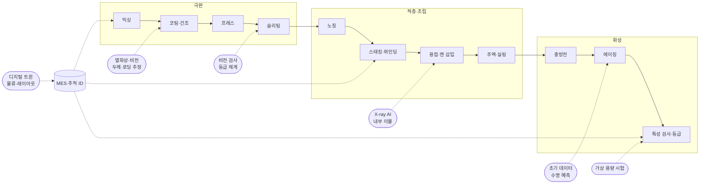

## 이 글이 묻는 것

[1편](/posts/ia-01-samsung-sdi-products-and-lines/)에서 셀 공정을 극판, 적층·조립, 화성 순서로 정리했다. 이번에는 그 공정 지도 위에 실제 회사들이 AI를 어디에 넣었다고 공개했는지를 올려 본다. 질문은 하나다. 이차전지 제조에서 AX(AI 전환)는 어느 공정에서, 무엇을 입력으로, 어떤 지표를 바꿨다고 발표되었는가.

자료는 세 갈래로 모았다. 회사가 직접 낸 원문(지속가능경영보고서, 뉴스룸, 보도자료), 세계경제포럼(WEF) 글로벌 라이트하우스 네트워크 백서, 공정 데이터로 수명이나 품질을 예측한 논문이다. 전부 직접 열어 읽은 것만 썼다. 이 글은 공부하며 정리한 스터디 노트이고, 회사 발표 수치는 회사가 낸 그대로 옮겼다. 기준선과 측정 방법이 공개되지 않은 수치가 대부분이라 회사 간 직접 비교는 하지 않는다.

## 삼성SDI가 공개한 것

삼성SDI의 공개 자료를 시간 순으로 놓으면 물류와 실행 시스템을 먼저 깔고 그 위에 AI 검사와 이상 감지를 올리는 순서가 보인다.

| 시점 | 내용 | 출처 |
|---|---|---|
| 2009 | 스마트팩토리 구축 시작 | 뉴스룸 2025.04 |
| 2018 | 천안 마더라인(M Line) 가동, 같은 해 천안 M라인부터 물류 자동화 도입 | 뉴스룸 2025.04, 2025.06 |
| 2019 | TSDI 물류 자동화. 이후 헝가리·북미 거점으로 확대(ASRS, AMR, OHT) | 뉴스룸 2025.04 |
| 2024 | 국내 사업장에 에너지관리시스템 설치, 공정·라인 단위 에너지 모니터링 | 지속가능경영보고서 2026 |
| 2025 초 | 주요 해외법인에 전기차 배터리용 차세대 MES 전환 완료 | 뉴스룸 2025.04 |
| 2025 | Vision AI 포털 운영, X-ray 장비에 AI 적용 | 뉴스룸 2025.04 |
| 2025 회계연도 | 외관 비전 검사를 통계 알고리즘에서 딥러닝으로 전환, 설비 상태 데이터로 이상 징후 조기 감지 | 지속가능경영보고서 2026 |

MES(제조실행시스템)는 생산·공정·설비 정보를 모아 관리하는 소프트웨어다. 회사는 이 데이터를 AI와 함께 써서 설비나 공정 품질의 이상을 감지하고, 고장을 미리 막고 불량 유출을 차단한다고 설명한다. 디지털 트윈은 지금은 물류 쪽에 쓰인다. 물류 지연 같은 문제를 실시간으로 예측하고, 공장 레이아웃 설계 단계에서 면적과 투자비를 예측한다. 생산 일정 최적화에는 앞으로 적용할 계획이라고 적었다.

검사 쪽은 Vision AI 포털이 중심이다. 현장 검사기가 찍은 원본 이미지를 모아 양품과 불량으로 라벨을 붙이고, 그 데이터로 모델을 학습해 라인에 내려보낸다. 라인 검사기가 새로 찍은 이미지는 다시 포털로 들어간다. 학습 데이터 수집에서 배포, 재수집까지 한 바퀴가 도는 구조다. 담당자 인터뷰에는 같은 사양 배터리라도 미세한 차이로 불량 유형이 다양해진다는 말이 있다. 최근에는 X-ray 장비에 AI를 붙여 셀 내부 금속 이물을 잡는다.

2026년 지속가능경영보고서(2025 회계연도 대상)는 범위를 R&D까지 넓힌다. 소재 조합이 10의 40제곱에 이르는 신소재 탐색에서 AI로 후보를 미리 걸러 실험 수를 줄였다. 수백 회 충방전 때문에 6개월 넘게 걸리던 수명 평가는 1~2개월치 단기 검증 데이터에 물리 기반 AI 모델을 더해 장기 수명을 예측한다. 품질 관리 체계 Q-Gate에서는 결함 이미지 기반 AI 비전 학습으로 검사 기준을 강화했고, 해외 사이트에 전극 등급 체계(Grade System)를 적용했다. 신규 라인은 양산 시작 단계에서 약 2개월간 공정 데이터와 비전 검사 결과를 검토한다. 생산 데이터와 규정을 자연어로 찾는 사내 AI 포털, 직원이 직접 모델을 만드는 AI-Crew 활동도 적혀 있다.

공개 자료에 없는 것도 분명하다. 검사 정확도, 불량률 변화, 에이징 시간 단축 같은 공정 지표의 수치는 찾지 못했다.

## 글로벌 비교: 라이트하우스에 오른 배터리 공장

WEF 글로벌 라이트하우스 네트워크는 4차 산업혁명 기술을 공장 규모로 적용한 사이트를 독립 전문가 패널이 지정하는 프로그램이다. 지정 사이트는 유스케이스마다 바뀐 지표를 백서 부록에 싣는다. 배터리 셀 공장을 공개 수치로 비교할 수 있는 거의 유일한 자료라 이것부터 본다.

| 사이트 | 게재 백서 | 회사가 제시한 성과 |
|---|---|---|
| CATL 닝더 | 2021.09 | 3년 만에 셀당 1.7초 속도에서 10억 개당 단위 불량률, 노동생산성 75% 향상, 에너지 연 10% 절감 |
| CATL 이빈 | 2023.01 | 라인 속도 17% 향상, 수율 손실 14% 감소, 탄소 배출 0 |
| CATL 리양 | 2023.12 | 생산량 320% 증가, 제조원가 33% 절감, 정규화 배출 47.4% 감소, 품질 불량 99% 감소 |
| EVE Energy 징먼, CATL 이빈, HiTHIUM 충칭 | 2026.01 | 2025년 신규 등대 지도에 배터리 업종으로 표기. 세부 수치는 이번에 확인 못 함 |

닝더 서술에는 AI, 고급 분석, 엣지·클라우드 컴퓨팅이 수단으로 적혀 있다. 이빈은 닝더 본사 등대의 디지털 과제 위에 AI, IoT, 유연 자동화를 더 깊게 넣었다고 설명한다. 이빈의 유스케이스별 수치는 다음과 같다. AI 광학 검사로 인원(FTE) 63%, AI 공정 제어로 조립 효율 100%, 유연 생산용 디지털 트윈으로 자동화율 128%, IIoT 센서 기반 에너지 관리로 에너지 소비 13%. 백서는 지표 이름과 숫자만 적고 기준선은 적지 않는다.

리양은 공정 쪽 서술이 가장 구체적이다. 빅데이터로 품질 시험을 시뮬레이션하고, 적층 제조(3D 프린팅)로 품종 교체 시간을 줄이고, 컴퓨터 비전으로 마이크론 단위 품질 검사를 하고, 딥러닝으로 공정 제어와 에너지 관리를 최적화했다. 불량 측정 단위를 "백만 개당"에서 "10억 개당"으로 올렸다고 적었다. 유스케이스 표에는 "빅데이터 기반 가상 배터리 용량 시험·추정"이 에너지 소비 80%, 딥러닝 정비 시스템이 정비 비용 41%로 올라 있다. 용량 시험은 화성 뒤 특성 검사에 해당하는 단계라, 충방전으로 재던 값을 데이터로 추정해 장비 에너지를 줄였다는 뜻으로 읽힌다. 같은 백서는 리양이 회사의 다른 등대 경험을 가져와 처음부터 확장을 전제로 설계했다고 적는다. CATL 최고제조책임자는 생성형 AI로 신입 엔지니어가 설계 기본 규칙을 빨리 익히게 하려 한다고 말했다.

### 국내외 다른 제조사

| 회사 | 공개된 내용 | 출처 성격 |
|---|---|---|
| LG에너지솔루션 | 오창 에너지플랜트(전 세계 공장의 마더 팩토리)에 생산라인 영상을 데이터화하는 AI 딥러닝 기반 팩토리 모니터링 컨트롤센터(FMCC) 구축 중(2023.04). 2022년 포스코 계열 연구소 RIST와 디지털 트윈 공동연구 | 회사 보도자료, 경제지 |
| LG에너지솔루션 | 원통형 생산설비에 디지털 트윈을 적용해 생산 속도 50% 이상 향상, 투자비 절감(2026.05 산업부 회의 보도) | 일간지 보도 |
| 파나소닉 에너지 | 캔자스 공장 2025.07 2170 셀 양산. 노동 절감형 라인으로 네바다 공장 대비 생산성 약 20% 높을 것으로 예상, 목표 연 32GWh | 회사 보도자료 |

파나소닉 보도자료와 공장 소개 글에는 로봇과 무인 운반차는 있지만 AI나 데이터 활용 언급은 없다. 테슬라는 셀 공정의 AI 적용을 직접 설명한 회사 원문을 이번에 찾지 못해 표에서 뺐다.

## 공정별 AI 적용 지점

회사 발표와 논문을 공정 단위로 다시 묶었다. 공정 자체의 설명은 1편에 있으니 여기서는 입력 데이터와 근거만 적는다.


*그림. 셀 공정 흐름 위에 공개 사례와 논문이 다룬 AI 적용 지점을 점선으로 표시했다.*

| 공정 | AI가 받는 입력 | 하는 일 | 공개 사례 또는 논문 |
|---|---|---|---|
| 전극 코팅 | 열화상·광학 이미지 | 줄무늬·핀홀 등 결함 검출, 면적당 로딩 추정 | Amin 외 2025(열화상 + 랜덤 포레스트), CATL 리양 마이크론 단위 비전 검사, 삼성SDI 전극 등급 체계 |
| 조립 | X-ray 영상, 외관 이미지 | 내부 금속 이물·외관 결함 판정 | 삼성SDI X-ray AI, Vision AI 포털 |
| 화성·에이징 | 충방전 전압 곡선, 저 SOC 저항 | 장수명·단수명 조기 분류, 화성 조건 평가 | Severson 외 2019, Weng 외 2021, CATL 리양 가상 용량 시험 |
| 설비 | 설비 상태 시계열 | 이상 징후 조기 감지, 예측정비 | 삼성SDI 지속가능경영보고서 2026, CATL 리양 정비 비용 41% |
| 공정 간 추적 | 셀 ID별 공정 이력 | 불량 원인 역추적, 출하 정보 생성 | 삼성SDI 차세대 MES, EU 배터리 여권 |
| 디지털 트윈 | 설비·물류 모델 | 물류 지연 예측, 레이아웃·투자비 산정, 생산 속도 개선 | 삼성SDI 물류 트윈, CATL 이빈 유연 생산 트윈, LG에너지솔루션 원통형 설비 보도 |

### 전극: 두께와 로딩을 이미지로 추정한다

코팅 결함은 종류가 많다. 재료 분포 불균일, 응집, 핀홀, 줄무늬, 오염, 균열, 두께·무게 편차가 대표적이다. Amin 외(2025)는 열화상 카메라로 실리콘계 박막 코팅을 찍었다. 줄무늬 결함은 표면 온도를 최대 15°C 낮추는 식으로 결함마다 열 신호가 다르게 나타난다. 표면 온도를 입력으로 한 랜덤 포레스트 모델은 면적당 로딩(mass loading)을 ±0.3 mg/cm² 정확도로 예측했다. 단 검증은 배치 공정에서 했고, 롤투롤 라인 적용은 저자들이 적합하다고 제시한 방향이다.

### 화성·에이징: 초기 데이터로 수명을 미리 가른다

화성·에이징은 Weng 외(2021)가 인용한 추정으로 전체 제조비용의 최대 30%를 차지하고, 완료까지 수일에서 수주가 걸린다. 셀을 오래 묶어 두는 단계라 초기 데이터로 결과를 미리 알 수 있다면 시간과 장비를 줄일 수 있다.

Severson 외(2019)는 LFP/흑연 상용 셀 124개를 72가지 급속 충전 조건으로 돌려 수명이 150에서 2,300 사이클까지 퍼진 데이터셋을 만들었다. 수명은 공칭 용량의 80%까지 버틴 사이클 수다. 초기 100사이클에서는 용량 감소가 거의 없다. 대신 저자들은 방전 곡선의 모양 변화를 봤다. 같은 전압에서의 용량을 10번째와 100번째 사이클끼리 빼 ΔQ100-10(V) 곡선을 만들고, 그 분산의 로그를 특징으로 썼다. 이 값과 수명의 상관계수는 -0.93이었다. 모델은 정규화 선형회귀인 elastic net으로 log(수명)을 예측한다. 처음 100사이클로 수명을 예측한 오차는 9.1%, 처음 5사이클로 장수명·단수명 두 그룹을 가른 분류 오차는 4.9%였다. 저자들은 제조사가 새 셀을 예상 수명으로 선별·등급화하거나 화성 사이클 조건을 최적화하는 데 쓸 수 있다고 적었다.

원리를 보이려는 목적으로 특징 계산만 짧게 옮기면 다음과 같다.

```python
import numpy as np

def delta_q_feature(q_cycle10, q_cycle100):
    # 같은 전압 격자에서 잰 방전 용량 곡선 두 개 (길이 동일)
    dq = q_cycle100 - q_cycle10          # ΔQ100-10(V)
    return np.log10(np.var(dq))          # 분산의 로그가 핵심 특징

# 특징 여러 개를 모아 elastic net으로 log10(수명)을 회귀한다
# from sklearn.linear_model import ElasticNetCV
# model = ElasticNetCV().fit(X_train, np.log10(cycle_life_train))
```

다만 이 연구는 100사이클을 돌려야 한다. 공장에서는 그만큼 기다릴 수 없다. Weng 외(2021)는 화성 직후 신호를 찾았다. 충전 상태(SOC) 5%에서 잰 셀 저항(R_LS)이 수명과 상관계수 -0.84를 보였고, 비교한 지표 중 의미 있는 상관을 보인 것은 이것뿐이었다. 이 신호는 라인 끝에서 수 초 만에 잴 수 있고 특수 장비가 필요 없다. 기존 방식으로 화성 중 리튬 손실을 재려면 완전 충방전이 필요해 수 시간에서 수일이 걸린다. 같은 연구에서 급속 화성 셀은 기준 화성 셀보다 초기 용량 70% 도달까지 100사이클 이상 더 버텼다. 저자들은 X선 단층촬영이나 임피던스 분광 같은 계측은 공장 전체에 깔 때 비용이 크다는 점도 함께 지적한다. 이미 있는 충방전 장비의 전류·전압 신호를 쓰자는 것이 이 연구의 출발점이다.

### 설비와 디지털 트윈

설비 쪽은 삼성SDI와 CATL 모두 상태 데이터 기반 이상 감지와 예측정비를 공개했다. CATL 리양 사례에서는 실시간 데이터로 정비 계획을 최적화하는 공장 전체 예측정비가 별도로 언급된다. 디지털 트윈은 회사마다 적용 범위가 다르다. 삼성SDI는 물류와 레이아웃, CATL 이빈은 유연 생산, LG에너지솔루션은 원통형 생산설비라고 밝혔다.

## 추적성과 EU 배터리 여권

공정 간 추적성은 그동안 품질 문제였다. 불량 셀이 나오면 그 셀이 어느 코팅 롤, 어느 화성 채널을 거쳤는지 거꾸로 찾는 일이다. EU 배터리 규정(Regulation (EU) 2023/1542, 2023년 7월 12일 채택)이 이 데이터를 규제 대상으로 바꿨다.

제77조 1항은 2027년 2월 18일부터 시장에 출시되거나 사용에 들어가는 LMT(경량 운송수단) 배터리, 용량 2kWh 초과 산업용 배터리, 전기차 배터리마다 전자 기록인 배터리 여권을 갖추도록 정한다. 여권에는 배터리 모델 정보와 함께 개별 배터리 고유 정보가 들어가며, 사용 과정에서 생기는 정보도 포함된다(2항). 공개 정보 항목(부속서 XIII)에는 사이클로 표시한 예상 수명과 기준 시험, 셀·팩 내부 저항이 있다. 라벨 일반 정보(부속서 VI Part A)에는 제조 장소와 제조 연월이 들어간다. 규정 전체는 2024년 2월 18일부터 적용되고, 여권 조항은 위 날짜부터다.

이 항목들은 화성·특성 검사에서 이미 재는 값이다. 셀 ID 단위로 공정 데이터를 묶어 두지 않은 공장은 여권 데이터를 만들 수 없다. 차세대 MES 전환과 셀 단위 추적이 규제 대응과 겹치는 지점이 여기다. 위 날짜와 조항은 2023년 공포 원문 기준이며, 이후 개정 여부는 따로 확인해야 한다.

## 남은 과제와 관전 포인트

공개 원문을 다 읽고 나서 남는 질문을 정리했다.

- 기준선 공개: WEF 백서의 63%, 128% 같은 수치는 무엇과 비교한 값인지 적혀 있지 않다. 삼성SDI는 공정 지표 수치를 아예 공개하지 않았다. 회사 간 비교가 가능해지려면 기준선과 측정 기간이 같이 나와야 한다
- 실험실 결과의 라인 이전: Severson은 단일 화학계(LFP/흑연), Amin은 배치 공정에서 검증했다. 다른 화학계와 양산 속도에서 같은 성능이 나오는지는 공개 근거가 아직 부족하다
- 화성 단축의 판정 기준: 초기 신호로 에이징을 줄여도 된다는 판정은 수명 시험 결과가 몇 년 뒤에 나와야 확인된다. 그 사이의 위험을 누가 어떤 기준으로 받아들이는지가 공개되지 않는다
- 여권 데이터 품질: 2027년 2월부터 개별 배터리 정보가 외부로 나간다. 공정 데이터의 결측과 오류가 곧 규제 리스크가 된다
- 등대 업체 확대: 2021~2023년 백서에서 확인한 배터리 사이트는 CATL 세 곳이었고, 2026년 1월 백서에는 EVE Energy와 HiTHIUM이 더해졌다. 국내 셀 제조사가 같은 형식으로 수치를 공개할지 볼 만하다

> **배터리 공장의 AI는 검사와 예측을 도구에 맡기지만, 무엇을 불량으로 볼지와 몇 시간을 줄여도 되는지는 여전히 사람이 정한다.**

도구에 맡길 수 있는 것과 사람이 정해야 하는 것을 이 글의 근거로 나누면 다음과 같다. 이미지에서 결함 후보를 찾고, 충방전 곡선에서 특징을 뽑아 수명을 회귀하고, 설비 시계열에서 이상 패턴을 잡는 일은 모델이 반복해서 한다. 사람 몫은 정의와 검증이다. 불량 유형과 라벨 기준을 정하는 일, 수명 예측 오차 몇 %까지 셀 등급에 쓸지 임계값을 긋는 일, 학습 데이터와 검증 데이터를 화학계·라인·기간으로 어떻게 나눌지 정하는 일이다. Severson 연구가 별도의 2차 테스트셋을 모델 개발 뒤에 만들어 확인한 것도 같은 맥락이다. 여권에 들어갈 값이 어느 공정의 어떤 측정에서 오는지 정의하는 일도 도구가 대신하지 않는다.

## 참고

- Samsung SDI (2026). Samsung SDI Sustainability Report 2026. Samsung SDI. https://samsungsdi.com/upload/download/sustainable-management/Samsung%20SDI_Sustainability%20Report_2026_English.pdf
- Samsung SDI (2025). [SDI Today] Advancing Smart Factories with Next-Gen MES and Digital Twins. Samsung SDI Newsroom. https://news.samsungsdi.com/global/articleView?seq=261
- Samsung SDI (2025). [SDI Interview] We Improve Safety and Efficiency through AI Inspection Development. Samsung SDI Newsroom. https://news.samsungsdi.com/global/people-culture/view?seq=262
- Samsung SDI (2025). SAMSUNG SDI's Journey. Samsung SDI Newsroom. https://news.samsungsdi.com/global/articleView?seq=286
- World Economic Forum (2021). Global Lighthouse Network: Unlocking Sustainability through Fourth Industrial Revolution Technologies. Impact Paper. https://www3.weforum.org/docs/WEF_Global_Lighthouse_Network_Unlocking_Sustainability_Through_4IR.pdf
- World Economic Forum (2023). Global Lighthouse Network: Shaping the Next Chapter of the Fourth Industrial Revolution. White Paper. https://www3.weforum.org/docs/WEF_Global_Lighthouse_Network_2023.pdf
- World Economic Forum (2023). Global Lighthouse Network: Adopting AI at Speed and Scale. White Paper. https://www3.weforum.org/docs/WEF_Global_Lighthouse_Network_Adopting_AI_at_Speed_and_Scale_2023.pdf
- World Economic Forum (2026). Global Lighthouse Network: Rewiring Operations for Resilience and Impact at Scale. White Paper. https://www3.weforum.org/docs/WEF_Global_Lighthouse_Network_2026.pdf
- Severson, K. A., Attia, P. M., Jin, N., et al. (2019). Data-driven prediction of battery cycle life before capacity degradation. Nature Energy 4, 383-391. https://doi.org/10.1038/s41560-019-0356-8
- Weng, A., Mohtat, P., Attia, P. M., Sulzer, V., Lee, S., Less, G., Stefanopoulou, A. (2021). Predicting the impact of formation protocols on battery lifetime immediately after manufacturing. Joule 5(11). https://arxiv.org/abs/2203.14158
- Amin, A., Geiping, P. V., Odungat, A. S., Özcan, F., Segets, D. (2025). Thermal Imaging for Quality Control in Thin Silicon-Based Coatings for Lithium-Ion Batteries: Defect Detection, Drying Dynamics, and Machine Learning-Based Mass Loading Estimation. Small Methods 9(7), 2402079. https://pmc.ncbi.nlm.nih.gov/articles/PMC12285618/
- European Parliament and Council (2023). Regulation (EU) 2023/1542 concerning batteries and waste batteries. Official Journal of the European Union L 191. https://eur-lex.europa.eu/eli/reg/2023/1542/oj
- European Commission (n.d.). Batteries. DG Environment. https://environment.ec.europa.eu/topics/waste-and-recycling/batteries_en
- LG에너지솔루션 (2023). 오창 에너지플랜트 글로벌 기술 허브로 만든다. 보도자료. https://www.lg.co.kr/media/release/26192
- The Korea Herald (2026). Industry ministry discusses AI transformation of battery industry with LGES. https://www.koreaherald.com/article/10755917
- KED Global (2022). LG Energy begins joint research on smart factory tech with elite institute. https://www.kedglobal.com/batteries/newsView/ked202205120003
- Panasonic Energy (2025). Panasonic Energy Begins Mass Production at New Automotive Lithium-ion Battery Factory in Kansas, Aiming for Annual Capacity of 32 GWh to Accelerate U.S. Local Production. Press release. https://na.panasonic.com/news/panasonic-energy-begins-mass-production-at-new-automotive-lithium-ion-battery-factory-in-kansas-aiming-for-annual-capacity-of-32-gwh-to-accelerate-us-local-production
- Panasonic Energy North America (2025). Powering progress: Panasonic's new EV battery facility in De Soto, Kansas. https://energy.na.panasonic.com/news/powering-progress-panasonics-new-ev-battery-facility
