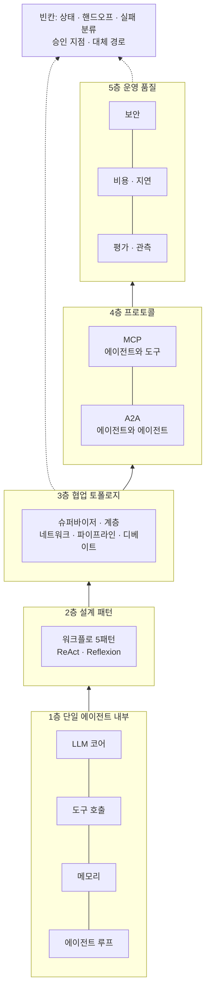
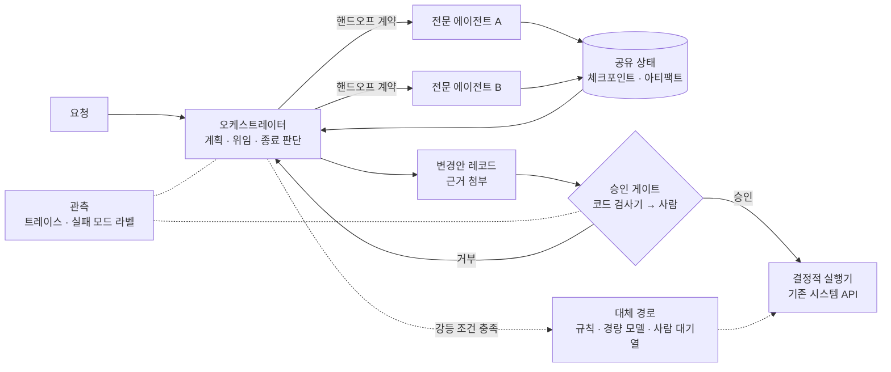

## 0. 흩어진 글을 한 장으로

이 블로그에는 에이전트 이야기가 열 편 넘게 쌓였다. 단일 에이전트의 부품, 설계 패턴, 메모리, 평가, 프로토콜, 보안, 비용을 따로 다뤘다. 각 글은 자기 주제 안에서는 닫혀 있지만, 여러 에이전트를 실제로 묶어 운영하는 시스템을 그리려고 하면 어느 글이 어느 층에 해당하는지, 그리고 층과 층 사이에 무엇이 비어 있는지가 잘 보이지 않는다.

이 글은 공부하며 정리한 스터디 노트다. 앞부분에서 기존 글을 한 장의 지도로 묶고, 본론에서는 지도에 빈칸으로 남아 있던 다섯 가지를 채운다. 오케스트레이터의 상태와 재개, 에이전트 사이의 핸드오프, 실패의 분류, 사람 승인 지점과 자율성 단계, 장애 때의 규칙 기반 대체 경로다. 마지막에는 이것들을 하나의 참조 아키텍처로 합친다.

> **멀티에이전트 설계에서 비어 있기 쉬운 자리는 에이전트 사이와 에이전트 바깥이다. 상태를 어디에 두고, 무엇을 넘기고, 누가 멈추고, 실패하면 어디로 빠지는가.**

## 1. 지금까지 쓴 것의 지도

기존 글을 아래에서 위로 쌓으면 다섯 층이 된다.


*그림 1. 기존 글을 다섯 층으로 쌓은 지도. 점선은 이 글이 채우는 빈칸이 걸치는 층이다.*

| 층 | 글 | 그 글에서 정리한 것 |
|---|---|---|
| 1 | [에이전트의 내부 구조](/building-with-ai/agent-01-architecture/) | 증강 LLM, 도구 호출, 루프, ReAct와 Plan-and-Execute |
| 1 | [에이전트 메모리](/building-with-ai/agent-04-memory/) | 맥락 창의 한계, 메모리 구분, 요약 압축 루프 |
| 2 | [에이전트 설계 패턴 카탈로그](/building-with-ai/agent-03-design-patterns/) | 워크플로 5패턴과 에이전트 패턴, 제어 흐름과 자율성의 두 축 |
| 2 | [에이전트는 단순하게 시작해 평가로 키운다](/building-with-ai/agent-02-build-methodology/) | 복잡도 사다리, 최대 스텝, 승인 게이트와 고무도장 문제 |
| 3 | [멀티에이전트 협업](/building-with-ai/agent-07-multiagent-collaboration/) | 다섯 토폴로지, 슈퍼바이저 코드, 쓰기 단일 스레드 원칙 |
| 3 | [멀티 에이전트가 기본값이 됐다](/thoughts/trend-multi-agent-becomes-default/) | 코딩 도구들이 서브에이전트를 기본 기능으로 넣은 시점 |
| 4 | [MCP 1부](/building-with-ai/mcp-01-protocol-architecture/) | 호스트·클라이언트·서버, 프리미티브, 전송, 핸드셰이크 |
| 4 | [A2A](/building-with-ai/agent-06-a2a-protocol/) | Agent Card, Task 수명주기, 스트리밍과 푸시 |
| 5 | [에이전트 보안](/building-with-ai/agent-08-security/) | lethal trifecta, OWASP LLM Top 10, 다층 방어 |
| 5 | [비용·지연 최적화](/building-with-ai/agent-09-cost-latency-optimization/) | 캐싱, 모델 라우팅, 컨텍스트 압축 |
| 5 | [평가 벤치마크와 관측](/building-with-ai/agent-05-eval-observability/) | 평가 축, LLM-as-judge, OpenTelemetry GenAI 규약 |

빈칸은 3층과 5층 사이에 있다. 토폴로지 글은 "누가 다음에 움직이나"를 다뤘고, 운영 품질 글들은 "잘 돌고 있나"를 다뤘다. 그 사이에서 오래 도는 작업이 중간에 죽으면 어떻게 이어 가는지, 에이전트가 다른 에이전트에게 일을 넘길 때 정확히 무엇을 들려 보내는지, 사람은 어느 지점에 서는지는 아직 정리하지 않았다.

## 2. 빠져 있던 것

### 2-1. 오케스트레이터의 상태와 체크포인트

무엇을 푸는가. 멀티에이전트 작업은 길다. 도구 호출이 수십 번 이어지고 그 사이 어디서든 프로세스가 죽거나 외부 API가 실패한다. Anthropic은 리서치 시스템 글에서 "에이전트는 상태를 가지며 오류는 누적된다"고 적고, 오류가 나면 처음부터 다시 시작하는 대신 "오류가 났던 지점에서 재개할 수 있는 시스템"을 만들었다고 밝힌다. 같은 글은 재시도 로직과 정기 체크포인트 같은 결정적 안전장치를 모델의 적응력과 함께 쓴다고 정리한다.

원리. 체크포인트는 그래프 실행의 특정 시점 상태를 통째로 저장한 스냅샷이다. LangGraph 문서를 기준으로 보면 구조가 구체적으로 보인다.

- 저장 단위는 super-step이다. 한 번의 tick에서 예정된 노드가 (병렬일 수 있게) 모두 실행되고, 그 경계마다 체크포인트가 하나 생긴다
- 체크포인트는 thread로 묶이고 `thread_id`가 기본 키다. 이 값이 없으면 상태를 저장할 수도, 인터럽트 뒤에 재개할 수도 없다
- 한 super-step 안에서 어떤 노드가 실패하면, 같은 단계에서 성공한 다른 노드의 쓰기(pending writes)를 따로 저장해 재개 때 성공한 노드를 다시 돌리지 않는다
- `update_state`로 상태를 고치면 원래 체크포인트를 바꾸지 않고 새 체크포인트를 만든다. 과거 지점에서 갈래를 내는 것(fork)이 이 방식이다

저장 시점은 성능과 맞바꾸는 선택이다. LangGraph의 세 가지 durability 모드가 그 선택지를 보여 준다.

| 모드 | 언제 저장하나 | 대가 |
|---|---|---|
| `exit` | 실행이 끝날 때만 (성공, 오류, 인터럽트) | 가장 빠르지만 실행 중 프로세스가 죽으면 중간 상태가 없다 |
| `async` | 다음 단계를 실행하는 동안 비동기로 | 성능과 내구성의 절충, 충돌 시 일부 체크포인트 유실 가능 |
| `sync` | 다음 단계 시작 전에 동기로 | 모든 체크포인트가 기록되지만 성능 부담이 있다 |

언제 쓰고 언제 안 쓰나. 몇 초 안에 끝나는 한 번짜리 질의에는 체크포인트가 저장 비용만 늘린다. 실행이 분 단위를 넘거나, 사람 승인을 기다리며 멈춰야 하거나, 외부 시스템을 호출하는 단계가 있으면 필요하다. 주의할 점이 하나 있다. 과거 체크포인트에서 재실행(replay)하면 그 뒤 노드의 LLM 호출과 API 요청이 다시 일어난다. 체크포인트가 상태를 되돌려 줘도 바깥 세계에 이미 낸 부작용까지 되돌리지는 못한다. 그래서 재개 가능한 설계는 외부 쓰기를 멱등(같은 요청을 여러 번 보내도 결과가 한 번과 같음)하게 만드는 일과 짝을 이룬다.

장기 실행 중 배포도 같은 문제다. Anthropic은 실행 중인 에이전트를 깨지 않으려고 구버전과 신버전을 함께 띄워 두고 트래픽을 서서히 옮기는 rainbow 배포를 쓴다고 적었다.

### 2-2. 핸드오프와 컨텍스트 전달

무엇을 푸는가. 에이전트 A가 B에게 일을 넘길 때 무엇을 같이 넘기는가. 너무 적게 넘기면 B가 A의 전제를 모르고, 너무 많이 넘기면 맥락 창이 차고 비용이 는다.

원리. 공개 문서에서 확인되는 방식은 셋으로 나뉜다.

| 방식 | 무엇을 넘기나 | 공개 사례 | 맞는 경우 |
|---|---|---|---|
| 전체 이력 이양 | 지금까지의 대화 전부 | OpenAI Agents SDK handoff 기본값 | 대화형 분기, 전문 에이전트가 사용자 응대를 이어받을 때 |
| 필터·요약 이양 | 걸러 낸 이력 또는 요약 | SDK의 `input_filter`, `nest_handoff_history`(베타) | 도구 결과 등 불필요한 이력을 덜어 낼 때 |
| 참조 이양 | 결과물은 외부 저장소에, 넘기는 건 참조 | Anthropic 아티팩트 패턴 | 코드·보고서처럼 큰 산출물이 오갈 때 |

OpenAI Agents SDK에서 handoff는 모델에게 도구로 보인다. Refund Agent로 넘기는 handoff는 `transfer_to_refund_agent`라는 이름의 도구가 된다. 기본 동작은 새 에이전트가 이전 대화 전체를 본 채 대화를 이어받는 것이고, 이를 바꾸려면 `input_filter`를 단다. `input_type`으로 넘기는 순간에 이유·우선순위 같은 작은 메타데이터를 스키마로 받게 할 수도 있다.

같은 SDK 문서는 위임을 두 갈래로 구분한다. agents-as-tools는 매니저가 대화의 주도권을 쥔 채 전문 에이전트를 도구처럼 부르고, handoff는 선택된 전문 에이전트가 그 턴의 나머지를 소유한다. 최종 답의 책임과 공통 가드레일을 한곳에 두려면 앞쪽, 라우팅 자체가 흐름의 일부면 뒤쪽이다.

Anthropic의 리서치 시스템은 세 번째 방식을 쓴다. 서브에이전트가 결과를 외부 시스템에 저장하고 오케스트레이터에는 가벼운 참조만 돌려준다. 여러 단계를 거치며 정보가 새는 것과 큰 출력을 대화 이력으로 복사하는 토큰 낭비를 함께 줄이려는 것이다. 위임 지시의 내용도 구체적이다. 각 서브에이전트에게 목표, 출력 형식, 사용할 도구와 출처에 대한 안내, 명확한 작업 경계를 줘야 하며, 이것이 없으면 작업이 중복되거나 빈틈이 생긴다고 적었다.

이 네 요소를 넘김 계약으로 굳히면 다음과 같은 모양이 된다. 이 코드는 핸드오프를 자유 문장이 아닌 검사 가능한 구조로 만든다는 점을 보이려는 예시다.

```python
from dataclasses import dataclass, field

@dataclass
class HandoffPacket:
    objective: str            # 이번 위임의 목표 한 문장
    output_schema: dict       # 돌려받을 형식 (필드 이름과 타입)
    allowed_tools: list[str]  # 쓸 수 있는 도구와 출처 범위
    boundary: str             # 하지 말아야 할 것, 끝나는 조건
    artifact_refs: list[str] = field(default_factory=list)  # 큰 자료는 본문 대신 참조로

def validate(p: HandoffPacket) -> None:
    # 비어 있는 칸이 있으면 위임하지 않는다 (작업 중복·빈틈 방지)
    for name in ("objective", "boundary"):
        if not getattr(p, name).strip():
            raise ValueError(f"handoff 거부: {name} 누락")
```

### 2-3. 실패의 분류

무엇을 푸는가. 멀티에이전트가 틀렸을 때 "모델이 부족했다"로 끝내면 고칠 곳이 없다. 실패를 분류해야 어느 층을 고칠지 정해진다.

Cemri 등의 「Why Do Multi-Agent LLM Systems Fail?」(2025)은 이 분류를 MAST(Multi-Agent System Failure Taxonomy)로 제시한다. 5개 프레임워크에서 모은 실행 기록 150개를 전문가 여섯 명이 분석해 14개 실패 모드를 3개 범주로 묶었고, 주석자 간 일치도는 Cohen's κ = 0.88이었다. 이후 o1 기반 LLM 주석기를 만들어(사람과의 일치도 κ = 0.77) 7개 프레임워크의 기록 1600여 개에 라벨을 붙인 데이터셋도 공개했다. 아래 비율은 논문 4절에 실린 값이다.

| 범주 | 실패 모드 (비율) | 고칠 층 |
|---|---|---|
| FC1 시스템 설계 문제 | 과업 명세 불이행 11.8%, 역할 명세 불이행 1.5%, 단계 반복 15.7%, 대화 이력 손실 2.8%, 종료 조건 인지 실패 12.4% | 역할·종료 조건·상태 관리 설계 |
| FC2 에이전트 간 불일치 | 대화 리셋 2.2%, 확인 질문 안 함 6.8%, 과업 이탈 7.4%, 정보 보류 0.85%, 다른 에이전트 입력 무시 1.9%, 추론과 행동 불일치 13.2% | 핸드오프 계약과 공유 상태 |
| FC3 과업 검증 | 조기 종료 6.2%, 검증 없음·불완전 8.2%, 잘못된 검증 9.1% | 검증 게이트 |

범주별로 내가 더해 보면 FC1이 약 44%, FC2가 약 32%, FC3이 약 24%다. 논문의 결론은 이 실패가 기반 모델의 한계만으로 설명되지 않는다는 것이다. 저자들은 기반 모델이 좋아지는 것만으로는 MAST 전체를 해결하기에 부족할 것이라고 추정한다. 개입 실험도 같은 방향이다. ChatDev에서 CEO 에이전트가 최종 결정권을 갖도록 흐름을 고치자 과업 성공률이 9.4% 올랐고, 상위 수준의 목표 검증 단계를 넣자 15.6% 올랐다. 같은 모델을 그대로 두고 얻은 개선이다. 다만 저자들은 모든 실패 모드가 해소되지는 않았고 완료율은 여전히 낮다고 덧붙였다.

이 표를 설계 점검표로 쓰는 방법은 단순하다. FC1은 2-1절의 상태 관리와 종료 조건으로, FC2는 2-2절의 핸드오프 계약으로, FC3은 다음 절의 승인·검증 게이트로 대응한다. 다만 비율은 논문이 다룬 프레임워크와 과업(코딩, 수학, 일반 에이전트 과업)에서 나온 분포이므로 내 시스템의 분포는 직접 라벨을 붙여 봐야 안다.

### 2-4. 사람 승인 지점과 자율성 단계

무엇을 푸는가. 승인 게이트를 어디에 걸지는 [빌드 방법론 글](/building-with-ai/agent-02-build-methodology/)과 [보안 글](/building-with-ai/agent-08-security/)에서 외부 상태 변경·금전·대외 발신 기준으로 다뤘다. 여기서는 그 게이트를 기술적으로 어떻게 멈추고 재개하는지, 그리고 자율성을 몇 단계로 나눌지를 본다.

멈추고 재개하는 원리는 체크포인트 위에 있다. LangGraph의 `interrupt()`는 그래프를 특정 지점에서 멈추고 외부 입력을 기다린다. 체크포인터와 `thread_id`가 필수이고, 재개는 `Command(resume=...)`로 하며 넘긴 값이 `interrupt()`의 반환값이 된다. 여기서 놓치기 쉬운 규칙이 있다. 재개할 때 런타임은 인터럽트가 있던 노드를 처음부터 다시 실행한다. 그래서 `interrupt()` 앞에 둔 부작용은 멱등이어야 하고, 문서는 부작용을 인터럽트 뒤로 옮기거나 별도 노드로 떼어 내라고 권한다.

OpenAI Agents SDK는 도구 쪽에서 건다. 도구에 `needs_approval`을 지정하면 실행이 멈추고 대기 중인 승인이 `interruptions`로 올라온다. `RunState`를 `to_json()`으로 직렬화해 DB나 큐에 넣어 두었다가 나중에 복원해 `approve`나 `reject`로 이어 간다. 문서는 복원 함수가 스냅샷이나 제출자를 인증하지 않으니 신뢰할 수 있는 저장소의 스냅샷만 복원하라고 경고한다. 승인 대기 상태 자체가 공격면이 된다는 뜻이다.

자율성 단계는 Feng 등의 「Levels of Autonomy for AI Agents」(2025)가 사용자의 역할로 다섯 단계를 정의한다. 운영자(operator), 협업자(collaborator), 자문자(consultant), 승인자(approver), 관찰자(observer)다. 승인자 단계에서는 에이전트가 스스로 풀 수 없는 장애물을 만났을 때만 사용자가 개입한다. 이 논문은 자율성을 능력과 별개로 설계할 수 있는 속성으로 보고, 에이전트가 운영될 수 있는 최대 단계를 정해 주는 autonomy certificate라는 거버넌스 장치도 제안한다.

내가 정리한 설계 원칙은 같은 생각을 업무 단위 승격 규칙으로 바꾼다.

| 단계 | AI가 하는 것 | 사람이 하는 것 | 다음 단계로 올리는 조건 |
|---|---|---|---|
| L0 조회 | 자료 찾기 | 판단과 작성 전부 | 없음 |
| L1 초안 | 초안과 근거 제시 | 검토·수정·승인 | 시작 기본값 |
| L2 승인 실행 | 초안, 승인되면 자동 실행 | 승인만 | L1 채택률이 기준 이상 |
| L3 조건부 자동 | 조건 충족분 자동, 예외만 상신 | 예외 처리 | L2 오류율이 목표 이하 |
| L4 완전 자동 | 전부 자동, 사후 표본 감사 | 감사 | L3 무사고 기간 충족 |

핵심은 단계를 업무 단위로 매기고, 측정된 오류율로만 올린다는 점이다. 한 시스템 안에 L1 업무와 L3 업무가 같이 있는 것이 정상이다.

### 2-5. 장애 시 규칙 기반 대체 경로

무엇을 푸는가. 모델 API가 멈추거나, 검증이 연속으로 실패하거나, 비용 한도를 넘었을 때 시스템이 어디로 빠지는가. 대체 경로가 없으면 선택지는 무한 재시도이거나 전체 정지다.

원리. 대체 경로는 "AI가 판단하고 실행은 결정적 코드가 한다"는 분리가 있을 때 자연스럽게 생긴다. 실행 경로가 원래 규칙 기반이면 AI 판단층이 빠져도 실행층은 남는다. 강등은 보통 세 칸으로 나눈다.

1. 정상: 오케스트레이터와 전문 에이전트가 판단하고 승인 게이트를 거쳐 실행
2. 축소: 실패한 에이전트 대신 결정 규칙(키워드 라우팅, 표 조회, 임계값 판정)이나 경량 모델로 처리하고 결과에 축소 모드 표시
3. 수동: 작업을 사람 대기열로 넘기고 체크포인트에 멈춤 사유를 기록

강등 조건은 코드로 고정한다. 연속 실패 횟수, 단계별 타임아웃, 작업당 토큰 예산, 검증 실패가 대표적인 트리거다. Anthropic이 적은 대로 도구가 실패하고 있다는 사실을 에이전트에게 알려 스스로 우회하게 하는 방법도 잘 동작하지만, 그것은 정상 칸 안에서의 회복이다. 칸을 내려가는 결정은 모델 바깥에 둔다. 아래 코드는 그 결정이 LLM 호출 없이 숫자로만 내려진다는 점을 보이려는 예시다.

```python
MAX_FAILS = 3            # 연속 실패 허용 횟수 (사람이 정하는 임계값)
TOKEN_BUDGET = 200_000   # 작업당 토큰 예산 (사람이 정하는 임계값)

def choose_route(stats) -> str:
    # 강등 판단은 모델에게 묻지 않는다. 숫자로만 정한다
    if stats.consecutive_fails >= MAX_FAILS or stats.tokens_used > TOKEN_BUDGET:
        return "manual_queue"      # 수동: 사람 대기열 + 체크포인트에 사유 기록
    if stats.agent_unavailable or stats.last_check_failed:
        return "rule_fallback"     # 축소: 결정 규칙·경량 모델로 처리
    return "agent"                 # 정상 경로
```

언제 안 쓰나. 대체 규칙이 원래 판단보다 위험한 업무, 예를 들어 규칙이 틀리면 되돌릴 수 없는 실행이 바로 이어지는 경우에는 축소 칸을 두지 않고 곧장 수동으로 보낸다.

## 3. 참조 아키텍처

지금까지의 빈칸을 하나의 구조로 합친다. 오케스트레이터와 전문 에이전트는 판단만 하고, 그 산출은 변경안 레코드로 공유 상태에 쌓인다. 실행은 승인 게이트를 통과한 뒤 결정적 실행기가 맡는다.


*그림 2. 오케스트레이터, 전문 에이전트, 공유 상태, 승인 게이트, 관측을 묶은 참조 아키텍처. 점선은 장애와 관측 경로다.*

이 구조에 내가 정리한 설계 원칙 네 가지를 대응시키면 각 부품이 왜 있는지가 정해진다.

| 설계 원칙 | 구조에서의 자리 | 대응하는 빈칸 |
|---|---|---|
| AI는 판단하고 실행은 규칙이 한다 | 변경안 레코드와 결정적 실행기의 분리, 운영 DB 직접 쓰기 금지 | 2-5 대체 경로 |
| 자율성은 측정 뒤에 올린다 | 승인 게이트의 통과 기준을 업무별 L0~L4로 설정 | 2-4 승인 지점 |
| 근거 없는 출력은 산출물로 인정하지 않는다 | 변경안 레코드에 근거 위치 필수, 없으면 게이트에서 반려 | 2-3 FC3 검증 |
| 금기는 코드로 막는다 | 게이트 앞단의 코드 검사기, 핸드오프 계약 검증 | 2-2 핸드오프 |

관측은 [평가·관측 글](/building-with-ai/agent-05-eval-observability/)의 트레이스를 그대로 쓰되 한 가지를 더한다. 실패한 실행에 MAST 범주 라벨을 붙여 두면 어느 층을 고칠지가 데이터로 나온다. 단계 반복과 종료 인지 실패가 많으면 오케스트레이터의 종료 조건을, 추론과 행동 불일치가 많으면 핸드오프 계약을 먼저 본다.

## 4. 도구에 맡길 것과 사람이 정할 것

체크포인터를 붙이고, `interrupt()`나 `needs_approval`로 승인 대기를 만들고, 핸드오프 스키마와 강등 함수를 짜는 일은 코딩 에이전트가 거의 자동으로 한다. 위 두 코드도 골격만 보면 몇 분짜리 작업이다.

도구가 대신 정하지 못하는 것은 그 코드에 들어갈 기준이다. 체크포인트를 어느 durability 모드로 둘지는 작업이 중간에 죽었을 때 감당할 손실로 정한다. 핸드오프 계약의 경계 칸에 무엇을 적을지, 큰 자료를 본문으로 넘길지 참조로 넘길지는 업무의 성격이 정한다. 승인 게이트를 어느 업무에 걸고 L1에서 L2로 올리는 채택률 기준을 몇으로 둘지, 연속 실패 몇 번에서 수동으로 내릴지, 토큰 예산을 얼마로 둘지도 모두 사람이 정하는 임계값이다. 그리고 그렇게 만든 시스템의 실패를 MAST 같은 분류로 라벨링해 기준이 맞았는지 다시 확인하는 일이 남는다.

멀티에이전트에서 무엇을 만들지 정의하는 일은 이 임계값과 경계를 적는 일이고, 결과를 검증하는 일은 실패를 분류해 그 숫자를 고치는 일이다.

---

## 참고

- Hadfield, J., Zhang, B., Lien, K., Scholz, F., Fox, J., Ford, D. (2025). How we built our multi-agent research system. Anthropic Engineering. https://www.anthropic.com/engineering/multi-agent-research-system
- Cemri, M., Pan, M. Z., Yang, S., Agrawal, L. A., Chopra, B., Tiwari, R., Keutzer, K., Parameswaran, A., Klein, D., Ramchandran, K., Zaharia, M., Gonzalez, J. E., Stoica, I. (2025). Why Do Multi-Agent LLM Systems Fail? arXiv:2503.13657v3. https://arxiv.org/abs/2503.13657
- Feng, K. J. K., McDonald, D. W., Zhang, A. X. (2025). Levels of Autonomy for AI Agents. arXiv:2506.12469v2. https://arxiv.org/abs/2506.12469
- LangChain (n.d.). Checkpointers. LangGraph 공식 문서. https://docs.langchain.com/oss/python/langgraph/checkpointers (2026-10-22 열람)
- LangChain (n.d.). Interrupts. LangGraph 공식 문서. https://docs.langchain.com/oss/python/langgraph/interrupts (2026-10-22 열람)
- OpenAI (n.d.). Handoffs. OpenAI Agents SDK 문서. https://openai.github.io/openai-agents-python/handoffs/ (2026-10-22 열람)
- OpenAI (n.d.). Agent orchestration. OpenAI Agents SDK 문서. https://openai.github.io/openai-agents-python/multi_agent/ (2026-10-22 열람)
- OpenAI (n.d.). Human-in-the-loop. OpenAI Agents SDK 문서. https://openai.github.io/openai-agents-python/human_in_the_loop/ (2026-10-22 열람)
