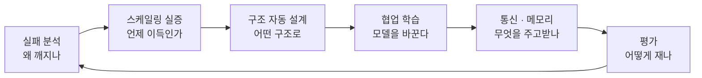

## 왜 논문 쪽을 따로 정리하나

멀티에이전트를 실무에서 어떻게 엮는지는 앞서 [멀티에이전트 협업 - 토폴로지, 조정 비용, 그리고 언제 독이 되나](/building-with-ai/agent-07-multiagent-collaboration/)에서, 도구 생태계가 왜 한꺼번에 멀티에이전트로 움직였는지는 [트렌드 글](/thoughts/trend-multi-agent-becomes-default/)에서 다뤘다. 그 글들이 기댄 근거는 대부분 기업 엔지니어링 블로그였다. "이 회사는 이렇게 해서 잘 됐다"는 사례다.

사례는 조건을 통제하지 않는다. 같은 모델과 예산에서 구조만 바꾼 비교는 논문에서 나온다. 이 글은 2025년부터 2026년 10월까지의 연구를 주제별로 묶어 읽은 스터디 노트다. 실험을 직접 돌리지는 않았고, 원문에서 문제, 방법, 수치, 한계를 옮긴 뒤 실무 시사점을 덧붙인다.

여섯 갈래로 나눴다. 갈래끼리는 하나의 순환으로 이어진다.


*그림. 이 글이 다루는 여섯 연구 갈래와 서로 넘겨주는 질문.*

## 1. 실패 분석: 멀티에이전트는 왜 깨지는가

### MAST (Cemri 외, 2025)

UC Berkeley 팀의 "Why Do Multi-Agent LLM Systems Fail?"은 출발점이 솔직하다. 멀티에이전트의 성능 이득이 단일 에이전트나 best-of-N 샘플링(같은 질문을 N번 풀게 해 가장 나은 답을 고르는 방식) 같은 단순 기준선에 비해 작다는 것이다. 실제로 7개 오픈소스 멀티에이전트 프레임워크의 실패율이 41%에서 86.7%였다.

방법은 질적 연구에 가깝다. 평균 1만 5천 줄이 넘는 실행 트레이스 150여 개를 근거이론(Grounded Theory, 데이터에서 범주를 귀납적으로 뽑아내는 질적 분석법)으로 읽어 실패 모드를 뽑았고, 주석자 간 일치도 κ=0.88을 확인했다. 결과가 14개 실패 모드, 3개 범주로 된 분류 체계 MAST다. 이후 o1 기반 LLM 판정기(사람과의 일치도 κ=0.77)로 1642개 트레이스에 라벨을 붙여 데이터셋으로 공개했다.

| 범주 | 비중 | 대표 실패 모드 (비중) |
|---|---|---|
| 시스템 설계 문제 | 44.2% | 단계 반복 15.7%, 종료 조건 인지 실패 12.4%, 과업 명세 불이행 11.8% |
| 에이전트 간 불일치 | 32.3% | 추론과 행동 불일치 13.2%, 과업 이탈 7.4%, 명확화 요청 없이 진행 6.8% |
| 과업 검증 | 23.5% | 잘못된 검증 9.1%, 검증 누락 8.2%, 조기 종료 6.2% |

두 대목을 적어 둔다. 에이전트 간 불일치는 MCP나 A2A로 메시지 형식을 표준화해도 남는다. 같은 프레임워크 안의 자연어 대화에서도 생기므로, 저자들은 상대 에이전트의 정보 요구를 모델링하지 못하는 문제로 본다. 그리고 검증자는 컴파일 여부나 TODO 주석 같은 표면만 본다. 체스 프로그램이 검토를 통과했는데 실제 규칙과 어긋난 사례가 그 예다.

개입 실험도 있다. ChatDev에서 역할 명세를 고치자 ProgramDev-v0 성공률이 25.0%에서 34.4%로, 토폴로지를 DAG에서 순환 그래프로 바꿔 CTO 에이전트가 모든 검토 충족을 확인할 때만 끝나게 하자 40.6%로 올랐다. 모델은 그대로였다. 저자들도 개입 후 성공률이 여전히 낮고, MAST가 모든 실패를 덮지는 않는다고 적는다.

### Who&When (Zhang 외, ICML 2025)

MAST가 "어떤 종류로 깨지나"를 분류했다면, 이 논문은 "누가, 몇 번째 단계에서 깨뜨렸나"를 자동으로 짚을 수 있는지를 묻는다. 127개 멀티에이전트 시스템의 실패 로그에 책임 에이전트와 결정적 오류 단계를 주석한 Who&When 데이터셋을 만들고, LLM에게 세 방식으로 로그를 보여 줬다.

- all-at-once: 로그 전체를 한 번에 주고 책임 에이전트와 단계를 묻는다
- step-by-step: 한 단계씩 보여 주며 이 단계에 실수가 있는지 묻는다
- binary search: 로그의 앞 절반과 뒤 절반 중 어디에 오류가 있는지 반복해 좁힌다

최고 성능이 에이전트 식별 53.5%, 단계 식별 14.2%였고, o1과 DeepSeek R1도 실용 수준에 못 미쳤다. 실패 원인 추적은 아직 사람이 로그를 읽는 일이다. 에이전트 수준에서는 all-at-once가, 단계 수준에서는 step-by-step이 나았다.

## 2. 언제 여러 에이전트가 이득인가: 스케일링 실증

### Towards a Science of Scaling Agent Systems (Kim 외, 2025, v3 2026)

Google Research, Google DeepMind, MIT 공동 연구다. 기존 비교 연구와 달리 프롬프트, 도구, 연산 예산을 맞춰 구조의 효과만 남겼다. 비교 대상은 Single과 멀티에이전트 넷이다. Independent(각자 집계자에게만 보고), Centralized(오케스트레이터와만 통신), Decentralized(전원 상호 통신), Hybrid(오케스트레이터에 제한적 동료 통신 추가)다.

이를 OpenAI, Google, Anthropic 세 모델 계열과 BrowseComp-Plus, Finance-Agent, PlanCraft, Workbench, SWE-bench Verified, Terminal-Bench 여섯 벤치마크에 걸쳐 260개 구성으로 돌렸다. 효율, 오류 증폭 계수, 메시지 밀도, 중복도를 설명 변수로 넣은 혼합효과 회귀 모델은 교차검증 R²=0.373이고, 보류해 둔 구성의 87%에서 최적 아키텍처를 맞혔다.

핵심 결과는 세 가지 패턴이다.

- 능력 천장: 단일 에이전트 정확도가 이미 45%를 넘는 작업에서는 에이전트를 더해도 수익이 음수였다(β=-0.236)
- 도구와 조정의 상충: 16개 도구를 쓰는 업무형 작업처럼 도구가 많을수록 조정 비용이 커졌다(β=-0.096). 에이전트별 토큰 예산이 쪼개져 도구 호출을 감당할 여력이 줄기 때문이다
- 오류 증폭: 검증 병목이 없는 Independent는 트레이스 수준 오류를 17.2배 증폭했고, Centralized는 4.4배로 억눌렀다

단일 에이전트 대비 상대 성능은 분해 가능한 재무 분석(Centralized)의 +80.8%부터 순차 계획(Independent)의 -70.0%까지 퍼졌다. 순차적 제약 충족이 필요한 계획 작업에서는 모든 멀티에이전트 변형이 39~70% 떨어졌고, 탐색 공간을 병렬로 훑는 웹 탐색에서는 Decentralized가 +9.2%를 냈다.

한계도 있다. 에이전트 수는 9개까지만 예비로 늘렸고, 그 안에서도 통신 오버헤드가 초선형으로 늘었다. 서로 다른 모델을 섞어 천장을 넘을 수 있는지도 봤는데, 중앙집중형 이질 구성은 강한 모델만으로 짠 구성보다 평균 12.6%p 낮았다. R²=0.373은 성능 분산의 상당 부분이 아직 설명되지 않는다는 뜻이기도 하다.

> **에이전트 수가 아니라 작업 구조와 조정 구조의 정렬이 성패를 가른다. 단일 에이전트가 이미 45%를 넘기면 에이전트 추가는 비용이 된다.**

## 3. 구조를 사람이 설계하지 않는다: 워크플로 자동 탐색

### ADAS (Hu, Lu, Clune, ICLR 2025)

ADAS(Automated Design of Agentic Systems)는 에이전트 설계 자체를 학습 대상으로 본다. 에이전트를 코드로 정의하면, 메타 에이전트가 지금까지 찾은 에이전트 아카이브를 참고해 새 에이전트 코드를 쓰고, 평가 점수와 함께 아카이브에 추가하는 루프를 돈다. 이 알고리즘이 Meta Agent Search다.

결과는 수작업 설계 기준선 대비 DROP 독해 F1 +13.6, MGSM 수학 정확도 +14.4%였다. 수학에서 찾은 에이전트를 GSM8K와 GSM-Hard로 옮겨도 각각 +25.9%, +13.2%를 유지했다. 모델이 생성한 코드를 실행하는 구조라서 저자들은 모든 코드를 격리 컨테이너에서 돌리고 수동 점검을 했다.

### AFlow (Zhang 외, ICLR 2025)

AFlow는 같은 문제를 탐색 문제로 다시 쓴다. LLM 호출 노드를 엣지로 이은 코드 워크플로가 탐색 공간이고, 이를 몬테카를로 트리 탐색(MCTS)으로 훑는다. 탐색 효율을 위해 Ensemble, Review & Revise 같은 자주 쓰는 조합을 Operator라는 재사용 블록으로 미리 넣어 둔다.

여섯 데이터셋에서 수작업 설계 대비 평균 5.7%, 당시 자동 워크플로 최적화 방법 대비 19.5% 높았다. 작은 모델로 짠 워크플로가 특정 작업에서 GPT-4o를 그 추론 비용의 4.55%로 앞섰다는 결과도 있다.

두 방법의 공통 전제는 채점 가능한 검증 데이터다. AFlow는 데이터를 검증 20%, 테스트 80%로 나누고 점수 분산이 큰 문제만 검증셋으로 남긴다. 정답을 자동으로 매길 수 없는 업무에는 이 루프를 바로 걸 수 없다.

```python
# AFlow식 탐색의 뼈대 (원리 설명용 의사 코드)
tree = [blank_workflow]
for round in range(N_MAX):
    parent = select(tree)                    # 점수와 탐색 여지를 섞어 확률적으로 고른다
    child = llm_modify(parent, operators)    # LLM이 코드 수준에서 워크플로를 고친다
    score = evaluate(child, validation_set)  # 사람이 정한 검증셋 점수가 유일한 신호
    tree.append((child, score))              # 경험을 트리에 쌓아 다음 선택에 반영
```

## 4. 프롬프트가 아니라 모델을 바꾼다: 협업의 강화학습

MAST의 저자들도 기본 LLM이 에이전트 간 상호작용에 맞춰 사전학습되지 않았다고 보고, 표적 학습을 해법 후보로 든다. 아래 두 편은 그 학습을 실제로 해 본 연구다.

### MAPoRL (Park 외, 2025)

여러 LLM이 각자 답을 낸 뒤 여러 턴 토론하고, 검증자가 최종 답의 정답 여부와 토론의 질(상대를 바로잡거나 설득하는 발언)을 함께 채점한다. 이 점수를 보상으로 여러 모델을 다중 에이전트 강화학습으로 동시에 학습시킨다. 실험은 주로 Phi-3-mini로 GSM8K와 ANLI에서 했다.

요지는 모델을 따로 학습시켜서는 협업이 생기지 않는다는 것이다. 학습된 모델에게 토론 없이 문제만 주면 GSM8K 정확도가 학습 전 0.609, 학습 후 0.604와 0.611로 거의 같았다. 지식이 아니라 협업 방식이 바뀌었다는 근거다.

### Stronger-MAS / AT-GRPO (Zhao 외, 2025, v5 2026)

GRPO(Group Relative Policy Optimization)는 같은 프롬프트로 여러 답을 뽑아 그룹 평균과 비교한 상대 점수로 학습한다. 멀티에이전트에서는 역할과 턴마다 프롬프트가 달라서 "같은 그룹"이라는 가정이 깨진다. AT-GRPO는 그룹 키를 환경 e, 에이전트 i, 턴 t의 해시로 잡는다.

```python
# 에이전트·턴 단위 그룹으로 상대 이점을 계산하는 원리
from collections import defaultdict
import statistics as st

groups = defaultdict(list)
for s in samples:                        # s: 한 번의 행동 후보와 보상
    key = (s.env, s.agent, s.turn)       # 같은 환경·같은 역할·같은 턴끼리만 비교
    groups[key].append(s)

for key, g in groups.items():
    mu = st.mean(x.reward for x in g)
    sd = st.pstdev(x.reward for x in g) or 1.0
    for x in g:
        x.advantage = (x.reward - mu) / sd   # 역할이 다른 답끼리 섞어 평균내지 않는다
```

Qwen3 1.7B·8B로 게임, 계획, 코딩, 수학을 학습시켰다. 장기 계획 작업에서 단일 에이전트 RL 기준선 14.0~47.0%가 96.0~99.5%로 올랐고, 코딩은 평균 3.87~7.62%, 수학은 9.0~17.93% 올랐다. 모든 역할이 한 정책을 공유할지 역할마다 따로 둘지는 작업 특성에 따라 달랐다. 실험 환경은 모두 자동 채점기(checker)가 있는 작업이었다는 점도 같이 적어 둔다.

## 5. 무엇을 주고받나: 통신 효율과 공유 메모리

에이전트 간 메시지는 그대로 토큰 비용이다. 이 갈래는 메시지를 줄이거나 형태를 바꾸거나 재사용한다.

| 논문 | 접근 | 보고 수치 | 전제 |
|---|---|---|---|
| AgentPrune (Zhang 외, 2024) | 시공간 메시지 그래프에서 중복 통신을 한 번에 가지치기 | 기존 최고 토폴로지 $43.7 대비 $5.6로 비슷한 결과, 토큰 28.1~72.8% 감소 | 기존 프레임워크에 끼워 넣는 방식 |
| LatentMAS (Zou 외, ICML 2026) | 텍스트 대신 마지막 층 은닉 표현으로 생각하고 KV cache를 공유 작업 메모리로 전달, 학습 불필요 | 9개 벤치마크에서 정확도 최대 +14.6%, 출력 토큰 70.8~83.7% 감소, 4~4.3배 빠름 | 모든 에이전트가 같은 층 구조(실험은 Qwen3 계열) |
| G-Memory (Zhang 외, 2025) | 통찰·질의·상호작용 3층 그래프에 협업 궤적을 저장하고 새 질의 때 위아래로 탐색 | 체화 행동 성공률 최대 +20.89%, 지식 QA 정확도 최대 +10.12%, 기존 프레임워크 무수정 | 과거 질의의 성공·실패 상태를 기록 |

LatentMAS는 이 중 가장 급진적이다. 사람이 읽을 수 있는 메시지가 사라지므로 토큰은 크게 줄지만, 에이전트끼리 무엇을 넘겼는지 로그로 검토할 수 없다. 실패 추적을 사람이 로그로 해야 하는 지금은 디버깅 비용이 커지는 방향이기도 하다. 서로 다른 모델 사이에서는 학습 가능한 어댑터가 필요하다고 저자들도 적는다.

G-Memory는 기존 멀티에이전트 메모리가 협업 궤적을 버린다는 문제에서 출발한다. 과거 질의마다 Failed·Resolved 상태를 붙여 두는 설계라 실패 분류 기록과 잇기 좋다.

## 6. 어떻게 재나: 멀티에이전트 전용 평가

단일 에이전트 벤치마크 일반론은 [에이전트 평가와 관측](/building-with-ai/agent-05-eval-observability/)에서 다뤘다. 멀티에이전트에서는 과업 완료만으로는 협업 품질을 알 수 없다는 문제가 추가된다.

MultiAgentBench(Zhu 외, 2025)는 협업 시나리오 넷(공동 연구 기획안 작성, Minecraft 공동 건축, 다섯 에이전트가 원인을 하나씩 맡는 DB 오류 분석, 코딩)과 경쟁 시나리오(Werewolf, Bargaining 등)를 묶었다. 최종 과업 점수 외에 중간 마일스톤 달성으로 기여를 재는 KPI와 소통·계획 점수를 따로 낸다. star, chain, tree, graph 네 조정 프로토콜을 비교했고, 연구 시나리오에서는 graph 구조가 가장 좋았다. cognitive planning은 마일스톤 달성률을 3% 올렸다.

에이전트 수 실험 결과가 2절과 같은 방향이다. 연구 시나리오에서 1, 3, 5, 7개로 늘리자 종합 KPI가 떨어졌다. 1개에서 3개로 갈 때 조정 점수는 크게 올랐지만 과업 점수는 완만했다.

## 축별 비교

| 연구 축 | 대표 논문 | 핵심 주장 | 실무 시사점 |
|---|---|---|---|
| 실패 분석 | MAST (2025), Who&When (2025) | 실패의 44.2%가 설계 문제, 23.5%가 검증 문제. 원인 단계 자동 식별은 14.2% | 실패 로그를 14개 모드로 분류해 쌓는다 |
| 스케일링 실증 | Scaling Agent Systems (2025~2026) | 단일 정확도 45% 이상이면 에이전트 추가가 손해. Independent 오류 증폭 17.2배 vs Centralized 4.4배 | 단일 기준선부터 재고 중앙 검증을 둔다 |
| 구조 자동 설계 | ADAS (ICLR 2025), AFlow (ICLR 2025) | 메타 에이전트나 MCTS가 수작업 설계를 앞선다(+5.7%, F1 +13.6) | 채점 가능한 검증셋이 전제다 |
| 협업 학습 | MAPoRL (2025), AT-GRPO (2025~2026) | 개별 학습으로는 협업이 안 생긴다. 역할·턴 단위 그룹 RL이 장기 계획을 96~99.5%로 | 자동 채점기가 있는 반복 업무에 한정된다 |
| 통신 · 메모리 | AgentPrune, LatentMAS (ICML 2026), G-Memory | 메시지를 가지치기하거나 잠재 표현으로 바꾸면 토큰 70~80%대 절감 | 토큰 절감과 로그 가독성의 맞교환을 확인한다 |
| 평가 | MultiAgentBench (2025) | 과업 점수와 협업 품질을 따로 재야 한다. 에이전트 수 증가 시 종합 KPI 하락 | 중간 산출물 단위 체크포인트를 만든다 |

## 실무자가 지금 가져갈 것

이 글에서 읽은 논문들은 공통적으로 조건을 따진다. 언제 깨지는지, 몇 개부터 손해인지, 어디서 오류가 증폭되는지를 수치로 잰다.

1. 단일 에이전트 기준선을 먼저 잰다. 그 값이 45% 근처를 넘으면 멀티에이전트로 갈 이유가 약하다
2. 작업이 분해형인지 순차 제약형인지 본다. 재무 분석형은 +80.8%, 순차 계획형은 -70.0%였다
3. 여러 에이전트를 쓰면 결과를 합치기 전에 검증 지점을 둔다. 오류 증폭 17.2배와 4.4배의 차이가 여기서 난다
4. 검증자에게 형식 확인 대신 원래 목표와의 대조를 시킨다. ChatDev 성공률이 이것으로 15.6%p 올랐다
5. 실패 트레이스를 분류해 쌓는다. 자동 원인 추적이 단계 수준 14.2%인 지금 가장 직접적인 설계 재료다

선도 그어진다. 워크플로 탐색, 에이전트 코드 생성, 협업 정책 학습, 메시지 압축은 자동화가 진행 중이다. 그 자동화가 도는 조건은 모두 사람이 만든다. AFlow의 검증셋, AT-GRPO의 자동 채점기, MAPoRL 검증자의 보상, MAST의 실패 정의와 κ=0.88까지의 주석 합의가 그렇다. 무엇을 성공으로 볼지, 어디서 검증할지, 몇 %를 넘으면 구조를 바꿀지를 정의하지 않으면 이 자동화는 걸 곳이 없다.

## 참고

- Mert Cemri, Melissa Z. Pan, Shuyi Yang 외 (2025). Why Do Multi-Agent LLM Systems Fail?. NeurIPS 2025 Datasets and Benchmarks Track. https://arxiv.org/abs/2503.13657
- Shaokun Zhang, Ming Yin 외 (2025). Which Agent Causes Task Failures and When? On Automated Failure Attribution of LLM Multi-Agent Systems. ICML 2025. https://arxiv.org/abs/2505.00212
- Yubin Kim, Ken Gu 외 (2025). Towards a Science of Scaling Agent Systems. arXiv (v3, 2026). https://arxiv.org/abs/2512.08296
- Shengran Hu, Cong Lu, Jeff Clune (2024). Automated Design of Agentic Systems. ICLR 2025. https://arxiv.org/abs/2408.08435
- Jiayi Zhang, Jinyu Xiang 외 (2024). AFlow: Automating Agentic Workflow Generation. ICLR 2025. https://arxiv.org/abs/2410.10762
- Chanwoo Park, Seungju Han, Xingzhi Guo, Asuman Ozdaglar, Kaiqing Zhang, Joo-Kyung Kim (2025). MAPoRL: Multi-Agent Post-Co-Training for Collaborative Large Language Models with Reinforcement Learning. arXiv. https://arxiv.org/abs/2502.18439
- Yujie Zhao, Lanxiang Hu, Yang Wang, Minmin Hou, Hao Zhang, Ke Ding, Jishen Zhao (2025). Stronger-MAS: Multi-Agent Reinforcement Learning for Collaborative LLMs. arXiv (v5, 2026). https://arxiv.org/abs/2510.11062
- Guibin Zhang, Yanwei Yue, Zhixun Li 외 (2024). Cut the Crap: An Economical Communication Pipeline for LLM-based Multi-Agent Systems. arXiv. https://arxiv.org/abs/2410.02506
- Jiaru Zou, Ruizhong Qiu 외 (2025). Latent Collaboration in Multi-Agent Systems. ICML 2026. https://arxiv.org/abs/2511.20639
- Guibin Zhang, Muxin Fu, Guancheng Wan, Miao Yu, Kun Wang, Shuicheng Yan (2025). G-Memory: Tracing Hierarchical Memory for Multi-Agent Systems. arXiv. https://arxiv.org/abs/2506.07398
- Kunlun Zhu, Hongyi Du, Zhaochen Hong 외 (2025). MultiAgentBench: Evaluating the Collaboration and Competition of LLM agents. arXiv. https://arxiv.org/abs/2503.01935
