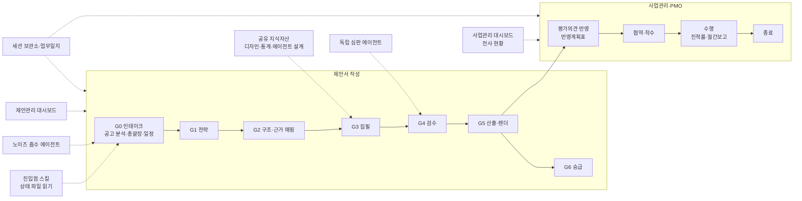

## 1. 왜 솔루션화인가

나는 몇 달 동안 Claude Code로 내 업무를 자동화하는 도구를 만들어 왔다. 대상은 세 가지 업무다. 사업관리(진행 중인 사업의 진척률·산출물·월간보고), PMO(여러 사업을 가로지르는 현황 관리), 제안서 작성(공고 분석부터 제출, 평가의견 반영까지). 지금 세어 보면 스킬 35개, 서브에이전트 10개, 화면이 있는 대시보드 6개, 훅 8개, 공용 스크립트 13개, 공유 지식자산 폴더 9개가 있다.

이 도구들은 매일 쓰인다. 문제는 전부 내 환경 위에서만 돈다는 점이다. 도구를 다른 동료에게 넘기려고 목록을 다시 훑었을 때 바로 걸리는 것들이 있었다.

- 스킬 35개 중 17개가 내 PC의 절대경로를 파일 안에 적고 있다. 파일 단위로는 137개 중 23개다
- 대시보드 포트 번호는 내 메모 파일의 표 하나로 관리된다. 새 대시보드를 만들 때마다 "다음 번호"를 손으로 고른다
- 회의록 스킬은 특정 요일·시각에 열리는 정기회의를 전제로 쓰여 있고, 총괄장 스킬은 "정량 서류는 어느 부서, 정성 서류는 어느 부서" 같은 우리 조직의 분장 규칙을 품고 있다
- 일정 등록·회의록 수집 스크립트는 내 구글 계정 하나로 인증한다

하나하나는 작은 문제다. 모아 놓고 보면 이 도구 묶음은 "나의 PC, 나의 폴더 구조, 나의 규칙"이라는 세 전제 위에 서 있다. 같은 업무를 하는 다른 사람이 쓰려면 이 전제를 하나씩 벗겨 내야 한다. 이 시리즈는 그 작업을 순서대로 기록한다. 1편은 출발점이다. 무엇을 가지고 있고, 어디가 내 환경에 묶여 있는지를 지도로 그리고, 바꿀 항목의 목록을 만든다.

> **개인 도구를 솔루션으로 바꾸는 일은 도구 안에 숨어 있던 "나"를 설정·데이터·규칙으로 꺼내 놓는 일이다.**

## 2. 현재 자산 지도

자산은 성격이 다른 네 종류로 나뉜다. 도구가 늘면서 종류가 섞이는 문제를 겪은 뒤, 나는 이 구분을 운영 문서에 못박았다.

| 종류 | 무엇을 담나 | 예 |
|---|---|---|
| 스킬 | 일을 어떻게 하는지(절차·규칙·스크립트) | 진척률 관리, 총괄장 작성, 평가의견 반영 |
| 서브에이전트 | 별도 컨텍스트에서 일하는 일꾼 | 공고 분석, 근거 대조, 수치 정합 검사 |
| 상설자산 | 끝이 없이 굴러가는 데이터·서비스 | 사업관리 대시보드, 제안관리 대시보드, 공고 추적 DB |
| 연결·훅 | 세션에 붙는 능력과 강제 장치 | 세션 이어보기, 대시(dash) 검사, 공유 저장소 쓰기 차단 |

서브에이전트에는 선정 기준이 하나 있다. 노이즈를 흡수하는 일(수백 쪽 문서나 수십 장의 렌더 이미지를 훑고 결론만 돌려주는 일) 또는 독립적으로 심판하는 일(같은 컨텍스트에서 만든 것을 같은 컨텍스트가 검사하면 관대해지므로 따로 검사하는 일)만 올린다. 규칙 자체를 에이전트로 빼면 메인 세션이 그 규칙을 지키지 않게 되기 때문이다. 이 기준은 에이전트를 만들기 전에 내가 정했다. Claude Code는 이 기준에 맞춰 각 에이전트의 정의 파일을 작성했다.

업무 단계에 이 자산들이 어디 붙는지 그리면 아래와 같다. 제안서 작성은 게이트 G0~G6으로 진행되고, 진입점 스킬이 각 사업 폴더의 상태 파일(`PROJECT.yaml`)을 읽어 지금 단계와 부를 도구를 정한다.


*그림. 업무 단계(실선)와 그 단계에 붙는 스킬·서브에이전트·대시보드·공유자산(점선).*

상위에는 네 층의 규칙 구조가 있다. 모든 세션에 항상 주입되는 전역 규칙 문서(L1), 업무를 만나면 발동하는 스킬(L2), 새 사업을 시작할 때 같은 모양으로 폴더를 만드는 표준 셋업(L3), 정해진 순간에 작동하는 훅(L4)이다. 이 구조와 "어떤 정보는 어디에 저장하고 어디서 읽는가"를 정한 배치표는 운영 문서 한 곳에 모여 있다. 배치표의 판단 기준은 한 줄이다. "이 정보가 다음 사업에도 참인가." 참이면 공유 자산, 이번 건에서만 참이면 사업 폴더로 간다.

## 3. 자산 분류표

솔루션화 관점에서 다시 나눴다. 마지막 열이 이 시리즈의 출발점이다. 로컬 파일을 열어 실제로 확인한 의존 요소만 적었다.

| 유형 | 개수 | 무엇을 자동화하나 | 개인 환경 의존 요소 |
|---|---|---|---|
| 제안서 작성 스킬 | 17 | 공고·제안요청서 분석, 총괄장(제출 서류 관리표), 기획자료, 컨소시엄 과업 분해·회신 취합, 용어 정의, 견적 대장, 본문 집필 틀, 평가의견 반영계획표 | 조직 분장 규칙, 사내 우수 제안서를 기준 문서로 지정, 일부 스크립트의 절대경로 |
| 사업관리·PMO 스킬 | 3 | 게이트 진행, 사업 생애주기 점검, 진척률·산출물·월간보고 | 스킬 안의 PMO 코드가 대시보드 코드의 사본, 상태 파일 위치 규칙 |
| 일상 업무 스킬 | 6 | 업무일지, 회의록, 백로그, 폴더 정리, 엑셀 대장 통합, 새 사업 폴더 생성 | 개인 구글 인증, 정기회의 요일·시각, 세션 기록 경로 |
| 산출물 생성 스킬 | 9 | 발표자료(가로·세로), 기술 도식, 이미지 생성, 큰 문서 검색, 논문 근거 캡처, 문체 교정 | 개인 PC의 GPU·모델 캐시, 공유 디자인 시스템의 절대경로 |
| 서브에이전트 | 10 | 공고 분석, 근거 매핑, 시장 조사, 부품 단가 조사, 렌더 검수, 근거 대조, 평가위원 관점 심사, 수치 정합, 요구사항 추적, 디자인 토큰 감사 | 상대적으로 적음. 공유 자산 폴더 경로를 프롬프트에 적은 것이 있음 |
| 대시보드 | 6 + 허브 1 | 사업관리, 제안관리, 세션 보관, 입찰 결과 분석, 공고 모니터 2종 | 수동 포트 배정, 허브 레지스트리의 절대경로, 동기화 드라이브 위 단일 파일 DB |
| 훅·공용 스크립트 | 8 + 13 | 세션 이어보기, 대시 검사, 공유 저장소 쓰기 차단, 렌더 안전 실행, 자가점검 | 내 전역 규칙 문서에 붙어 있어 규칙과 분리되지 않음 |
| 공유 지식자산 | 9 폴더 | 디자인 시스템, 통계집, 에이전트 설계, 업무일지, 백로그, 대장 통합 도구 | 특정 드라이브 문자를 전제로 한 절대경로 참조 |

표에서 보이는 경향이 있다. 서브에이전트는 의존이 가장 적다. 판단 기준을 프롬프트에 담고 입력을 인자로 받기 때문이다. 반대로 의존이 가장 큰 쪽은 일상 업무 스킬과 대시보드다. 이 둘은 "누가, 어느 계정으로, 어느 폴더를 보는가"가 코드에 섞여 있다.

## 4. 솔루션이 되려면 바뀌어야 하는 것

### 4-1. 설정 분리

가장 먼저 손댈 곳이다. SaaS 형태로 배포되는 앱을 위한 설계 원칙을 정리한 The Twelve-Factor App은 설정(config)을 "배포마다 달라질 가능성이 있는 모든 것"으로 정의하고, 설정과 코드를 엄격히 분리하라고 요구한다. 검사 방법도 제시한다. 코드베이스를 지금 당장 공개해도 자격 증명이 새지 않는가를 묻는다.

이 기준을 내 스킬에 대 보면 17개가 탈락한다. 절대경로는 자격 증명은 아니지만, 다른 PC에서 그 코드가 돌지 않는다는 점에서 같은 결함이다.

반대로 이미 분리가 된 곳도 있다. 사업관리 대시보드와 제안관리 대시보드는 저장소 위치를 설정 파일 하나로 뺐다. 이 코드를 보이는 목적은 "분리했을 때 무엇이 남는가"를 보여 주기 위해서다.

`storage.json` (경로는 일반화)

```json
{
  "type": "local",
  "root": "<저장소 루트>"
}
```

앱 코드는 이 `root` 하나만 읽는다. 환경변수가 있으면 그 값이 우선한다. 파일시스템이 아닌 저장소(예: 객체 저장소)로 갈 때는 `pm_storage.py`의 `Storage` 클래스를 상속해 구현하고 등록하면 나머지 코드는 그대로 둔다. Claude Code가 이 저장소 추상화 코드를 작성했다. 나는 "나중에 회사 서버로 옮긴다"는 조건을 처음에 정했고, 그 조건 때문에 이 구조가 나왔다. Twelve-Factor의 백킹 서비스 항목이 말하는 "로컬 데이터베이스를 외부 관리형으로 바꿔도 앱 코드는 바뀌지 않아야 한다"와 같은 방향이다.

하지만 같은 설정 파일 안에 작업 폴더 목록과 숨길 폴더 이름이 내 폴더명 그대로 들어 있다. 저장소 위치는 분리했지만 "어느 폴더를 훑는가"는 아직 내 것이다. 설정 분리는 한 번에 끝나지 않고 층마다 다시 해야 한다.

### 4-2. 도메인 규칙 분리

스킬 안에는 두 종류의 규칙이 섞여 있다.

- 어느 조직에서도 참인 규칙: 총괄장의 목적은 접수 성공이다, 평가의견은 바로 고치지 않고 반영계획표를 먼저 만들어 승인받는다, 계획과 실적은 같은 기준일끼리 비교한다
- 우리 조직에서만 참인 규칙: 서류 유형별 담당 부서, 정기회의 일정, 경영진 보고용 엑셀의 탭 순서, 공유 저장소의 폴더 이름으로 제안 결과(선정·미선정)를 판정하는 규칙

뒤쪽 규칙은 지금 스킬 본문과 대시보드 코드에 직접 들어 있다. 제안관리 대시보드는 "어느 폴더 아래에 있으면 평가 종료, 이름에 특정 단어가 있으면 선정"이라는 폴더 관례로 상태를 판정한다. 다른 조직은 폴더 관례가 다르다. 이 규칙들을 조직별 프로파일 파일로 빼고, 스킬은 프로파일을 읽어 동작하게 바꿔야 한다.

### 4-3. 데이터 모델과 단일 원천

현재 데이터는 엑셀·YAML·SQLite·JSON에 흩어져 있다. 통합 작업을 시작할 때 세어 보니 사업 목록을 가진 곳이 5곳이었고, 도구 10개 중 버전 관리(git)가 된 것은 1개였다. 사업관리 쪽은 사업 1건의 정본을 사업관리대장 엑셀로 정했고, 제안관리 쪽은 대시보드 안의 SQLite가 정본이다. 그런데 이 SQLite는 동기화 드라이브 위에 있어서 동시 쓰기에 유리한 저널 모드(WAL)를 쓸 수 없다. 혼자 쓸 때는 문제가 없지만, 여러 사람이 쓰는 순간 이 선택이 한계가 된다.

또 하나는 코드 사본이다. 사업관리 대시보드의 PMO 코드와 진척률 스킬 안의 PMO 코드는 같은 파일의 사본이고, README에 "고친 뒤 복사한다"고 적혀 있다. 사본은 반드시 어긋난다. 솔루션이 되려면 도구들이 같은 데이터 계층과 같은 라이브러리를 바라봐야 한다.

### 4-4. 다중 사용자와 권한

지금 모든 도구의 사용자는 한 명이다. 세션 보관소는 내 Claude Code 세션 기록을 읽고, 업무일지도 내 세션 기록에서 그날 한 일을 뽑는다. 일정·회의록 스크립트는 내 구글 계정 토큰으로 인증한다.

권한 규칙은 있다. 공유 저장소는 읽기 전용이고, 쓰기는 사용자가 저장을 명시 요청하고 대상 폴더를 지정하고 직전에 확인받았을 때만 허용한다. 이 규칙을 훅이 강제한다. 하지만 이 규칙은 "나와 공유 저장소" 사이의 규칙이다. "PM은 자기 사업만 편집하고 PMO는 전체를 본다" 같은 역할 기반 권한은 아직 어디에도 없다.

### 4-5. 배포와 설치

대시보드는 배치 파일 하나로 백엔드·프론트엔드 두 프로세스를 띄우고, 허브가 그것들을 켜고 끈다. 새 대시보드를 등록하려면 허브 레지스트리에 작업 폴더 절대경로와 포트를 적는다. 다른 사람이 쓰려면 Python·Node 환경 설치, 포트 충돌 확인, 레지스트리 수정까지 손으로 해야 한다.

통합 작업의 첫 결과물인 통합 점검 도구(workos)는 경로를 설정 파일 한 곳에서만 정하게 만들었고, 다른 PC에서는 그 파일만 고치도록 했다. 도구 14개를 계약 파일 하나에 등록하고, 각 도구가 어디에 쓰는지(`writes`)를 필수 항목으로 선언하게 했다. 이 방향을 대시보드와 스킬 전체로 넓히는 것이 배포 과제다.

### 4-6. 문서화와 검증

스킬마다 SKILL.md가 있고 대시보드마다 README·NOTES가 있다. 그런데 이 문서들은 Claude Code가 읽도록 쓰였다. 트리거 문구와 내부 경로가 많고, 처음 보는 사람을 위한 설치·개념 설명은 없다. 사람용 문서를 따로 만들어야 한다.

검증은 이미 일부 장치가 있다. 통합 점검 도구는 적합도 지표 15종을 측정해 기록하고, 직전보다 나빠지면 실패로 처리하는 래칫(ratchet, 되돌아가지 못하게 거는 기준)을 둔다. 같은 교정을 두 번 하면 검사기나 스킬로 승급할 후보로 표시하는 교정 장부도 있다. 솔루션이 되면 이 지표가 "내 도구가 건강한가"에서 "다른 조직에 설치했을 때도 건강한가"로 범위가 넓어져야 한다.

## 5. 이 시리즈에서 순서대로 기록할 항목

순서는 의존 관계로 정했다. 설정이 분리되지 않으면 데이터 계층을 옮길 수 없고, 데이터 계층이 하나가 아니면 권한을 걸 곳이 없다.

| 순서 | 과제 | 끝났다고 판단할 기준 |
|---|---|---|
| 2편 | 자산 인벤토리와 도구 계약 | 스킬·에이전트·대시보드 전부가 계약 파일에 등록되고 쓰기 위치가 선언됨 |
| 3편 | 설정 분리 | 스킬·대시보드 파일 안 절대경로 0건, 포트·계정은 설정에서만 |
| 4편 | 도메인 규칙 분리 | 조직 규칙이 프로파일 파일로 빠지고, 빈 프로파일로도 스킬이 동작 |
| 5편 | 데이터 모델과 단일 원천 | 사업 목록 원천 1곳, 코드 사본 0건 |
| 6편 | 다중 사용자와 권한 | 역할별 읽기·쓰기 범위가 코드가 아닌 설정으로 정의됨 |
| 7편 | 배포와 설치 | 새 PC에서 설명서만 보고 설치 완료 |
| 8편 | 문서화와 검증 | 사람용 문서 세트, 설치 환경 기준 적합도 측정 |

각 편은 "무엇을 결정했고, Claude Code가 무엇을 만들었고, 내가 무엇을 검증했는가"로 쓴다. 계획대로 안 된 부분도 그대로 적는다.

## 6. 결론: 사용자의 일이 자리 잡는 곳

이 자산들의 코드는 거의 전부 Claude Code가 작성했다. 대시보드의 React 화면, FastAPI 백엔드, 엑셀 생성 스크립트, 저장소 추상화 계층이 모두 그렇다. 이번에 목록을 만들면서 확인한 것은 솔루션화를 가로막는 의존 요소의 출처다. 절대경로, 폴더 관례로 판정하는 규칙, 한 사람 계정으로 하는 인증은 모두 "이 도구를 누가 쓰는가"를 처음에 정의하지 않았기 때문에 생겼다. 내가 "나 혼자 쓴다"고 정의했으니 도구는 그 정의대로 만들어졌다.

거꾸로, 처음부터 정의가 있었던 곳은 이미 분리되어 있다. "나중에 회사 서버로 옮긴다"고 정한 대시보드는 저장소가 설정 한 줄로 바뀐다. "규칙은 에이전트로 빼지 않는다"고 정한 서브에이전트는 환경 의존이 가장 적다.

솔루션화도 같은 방식으로 진행될 것이다. 다른 조직의 사용자가 누구이고, 무엇이 조직마다 다르며, 무엇이 어디서나 참인지를 내가 정의하면, 그 정의를 코드로 옮기는 일은 Claude Code가 한다. 옮긴 결과가 정의대로인지, 다른 PC·다른 계정에서 정말 도는지는 내가 확인한다. 이 시리즈는 그 두 가지 일, 정의와 검증을 비전문가가 끝까지 해 볼 수 있는지에 대한 기록이다.

> **AI 기여도**: 본 글이 다루는 도구들의 코드는 Claude Code가 작성했다. 나는 업무 규칙 정의·구조 결정·검증을 맡았다.
>
> **글 자체의 작성**: 초안 1회(Claude Code, 로컬 파일 근거) / 직접 교정 검토 전.

## 참고

- Adam Wiggins (최종 갱신 2017). The Twelve-Factor App: III. Config. https://12factor.net/config
- Adam Wiggins (최종 갱신 2017). The Twelve-Factor App: IV. Backing services. https://12factor.net/backing-services
