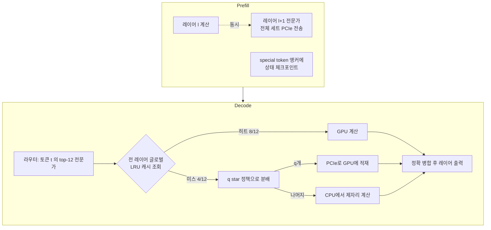

## TL;DR

개인 장비 한 대에서 프런티어급 MoE 모델을 돌리려면 전문가(expert) 가중치를 GPU 메모리 밖에 두고 그때그때 끌어와야 한다. FreeToken은 이 끌어오기를 고정 전략으로 정하지 않고, 그 기계에서 실제로 측정된 PCIe 대역폭과 호스트 메모리 대역폭의 비율에 맞춰 매 토큰 다시 정한다. 그 결과 8GB 랩톱 GPU에서 35B, 게이밍 데스크톱에서 284B, 워크스테이션 GPU 한 장에서 753B GLM-5.2를 실제로 서빙했다. llama.cpp 대비 디코드 1.3~2.1배, 최악 TTFT는 44초 미만(llama.cpp 232초, KTransformers 946초).

- arXiv: 2608.16157, 2026-08-17 제출, cs.DC, 16쪽
- 저자: Shuo Yang, Xiaoze Fan, Melissa Pan, Haocheng Xi, Zhe Wang, Shanlin Sun, Kurt Keutzer, Song Han, Matei Zaharia, Chenfeng Xu, Ion Stoica
- 코드: <http://flashml.ai>

## 이 논문이 푸는 문제

MoE(Mixture-of-Experts)는 파라미터 총량은 크지만 토큰 하나당 활성화되는 전문가는 일부다. DeepSeek-V4-Flash는 284B 중 13B만, GLM-5.2는 753B 중 40B만 활성이다. 계산량만 보면 개인 장비에서도 가능해 보인다. 문제는 계산량이 아니라 가중치가 어디에 있느냐다.

GLM-5.2의 체크포인트는 NVFP4로 양자화해도 433GB다. RTX PRO 6000의 VRAM은 96GB다. 전문가 대부분은 호스트 DRAM에 있어야 하고, 필요할 때 PCIe로 넘어오거나 CPU가 직접 계산해야 한다. 논문은 이 지점에서 세 가지 병목을 구분한다.

| 단계 | 병목 | 왜 생기나 |
|---|---|---|
| Prefill | 전송량과 재계산 | 프리필은 거의 모든 레이어의 전문가 세트를 다 건드린다. 전문가 풀을 통째로 한 번 스트리밍하는 시간이 하한이 된다 |
| Decode | 캐시 미스와 CPU 대역폭 | 토큰마다 라우팅이 바뀐다. GPU 캐시에 없는 전문가는 PCIe로 옮기거나 CPU에서 계산해야 하는데 둘 다 느리다 |
| 자원 관리 | 엣지에는 전용 자원이 없다 | 데이터센터와 달리 GPU도 CPU도 DRAM도 다른 프로세스와 나눠 쓴다 |

기존 엔진은 이 셋을 고정된 배치 전략으로 푼다. llama.cpp는 전문가를 GPU와 CPU에 정적으로 쪼개 두고, KTransformers는 프리필 시점의 라우팅을 보고 배치를 갱신한다. 논문의 관찰은 그 고정 전략이 에이전트 워크로드에서 무너진다는 것이다.

## 설계 - 세 가지 코디자인

*그림. FreeToken의 프리필·디코드 경로. 프리필은 전송을 계산 뒤에 숨기고, 디코드는 미스 전문가를 PCIe와 CPU에 나눠 태운다.*

### 1) 프리필: 풀레이어 더블 버퍼링

프리필은 어차피 거의 모든 전문가를 쓴다. 그러니 필요한 것만 골라 가져오는 대신, 레이어 단위로 전문가 세트를 통째로 미리 가져온다. GPU가 레이어 l을 계산하는 동안 전송 스트림이 레이어 l+1의 전 전문가를 다른 버퍼에 채운다. 전체 레이어를 통째로 싣기 때문에 그 레이어의 라우팅 결과가 나오기 전에 전송을 시작할 수 있다.

효과는 수치로 확인된다. RTX 5090에서 8,192토큰 청크 하나가 1.19~1.22초에 끝난다. 이 값은 64.4GB짜리 전문가 풀을 PCIe 5.0 x16의 실측 52.7GB/s로 한 번 흘리는 시간과 같다. 전송이 하한이고 계산은 그 뒤에 완전히 숨었다는 뜻이다. 프리필 처리량은 16k 토큰에서 6.7k tok/s. 두 번째 버퍼를 끄면 4k에서 19%, 8k에서 25%, 16k에서 26%를 잃는다. 프롬프트가 길수록 손해가 커진다.

### 2) 프리필: 의미 인지 상태 캐시

에이전트 세션은 컨텍스트를 계속 편집한다. 툴 출력이 잘리고, 이전 추론이 압축되고, 중간이 삭제된다. 프리픽스 캐시는 접두사가 한 글자만 달라져도 뒤를 전부 버린다.

FreeToken은 체크포인트를 아무 데나 찍지 않고 `</think>`, `</tool_call>`, `</tool_output>` 같은 특수 토큰 경계에 앵커를 건다. 컨텍스트 편집은 대개 이 경계 단위로 일어나므로, 편집 후에도 앵커 이전 상태는 그대로 살아남고 새 접미사만 다시 프리필하면 된다.

### 3) 디코드: 글로벌 LRU와 q star 정책

논문의 관찰은 이렇다. 디코드 라우팅에는 짧은 시간 범위의 지역성이 있다. 토큰 t의 top-12 전문가 중 8개가 t-1과 겹친다. 그래서 프리필 시점에 정해 둔 배치보다, 미스마다 갱신하는 단순 LRU가 더 낫다.

동일한 라우팅 트레이스를 세 엔진의 배치 정책에 그대로 재생한 결과가 근거다. RTX 5090의 실제 캐시 용량(Qwen3.6 전문가 풀의 37%, DSV4-Flash의 11%)에서 디코드 미스율은 이렇다.

| 배치 정책 | Qwen3.6-35B 미스율 | DeepSeek-V4-Flash 미스율 |
|---|---|---|
| FreeToken 글로벌 LRU | 16% | 39% |
| KTransformers 프리필 갱신 | 41% | 59% |
| llama.cpp 정적 분할 | 62% | 89% |

미스가 난 m개 전문가를 어떻게 처리할지가 q star 정책이다. 전부 PCIe로 옮기면 링크가 포화되고, 전부 CPU에서 계산하면 호스트 대역폭이 포화된다. FreeToken은 두 대역폭의 실측 비율로 나눈다.

> **q\* = m x (B_PCIe / B_Host)**

프로파일링 결과 B_PCIe 대 B_Host가 대략 1:4라서, 미스 4개면 1개만 GPU로 올리고 3개는 CPU에서 제자리 계산한 뒤 결과를 정확히 병합한다. 이 비율은 기계마다 다르고, 그래서 고정 오프로딩 전략이 기계를 옮기면 무너지는 것이다.

## 평가 - 무엇을 어디서 쟀나

### 하드웨어

논문이 특이한 점은 스펙시트 값이 아니라 실제 배포 텐서 모양으로 측정한 대역폭을 표로 제시한다는 것이다. B_P는 PCIe 전문가 전송 실측, B_H는 CPU측 MoE 커널 실효 대역폭이다.

| 시스템 | GPU (VRAM) | PCIe | B_P (GB/s) | CPU | DRAM | B_H (GB/s) |
|---|---|---|---|---|---|---|
| 5090 서버 | RTX 5090 (32GB) | 5.0 x16 | 52.7 | 2x Xeon Gold 6459C | DDR5 180GiB | 77.3 |
| 4090 | RTX 4090 (24GB) | 4.0 x16 | 25.1 | 2x Xeon Platinum 8358P | DDR4 240GiB | 63.2 |
| 3090 | RTX 3090 (24GB) | 4.0 x16 | 25.3 | 2x Xeon Gold 6330 | DDR4 180GiB | 56.7 |
| 5090 데스크톱 | RTX 5090 (32GB) | 5.0 x16 | 49.0 | Ryzen 9 9950X3D | DDR5 192GiB | 53.8 |
| 4060 랩톱 | RTX 4060 Laptop (8GB) | 4.0 x8 | 11.8 | Core i9-13900H | LPDDR5 32GiB | 47.5 |
| PRO 6000 | RTX PRO 6000 (96GB) | 5.0 x16 | 51.5 | Xeon Platinum 8559C | DDR5 512GiB | 178 |

렌탈 서버 3대는 CPU가 엣지 기준으로 과했기 때문에 6스레드로 제한하고 GPU의 NUMA 노드에 고정했다. 그렇게 묶으면 56.7~77.3GB/s로, 실제 엣지 기계 두 대가 전 스레드로 내는 47.5~53.8GB/s와 같은 급이 된다. 실측 정직성 면에서 볼 만한 처리다.

### 모델과 워크로드

- Qwen3.6-35B-A3B (BF16, 8GB 랩톱만 NVFP4 공식 릴리스)
- DeepSeek-V4-Flash 284B / 활성 13B (공식 체크포인트, 라우팅 전문가는 네이티브 MXFP4)
- GLM-5.2 753B / 활성 40B (NVFP4, 433GB 체크포인트). PRO 6000 전용 프런티어 시연

워크로드는 벤치마크 프롬프트가 아니라 실제 에이전트 하네스 4종이다. W1 AIME 수학(단일턴, 디코드 중심), W2 OpenCode로 SWE-bench 이슈 해결(툴 실행 포함 3턴), W3 Claude Code를 각 엔진의 Anthropic 호환 엔드포인트에 물려 서브에이전트 동시 요청까지 발생(세션 56~65k 토큰), W4 OpenClaw 이메일·캘린더 13턴(시스템 컨텍스트 약 24.5k 토큰 상시 점유).

### 결과

디코드 처리량은 Qwen3.6에서 77~83 tok/s, DSV4-Flash에서 22~25 tok/s로 각 워크로드의 최강 베이스라인 대비 1.8~2.3배와 1.5~1.9배다. 더 중요한 건 안정성이다. FreeToken은 단일턴 W1 값 대비 에이전트 워크로드 세 개에서 12% 이내를 유지한다. 반면 KTransformers는 DSV4-Flash에서 W2만 가도 W1 대비 31%를 잃는다. 논문의 표현대로, 단일 스트림 벤치마크는 베이스라인의 에이전트 성능을 과대평가한다.

TTFT는 평균보다 꼬리에서 갈린다.

| 엔진 | 최악 턴 TTFT |
|---|---|
| FreeToken | 44초 미만 (모든 셀) |
| Ollama | 179초 |
| llama.cpp | 232초 |
| KTransformers | 946초 |

이 숫자가 왜 중요한가. OpenClaw는 120초 유휴 워치독을 달고 있고 Claude Code의 기본 요청 타임아웃은 약 10분이다. 946초는 클라이언트가 요청을 포기하는 구간이다. 논문은 이걸 지연 통계가 아니라 가용성 경계라고 부른다. 동의한다. 평균 TTFT가 좋아도 한 턴이 타임아웃되면 에이전트 트래젝토리 전체가 죽는다.

기계를 바꿔도 우위가 유지되는지가 마지막 확인이다. W2를 다섯 대에서 반복한 결과 최강 베이스라인 대비 3090·4090에서 1.3배, 5090 서버 1.9배, 5090 데스크톱 2.1배, 4060 랩톱 1.8배다. 8GB·PCIe x8 랩톱에서 NVFP4 빌드가 39.3 tok/s를 냈는데, 이건 RTX 4090에서 낸 값의 92%다.

같은 5090 실리콘인데 호스트만 서버에서 듀얼채널 소비자 데스크톱으로 바꾸면, FreeToken은 디코드의 4%만 잃고 llama.cpp는 80%만 남는다. CPU에 상주시킨 전문가가 DDR5 2채널에서 굶기 때문이다. 고정 배치가 기계 이동에 약하다는 주장의 직접 증거다.

프런티어 티어에서는 PRO 6000 한 장으로 GLM-5.2를 14.9 tok/s에 서빙했다. llama.cpp는 같은 비트의 전문가 가중치로 7.3 tok/s(2.0배 차이), 평균 TTFT는 7.5초 대 7.8초로 비슷하다. KTransformers는 이 조합에 서빙 경로가 아예 없다. GLM-5.2용 방식이 호스트 상주 전문가로 753GB~1.5TB를 요구하는데 그 기계의 호스트 메모리는 512GiB이고, CPU 커널이 NVFP4 레이아웃을 읽지 못한다.

## 실무에서 무엇을 가져갈 것인가

**로컬 서빙의 성능은 GPU가 아니라 두 대역폭의 비율이 정한다.** 이 논문이 반복해서 보여주는 건 VRAM 크기가 아니라 B_PCIe와 B_Host의 비율이 최적 전략을 바꾼다는 사실이다. 로컬 LLM을 붙일 기계를 고를 때 봐야 할 항목이 늘어난다. GPU 모델명과 VRAM만이 아니라 PCIe 레인 수와 세대, 메모리 채널 수, DRAM 세대까지다. 같은 RTX 5090이라도 듀얼채널 데스크톱에 꽂히면 llama.cpp 기준 성능의 80%만 남는다.

**벤치마크를 에이전트 워크로드로 재야 한다.** 단일턴 토큰 생성 속도로 엔진을 고르면 실제 사용에서 뒤집힌다. KTransformers가 W1에서 좋아 보이다가 W2에서 31%를 잃는 게 그 예다. 로컬 모델을 코딩 에이전트에 붙일 계획이라면, 측정도 툴 호출과 컨텍스트 편집이 있는 다중 턴으로 해야 한다.

**컨텍스트 편집이 캐시를 죽인다는 걸 설계에 반영할 수 있다.** 의미 인지 상태 캐시의 아이디어는 서빙 엔진 밖에서도 쓸모가 있다. 에이전트 프롬프트를 짤 때 편집이 일어나는 지점을 특수 토큰 경계에 정렬해 두면, 어떤 캐시 계층이든 재사용률이 올라간다. 툴 출력을 잘라 낼 때 문장 중간이 아니라 블록 경계에서 자르는 식이다.

**개인 장비의 천장이 올라갔다.** 8GB 랩톱에서 35B, 게이밍 데스크톱에서 284B가 실용 속도로 돈다면 "이 작업은 API로 보내야 한다"는 선이 이동한다. 다만 이건 오픈웨이트 MoE에 한정된 이야기다. 밀집(dense) 모델은 활성 파라미터가 곧 전체이므로 같은 방식이 통하지 않는다.

한계도 분명하다. 논문의 비교는 모두 단일 요청 기준이고, 여러 사용자를 동시에 받는 상황은 다루지 않는다. 코드는 공개됐지만 20종 이상 MoE 지원이라는 주장은 각자 자기 모델로 확인해야 한다. q star 정책이 실측 프로파일에 의존하므로 프로파일링이 어긋난 기계에서 어떻게 되는지도 논문에 없다.

> **모델을 어디서 돌릴지는 이제 "그 모델이 GPU에 들어가는가"가 아니라 "이 기계의 두 대역폭 비율이 얼마인가"의 문제다.**

도구가 오프로딩 전략을 자동으로 결정한다는 건 결정 자체가 사라졌다는 뜻이 아니다. 결정의 입력이 바뀐 것이다. 예전에는 사람이 `--n-gpu-layers` 값을 손으로 맞췄고, 이제는 엔진이 실측 대역폭으로 맞춘다. 그럴수록 사람의 일은 스위치를 돌리는 데서 어떤 기계를 사서 어떤 워크로드로 검증할지 정의하는 데로 옮겨간다.

---

## 출처

- Yang, S., Fan, X., Pan, M., Xi, H., Wang, Z., Sun, S., Keutzer, K., Han, S., Zaharia, M., Xu, C., Stoica, I., "FreeToken: Efficient Edge-Native MoE Serving with Bandwidth-Adaptive Execution", arXiv:2608.16157, 2026-08-17, <https://arxiv.org/abs/2608.16157>
- 코드 공개: <http://flashml.ai>

*※ 본문의 모든 수치(하드웨어 실측 대역폭 표, 디코드 77~83·22~25 tok/s와 1.8~2.3배·1.5~1.9배, 미스율 16/39 대 41/59 대 62/89%, 프리필 1.19~1.22초·6.7k tok/s·더블버퍼 해제 시 19/25/26% 손실, TTFT 44초 대 179·232·946초, 기계별 1.3~2.1배, 4060 랩톱 39.3 tok/s, GLM-5.2 14.9 대 7.3 tok/s, q star 비율 1:4)는 arXiv 본문 기준이다. 실무 함의 네 가지는 내가 해석한 것이다.*
