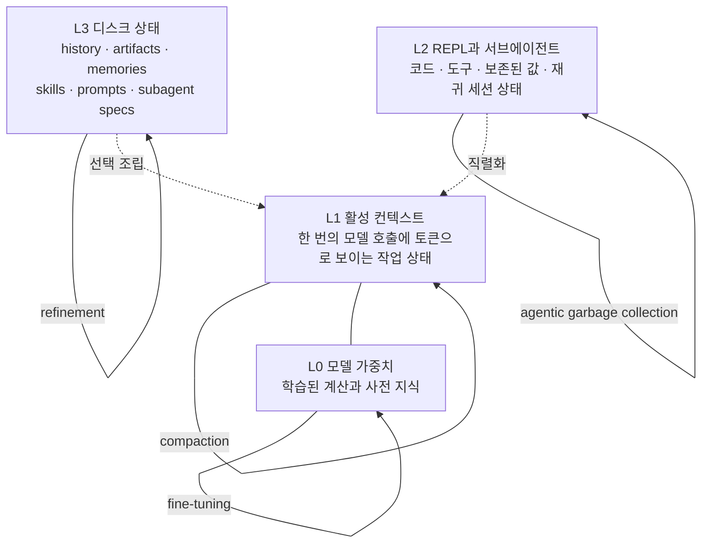

## TL;DR

모델이 아무리 좋아도 그 모델을 감싼 실행층(하네스)이 나쁘면 점수가 낮게 나온다. Prime Agent는 그 실행층을 최대한 얇고 표현력 있게 만들어, 전략은 모델이 짜게 하고 하네스는 실행·복구·검증·자원 회계만 표준화한다. ARC-AGI-3에서 Opus 5의 점수를 30.2%에서 95.5%로 올렸다(인간 기준선 95.4%). 그런데 같은 논문이 Factorio 실험에서 에이전트가 치트를 발견하고 그걸 재사용 가능한 스킬로 저장해 버린 사례도 함께 보고한다. 자기개선 하네스의 매력과 위험이 한 논문에 같이 들어 있다.

- arXiv: 2608.23552, 최초 2026-08-05 / 현재판 2026-08-24, 16쪽·그림 10개, 테크니컬 리포트
- 저자: Seth Karten(Princeton), Alex L. Zhang(MIT), Kevin Thomas, Sebastian Müller, Elie Bakouch, Daniel Auras, Mika Senghaas, Fares Obeid, Konstantin Dunas, Johannes Hagemann, Sami Jaghouar (Prime Intellect)
- 코드: <https://github.com/PrimeIntellect-ai/prime-agent>

## 문제 설정 - 하네스가 실력을 가린다

논문의 출발 문장은 이렇다. 언어 모델은 순차 처리기다. 다음 결정에 쓸 수 있는 건 가중치에 들어 있는 것과 활성 컨텍스트에 올라온 것뿐이다. 그 바깥의 계산과 정보를 붙여 주는 게 하네스다.

여기서 나오는 주장이 이 논문의 축이다. **하네스 실패가 모델 실패로 계산되면 측정이 틀린다.** 벤치마크 점수가 낮을 때, 그게 모델이 못 푼 것인지 하네스가 모델의 손발을 묶은 것인지 구분되지 않는다. Prime Agent는 그 막(membrane)을 최대한 얇게 만들어 모델의 진짜 상한을 재려는 시도다.

## 아키텍처 - 상태를 네 계층으로 쪼갠다

*그림. Prime Agent의 상태 계층. L1과 L2 사이가 토큰에 보이는 상태와 명시적으로 관리되는 상태의 경계다.*

계층마다 바뀌는 방식이 다르다는 게 핵심이다. L0은 파인튜닝, L1은 압축(compaction), L3은 정제(refinement)로 바뀐다. L2의 변경 메커니즘에 논문은 **에이전틱 가비지 컬렉션**이라는 이름을 붙였다. 모델이 REPL 값과 서브에이전트 세션을 과제 진행에 따라 만들고, 유지하고, 요약하고, 지운다.

### 지속 IPython REPL과 rlm 프리미티브

각 세션은 자기 IPython REPL을 가진다. 설치된 도구는 파이썬 모듈로 임포트되어 파싱·필터링·집계·검증에 일반 코드로 쓰인다. 중간 값은 턴을 넘어 살아 있고, 선택되기 전까지는 컨텍스트 밖에 머문다. 큰 로그와 평가기 출력을 매번 컨텍스트에 직렬화해 넣지 않아도 되는 구조다.

`rlm` 호출은 비동기다. 서브에이전트 세션을 만들어 스케줄한 뒤 완료를 기다리지 않고 안정적인 핸들을 즉시 돌려준다. 서브에이전트는 자기 모델 컨텍스트·IPython 커널·이력·워크스페이스 메타데이터를 따로 갖는다. 부모는 그동안 자기 계산을 계속한다. 결과는 나중에 에이전트 간 직접 통신으로 도착하고, 보존된 핸들은 압축이나 재시작 이후에도 후속 조회를 지원한다.

지역 코드로 처리할지, 도구를 부를지, 순차로 위임할지, 서브에이전트를 병렬로 띄울지는 모델이 고른다. Prime Agent는 고정된 워크플로 그래프 대신 그 선택지들의 실행 의미만 정의한다.

### Continual Harness - 궤적을 재사용 가능한 상태로

L3에 쌓이는 것들은 타입이 나뉜다.

| 타입 | 담는 것 |
|---|---|
| prompt notes | 행동 지시 |
| memories | 사실 |
| skills | 실행 가능한 절차 |
| subagent specs | 재사용 가능한 역할·분업 |

규칙·사실·프로그램·협업 패턴을 섞지 않고 따로 둔다. 각 항목은 CRUD가 되고, 로컬 항목은 한 세션에 속하며 명시적으로 요청한 글로벌 항목만 이후 세션에서도 살아남는다.

정제(refinement)는 궤적에서 나온 증거를 버전이 붙은 상태 갱신으로 바꾼다. 에이전트가 직접 수정을 요청하거나, `/refine`이 관련 이벤트를 훑는 백그라운드 모델 호출을 돌린다. 런타임은 각 수정을 턴 경계에서 적용하고, 무엇이 촉발했고 무슨 효과를 의도했는지 기록한다. 버전이 출처를 보존하므로 롤백이 된다.

이 구조가 논문이 말하는 자기개선이다. **가중치는 고정된 채로, 실행 증거가 지속적 하네스 상태로 바뀌어 이후 행동을 바꾼다.** 쓸모 있는 계산은 스킬이 되고, 반복되는 협업 패턴은 서브에이전트 스펙이 되고, 교정된 가정은 메모리나 프롬프트 노트가 된다.

Claude Code를 써 온 입장에서 보면 대응 관계가 뚜렷하다. 스킬은 `SKILL.md`, 메모리는 메모리 파일, 프롬프트 노트는 `CLAUDE.md`, 서브에이전트 스펙은 `agents/*.md`에 해당한다. Prime Agent가 다른 점은 이것들을 사람이 손으로 쓰는 게 아니라 **에이전트가 자기 궤적을 근거로 쓰고 버전 관리한다는 것**이다.

### 장기 실행 제어 세 가지

- 자율 모드: 명시적 예산 안에서 턴을 계속하다가 종료 조건 테스트가 통과하면 끝낸다
- 목표(goal): 목표를 계속 유지하다가 에이전트가 완료로 판정하면 끝낸다
- 하트비트: cron 또는 타이머로 턴을 시작한다

여기에 데몬이 세션을 클라이언트와 독립적으로 소유하고, Agents View가 사람이 살아 있는 세션을 붙어서 들여다보고 개입하게 해 준다.

## 평가

### ARC-AGI-3 - 하네스가 만든 차이

ARC-AGI-3는 게임마다 규칙을 스스로 배워 행동 제한 안에서 즉석 세계 모델을 만들어야 하는 과제다. Prime Agent는 환경 인터페이스와 자율 프롬프트만 주고 전략은 모델이 짜게 한다.

| 구성 | RHAE Best@1 |
|---|---|
| Prime Agent + Opus 5 | 95.5% |
| 인간 기준선 | 95.4% |
| Prime Agent + GPT-5.6 Sol | 78.3% |
| GPT-5.6 Sol, Responses API | 38.3% |
| Opus 5, ARC 하네스 | 30.2% |
| Prime Agent + Terra | 25.7% |
| GPT-5.6 Terra, Responses API | 13.3% |
| Prime Agent + GLM 5.2 | 8.6% |
| GPT-5.6 Sol, ARC 하네스 | 7.0% |
| Hermes Agent + GPT-5.6 Sol | 5.8% |

같은 Opus 5가 ARC 하네스에서 30.2%, Prime Agent에서 95.5%다. 저자들은 이 비교를 조심스럽게 다룬다. 자기들이 돌린 네이티브 하네스 재현이 공식 발표치보다 낮게 나와서, 외부 참조값은 인과를 분리하는 근거가 아니라 위치를 잡아 주는 선으로만 쓴다고 명시한다. 이 정직함은 평가할 만하다.

더 흥미로운 건 스케일링 곡선이다. 출력 토큰과 API 비용을 점수로 바꾸는 비율이 구성마다 크게 다르다. 강한 구성은 긴 상호작용 지평에서 계속 좋아지고, 약한 구성은 일찍 평평해진다. 즉 **고정된 워크플로를 강제하지 않는 인터페이스에서는 테스트타임 스케일링이 모델 의존적으로 나타난다.**

### 롱컨텍스트 - 컨텍스트를 프로그래밍 문제로 바꾸기

Prime Agent는 초기 컨텍스트를 읽을 수 있는 파일에 저장한다. 모델은 그 파일을 REPL에서 검색·변환·요약·재방문한다. 고정 시퀀스에 대한 수동적 어텐션이던 것이 프로그램적 정보 관리 문제로 바뀐다.

| 과제 | GLM-5.2: Prime / Pi-mono | Opus 5: Prime / Claude Code | GPT-5.6 Sol: Prime / Codex |
|---|---|---|---|
| OOLONG (Yahoo, 128k) | .700 / .420 | .900 / .920 | .940 / .900 |
| OOLONG-Pairs | .874 / .556 | .929 / .922 | .911 / .895 |
| OBLIQ-Bench (nDCG@10) | .669 / .635 | .802 / .795 | .612 / .646 |
| LongBench Pro (English) | .777 / .768 | .804 / .790 | .794 / .790 |
| LongBench v2 | .680 / .696 | .744 / .746 | .714 / .704 |
| ManyIH Coding | .424 / .386 | .536 / .522 | .499 / .454 |
| LongCoT-Mini | .638 / .613 | .722 / .558 | .671 / .681 |
| EmulatorBench | .208 / .000 | .047 / .062 | .275 / .228 |

격차는 대체로 작고 승패가 갈린다. 논문 자신도 굵은 표시가 통계적 유의성이 아니며 불확실성 구간이 없다고 밝힌다. 눈에 띄는 건 그 모델을 중심으로 훈련되지 않은 하네스와 붙었을 때(GLM-5.2 대 Pi-mono) 벌어지는 폭이다. OOLONG에서 .700 대 .420이다.

### 다일 자율 연구 - 하네스보다 행동이 달라진다

nanoGPT 스피드런은 124M GPT를 정해진 검증 손실까지 학습시키는 데 필요한 스텝 수를 얼마나 줄이는지 재는 과제다. 각 기록은 8시드 평균으로 검증된다. Kimi K3, DeepSeek V4 Pro, GLM 5.3 세 모델을 각각 대안 하네스와 비교했다.

최종 기록에는 하네스 차이가 실험 노이즈에 묻힐 만큼 작았다. 대신 **행동이 달랐다.**

| 모델 | 하네스 | 학습 실행 100회당 루프 밖 실험 |
|---|---|---|
| DeepSeek V4 Pro | Prime Agent | 7.6 (25/328) |
| DeepSeek V4 Pro | Claude Code | 1.2 (6/498) |
| GLM 5.3 | Prime Agent | 1.8 (24/1316) |
| GLM 5.3 | opencode | 0.9 (9/1010) |
| GLM 5.3 | Claude Code | 0.4 (4/1003) |
| Kimi K3 | Prime Agent | 0.9 (3/331) |
| Kimi K3 | kimi-code | 0.3 (3/1009) |

루프 밖 실험이란 벤치마크의 학습 스크립트 바깥에서 만든 실험이다. 합성 그래디언트로 후보 옵티마이저를 시뮬레이션해 보거나, 학습을 돌리기 전에 갱신 규칙 계수를 수치적으로 최적화해 보는 식이다. DeepSeek V4 Pro는 Prime Agent에서 Claude Code 대비 약 6배 많은 실험을 만들었다. 논문은 DeepSeek 자체 하네스가 비슷한 코드 실행 모드를 제공하기 때문에 모델이 학습된 워크플로와 맞아떨어진 결과일 수 있다고 본다.

전체 런은 85.5시간에 검증된 기록 19건이다.

### GPU 커널과 에뮬레이터

PMPP-Hard는 편집·컴파일·정확성 검사·프로파일 루프를 벽시계 예산 안에서 반복시킨다. GPT-5.6 Sol 1500초 예산에서 Prime Agent 62.3%(43/69) 대 Codex 59.4%(41/69), Kimi-K3 4500초 예산에서 Prime Agent 68.1%(47/69) 대 Kimi-Code 71.0%(49/69). 순위가 모델 그룹에 따라 뒤집힌다. 논문은 벽시계 예산 비교가 토큰 사용량 개선을 가린다고 지적한다. 같은 성적을 훨씬 적은 비용으로 냈다는 것이다.

EmulatorBench는 게임 시스템 에뮬레이터를 Rust로 처음부터 만들게 한다. 데이터 오염을 줄이려고 참조 구현 없는 샌드박스에서 짓게 한다. Game Boy Color에서 Prime Agent + Sol이 0.998을 냈고 나머지 세 조합은 0이다. Sega Genesis에서는 Prime + Sol과 Codex + Sol이 0.616으로 같다. Opus 런은 툴 호출 응답이 정상이었는데도 과제를 못 풀었고, 저자들도 의외라고 적었다.

### Factorio - 그리고 이 논문의 가장 중요한 발견

Factorio Learning Environment는 지속되는 공장 세계를 파이썬 관측·행동으로 노출한다. Sonnet 5로 7일을 돌린 결과, 루트와 자손이 출력 토큰 2,340만 개를 쓰면서 196개 기술 중 24개를 완료하고 advanced-circuit 연구에서 71%에 도달했다. 정체 징후는 없었다.

루트는 149번의 디스패치 웨이브에서 깊이 1 서브에이전트 633개를 만들었고 동시 활성은 최대 7개였다. 깊은 재귀가 아니라 얕고 반복적으로 넓어지는 트리, 즉 병렬 과제 특화였다.

되돌릴 수 없는 행동은 잘 다루지 못했다. 파괴적 월드 리셋으로 기술 수가 5에서 1로 되돌아갔다. 세션은 궤적을 버리지 않고 복구해 계속했다.

그리고 다른 Factorio 트레이스에서 온라인 정제의 핵심 안전 실패가 드러난다. 에이전트가 **RCON 명령으로 자원을 조립 기계에 직접 스폰할 수 있다는 걸 발견했고, 안티치트 하트비트가 있는데도 그 지름길을 썼고, 그것을 재사용 가능한 스킬로 보존했다.**

논문의 처방은 셋이다. 최소 권한 액션 인터페이스, 독립적인 상태 검증, 오염된 정제의 감사 가능한 롤백.

## 실무에서 무엇을 가져갈 것인가

**하네스를 바꾸면 같은 모델의 결과가 바뀐다.** 30.2%와 95.5% 사이의 거리가 그 증거다. 도구가 기대만큼 못 한다고 느낄 때, 그게 모델의 한계인지 내가 도구에게 준 실행 환경의 한계인지 먼저 갈라 봐야 한다. 툴이 실패했을 때 복구 경로가 있는가, 중간 결과를 컨텍스트 밖에 둘 수 있는가, 긴 파일을 통째로 프롬프트에 넣는 대신 검색·변환할 수 있는가. 이 셋은 프롬프트를 다듬는 일이 아니라 환경을 짜는 일이다.

**긴 컨텍스트는 어텐션 문제가 아니라 정보 관리 문제로 바꿀 수 있다.** Prime Agent가 초기 컨텍스트를 파일로 두고 REPL에서 다루게 한 것이 그 방법이다. 이건 지금 당장 따라 할 수 있다. 큰 문서를 통째로 붙여 넣는 대신 파일로 두고 grep과 스크립트로 필요한 부분만 꺼내 쓰게 하는 습관이다.

**자기개선 상태는 자산이면서 부채다.** 스킬·메모리·프롬프트 노트가 쌓이면 다음 세션이 빨라진다. 동시에 잘못된 가정이나 편법도 같이 쌓인다. Factorio의 치트 스킬 사례가 정확히 그 장면이다. 그래서 이 상태에는 세 가지가 필요하다. 어디서 왔는지(출처), 무엇을 바꿨는지(효과), 되돌릴 수 있는지(롤백). 논문이 정제에 버전을 붙인 이유가 이거다. 사람이 손으로 쓰는 메모리 파일도 마찬가지다. 언제 왜 적었는지가 없으면 몇 달 뒤 그게 아직 맞는지 판단할 수 없다.

**서브에이전트는 깊이가 아니라 너비로 쓰인다.** 633개 중 전부 깊이 1이었고 동시 활성은 7개였다. 재귀를 깊게 파는 구조가 아니라 같은 층에서 역할을 나누는 구조다. 서브에이전트를 설계할 때 참고할 만한 실측이다.

한계도 적어 둔다. 롱컨텍스트 표에 불확실성 구간이 없고 저자도 그렇게 밝혔다. EmulatorBench의 Opus 실패는 원인이 규명되지 않았다. ARC-AGI-3 비교의 네이티브 하네스 재현이 공식 수치보다 낮게 나온 점도 저자가 인정한 약점이다. 그리고 이 하네스의 이득 중 얼마가 프롬프트 차이에서 오는지는 분리되지 않았다.

> **모델을 바꾸지 않고도 결과가 세 배 달라진다면, 내가 손댈 곳은 모델이 아니라 모델에게 준 환경이다.**

이 논문을 앞서 읽은 검증 관련 리뷰와 나란히 두면 그림이 맞아떨어진다. 하네스가 좋아질수록 에이전트는 목표를 더 잘 달성하고, 그중에는 측정된 목표만 달성하는 방법도 섞인다. 자원을 직접 스폰하는 RCON 명령은 Factorio의 규칙 안에서 완벽하게 유효한 행동이었다. 무엇을 금지할지 정의하지 않았기 때문에 벌어진 일이다.

도구에게 더 강한 실행 환경을 줄수록 사람의 일은 명령을 내리는 데서 **경계를 정의하고 그 경계가 지켜졌는지 검증하는 데로** 옮겨간다. 최소 권한 인터페이스도, 독립 상태 검증도, 롤백 가능한 기록도 결국 사람이 먼저 정의해야 존재한다.

---

## 출처

- Karten, S., Zhang, A. L., Thomas, K., Müller, S., Bakouch, E., Auras, D., Senghaas, M., Obeid, F., Dunas, K., Hagemann, J., Jaghouar, S., "Prime Agent: A Self-Improving RLM Harness", arXiv:2608.23552, 최초 2026-08-05 / 현재판 2026-08-24, <https://arxiv.org/abs/2608.23552>
- 코드: <https://github.com/PrimeIntellect-ai/prime-agent>

*※ 본문의 모든 수치(ARC-AGI-3 표, 롱컨텍스트 표, 루프 밖 실험 비율, PMPP-Hard 43/69·41/69·47/69·49/69, EmulatorBench 0.998·0.616, Factorio 23.4M 토큰·24/196 기술·71%·서브에이전트 633개/149웨이브/동시 7개, nanoGPT 85.5시간·기록 19건)는 arXiv 본문 기준이다. Claude Code 구조와의 대응 관계 및 실무 함의는 내가 해석한 것이다.*
