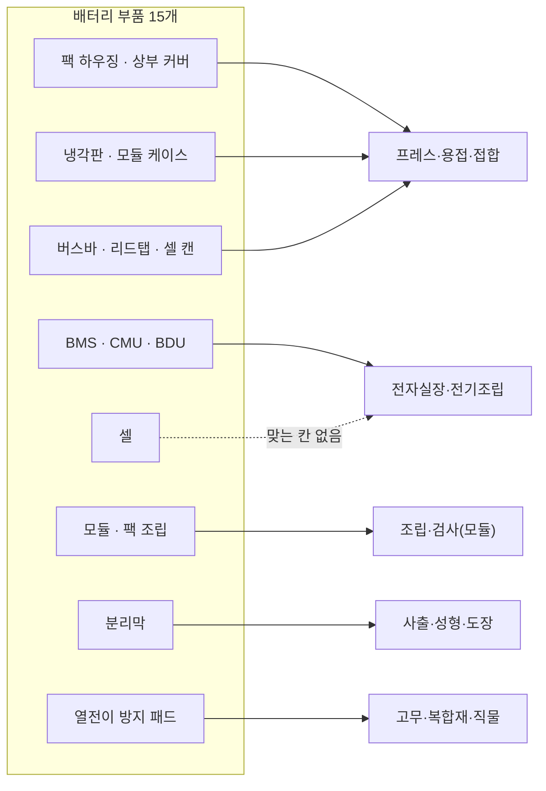
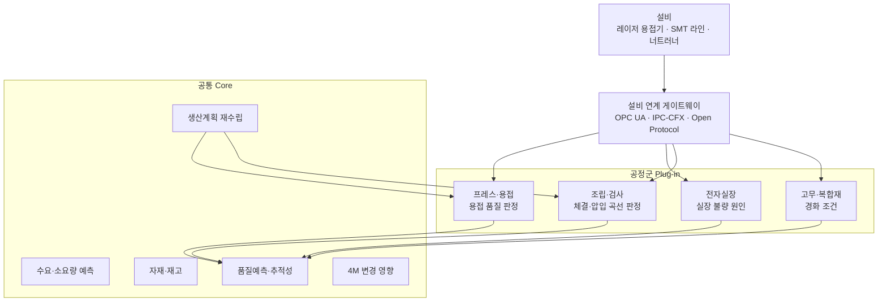

## 품목 목록으로는 AI 설계가 시작되지 않는다

자동차 부품 258개를 공정군 7개로 나눠 정리해 본 적이 있다. 품목마다 세 개의 꼬리표를 붙였다. 차의 어디에 들어가는지(차량 시스템), 어떻게 만드는지(주공정군), 통계상 어느 업종 코드에 속하는지(한국표준산업분류 세세분류). 이 중 제조 AI 설계에 쓸모가 있었던 축은 두 번째, 공정군 하나였다.

배터리 부품을 보면 이유가 분명해진다. 기준서의 전동화 파워트레인 중 배터리 하위 시스템에는 15개 품목이 있다. 이름만 보면 "배터리 부품"이라는 한 묶음이다. 그런데 만드는 방식으로 다시 나누면 다섯 갈래로 흩어진다. 버스바는 프레스로 찍고 레이저로 붙이는 금속 부품이고, CMU는 기판 위에 칩을 올리는 전자 부품이다. 열전이 방지 패드는 운모나 에어로젤 복합재다. 셋은 같은 배터리 팩 안에 들어가지만 공장에서 쌓이는 데이터는 서로 닮은 데가 거의 없다.

> **제조 AI가 받아야 할 데이터의 모양은 "어떻게 만드는가"가 정한다.**

## 15개 품목, 다섯 갈래

먼저 배터리 구조를 짧게 정리한다. 셀은 전기를 저장하는 최소 단위다. 형식은 세 가지다. 원통형은 젤리롤(양극·분리막·음극을 감은 뭉치)을 둥근 금속 캔에 넣고 18650, 21700처럼 지름과 길이로 규격을 부른다. 46계열의 대표인 4680은 지름 46mm, 높이 80mm로 2020년에 공개됐다. 각형은 직사각형 금속 캔을 쓰고 치수 표준이 없어 제조사마다 다르다. 파우치형은 나일론·알루미늄박·내층 수지를 겹친 알루미늄 파우치 필름으로 감싼다. 케이스가 가벼운 대신 구조 강성이 약해 외부에서 압력을 잡아 줘야 한다.

셀 여러 개를 버스바로 잇고 케이스에 넣으면 모듈, 모듈을 하우징에 넣고 BMS와 냉각판, 차단 장치를 붙이면 팩이다. 기준서의 15개 품목을 주공정군으로 나눈 결과는 아래와 같다.

| 주공정군 | 품목 | 수 |
|---|---|---|
| 프레스·용접·접합 | 팩 하우징(로어 케이스), 상부 커버, 냉각판, 버스바, 모듈 케이스·엔드플레이트, 셀 케이스(캔·파우치), 셀 리드탭 | 7 |
| 전자실장·전기조립 | 배터리 셀, BMS, CMU, BDU | 4 |
| 조립·검사(모듈) | 배터리 모듈, 배터리팩 어셈블리 | 2 |
| 사출·성형·도장 | 분리막 | 1 |
| 고무·복합재·직물 | 셀 열전이 방지 패드 | 1 |


*그림. 배터리 부품 15개가 주공정군 다섯 개로 흩어지는 모습. 점선은 억지로 넣은 칸이다*

표에서 걸리는 점이 두 개 있다.

첫째, 셀은 어느 칸에도 깔끔하게 맞지 않는다. 셀 제조는 전극 코팅, 조립, 화성(첫 충방전으로 셀을 활성화하는 공정)으로 이어지는데, 범용 자동차 부품용 공정군 7개는 이 흐름을 담도록 만든 분류가 아니다. 기준서에서는 셀을 전자실장·전기조립에 두되 비고에 "7개 공정군에 딱 맞지 않음"이라고 적어 두었다. 분류표는 깔끔해 보이는 것보다 어디가 억지인지 드러나는 편이 낫다. 셀 공정을 AI로 다루려면 별도 공정군을 새로 정의해야 한다.

둘째, 분리막이 사출·성형에 들어가 있다. 분리막은 PE·PP 폴리올레핀 필름이다. 건식 공정은 압출한 전구체 필름을 늘려 기공을 만들고, 습식 공정은 열 유도 상분리 뒤 용매를 추출해 기공을 만든다. 둘 다 고분자를 녹여 압출하고 성형하는 계열이라 이 칸에 넣었다. 그 위에 알루미나·실리카 같은 세라믹 코팅을 올리는 공정은 보조공정군(열처리·표면처리)으로 따로 표시했다.

## 같은 칸에 들어가면 데이터도 닮는다

공정군으로 묶는 의미는 데이터 구조에서 나온다. 같은 공정군이면 품목이 달라도 설비, 공정변수, 불량 유형, 데이터 단위가 비슷하다.

| 공정군 | 배터리 품목 예 | 데이터 단위 | 핵심 변수·신호 | 연계 표준 |
|---|---|---|---|---|
| 프레스·용접·접합 | 버스바, 리드탭, 하우징 | 스트로크·용접점 단위 파형 | 프레스 하중, 레이저 출력(kW)·속도(m/min)·초점 위치(mm) | 제조사별 PLC·타이머, OPC UA |
| 전자실장·전기조립 | BMS, CMU, BDU | 패드·기판 단위 검사값 | SPI 체적, 리플로우 프로파일, AOI 판정, ICT·FCT 측정값 | IPC-CFX, IPC-HERMES-9852 |
| 조립·검사(모듈) | 모듈, 팩 | 체결·압입 건 단위 곡선 | 토크-각도 곡선, 압입 하중-변위, 누설 시험값, EOL 결과 | Open Protocol, OPC UA |
| 사출·성형·도장 | 분리막 | 사이클·롤 단위 레코드 | 온도, 압출 조건, 두께, 외관 이미지 | EUROMAP 77(OPC 40077)은 사출기 대상 |
| 고무·복합재·직물 | 열전이 방지 패드 | 배치 단위 경화곡선 | 경화 온도·압력·시간, 적층 상태 | 표준 성숙도 낮음 |

버스바 하나만 들여다봐도 이 표의 첫 행이 왜 중요한지 보인다. 버스바와 셀 탭은 구리와 알루미늄처럼 서로 다른 금속을 잇는 경우가 많다. 레이저로 녹여 붙이면 두 금속 사이에 단단하고 잘 깨지는 금속간 화합물이 생기고, 기공과 블로홀, 균열도 따라온다. 영국 AMRC의 사례에서는 이 문제를 줄이려고 연속 용접 대신 점 단위로 나눠 용접했고, 알루미늄 탭과 버스바 접합부 저항이 0.03~0.08mΩ으로 측정됐다. 이 판단에 필요한 입력은 레이저 출력·속도·초점과 접합 저항이다. 같은 공정군에 있는 하우징의 프레스 하중 곡선과는 신호 모양이 비슷하고, CMU의 AOI 이미지와는 전혀 다르다.

열전이 방지 패드는 다른 이유로 흥미롭다. 셀 하나가 열폭주에 들어갔을 때 옆 셀로 열이 번지는 것을 늦추는 부품이고, 운모 적층판과 실리카 에어로젤이 대표 소재다. 중국 GB 38031-2025는 열폭주 발생 후 2시간 동안 화재·폭발이 없어야 한다는 요구를 담았고, 신규 형식승인 차종에는 2026년 7월 1일부터 적용됐다. 부품 중요도는 올라가는데, 고무·복합재 공정군은 내가 정리한 7개 공정군 중 양산 AI 공개 사례를 가장 찾기 어려웠던 칸이다. 사례가 적은 칸은 데이터 확보부터 설계해야 한다.

## BMS, CMU, BDU는 같은 칸이지만 역할이 다르다

전자 부품 셋은 공정군은 같아도 팩 안에서 맡는 일이 다르다. 제조 데이터 스키마는 공유하되, 검사 기준은 품목별로 갈린다.

| 품목 | 하는 일 | 확인한 예 |
|---|---|---|
| CMU | 셀 전압·온도를 측정하고 셀 밸런싱을 한 뒤 BMS 주제어기로 전달 | NXP RD33775A 참조설계: MC33775A 4개로 최대 56셀, 데이지 체인으로 확장, BMU와 절연 2선 링크(ETPL) 또는 CAN FD |
| BMS | 셀·팩 상태를 모아 전류·전압·온도를 감시하고 충방전과 보호를 판단 | 주제어기가 전류·전압·온도를 실시간 감시 |
| BDU | 고전압 회로를 연결·차단 | 메인 컨택터, 프리차지 회로, 고전압 퓨즈, 파이로 퓨즈로 구성. 프리차지는 돌입 전류로 접점이 용착되는 것을 막는다 |

BDU는 릴레이·퓨즈·버스바가 들어가는 조립품이라 기준서에서 보조공정군에 조립·검사(모듈)를 같이 달았다. 주공정군 하나로 끝나지 않는 품목은 보조공정군 칸으로 두 번째 Plug-in을 연결한다.

## 셀-모듈-팩 구조가 바뀌면 품목 수가 바뀐다

전동화로 부품 구조가 이동한다. 기준서 258개 품목을 전동화 영향으로 나누면 내연 전용으로 줄어드는 품목이 55개, 전동화로 새로 생기는 품목이 53개, 유지가 150개였다. 증가 품목은 대부분 전자실장·전기조립에 몰려 있다. 전동화 파워트레인 36개 중 16개가 이 공정군이다. 배터리 15개는 전부 증가 쪽이다.

배터리 안에서도 구조 변화가 진행 중이다. 셀투팩(CTP, cell-to-pack)은 모듈 단계를 건너뛰고 셀을 팩에 바로 넣는다. 모듈의 엔드플레이트, 사이드 플레이트, 내부 커넥터처럼 에너지를 저장하지 않는 부품을 덜어 내는 방식이다. 한 분석은 기존 팩의 체적 활용률을 50% 안팎(낮게는 40% 미만)으로, 블레이드형 셀의 모듈리스 팩을 62.4%로 추정했다. 추정값이고 측정값은 아니다.

공정군 관점에서 CTP를 읽으면 이렇다. 모듈 케이스·엔드플레이트(프레스·용접) 품목과 모듈 조립(조립·검사) 공정 일부가 줄고, 팩 하우징이 구조 역할을 더 맡는다. 품목 목록은 바뀌지만 공정군 칸은 그대로다. 공정군 단위로 만든 판단 모델은 이 변화에서 살아남고, 품목 단위로 만든 모델은 해당 품목과 함께 사라진다.

## 공통 Core와 공정군 Plug-in

이 분류를 AI 구조로 옮기면 두 층이 나온다. 수요 예측, 자재 수급, 생산계획, 품질 추적처럼 공정과 무관한 판단은 공통 Core로 한 벌 만든다. 용접 품질 판정이나 실장 불량 원인 분석처럼 공정 고유 판단은 공정군 Plug-in으로 뺀다.


*그림. 공정군 Plug-in이 설비 데이터를 받아 공통 Core의 품질·계획 판단에 넘기는 구조*

Plug-in의 입력 스키마는 공정군이 정한다. 아래는 프레스·용접 Plug-in이 버스바 레이저 용접에서 받는 레코드를 예시로 적어 본 것이다. 이 레코드에서 품목 이름은 속성 하나로만 들어간다.

```yaml
# 프레스·용접·접합 Plug-in 입력 레코드 (예시)
process_group: press_weld_join      # 키는 공정군
record_unit: weld_point             # 데이터 단위: 용접점 1개 = 레코드 1개
item_id: busbar                     # 품목은 속성일 뿐. 리드탭·하우징도 같은 스키마
material_pair: [Cu, Al]             # 이종 접합 여부가 불량 판단에 들어간다
laser:
  power_kw: ...                     # 출력
  speed_m_per_min: ...              # 속도
  focus_mm: ...                     # 초점 위치
result:
  joint_resistance_mohm: ...        # 접합 저항
  vision_image: ...                 # 비드 이미지
lot: { coil_lot: ..., tab_lot: ... } # 4M 변경 추적용
```

같은 스키마에 `item_id: lead_tab`을 넣으면 리드탭, `module_end_plate`를 넣으면 엔드플레이트 용접이 된다. 반대로 CMU를 이 스키마에 넣으려 하면 필드가 하나도 맞지 않는다. 그 순간이 다른 Plug-in이 필요하다는 신호다.

## 정리: 분류 축을 고르는 일은 사람이 했다

이 작업에서 품목 행을 채우고, 시스템과 공정군을 교차 집계하고, 표를 엑셀과 문서로 뽑는 일은 도구로 처리할 수 있는 영역이다. 반면 무엇으로 나눌지는 도구가 정해 주지 않는다. 차량 시스템, 업종 코드, 공정군 세 축 중 AI 설계에 쓸 축을 고르는 일, 셀처럼 어느 칸에도 맞지 않는 품목을 억지로 끼우지 않고 "맞지 않음"으로 표시하는 일, 분리막을 사출·성형에 둔 근거를 적는 일은 정의의 영역이다. 기준서의 공정군 값도 재료와 일반 제조 방식으로 판단한 값이고 개별 기업 공시로 검증한 값이 아니라는 한계를 같이 적어 두었다.

배터리 부품 15개를 다섯 공정군으로 나누면, 만들어야 할 Plug-in 수는 공정군 수인 5개(셀 공정을 따로 정의하면 6개)로 정해진다. 그 숫자를 정하는 데 필요한 것은 공장에서 무엇이 어떻게 만들어지는지에 대한 정의다.

## 참고

- 4680 셀 치수(46mm x 80mm)와 공개 시점: [Electrek, 2020-09-22](https://electrek.co/2020/09/22/tesla-4680-battery-cell-bigger-power-energy/), [CleanTechnica, 2020-09-22](https://cleantechnica.com/2020/09/22/everything-you-need-to-know-about-teslas-new-4680-battery-cell/)
- 셀 형식별 케이스와 파우치 필름 3층 구조: [Grepow, cylindrical·prismatic·pouch 비교](https://www.grepow.com/blog/the-difference-between-cylindrical-prismatic-and-soft-pack-pouch-cell-batteries.html), [Battle Born Batteries, 셀 형식 가이드](https://battlebornbatteries.com/blogs/articles/pouch-vs-prismatic-vs-cylindrical-lithium-battery-cells)
- CTP 개념과 체적 활용률 추정: [Volta Foundation, From the Blade Cell to Module-Free Battery Pack](https://volta.foundation/the-next-generation-battery-pack-design-from-the-byd-blade-cell-to-module-free-battery-pack/)
- 버스바·탭 이종금속 레이저 용접과 접합 저항: [AMRC 사례](https://www.amrc.co.uk/case-studies/laser-welding-holds-firm-for-electric-vehicle-battery-joins), [Kumar et al. 2021, Warwick](https://wrap.warwick.ac.uk/168639/1/WRAP-In-depth-evaluation-of-laser-welded-similar-and-dissimilar-material-tab-to-busbar-electrical-interconnects-for-electric-vehicle-battery-pack-Kumar-2021.pdf)
- 분리막 건식·습식 공정과 세라믹 코팅: [E-Mobility Engineering, Battery separator materials](https://www.emobility-engineering.com/?p=17657)
- 열전이 방지 소재와 GB 38031-2025: [Charged EVs, thermal runaway mitigation](https://chargedevs.com/features/thermal-runaway-in-ev-battery-packs-designing-a-mitigation-strategy/), [AVL, GB 38031-2025 백서](https://www.avl.com/sites/default/files/2025-10/gl_pte_en_whitepaper_regulation_gb38031-2025_web_10.25.pdf)
- CMU 구성: [NXP RD33775ACNTEVB](https://www.nxp.com/RD33775ACNTEVB), [Infineon, Battery cell balancing and monitoring](https://www.infineon.com/cms/en/applications/solutions/battery-management-system/battery-balancing/)
- BDU 구성: [EFI Automotive, Battery Disconnect Unit](https://www.efiautomotive.com/en/produits/bdu/)
- 업종 코드: 한국표준산업분류 제11차, 28202 운송장비용 이차전지 제조업 해설
