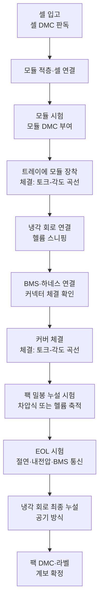
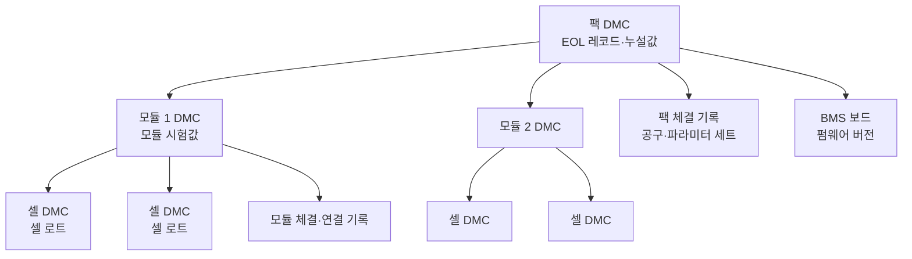

## 조립 라인은 데이터가 적은 공정이 아니다

셀 공장 이야기를 하면 전극 코팅 두께, 화성 충방전 곡선처럼 데이터가 쏟아지는 장면이 먼저 떠오른다. 모듈·팩 조립은 그에 비해 볼트를 조이고 뚜껑을 닫는 공정으로 보이기 쉽다. 실제로 조립 라인을 데이터 기준으로 다시 그리면 그림이 달라진다. 볼트 하나를 조일 때마다 토크-각도 곡선이 한 개 생기고, 팩 하나가 라인 끝을 지날 때마다 누설 시험값과 절연 측정값, EOL(End of Line, 라인 끝 종합 시험) 레코드가 한 묶음씩 쌓인다. 그리고 이 모든 기록이 DMC(Data Matrix Code, 2차원 바코드의 한 형식) 하나에 매달린다.

나는 자동차부품 공정군을 일곱 갈래로 정리하는 기준표를 만든 적이 있다. 그중 조립·검사 공정군의 데이터 성격을 한 줄로 요약하면 "체결·압입 곡선, EOL, 비전, 계보"였다. 그 정리에서 정한 원칙은 하나였다: 수치는 출처가 있을 때만 적고, 출처가 없으면 "체결 1건당 1곡선", "제품 1개당 EOL 1레코드"처럼 발생 단위로만 적는다. 이 글은 그 틀을 배터리 모듈·팩 라인에 옮겨, 공개 자료로 확인한 범위 안에서 데이터 지도를 그려 본 기록이다.

## 공정 순서대로 본 데이터 발생 지점

팩 라인의 순서는 제품 설계마다 다르다. 아래는 누설 시험 장비 공급사 한 곳(Marposs)이 공개한 팩 라인 공정 설명과, 앞서 말한 조립·검사 공정군 흐름을 겹쳐 놓은 일반형이다.

*그림. 팩 조립 공정 순서별로 생기는 데이터. 각 상자의 둘째 줄이 그 공정이 남기는 판정 데이터다*

| 공정 | 생기는 데이터 | 판정하는 것 | 발생 단위 |
|---|---|---|---|
| 체결 | 최종 토크(N·m), 각도(°), 토크-각도 곡선, 체결 시간 | 미체결·과체결·나사산 손상 | 체결 1건당 1곡선 |
| 압입 | 압입력(kN), 변위(mm), 하중-변위 곡선 | 압입력 이탈, 끼워짐 깊이 | 압입 1건당 1곡선 |
| 누설 | 시험 압력, 누설량(Pa, cc/min, mbar·L/s), 시험 시간 | 밀봉 불량, 냉각 회로 누설 | 시험 1회당 1값 |
| EOL | 절연저항, 내전압 결과, 셀 전압·온도, 접촉기 동작, BMS 오류 상태 | 출하 가부 | 팩 1개당 1레코드 |
| 계보 | 셀·모듈·팩 DMC와 상위·하위 관계 | 어떤 셀이 어느 팩에 들어갔는가 | 조립 이벤트마다 1건 |

## 체결: 곡선 한 장에 담긴 판정

체결 공정의 판정은 최종 토크값 하나로 끝나지 않는다. 같은 최종 토크라도 각도가 너무 작으면 나사가 걸려 멈춘 것이고, 너무 크면 나사산이 밀렸을 수 있다. 그래서 체결 컨트롤러는 토크-각도 곡선 전체를 남기고 토크 창과 각도 창을 함께 본다. 자동차 업계에서 체결부를 등급으로 나누는 지침인 VDI/VDE 2862는 체결부를 A(실패 시 신체 위험), B(기능 상실), C(불편) 세 범주로 나누고, A와 B에 더 엄격한 시험 요구를 둔다. 배터리 팩에서 모듈 고정 볼트와 고전압 버스바 체결이 어느 범주로 분류되는지는 제품 설계 문서가 정한다.

체결 데이터를 상위 시스템으로 꺼내는 경로는 대개 Open Protocol이다. Atlas Copco가 공개한 체결 컨트롤러 통신 규격으로, 여러 체결공구 제조사가 지원해 업계 사실상 표준으로 쓰인다. 핵심 구조는 아래와 같다.

| 항목 | 내용 |
|---|---|
| 전송 | TCP/IP, 기본 포트 4545, 컨트롤러가 서버 |
| 메시지 단위 | MID(Message Identification) 4자리 번호와 리비전 |
| 체결 결과 | MID 0060 구독 요청 → MID 0061 최종 체결 결과 → MID 0062 수신 확인 |
| 연결 유지 | MID 9999 Keep Alive |

MID 0061에는 목표 토크, 측정 토크, 각도 하한·상한, 측정 각도, OK/NOK 판정 같은 결과값이 담긴다. 리비전마다 필드 구성이 달라서, 연결 전에 컨트롤러가 지원하는 리비전부터 확인해야 한다. 곡선 전체를 받는 방법도 컨트롤러 모델에 따라 다르므로 사양서로 확인할 항목이다.

## 압입: 하중-변위 곡선과 창 평가

부싱, 핀, 단자처럼 끼워 넣는 부품이 있으면 압입 공정이 생긴다. 서보 프레스는 압입하는 동안 하중과 변위를 같이 기록하고, 모니터가 곡선의 정해진 구간을 평가 객체로 판정한다. Kistler의 maXYmos 계열은 BOX(정해진 사각 구간을 곡선이 통과하는가), LINE(곡선이 선을 넘는가), ENVELOPE(곡선이 허용 띠 안에 머무는가) 같은 평가 객체를 쓴다. 판정 논리는 체결과 같다. 최종값보다 곡선이 어떤 경로로 거기 도달했는지가 불량을 가른다.

## 누설: 방식마다 단위와 범위가 다르다

팩 누설 시험의 목적은 물 유입을 막는 것이다. 고전압 부품에 물이 들어가면 단락이 생기기 때문이다. 냉각 회로는 반대 방향으로, 냉매가 팩 안으로 새지 않는지를 본다. Marposs가 공개한 팩 라인 자료는 방식별 검출 범위를 아래처럼 제시한다.

| 방식 | 원리 | 검출 범위(공급사 제시) | 팩 라인에서 쓰는 자리 |
|---|---|---|---|
| 차압식·유량식(공기) | 가압 후 압력 변화나 유량을 시험 시간 동안 측정 | 10~100 cc/min (부품 체적에 따라) | 트레이·커버, 팩 밀봉, 냉각 회로 최종 시험 |
| 헬륨 축적 챔버 | 팩에 헬륨을 넣고 챔버에 모인 헬륨을 질량분석기로 측정 | 10⁻²~10⁻⁴ mbar·L/s | 트레이·커버, 팩 밀봉 |
| 헬륨 스니핑 | 프로브로 이음부를 훑어 새는 위치를 찾음 | 10⁻²~10⁻⁴ mbar·L/s | 커버 닫기 전 냉각 회로 이음부, 재작업 |
| 헬륨 진공 챔버 | 부품을 진공 챔버에 넣고 헬륨 이탈을 측정 | 10⁻⁵~10⁻⁷ mbar·L/s | 냉각판 등 냉각 부품 |

두 가지가 눈에 띈다. 첫째, 공기 방식과 헬륨 방식은 단위부터 다르다. cc/min은 체적 유량이고 mbar·L/s는 압력과 체적을 곱한 누설률이다. 같은 팩이라도 어느 방식으로 쟀는지 모르면 값을 비교할 수 없으므로, 누설값은 반드시 방식·시험 압력·시험 시간과 묶어 저장해야 한다. 둘째, 팩 안에 완전히 갇힌 냉각 회로의 최종 시험은 추적 가스 없이 공기 방식으로 한다. 공개 자료에서 IP67에 대응하는 단일 합격 누설률은 찾지 못했다. 합격 기준은 제품과 장비 공급사가 정하는 값이다.

## 절연·내전압과 EOL

EOL 시험은 출하 직전 마지막 판정이다. 시험 장비 공급사(Chroma, HORIBA, GÖPEL, Marposs) 공개 자료를 겹쳐 보면 항목은 대체로 네 갈래로 모인다.

- 절연: 단자 절연저항, 접지 절연, 내전압(Hi-Pot, 수 kV 수준까지 인가)
- BMS 통신: CAN으로 셀·팩 전압과 온도를 읽어 송신값 타당성 확인, 오류 상태 판독, 펌웨어 기록
- 안전 기능: 고전압 접촉기 동작, HVIL(고전압 인터락) 동작
- 전기 성능: 셀 밸런스·편차, OCV, DCIR(직류 내부저항)

절연저항 기준의 출발점은 차량 규정이다. UN R100은 고전압 버스와 차체 사이 절연저항을 직류 버스 기준 작동 전압 1 V당 100 Ω 이상, 교류 버스 기준 500 Ω/V 이상으로 요구한다. 400 V 팩에 직류 기준을 대입하면 최소 40 kΩ이다. 라인의 EOL 합격 기준은 이 차량 요건보다 여유를 두고 제품별로 따로 정한다. GÖPEL 자료는 모듈 전체에 안전 시험을 먼저 하고 통과해야만 기능 시험으로 넘어가는 순서를 쓴다. 이 순서 자체가 데이터 설계의 단서다. 안전 시험 불합격 레코드에는 기능 시험 값이 비어 있는 것이 정상이다.

## 계보: DMC 하나에 매달리는 기록

위의 모든 데이터는 결국 어느 제품의 것인지로 묶여야 쓸모가 있다. 그 열쇠가 DMC(Data Matrix, ISO/IEC 16022)다. 셀마다, 모듈마다, 팩마다 코드를 읽고 조립 이벤트에서 상위·하위 관계를 기록하면 계보(Genealogy)가 생긴다.

*그림. 팩 DMC 아래로 모듈·셀 DMC와 공정 기록이 매달리는 계보 트리*

이 트리는 2027년부터 규제 요건과 직접 맞닿는다. EU 배터리 규정(Regulation (EU) 2023/1542) 제77조는 전기차 배터리, LMT(경량 이동수단) 배터리, 2 kWh 초과 산업용 배터리에 배터리 여권을 요구하고, 적용일은 2027년 2월 18일이다. 여권은 데이터 캐리어나 고유 식별자로 접근한다. 탄소발자국이나 재생원료 같은 여권의 내용 항목은 이 글의 범위를 벗어난다. 조립 라인 쪽에서 의미가 있는 부분은 팩 하나가 고유 식별자를 갖고 그 아래 구성이 추적 가능해야 한다는 전제다. 계보 트리가 라인에서 이미 만들어져 있으면 여권 데이터의 상당 부분은 새로 수집할 필요가 없어진다.

## AI가 끼어들 자리 세 곳

데이터 지도를 그리고 나면 AI가 붙을 자리가 보인다. 동시에 붙으면 안 되는 자리도 보인다. 다른 업종 라인에서 설계해 본 원칙은 "AI는 판단, 실행은 룰"이었다. 설비 설정값 변경은 AI가 요청을 만들고 승인과 게이트웨이 인터락을 거쳐서만 실행한다. 이 원칙을 배터리 조립 라인에 옮겨 보면 세 자리가 나온다.

> **곡선과 경계값과 계보, 세 자리 모두 AI가 합격 기준을 바꾸지 않는다. 기준 근처의 애매한 건을 골라 사람과 정밀 시험으로 보내는 일을 한다.**

첫째, 곡선 이상탐지. 토크·각도 창 안에 들어왔지만 모양이 평소와 다른 곡선을 찾는 일이다. 공개 연구가 이미 있다. 포르투갈 미뉴대학 연구는 산업 현장의 각도-토크 쌍 레코드 280만 건으로 Isolation Forest, LOF, 오토인코더를 비교했다. TU Dresden 연구는 관리 창과 기계학습을 결합해 학습 곡선 20개만으로 동작하는 하이브리드 방식을 보고했다. 창 판정은 그대로 두고, 창 안의 이상 곡선에 별도 경보를 붙이는 구조다. 압입 곡선도 같은 방식이 통한다.

둘째, 누설 판정 경계값. 차압식 시험값은 부품 체적과 온도 조건의 영향을 받는다. 합격선 바로 아래에 걸친 값이 시험 시점 온도 때문에 낮게 나온 것인지 판단하는 일에 모델을 쓸 수 있다. 모델의 출력은 "경계 구간이니 헬륨 스니핑으로 재시험"이라는 경로 지정이고, 합격선은 그대로 둔다. 합격선 변경은 품질 기준 변경이고, 기준 변경은 사람이 승인하는 변경 관리 절차를 탄다.

셋째, 계보 기반 리콜 범위 축소. 셀 한 로트에 문제가 생겼을 때 계보가 없으면 그 기간에 만든 팩 전체가 대상이 된다. 계보가 있으면 "이 셀 로트가 들어갔고, 교정 주기가 지난 공구로 체결됐고, EOL 절연값이 하위 구간이던 팩"처럼 조건을 겹쳐 대상을 좁힐 수 있다. 여기서 AI의 일은 조건 후보를 제안하고 근거 레코드를 붙이는 것까지다. 조회 자체는 정의된 조회 도구가 하고, 수치는 원본 레코드에서만 가져온다.

## 수집 경로와 도입 순서

데이터 지도는 수집 경로가 있어야 실재한다. 다른 업종 라인에서 쓴 구조를 그대로 옮기면, 체결 컨트롤러의 Open Protocol, 누설 시험기와 EOL 테스터의 출력, PLC의 OPC UA를 엣지 게이트웨이가 받아 MQTT Sparkplug B로 발행한다. Sparkplug B는 Birth/Death 메시지와 시퀀스 번호를 쓰므로 게이트웨이가 끊긴 순간을 바로 알고 누락 메시지를 검출할 수 있다. 게이트웨이에는 저장 후 전송 버퍼를 둔다. 곡선 데이터는 건수가 많아서 이 버퍼가 없으면 망이 잠깐 끊긴 사이의 곡선이 그대로 사라진다.

도입은 세 단계로 나눈다.

| 단계 | AI가 하는 일 | 사람이 하는 일 | 다음 단계로 넘어가는 조건 |
|---|---|---|---|
| 섀도 | 판정을 기록만 하고 라인에 영향 없음 | 기존 판정과 대조 | 오경보·누락 건수가 합의한 수준 이하 |
| 승인 | 재시험·격리 요청을 만든다 | 요청마다 승인·반려 | 승인 이력이 쌓여 반려 사유가 정리됨 |
| 부분 자율 | 정해진 범위의 재시험 경로 지정을 바로 실행 | 범위 밖 건과 기준 변경 승인 | 범위와 중단 조건이 문서화됨 |

## 정리: 도구가 한 일과 내가 정한 일

이 글의 표와 도식은 Claude Code와 함께 공개 자료를 모아 만들었다. 공급사 자료와 연구 초록을 찾아 읽고, 수치를 추려 표에 넣는 일은 도구가 빠르게 했다. 내가 정한 것은 세 가지다. 공정마다 "무엇을 판정하는 데이터인가"를 먼저 적는 틀, 출처가 없는 수치는 발생 단위로만 적는 규칙, AI가 합격 기준을 건드리지 않는다는 경계다. 확인한 것도 있다. 누설 범위는 공급사 원문 PDF에서 숫자를 다시 읽었고, 절연 기준은 차량 규정의 값과 라인 합격값을 본문에서 나눠 적었다. 데이터 지도를 그리는 손은 도구가 대신할 수 있다. 어떤 값이 판정을 바꾸고 어떤 값은 바꾸면 안 되는지 정하는 일은 남는다.

## 참고

- Marposs, "Leak Test in Battery Modules & Packs Production" (2025.10): <https://www.marposs.com/media/32566/d-1/t-file/LEAK-TEST-IN-BATTERY-MODULE-AND-PACK-PRODUCTION.pdf>
- Marposs, Electrical testing of battery systems: <https://www.marposs.com/eng/electrical-testing-of-battery-systems/>
- Chroma, Battery Pack ATS 8720: <https://chromausa.com/product/battery-pack-ats-model-8720>
- HORIBA, Evaluator EOL: <https://static.horiba.com/fileadmin/Horiba/Products/Automotive/Mechatronics/Battery/Evaluator-EOL/Evaluator_EOL_Flyer_USA.pdf>
- GÖPEL electronic, Battery Test: <https://www.goepel.com/en/automotive-test-solutions/emobility/powertrain/battery-test>
- UN R100 절연저항 요건 인용(홍콩 운수부 점검표): <https://www.td.gov.hk/filemanager/en/content_4808/item%201.8.2%20-%20May%202023.pdf>
- Battery passport (Regulation (EU) 2023/1542 Article 77): <https://en.wikipedia.org/wiki/Battery_passport>
- EU Batteries Regulation 일정: <https://www.compliancegate.com/eu-batteries-regulation-timeline-and-dates/>
- Atlas Copco Open Protocol MID 목록: <https://picontent.atlascopco.com/cont/external/dir/f7/22951038475__html5_external/en-US/12590675595.html>
- Ubisense, ACS Atlas Copco Open Protocol (TCP 4545): <https://docs.ubisense.com/portal/Content/Downloads/ACS/ACS-Atlas-Copco-Open-Protocol.pdf>
- Maple Systems, Atlas Copco Open Protocol 연결 가이드: <https://maplesystems.com/support-center/controller-connection-guides/atlas-copco-torque-tool-open-protocol-ebpro/>
- VDI/VDE 2862 Blatt 1: <https://vdi.de/richtlinien/details/vdivde-2862-blatt-1-minimum-restrictions-for-application-of-fastening-systems-and-tools-applications-in-the-automotive-industry>
- Fastener + Fixing, Quality assurance in fastener assembly(A/B/C 범주): <https://fastenerandfixing.com/fastener-testing/quality-assurance-in-fastener-assembly>
- Kistler, Force-displacement measurement(maXYmos): <https://www.kistler.com/CH/en/force-displacement-measurement/C00000111>
- University of Minho, 체결 이상탐지 비교 연구: <https://repositorium.sdum.uminho.pt/bitstream/1822/74067/1/main5.pdf>
- TU Dresden, Hybrid model monitoring approach for screw tightening processes: <https://fis.tu-dresden.de/portal/en/publications/hybrid-model-monitoring-approach-for-screw-tightening-processes(55648a7f-d0b0-4426-b85e-291adab7f8d0).html>
