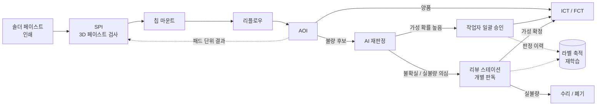
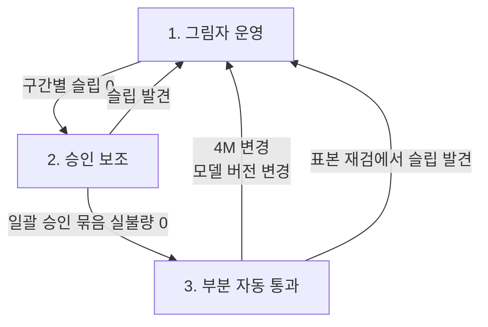

## 불량이라고 표시된 기판 앞에 사람이 서 있다

자동차 부품 공정을 공정군별로 정리한 기준서를 만들면서 전자실장 절을 채우다가 한 칸에서 오래 멈췄다. 품질 관리 포인트 칸의 측정시스템분석(MSA) 항목에 "AOI 가성 불량률(false call)과 누락"이라는 한 줄이 들어갔는데, 이 한 줄이 라인의 사람 배치를 정한다.

AOI(Automated Optical Inspection, 자동 광학 검사)는 리플로우를 마친 기판을 카메라로 찍어 솔더 접합과 부품 위치를 판정하는 장비다. AOI가 불량이라고 표시한 기판은 리뷰 스테이션(작업자가 불량 후보 이미지를 보고 진짜 불량인지 확정하는 자리)으로 간다. 이 자리에 올라오는 후보 중 양품을 불량으로 잘못 짚은 것이 가성불량(false call)이다.

가성불량이 얼마나 많은지는 공개 자료마다 편차가 크다.

| 출처 | 내용 | 성격 |
|---|---|---|
| Cogiscan 기고(Evertiq) | AOI 프로그램에 따라 가성불량 비율 30~80% | 고객 대화 기반 추정, 장비사 자료 |
| Mycronic 기사(2024.12) | AOI 불량 10건 중 가성 8건, 실불량 2건 | 설명용 예시 |
| Ulster대 외 논문(arXiv 2505.03576) | 솔더 검사 917개 부품에서 가성 표시 54,019건, 실불량 544건 | 실측 데이터, 비율은 내가 계산(약 99%가 가성) |

세 숫자의 공통점은 한 가지다. 리뷰 스테이션에 올라오는 후보의 상당수가 양품이고, 작업자는 그 양품을 하나씩 "불량 아님"으로 확인하는 데 시간을 쓴다.

> **AOI의 가성불량은 미탐을 피하려고 일부러 좁혀 둔 임계값이 치르는 비용이다.**

## BMS 보드 SMT 라인의 흐름

BMS(Battery Management System) 보드가 거치는 SMT(Surface Mount Technology, 표면실장) 라인은 기준서에 정리한 전자실장 공정 흐름과 같다.

*그림. SMT 라인에서 AI 재판정이 들어가는 자리. AOI와 리뷰 스테이션 사이에 끼우고, 사람의 최종 확인은 없애지 않는다.*

각 단계가 남기는 데이터는 이렇다.

- SPI(Solder Paste Inspection): 패드마다 페이스트 체적(%), 높이(μm), 면적(%), 오프셋(μm)
- 마운트: 흡착률, 장착 오프셋
- 리플로우: 존별 온도, 피크 온도, TAL(액상선 이상 유지 시간, s), 질소 분위기라면 산소 농도(ppm)
- AOI: 판정 결과와 불량 후보 이미지
- ICT/FCT(In-Circuit Test / Functional Test): 전압·저항·전류 측정값과 판정

대표 불량은 솔더 브리지, 미납·냉납, 보이드, 툼스톤(칩 한쪽이 들려 서는 현상), 부품 틀어짐·누락·역삽, 솔더볼, 헤드 인 필로우(BGA 볼과 페이스트가 붙지 않고 맞닿기만 한 상태)다. AOI는 이 중 겉으로 보이는 것을 잡는다. BGA 아래 보이드나 헤드 인 필로우는 AXI(X-ray 검사) 영역이다.

## AOI가 보수적으로 판정하는 이유

AOI 판정은 부품 종류별로 정한 허용 범위(tolerance)와 측정값을 비교하는 방식이다. 틀어짐 몇 μm까지, 필렛 높이 몇 %까지를 프로그램에 적어 두고 범위를 벗어나면 불량 후보로 띄운다.

이 범위를 넓히면 가성불량이 줄고 미탐이 늘어난다. 좁히면 반대다. 차량 전장 라인은 미탐 쪽 비용이 훨씬 크기 때문에 범위를 좁게 잡는다. 여기에 부품 공급사 변경, 페이스트 변경, 기판 색상이나 실크 인쇄 차이 같은 변동이 들어오면 같은 프로그램에서도 가성불량이 늘어난다. Mycronic 기사도 재료·부품·기판 설계의 변동이 새로운 가성불량 흐름을 만든다고 적는다.

허용 범위 자체를 데이터로 다시 잡는 방법도 있다. 앞의 Ulster대 논문은 과거 가성불량 측정값의 백분위수로 허용 범위를 재계산했다. 80백분위 기준에서 가성 표시가 54,019건에서 44,209건으로 18% 줄었고, 75백분위에서는 22% 줄었다. 두 경우 모두 실불량 544건은 전부 그대로 잡았다. 임계값 조정만으로는 20% 안팎이 한계라는 것도 이 숫자에서 읽힌다. 나머지는 이미지를 다시 보는 판정기가 맡아야 한다.

## BMS 보드가 실장 품질에 민감한 이유

BMS 보드는 셀 전압 측정, 온도 측정, 셀 밸런싱, SOC(State of Charge, 충전 상태)·SOH(State of Health, 노화 상태) 추정을 맡는다. 측정 정밀도의 단위부터 보면 실장 불량이 왜 바로 기능 문제가 되는지 보인다.

배터리 모니터 IC 하나를 예로 든다. TI BQ79616은 16직렬 셀을 한 칩으로 측정하는 AFE(Analog Front End)이고, 데이터시트 기준 ADC 정확도는 ±1.5mV, 밸런싱 전류는 240mA다. 셀 입력단에는 차동 RC 필터를 외부 부품으로 단다. mV 단위 측정을 하는 회로의 입력단에 저항과 커패시터가 칩 부품으로 촘촘히 붙어 있는 구조다.

| 실장 불량 | BMS 기능에 미치는 영향(추론) |
|---|---|
| 셀 감지 라인 솔더 브리지 | 인접 셀 채널 단락, 측정값 왜곡 또는 과전류 |
| 냉납·미납 | 접촉 저항 변동, 측정값 잡음과 간헐 오류 |
| 필터 부품 툼스톤·누락 | 입력 필터 미동작, 잡음 유입 |
| 밸런싱 저항·FET 접합 불량 | 밸런싱 전류 경로의 발열, 밸런싱 미동작 |
| 서미스터 회로 접합 불량 | 온도 측정 오류, 보호 로직 오판 |

표의 오른쪽 열은 회로 구조에서 내가 추론한 것이고 특정 사고 사례에서 가져온 것이 아니다. 다만 방향은 분명하다. SOC 추정은 셀 전압과 전류, 온도를 입력으로 쓰기 때문에 측정 오차가 추정 오차로 그대로 이어진다. 그리고 냉납처럼 출하 검사를 통과한 뒤 진동과 열 사이클을 거치며 드러나는 불량이 있다. 기준서에서 이 공정군의 특별특성 항목에 "기능 안전 관련 회로, 절연"을 적은 이유가 여기에 있다.

## 차량 전장의 품질 요구: CQI-17과 IATF 16949

CQI-17은 AIAG(Automotive Industry Action Group)가 낸 솔더링 시스템 평가 지침이다. 2010년에 초판이 나왔고 2021년 10월에 2판(Electronic Assembly Manufacturing - Soldering System Assessment)이 나왔다. 웨이브, 리플로우, 선택적 솔더링, 수작업 솔더링을 다룬다. 평가 구성은 경영 책임과 품질 계획, 현장과 자재 취급, 설비, 작업 감사의 4개 절과 공정 요구사항 표(Process Tables)다. AIAG가 밝힌 2판의 변경점에는 이상 발생 시 대응 계획, 추적성 관리, EOS/ESD 손상 방지, 성과 지표 문서화 확대가 들어 있다.

자동차 부품의 품질경영시스템 표준은 IATF 16949다. CQI-17 교육 자료는 이 지침이 국제 품질경영시스템 표준, 고객 특정 요구사항(CSR)과 함께 솔더링 관리 체계의 기본 요구를 정의한다고 설명한다. 자동차 부품 라인에서 그 품질경영시스템 표준 자리에 놓이는 것이 IATF 16949다. 기준서에 정리한 전자실장 품질 관리 포인트는 이렇다.

- 추적성: 기판에 새긴 DMC(Data Matrix Code)로 부품 릴 로트까지 연결
- 4M 변경 재승인: 부품 대체, 솔더 페이스트 변경, 리플로우 프로파일 변경, 펌웨어 변경
- SPC: SPI 체적, 리플로우 피크·TAL
- MSA: AOI 가성불량률과 누락

AI 재판정기를 라인에 넣는 것도 검사 체계의 변경이다. 판정 주체가 바뀌기 때문에 재판정 모델 자체가 MSA 대상이 되고, 모델 버전이 바뀌면 재승인 절차를 밟아야 한다는 결론이 이 목록에서 나온다.

## 딥러닝 재판정의 구조

재판정기의 입력은 AOI가 띄운 불량 후보 이미지와 AOI의 측정값이다. 출력은 "가성 확률"이다. 학습 라벨은 리뷰 스테이션 작업자가 이미 남겨 온 판정 이력이다. 라벨을 따로 만들 필요가 적다는 점이 이 과제의 장점이다.

상용 제품 하나를 보면 구조가 구체적으로 보인다. Mycronic DeepReview는 3D AOI용 자동 불량 분류 시스템이다. 2024년 12월 기사 기준으로 정리하면 다음과 같다.

- 서버는 현장(on-premises)에 두고 데이터 수집·저장·학습·추론을 모두 내부에서 처리
- 각 고객의 과거 생산 이미지와 작업자 판정 이력으로 학습, 학습 시간은 약 30분
- 현재 범위는 작은 부품의 2D 컬러 이미지(틀어짐, 솔더 접합 불량), QFP 이상 부품의 리드 단위 분석은 예정
- 장비사가 제시한 기대치는 가성불량 50~90% 감소

장비사와 별개로 기존 AOI 위에 얹는 재판정 소프트웨어도 있고, Cogiscan은 유럽 EMS 고객 사례로 수동 확인 작업 최대 60% 감소를 적었다. 이 수치들은 모두 장비사가 낸 것이고 측정 조건은 공개되어 있지 않다.

## 미탐을 늘리지 않는 운영: Recall 우선과 승인 단계

이 과제에서 가장 조심할 숫자는 감소율이 아니다. Siemens와 헬싱키대 연구진의 논문(arXiv 2506.14521)은 이 문제를 정면으로 다룬다. AOI와 리뷰 스테이션 사이에 머신러닝 판정 단계를 넣는 설정에서, 실불량을 가성으로 판정해 다음 공정으로 넘기는 것을 슬립(slip)이라 부른다. 연구진은 성공 기준을 "작업자 검토 물량 40% 이상 감소, 슬립률 1% 이하"로 먼저 정했다.

결과는 이렇다.

- 데이터의 클래스 불균형이 99% 수준이라, 항상 양품이라고 답하는 더미 분류기의 정확도가 99.2%였다
- 정확도, F1, AUC 같은 일반 지표로 고른 모델은 사업 기준을 맞추지 못했다
- 요구사항에 맞춘 지표로 고른 모델은 테스트셋에서 두 기준을 모두 맞췄다
- 그 뒤 시간순으로 나눈 다섯 개 평가 구간에서는 첫 구간부터 슬립률이 1%를 넘었다(약 7~10%)

연구진은 이 모델을 배치하면 실패한다고 결론 냈다. 테스트셋 성적이 좋아도 생산 데이터는 시간에 따라 움직인다.

이 대목에서 다른 업종의 비전검사 설계가 떠올랐다. 나는 식품 제조 라인의 외관 불량 판정 모델 성능지표를 정한 적이 있다. 거기서 기준을 "미탐 비용이 오탐 비용보다 크다, 따라서 Recall(실불량을 불량으로 잡는 비율)을 우선한다"로 두고 목표를 Recall 85~90%로 잡았다. 과탐 일부는 허용하는 정책도 함께 적었다. 지연 목표는 컨베이어 위 제품을 실시간으로 봐야 해서 프레임당 50ms 이하(20 FPS 이상)였다.

다른 업종 라인에서 설계해 본 이 구조를 BMS 보드 라인에 옮겨 보면 두 군데가 달라진다.

첫째, Recall 목표치의 자리가 바뀐다. 식품 라인 모델은 1차 판정기였고 85~90%는 1차 판정기의 목표였다. SMT 재판정기는 AOI가 이미 잡은 후보만 다시 본다. 이 위치에서 실불량을 가성으로 넘기면 바로 유출이므로 실불량 Recall은 사실상 100%에 붙어 있어야 한다. 줄일 수 있는 것은 가성불량 물량이고, 그 감소율은 Recall을 지키는 범위 안에서 얻는 부산물이다.

둘째, 지연 예산의 단위가 바뀐다. 재판정은 기판 하나에 딸린 후보 이미지 묶음을 단위로 판정한다. 기준은 라인 택트 안에 끝나는가, 그리고 리뷰 스테이션 앞에 기판이 쌓이지 않는가다. 50ms라는 숫자를 그대로 가져올 이유는 없다.

이 두 가지를 반영한 운영 단계는 아래처럼 잡는다.

| 단계 | AI의 역할 | 사람의 역할 | 다음 단계로 넘어가는 조건 |
|---|---|---|---|
| 1. 그림자 운영 | 판정만 기록, 라인에 영향 없음 | 기존처럼 전수 판독 | 시간순 구간별로 슬립 0건 유지 |
| 2. 승인 보조 | 가성 확률 높은 후보를 묶어 제시 | 묶음을 보고 일괄 승인, 불확실 건은 개별 판독 | 일괄 승인 묶음에서 실불량 발견 0건 유지 |
| 3. 부분 자동 통과 | 검증된 부품 유형에 한해 자동 통과 | 나머지 판독, 표본 재검 | 4M 변경 시 1단계로 복귀 |

*그림. 재판정기 운영 단계. 변경이나 슬립이 생기면 그림자 운영으로 되돌아간다.*

Siemens 논문이 지적한 감시의 어려움도 이 표에 들어 있다. 재판정기가 잘 작동할수록 사람이 보는 이미지가 줄고, 모델을 평가할 정답 라벨도 같이 줄어든다. 3단계에서 표본 재검을 남겨 두는 것은 그 라벨을 일부러 계속 만들기 위해서다.

## 이 사례에서 도구가 한 일과 내가 정한 일

공정 흐름, 공정변수, 불량 유형, 표준 목록은 공개 자료를 모아 기준서로 정리했다. 그 정리 작업은 도구가 빨리 해 준다. 웹에서 장비사 제품과 논문 수치를 찾아오는 일도 마찬가지다.

남은 일은 판단이었다. 장비사가 낸 50~90%와 논문의 18~22%, 32.4%(Reshadat과 Kapteijns가 kNN 분류기로 보고한 가성불량 감소율)를 같은 표에 놓고 성격이 다른 숫자라고 구분하는 일, 다른 업종에서 정한 Recall 85~90%가 이 위치에서는 그대로 쓸 수 없는 숫자라는 걸 알아보는 일, 그리고 슬립 0건을 단계 전환 조건으로 적는 일이다. 재판정기의 성능은 모델이 정하지만, 무엇을 성공으로 볼지는 라인을 책임지는 사람이 먼저 적어야 한다.

## 참고

- Cogiscan, AOI 가성불량과 AI 적용에 관한 Evertiq 기고: <https://evertiq.com/nanews/42295>
- Mycronic, "The false call killer" (2024.12.12): <https://www.mycronic.com/product-areas/pcb-assembly/news-and-press-releases/news/the-false-call-killer/>
- Kogileru 외, "Design and Development of a Robust Tolerance Optimisation Framework for Automated Optical Inspection in Semiconductor Manufacturing", arXiv:2505.03576 (2025): <https://arxiv.org/abs/2505.03576>
- Pfab, Rothering, "Towards Improved Research Methodologies for Industrial AI: A case study of false call reduction", arXiv:2506.14521 (2025): <https://arxiv.org/abs/2506.14521>
- AIAG, CQI-17 2판 발간 안내 (2021.10.07): <https://blog.aiag.org/second-edition-now-available-get-your-copy-of-the-updated-cqi-17-today>
- Omnex, CQI-17 교육 과정 개요: <https://training.omnex.com/continuous-quality-improvement/cqi-17-understanding-soldering-system-assessments>
- Texas Instruments, BQ79616 제품 정보: <https://www.ti.com/product/BQ79616>
