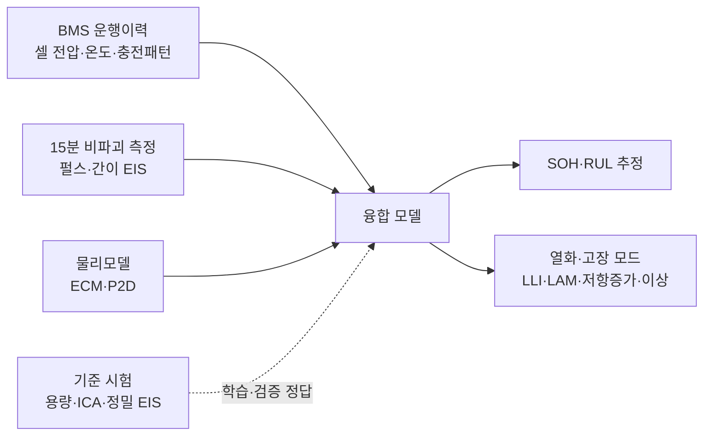
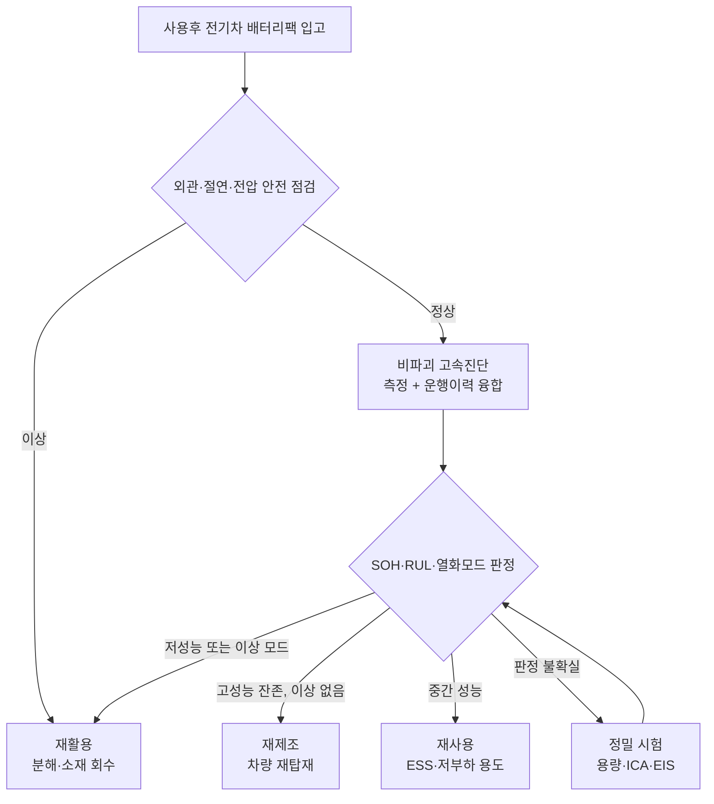

## 공고에 적힌 네 줄

한 공공 R&D 과제 공고의 정량 목표 칸에 다음 네 줄이 있다.

- 전기차 배터리팩 비파괴 고속진단 소요시간 15분 이내
- 충·방전 용량시험 대비 SOH·RUL 추정오차 ±5% 이내
- 순환 경로 판정을 위한 열화·고장 모드 판별 정확도 95% 이상
- 정밀 성능평가 대비 진단·평가 비용 절감률 70% 이상

같은 공고는 연구목표를 "차량 운행이력과 사용후 배터리 진단 데이터를 융합하여 상태와 재사용 내구수명을 예측하고, 가치평가를 통해 최적 자원순환 경로를 결정"하는 것으로 적는다. 숫자 네 개가 각각 무엇을 기준으로 재는지 풀어 보면, 이 과제가 실제로 풀어야 하는 문제의 모양이 드러난다. 이 글은 그 해석 노트다.

> **15분과 ±5%는 서로 당기는 숫자다. 기준값은 몇 시간짜리 시험에서 나오고, 진단은 그 시험을 15분 안에 흉내 내야 한다.**

## SOH와 RUL, 무엇을 기준으로 재는가

SOH(State of Health, 건강 상태)는 보통 현재 만충 용량을 정격 용량으로 나눈 값이다. 정격 60 kWh 팩에서 지금 48 kWh가 나오면 SOH 80%다. 내부저항 증가율로 정의하는 방식도 있지만, 공고가 "충·방전 용량시험 대비"라고 적었으므로 여기서는 용량 기준 SOH로 읽는 것이 맞다.

RUL(Remaining Useful Life, 잔존 유효 수명)은 지금부터 수명 종료 기준에 닿을 때까지 남은 사이클 수나 기간이다. 수명 종료 기준은 하나로 정해져 있지 않다. 사용후 배터리 진단 연구를 정리한 2025년 리뷰는 많은 완성차와 표준이 용량 80%를 모빌리티 용도의 수명 종료로 쓰고, 일부 제조사는 70%까지 허용한다고 정리한다. RUL은 어느 용도로, 어떤 부하 조건에서 쓰느냐에 따라 값이 달라진다. ESS로 옮겨 하루 한 번 충방전하는 경우와 차량에 다시 넣는 경우의 RUL은 같은 배터리라도 다르다.

여기서 ±5%의 해석이 갈린다.

| 해석 | SOH 80% 배터리에서 허용 범위 | 의미 |
|---|---|---|
| 절대 오차 ±5%p | 75~85% | 등급 경계(80%) 근처 배터리는 판정이 뒤집힐 수 있다 |
| 상대 오차 ±5% | 76~84% | 절대 오차보다 약간 좁다 |
| RUL 상대 오차 ±5% | 예: 1,000사이클 예측이면 950~1,050 | 미래 사용 조건을 고정해야 정의가 성립한다 |

SOH는 같은 날 용량시험을 한 번 더 돌리면 정답이 나온다. RUL은 정답을 얻으려면 그 배터리를 수명 끝까지 써 봐야 한다. 그래서 RUL ±5%를 검증하려면 가속 수명 시험 데이터나 장기 운용 데이터 같은 별도의 기준 데이터가 필요하다. 이 차이는 과제 기간 안에 무엇을 검증할 수 있는지와 직결된다.

## 진단 방법 다섯 가지와 시간

15분이라는 숫자가 어려운 이유는 기준값을 만드는 시험이 몇 시간 단위이기 때문이다. 대표 진단법을 측정 대상과 시간으로 나란히 놓으면 다음과 같다.

| 방법 | 측정하는 것 | 소요 시간 | 강점 | 한계 |
|---|---|---|---|---|
| 용량 완충방전 시험 | 실제로 꺼낼 수 있는 Ah·Wh | 셀당 수 시간. 1/3C면 충전·방전만 각 3시간 | SOH 정의 그 자체, 기준값 | 15분 목표와 양립 불가, 에너지 소모 |
| 내부저항(DCIR) | 짧은 전류 펄스에 대한 전압 강하 | 짧은 펄스 수준 | 교대조당 수천 셀 선별이 가능할 만큼 빠름 | 온도·SOC에 민감, 원인 분리 불가 |
| EIS 임피던스 분광 | 주파수별 임피던스(옴 저항, 전하전달, 확산) | 저주파가 시간을 지배. 한 리튬이온 셀 측정 예에서 single-sine 20분 38초, multisine 5분 22초 | 열화 원인을 성분별로 분리 | 휴지 상태 필요, 팩 단위 고전압 측정 장비 부담 |
| ICA(dQ/dV) 증분용량분석 | 전압-용량 곡선의 미분 피크 이동·감소 | C/20 이하 저율 충방전 필요. C/20 완충만 이론상 20시간 | LLI·LAM 열화 모드 구분 | 시간, 실험실 조건 의존 |
| 펄스 시험(HPPC, 다단 펄스) | 펄스 응답에서 저항·동특성 추출 | 수 분 수준 연구 보고 | 자동화 라인에 적합, 조기 열화에 민감 | 펄스 설계가 결과를 좌우 |

몇 가지 수치를 보충한다.

EIS 측정 시간은 주파수에 반비례한다. 한 주기를 재려면 그 주기만큼의 시간이 필요해서, 10 mHz 한 점에만 최소 100초가 들어간다. 전지 셀용으로 흔히 쓰는 범위는 1 mHz~10 kHz이고, 상용 배터리 임피던스 측정기 예로 Hioki BT4560-60은 0.01 Hz~10 kHz를 지원한다. 고속진단에서 EIS를 쓰려면 저주파 하한을 어디서 자를지, 몇 개 주파수만 볼지가 설계 변수가 된다. 앞의 리뷰는 제한된 주파수의 간이 등가회로 파라미터로 퇴역 배터리 SOH를 2% 미만 오차로 추정한 연구를 소개한다.

ICA에서 피크가 전압 축 방향으로 평행 이동하면 SEI(음극 표면 피막) 성장으로 순환 가능한 리튬이 줄어든 LLI(리튬 재고 손실), 특정 피크 높이가 줄면 입자 균열 등으로 활물질이 줄어든 LAM(활물질 손실)으로 해석한다. 공고의 "열화·고장 모드 판별"이 이 구분을 가리킨다면 ICA나 그에 준하는 정보가 필요하다. 문제는 C/20 이하 저율이라는 조건이다.

같은 리뷰는 고주파·다단 펄스의 고조파를 머신러닝으로 학습해 IC 극값을 복원하고 수 분 안에 임피던스형·IC형 진단을 동시에 수행한 연구, LFP 셀의 좁은 전압 구간 부분충전으로 전체 용량을 추정해 시험 시간을 절반 넘게 줄인 연구를 정리한다. 15분 목표는 이 계열 기법을 팩 단위로 끌어올리는 문제로 읽힌다.

## 물리모델과 데이터 모델을 섞는 이유

짧은 측정으로 긴 시험의 결과를 맞히려면 모델이 빈 정보를 채워야 한다. 공고는 "멀티스케일 물리모델"과 "멀티모달 융합형 AI 모델"을 함께 요구한다. 두 축은 하는 일이 다르다.

| 모델 | 구조 | 쓰임 | 약점 |
|---|---|---|---|
| 등가회로 모델(ECM) | 저항·RC 회로로 전압 응답 근사 | 펄스·EIS 결과를 파라미터로 압축 | 열화 원인과의 대응이 느슨함, 고열화 시 파라미터 비유일성 |
| 전기화학 P2D(DFN) 모델 | 다공성 전극 내 리튬 확산·반응·전하 보존을 편미분방정식으로 풂 | 전극 내부 위치별 열화(리튬 석출 등) 해석 | 파라미터가 많고 계산이 무거움 |
| 축약 모델(SPM, SPMe) | P2D를 단일 입자로 축약 | 속도와 물리 해석의 절충 | 고율 조건에서 정확도 손실 |
| 데이터 기반 모델 | 스펙트럼·곡선·로그에서 직접 학습 | 회로 가정 없이 특징 추출 | 화학계·형식·이력 다양성을 덮는 학습 데이터 필요 |

P2D는 Doyle-Fuller-Newman 모델로도 불리고, 오픈소스 PyBaMM에 DFN·SPM·SPMe가 함께 구현되어 있다. 융합의 실제 형태는 대체로 둘 중 하나다. 물리모델로 열화 시나리오별 가상 데이터를 만들어 데이터 모델의 학습 공백을 메우거나, 물리모델의 파라미터(LLI량, LAM량, 저항 성분)를 데이터 모델의 출력 목표로 삼아 결과를 해석 가능하게 만든다. 판별 결과가 "재사용 불가"로 나왔을 때 그 이유를 LAM 비율로 설명할 수 있어야 다음 단계 사업자가 판정을 받아들인다.

## BMS 로그를 더하면 달라지는 것

공고가 "SDV 기반 차량 운행이력"을 진단 데이터와 융합하라고 적은 이유는 팩 단위 측정의 한계에 있다. 400V급 팩은 공칭 3.6~3.7V 셀 그룹 100개 안팎이 직렬로 연결된 구조라, 외부 단자에서 측정하면 그 합만 보인다. 가장 약한 셀 그룹 하나가 팩 전체의 사용 가능 용량을 결정하는데, 합산 측정으로는 그 셀이 어디인지 보이지 않는다.

BMS(배터리 관리 시스템) 로그에는 셀 그룹별 전압, 온도, 충전 이력이 남는다. 급속충전 비율, 고온 노출 시간, 셀 간 전압 편차의 추이가 있으면 짧은 외부 측정 결과를 해석할 맥락이 생긴다. 이력이 있는 배터리와 없는 배터리를 같은 모델로 판정할 수 없다는 점도 함께 따라온다. 로그 결측은 실제 현장에서 흔하므로, 모델은 이력 없이도 동작하는 경로와 이력으로 보정하는 경로를 둘 다 가져야 한다.

*그림. 운행이력·고속 측정·물리모델을 묶는 융합 구조. 점선은 정답 라벨을 공급하는 기준 시험이다.*

## 판정 결과가 정하는 경로

진단의 최종 산출물은 이 배터리를 어디로 보낼지에 대한 결정이다. SOH는 그 결정의 입력값 중 하나다. 앞의 리뷰는 SOH 80% 초과를 고부하 재사용, 50~80%를 ESS·백업 전원 같은 저부하 용도, 50% 미만이나 비정상 저항 증가·물리적 결함은 재활용으로 보내는 3단 구분이 널리 쓰인다고 정리한다. 다만 경계값은 지역과 기관마다 다르다.

국내도 같은 3단 구조로 제도화가 진행 중이다. 2026년 제정된 사용후 배터리 관련 법은 탈거 전 성능·안전 평가를 도입했고, 2026년 10월 보도 기준으로 2027년 5월 시행 예정이다. 성능평가 결과는 재제조·재사용·재활용 3개 등급으로 나뉘고, 판정 등급보다 높은 용도로 쓰는 것은 제한된다. 2024년 정부 발표에서는 잔존 성능이 높은 배터리를 재제조로 분류해 새 차에도 쓸 수 있게 하는 방향이 제시됐다. 세부 평가 기준은 관계 부처가 하위 법령으로 함께 논의하는 단계다.

*그림. 진단에서 순환 경로 결정까지의 흐름. 판정 불확실 구간을 정밀 시험으로 되돌리는 경로가 비용 절감률을 좌우한다.*

재활용 쪽에도 수치 목표가 붙어 있다. 공고는 전이금속·리튬·전해질 재자원화 85% 이상을 적었다. EU 배터리 규정(Regulation (EU) 2023/1542)은 리튬 회수율을 2027년까지 50%, 2031년까지 80%로, 코발트·구리·납·니켈은 2027년 90%, 2031년 95%로 정했다. EV 배터리에는 QR 코드로 접근하는 배터리 여권이 2027년부터 요구되고, 여권 정보에는 SOH 같은 상태 정보가 포함된다. 진단 결과가 규제 데이터로 이어지는 구조다.

## 95%와 70%를 같이 읽기

판별 정확도 95%는 어떤 라벨로 채점하느냐에 따라 난이도가 크게 바뀐다. 입고 배터리의 대부분이 "정상 열화"이고 리튬 석출이나 내부 미세단락 같은 이상 모드가 소수라면, 전부 정상이라고 답해도 정확도가 높게 나온다. 의미 있는 검증이 되려면 모드별 재현율을 따로 보고, 이상 모드의 정답 라벨은 정밀 시험이나 해체 분석으로 확보해야 한다.

비용 절감률 70%는 위 흐름도의 "판정 불확실" 비율과 묶여 있다. 고속진단으로 확정 판정하는 비율이 높을수록 정밀 시험 횟수가 줄어 비용이 내려가지만, 그만큼 경계값 근처의 오판 위험을 감수해야 한다. 불확실 구간을 얼마나 넓게 잡을지는 운영 정책으로 정할 문제다. 오판 한 건의 비용(재사용 후 조기 고장, 혹은 쓸 만한 배터리의 조기 재활용)을 금액으로 정의해야 이 구간을 정할 수 있다.

## 정리

이 공고를 읽으며 Claude는 진단법별 소요 시간, EU 규정의 회수율, 국내 법 시행 일정 같은 공개 자료를 찾아 정리했다. 그 수치들을 한 표에 놓으면 15분과 ±5%가 왜 동시에 어려운지는 금방 보인다.

모델을 학습시키는 일은 도구가 상당 부분 대신할 수 있다. 대신하기 어려운 것은 그 앞의 정의다. ±5%를 절대 오차로 볼지 상대 오차로 볼지, RUL의 수명 종료 기준을 80%로 둘지 70%로 둘지, 판별 정확도를 전체 정확도로 셀지 모드별 재현율로 셀지, 불확실 판정을 어디서 정밀 시험으로 돌릴지. 이 질문들에 답이 정해져야 데이터 수집 계획과 검증 시험이 설계된다. 숫자 네 줄을 읽는 일은 결국 이 정의 목록을 만드는 일이었다.

## 참고

- Experimental Methods, Health Indicators, and Diagnostic Strategies for Retired Lithium-ion Batteries: A Comprehensive Review (arXiv 2512.01294, 2025): <https://arxiv.org/abs/2512.01294>
- Learning Li-ion battery health and degradation modes from data with aging-aware circuit models (arXiv 2407.06639): <https://arxiv.org/abs/2407.06639>
- BioLogic, EIS measurements with multisine, Battery & Corrosion Application Note 19: <https://www.biologic.net/documents/eis-multisine-electrochemistry-battery-corrosion-application-note-19/>
- Gantner Instruments, Electrochemical impedance spectroscopy: <https://www.gantner-instruments.com/blog/electrochemical-impedance-spectroscopy/>
- Hioki, Battery Impedance Meter BT4560-60: <https://www.hioki.com/sg-en/products/resistance-meters/battery/id_1381510>
- MathWorks, Simulate Battery Using Doyle-Fuller-Newman Model: <https://www.mathworks.com/help/simscape-battery/ug/simulate-battery-using-doyle-fuller-newman-model.html>
- PyBOP documentation, lithium-ion models (PyBaMM DFN·SPM·SPMe): <https://pybop-docs.readthedocs.io/en/v25.6/api/pybop/models/lithium_ion/echem/index.html>
- European Parliament Legislative Observatory, Batteries and waste batteries 요약: <https://oeil.europarl.europa.eu/oeil/en/document-summary?id=1754181>
- IEA, EU Sustainable Batteries Regulation: <https://www.iea.org/policies/16763-eu-sustainable-batteries-regulation>
- Arianee, Battery passport requirements 2027: <https://www.arianee.com/en/blog/battery-passport-requirements-2027>
- 한국경제, 사용후 배터리 안전관리·재제조 순환체계 세미나 보도(2026-10-01): <https://hankyung.com/article/202610017473g>
- 헤럴드경제, 사용후 배터리법 국회 본회의 통과 보도(2026-04-23): <https://www.heraldk.com/article/2026042302202453419>
- 데일리안, 전기차 폐배터리 성능평가·재제조 방안 보도(2024-07-10): <https://www.dailian.co.kr/news/view/1381642/>
