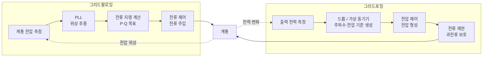
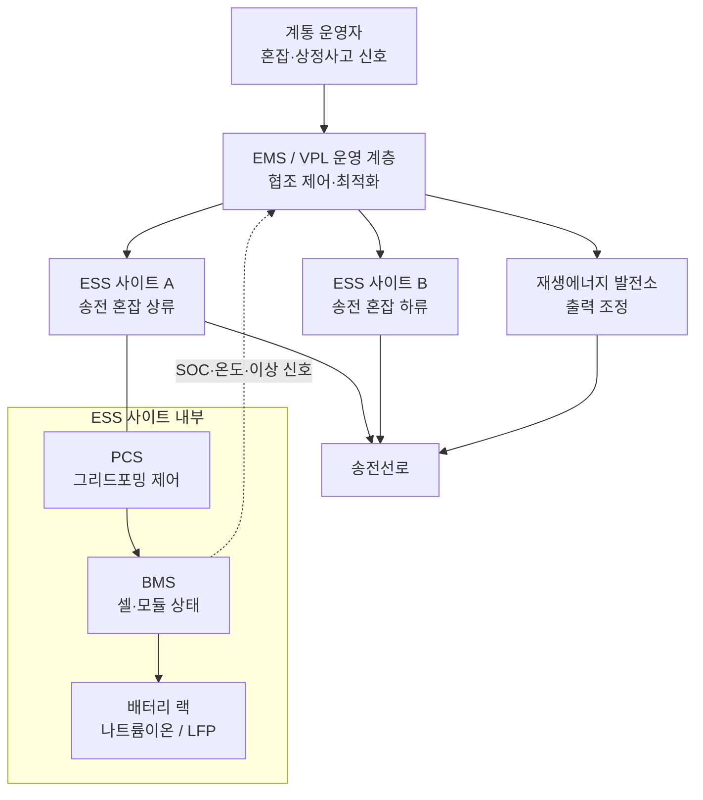

## 공고 두 장이 같은 질문을 하고 있었다

공공 R&D 과제 공고들을 읽다가 에너지 분야 두 건이 한 묶음이라는 걸 알게 됐다. 하나는 나트륨이온전지로 ESS(Energy Storage System, 전력 저장 장치)를 만들고 그 ESS를 그리드포밍 방식으로 운전하라는 과제였다. 다른 하나는 이미 깔린 분산 자원과 ESS를 EMS(Energy Management System, 에너지 관리 시스템)로 묶어 송전선을 새로 놓지 않고도 송전 여유를 만들라는 과제였다. 두 공고는 서로를 연계 과제로 지목했고, 역할도 갈라 놓았다. 앞의 것은 디바이스 레벨(ESS 모듈과 인버터 단위 제어), 뒤의 것은 시스템 레벨(다수 자원 협조와 계통 운영 최적화)이다.

앞 공고의 정량 목표가 구체적이었다. 실증 용량 1MWh 이상 2기, 그리드포밍 운전 성공률 90% 이상, 리튬이온 대비 20년 총소유비용 30% 절감, 셀 에너지밀도 160Wh/kg 이상, 양극재 공정 5kg/day 스케일업. 숫자를 읽고 나니 질문이 세 개로 좁혀졌다. 160Wh/kg은 어느 정도 수준인가. 그리드포밍은 왜 굳이 요구하는가. 그리고 이 ESS가 계통 운영에 어떤 구조로 들어가는가. 이 글은 그 세 질문에 대한 스터디 노트다.

> **나트륨이온 ESS는 원료 공급망과 20년 총소유비용으로 경쟁하고, 그리드포밍은 그 ESS가 계통에서 맡을 일을 바꾸는 제어 방식이다.**

## 셀 화학 비교: LFP, NCM, 나트륨이온

ESS용 셀은 지금 LFP(리튬인산철)가 주류이고, 전기차는 NCM(니켈코발트망간 삼원계)과 LFP가 나뉘어 있다. 나트륨이온은 리튬 대신 나트륨 이온이 양극과 음극 사이를 오가는 전지다. 공칭 전압은 셀당 3.0~3.1V로 LFP(약 3.2V)와 비슷하다. 양극재는 층상 산화물, 프러시안 블루 계열, NVPF(Na3V2(PO4)2F3) 같은 폴리음이온계가 경쟁하고, 음극은 하드카본(흑연보다 무질서한 구조의 탄소)이 사실상 표준이다.

수치는 출처마다 범위가 꽤 다르다. 학술 리뷰의 비교표와 제조사 발표를 나란히 놓으면 이렇다.

| 항목 | LFP | NCM | 나트륨이온 |
|---|---|---|---|
| 셀 에너지밀도 (리뷰 표 기준) | 120~200 Wh/kg | 150~220 Wh/kg | 100~160 Wh/kg |
| 상용 셀 발표치 | 약 185 Wh/kg (비교 기준으로 언급) | 고니켈 계열은 더 높음 | 1세대 160 Wh/kg(2021), 2세대 175 Wh/kg(2025) |
| 사이클 수명 (리뷰 표 기준) | 2,000~8,000 | 약 1,800~2,500 | 500~2,000 |
| 사이클 수명 (제조사 발표) | - | - | 4,500회(2022), 10,000회 이상 주장(2025) |
| 저온 특성 | 보통 | 양호 | 리뷰는 "낮음~보통", 제조사는 -20°C 방전 유지율 90% 이상(1세대), -40°C 동작(2세대) 주장 |
| 열 안전성 (리뷰 표 기준) | 매우 높음 | 중간 | 높음 |
| 원료 | 리튬, 철, 인. 코발트·니켈 없음 | 리튬, 니켈, 코발트, 망간 | 나트륨, 철·망간 산화물 가능. 리튬·코발트·니켈 불필요 |
| 집전체 | 양극 알루미늄, 음극 구리 | 양극 알루미늄, 음극 구리 | 양극·음극 모두 알루미늄 가능 |

*표. 리뷰 표는 Oxford Academic 게재 비교표(Table 6), 상용 셀 수치는 제조사 발표를 보도한 기사 기준. 하단 참고 절에 링크.*

이 표에서 읽히는 것은 두 가지다. 첫째, 공고의 160Wh/kg 목표는 중국 업체가 2021년에 발표한 1세대 셀과 같은 숫자다. 같은 업체가 2025년 4월 발표한 2세대 셀은 175Wh/kg이었고, 비교 대상으로 든 LFP가 185Wh/kg였다. 나트륨이온은 아직 LFP를 에너지밀도로 넘지 못한다. 둘째, 사이클 수명과 저온 특성은 리뷰 표와 제조사 발표가 크게 엇갈린다. 리뷰 표는 2,000회 이하로 보고 제조사는 10,000회를 말한다. 화학 계열(층상 산화물인지 폴리음이온계인지)과 측정 조건(방전 심도, 온도)이 다르면 같은 이름의 전지라도 숫자가 몇 배 벌어진다. 그래서 공고의 "장수명 셀"이라는 핵심어는 어떤 양극재 계열을 고르느냐의 문제로 바로 이어진다.

ESS에서 에너지밀도가 덜 중요한 이유는 무게와 부피 제약이 차량보다 느슨하기 때문이다. 컨테이너 한 대에 셀이 몇 개 더 들어가느냐보다 kWh당 셀 단가와 수명이 총소유비용을 결정한다. 2025년 평균 셀 단가는 LFP 81달러/kWh, NCM 128달러/kWh 수준으로 집계됐고, 나트륨이온 팩은 아직 생산 규모가 작아 LFP보다 약 30% 비싸다는 정리가 있다. 공고가 요구하는 "20년 총소유비용 30% 절감"은 소재 국산화와 양산 규모가 받쳐 준 뒤에야 성립하는 숫자다.

## 셀, 모듈, 시스템 설계에서 달라지는 지점

나트륨이온 셀을 LFP 자리에 그대로 끼우면 끝나는 일이 아니다. 단계마다 다른 설계 판단이 생긴다.

| 단계 | 나트륨이온에서 달라지는 점 | 설계 판단 |
|---|---|---|
| 셀 | 음극 집전체를 알루미늄으로 쓸 수 있다. 나트륨은 음극 전위에서 알루미늄과 합금을 만들지 않기 때문이다 | 구리 원가 절감. 하드카본의 낮은 초기 쿨롱 효율 보상 |
| 셀 보관·운송 | 알루미늄 집전체 덕에 0V까지 방전해 운송하는 방식이 제시됐다 | 2022년 연구는 0V 안정성이 화학 조합에 따라 다르다고 결론. 셀마다 검증 필요 |
| 모듈 | 전압 곡선이 LFP보다 기울어 있어 SOC(충전 상태) 추정 방식이 다르다 | BMS(Battery Management System) 알고리즘과 셀 전압 감시 범위 재설정 |
| 시스템 | 셀 전압 범위가 LFP와 달라 직렬 수가 같아도 DC 링크 전압 범위가 바뀐다 | PCS(Power Conversion System, 전력 변환 장치) 입력 전압 범위와 맞춤 |

0V 운송은 자주 장점으로 소개되지만, 2022년 공개된 연구는 "0V 안정성은 나트륨이온 셀의 내재 속성이 아니며 셀 화학을 신중히 골라야 얻어진다"고 정리했다. 0V까지 내리면 SEI(음극 표면 보호막)가 손상되는 경우가 있었다. 안전성도 같은 방식으로 읽어야 한다. 탄소 음극을 쓰는 나트륨이온 셀도 높은 SOC에서는 열폭주 위험이 있다는 정리가 있다. 리튬이 없다고 화재 시험을 건너뛸 수는 없다.

## 그리드팔로잉과 그리드포밍

재생에너지가 늘면 왜 그리드포밍이 필요한가는 발전기의 관성에서 출발한다. 화력·원자력 발전기는 수백 톤짜리 회전자가 계통 주파수와 같은 속도로 돈다. 큰 발전기가 갑자기 떨어져 나가면 공급이 모자라는데, 그 순간 회전자의 운동에너지가 풀려 나오면서 주파수가 떨어지는 속도를 늦춘다. 이 관계를 스윙 방정식으로 쓰면 다음과 같다.

```text
# 계통 전체를 하나의 등가 발전기로 본 근사 (단위법)
(2H / f0) × df/dt = ΔP
# H  : 관성 상수(초). 회전 에너지 / 정격 용량
# f0 : 정격 주파수(60Hz)
# ΔP : 공급과 수요의 차이(정격 대비 비율)
# → 주파수 변화율 RoCoF = ΔP × f0 / (2H)
```

숫자를 넣어 보면 의미가 보인다. 정격의 10%가 빠지는 사고(ΔP = 0.1)에서 H가 5초인 계통은 RoCoF가 0.1 × 60 / 10 = 0.6Hz/s다. 회전기가 줄어 등가 H가 2초로 내려가면 같은 사고에서 1.5Hz/s가 된다. 주파수가 2.5배 빨리 떨어지니 보호 계전기와 1차 주파수 조정이 반응할 시간이 그만큼 줄어든다. 태양광과 풍력은 인버터로 계통에 붙고 인버터에는 회전자가 없다. 재생에너지 비중이 높아질수록 H가 내려가는 이유다.

이 지점에서 인버터 제어 방식이 갈린다.

| 구분 | 그리드팔로잉 (GFL) | 그리드포밍 (GFM) |
|---|---|---|
| 전기적 성격 | 전류원처럼 동작 | 전압원처럼 동작 |
| 동기화 | PLL(위상 고정 루프)로 계통 전압 위상을 측정해 따라감 | 스스로 전압 크기·주파수 기준을 만들고 드룹(droop) 또는 가상 동기기 제어로 계통과 맞춤 |
| 사고 순간 반응 | 측정과 제어 루프를 거친 뒤 출력 조정 | 전압원이므로 전력 변화에 즉시 반응, 합성 관성 제공 |
| 약한 계통 | PLL이 불안정해질 수 있음 | 약계통 운전, 마지막 동기기 탈락 상황 대응을 요구사항으로 다룸 |
| 추가로 필요한 것 | - | 순간 과전류 여유, 에너지 버퍼(배터리 헤드룸) |



*그림. 그리드팔로잉은 계통 전압을 측정해 따라가고, 그리드포밍은 자기 기준 전압을 세운 뒤 전력 변화에 맞춰 그 기준을 움직인다.*

그리드포밍의 공개 사례로는 호주 남부의 Hornsdale Power Reserve가 자주 인용된다. 2020년 증설 이후 가상 동기기 모드 시험을 거쳐 2022년 7월 계통운영자의 승인을 받았고, 운영사는 약 2,000MW·s의 등가 관성을 제공할 수 있다고 밝혔다. 2021년 퀸즐랜드의 발전소 사고 때는 주파수가 49.6Hz까지 떨어졌는데, 가상 동기기 모드로 동작한 인버터가 나머지 인버터보다 약 3분의 1초 먼저 최대 출력에 도달했다는 보도가 있다. 호주 계통운영자는 2023년 5월 그리드포밍 인버터 자율 사양을 내고 핵심 기능(전압원 동작, 관성 응답, 약계통 운전, 진동 감쇠 등)과 추가 기능(과전류 여유, 블랙스타트 등)을 나눴다. 2024년 1월에는 핵심 기능의 시뮬레이션 시험 방법도 공개했다.

이 사양 구분을 보면 공고의 "그리드포밍 운전 성공률 90%"가 무엇을 재야 하는지 감이 잡힌다. 성공률을 정의하려면 어떤 사고 시나리오(전압 위상 급변, 주파수 급락, 마지막 동기기 탈락)를 몇 회 주입해 어떤 판정 기준(주파수 하한, 응답 시간, 과전류 차단 여부)을 넘으면 성공으로 칠지부터 정해야 한다. 이 정의가 없으면 90%라는 숫자는 검증할 수 없다.

## ESS를 계통 운영에 묶는 구조

인버터 하나가 그리드포밍으로 잘 돌아도 계통 혼잡은 풀리지 않는다. 여러 ESS와 분산 자원을 한 운영 체계로 묶어야 한다. 흔히 쓰는 말이 VPP(Virtual Power Plant, 가상발전소)다. 흩어진 자원을 묶어 하나의 발전소처럼 전력시장에 참여하고 운전한다. 두 번째 공고는 여기서 한 걸음 더 나간 VPL(Virtual Power Line, 가상송전선로)을 다룬다. 혼잡한 송전선 양쪽의 ESS를 협조 제어해, 상정사고(설비 하나가 빠지는 가정) 때 한쪽은 충전하고 다른 쪽은 방전해 선로 조류를 실시간으로 줄인다. 선로를 새로 놓지 않고 송전 여유를 확보하는 비증설(Non-wire) 대안이다. 공고의 목표는 확보용량 100MW급, 상정사고 시 혼잡완화율 30% 이상, 재생에너지 출력제어 저감률 20% 이상이었다. 신규 ESS 구축은 범위에서 빼고 기존 ESS를 EMS로 연계하라고 못박은 점도 눈에 띄었다.



*그림. 계통 운영자 신호를 EMS가 받아 사이트별 지령으로 나누고, 각 사이트의 PCS와 BMS가 그 지령을 디바이스 수준에서 실행한다.*

두 공고가 역할을 나눈 선이 이 그림에 그대로 보인다. 아래 사각형(PCS, BMS, 랙)이 디바이스 레벨이고, 위의 EMS가 시스템 레벨이다. 경계에서 오가는 데이터가 설계의 핵심이다. EMS가 사이트 B에 "30초 안에 20MW 방전"을 지시하려면 그 사이트 BMS가 보고한 SOC, 셀 온도, 허용 방전 전력을 믿을 수 있어야 한다. 나트륨이온처럼 SOC 추정 방식이 다른 셀이 섞이면, 이 보고값의 정확도가 협조 제어 성능을 좌우한다.

## ESS 화재 안전: 열폭주와 UL 9540A

ESS 화재의 출발점은 열폭주(thermal runaway)다. 셀 내부 단락이나 과충전으로 온도가 오르면 전해질과 전극이 발열 반응을 일으키고, 그 열이 다시 반응을 키운다. 이 과정에서 가연성 가스가 나온다. 셀 하나의 열폭주가 옆 셀, 옆 모듈, 옆 컨테이너로 번지는지가 실제 피해 규모를 정한다.

UL 9540A는 이 전파를 평가하는 시험 방법이다. 열폭주가 어떻게 번지는지 데이터를 만드는 방법론이고, 그 자체로 인증을 주지는 않는다. ESS 설비 표준인 UL 9540이 이 방법을 인정하고, 미국 화재 코드 NFPA 855가 대규모 화재 시험의 근거로 명시해 인용한다.

| 시험 수준 | 무엇을 보는가 |
|---|---|
| 셀 | 열폭주 특성, 배출 가스 조성과 가연성 |
| 모듈 | 셀 간 열폭주 전파 경향, 열·가스 방출률, 점화·폭연 위험 |
| 유닛 | 모듈 간 화재 확산 가능성, 열·가스 방출률, 폭연·재발화 가능성 |
| 설치 | 소화 설비의 유효성, 열·가스 방출률, 폭연·재발화 위험 |

5판은 셀, 모듈, 유닛, 설치 4단계로 나뉘고, 앞 단계에서 전파가 확인되면 다음 단계로 넘어간다. 6판에서는 설치 단계가 폭연 이후 상황을 가정한 대규모 화재 시험으로 바뀌어 외함 설계, 이격 거리, 실내 설치 시 건물 소화 설비를 평가한다. 나트륨이온 ESS를 실증하려면 셀 단계부터 이 시험 데이터를 새로 쌓아야 한다. LFP 랙의 시험 결과는 화학이 다른 셀에 그대로 쓸 수 없다.

## 이 사례에서 도구가 한 일과 내가 한 일

이 글의 외부 수치는 Claude Code가 웹검색으로 모았다. 셀 에너지밀도, Hornsdale의 관성 제공량, UL 9540A의 단계 구분 같은 것들이다. 도구는 빠르게 모았고, 출처마다 숫자가 다르다는 사실도 같이 보고했다. 나트륨이온의 사이클 수명은 학술 리뷰 표에서 500~2,000회, 제조사 발표에서 10,000회 이상이었다. 저온 특성은 한쪽이 "낮음~보통", 다른 쪽이 "-40°C 동작"이었다.

어느 숫자를 본문에 둘지는 내가 정했다. 하나로 고르지 않고 두 출처를 같은 표에 나란히 두고, 제조사 수치에는 "발표" 또는 "주장"을 붙였다. 0V 운송처럼 장점으로 소개되는 항목은 반대 결론을 낸 연구가 있는지 한 번 더 찾게 했다. 공고의 정량 목표를 읽을 때도 같은 일을 했다. "운전 성공률 90%"는 시험 시나리오와 판정 기준이 정의되기 전에는 검증할 수 없는 숫자라는 판단은 도구가 내려 주지 않았다. 공고가 디바이스와 시스템 레벨을 나눈 선을 그림의 어느 경계에 둘지도 내가 정의했다. 수치를 모으는 일은 도구로 넘어갔고, 그 수치가 어떤 조건에서 나온 숫자인지 따지고 정의되지 않은 목표를 찾아내는 일이 내 몫으로 남았다.

## 참고

- 1세대 나트륨이온 셀 160Wh/kg, -20°C 방전 유지율: [CnEVPost (2021-07-29)](https://cnevpost.com/2021/07/29/catl-unveils-first-gen-sodium-ion-battery-with-energy-density-of-160wh-kg/), [pv magazine USA (2021-07-29)](https://pv-magazine-usa.com/2021/07/29/catl-claims-to-have-made-sodium-ion-batteries-a-commercial-reality/)
- 2세대 나트륨이온 셀 175Wh/kg, 저온·사이클 주장: [Battery Technology, 5 Key Takeaways](https://www.batterytechonline.com/materials/5-key-takeaways-from-catl-s-naxtra-sodium-ion-battery-launch), [R&D World](https://www.rdworldonline.com/175-wh-kg-how-catls-naxtra-architecture-moves-sodium-ion-beyond-the-lab/)
- 셀 화학 비교표(LFP, 나트륨이온, NCM): [Oxford Academic, Table 6](https://academic.oup.com/view-large/540443150)
- 나트륨이온 공칭 전압, 양극·음극 재료, 알루미늄 집전체, 셀 단가, 사이클 발표치: [Wikipedia, Sodium-ion battery](https://en.wikipedia.org/wiki/Sodium-ion_battery)
- 0V 방전 안정성 연구(2022): [Zenodo record 8138260](https://zenodo.org/record/8138260)
- 그리드팔로잉·그리드포밍 정의: [TechXplore, NREL Research Roadmap on Grid-Forming Inverters](https://techxplore.com/news/2020-12-technical-roadmap-grid-forming-inverters.html), [arXiv 2105.13094](https://arxiv.org/pdf/2105.13094)
- 관성과 RoCoF: [Imperix, Virtual synchronous generator for droop control](https://imperix.com/doc/TN170), [arXiv 2601.04504](https://arxiv.org/pdf/2601.04504)
- Hornsdale Power Reserve 관성 서비스: [pv magazine (2022-07-27)](https://pv-magazine.com/2022/07/27/tesla-big-battery-begins-providing-inertia-grid-services-at-scale-in-world-first-in-australia), [RenewEconomy, Callide 사고 대응](https://reneweconomy.com.au/virtual-machine-hornsdale-battery-steps-in-to-protect-grid-after-callide-explosion/)
- 호주 그리드포밍 인버터 자율 사양(2023)과 시험 프레임워크(2024): [AEMO Voluntary Specification](https://aemo.com.au/-/media/files/initiatives/primary-frequency-response/2023/gfm-voluntary-spec.pdf?la=en), [AEMO Core Requirements Test Framework](https://aemo.com.au/-/media/files/initiatives/engineering-framework/2023/grid-forming-inverters-jan-2024.pdf?la=en), [ESIG, Australian Landscape of Grid-Forming Batteries](https://www.esig.energy/australian-landscape-of-grid-forming-batteries/)
- UL 9540A 시험 방법: [UL Solutions, UL 9540A Test Method](https://www.ul.com/services/UL-9540A-test-method)
