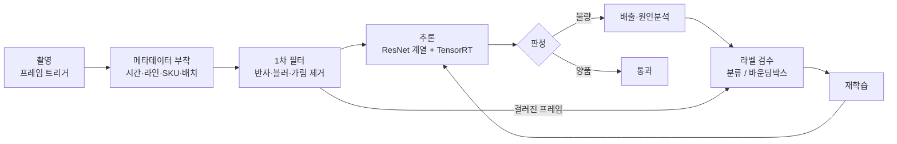

## 정확도 90%라는 목표가 말해 주지 않는 것

외관검사 AI의 목표를 처음 적을 때 가장 손쉬운 문장은 "불량 판정 정확도 90% 이상, 오탐률 10% 이하"다. 나도 식품 제조 라인의 멀티에이전트 PoC(개념검증) 성능지표를 처음 쓸 때 이렇게 적었다. 검토 과정에서 이 행을 지우고 모듈별 기술지표로 다시 썼다. 외관검사 모듈의 대표 지표는 정확도에서 재현율(Recall, 실제 불량 중 모델이 불량으로 잡아낸 비율)로 바뀌었고 목표치는 85~90%가 됐다.

정확도가 왜 부적합한지는 산수 한 줄로 보인다. 불량률이 1%인 라인에서 모든 제품을 "양품"이라고 답하는 모델은 정확도 99%를 얻는다. Recall은 0%다. 불량이 드문 공정일수록 정확도는 높게 나오고 정보는 적다. 배터리 공정도 마찬가지다. 한 공개 연구(Kang 외, 2025)가 파우치 셀 생산 라인에서 모은 이미지 15,312장을 보면 누액(leakage) 클래스가 8.8%에 그쳐 증강으로 균형을 맞췄다. 데이터를 일부러 모아도 희귀 불량은 소수 클래스로 남는다.

> **검사 AI의 첫 결정은 "어느 쪽 실수를 덜 허용할 것인가"다. 모델 구조는 그다음이다.**

## 미탐과 오탐의 값을 먼저 매긴다

Recall을 앞세운 근거는 비용의 비대칭이다. 식품 라인 설계에서 나는 "미탐 비용이 오탐 비용보다 크다"는 한 줄을 산정근거 칸에 적었다. 미탐은 불량이 그대로 출하되는 사건이고, 오탐은 양품 하나를 사람이 한 번 더 보는 사건이다.

다른 업종 라인에서 세운 이 논리를 배터리 공정에 옮겨 보면 비대칭은 더 커진다. 전극 가장자리의 버(burr, 절단면에 남은 금속 돌기)는 분리막을 찢어 내부 단락과 열폭주로 이어질 수 있다(Leica Microsystems). 이물도 같은 경로를 탄다. 아래 표는 혼동행렬(confusion matrix, 실제 상태와 판정 결과를 2x2로 교차한 표) 네 칸에 비용을 붙인 것이다. 배터리 쪽 칸은 공개 자료에서 확인한 위험 경로를 바탕으로 내가 정리한 유추다.

| 칸 | 의미 | 식품 제조 라인에서의 결과 | 배터리 전극·셀 공정으로 옮기면 |
|---|---|---|---|
| TP | 불량을 불량으로 판정 | 배출, 공정 원인 추적 | 마킹 후 제거, 상류 공정 점검 |
| FN (미탐) | 불량을 양품으로 판정 | 외관 불량품 출하, 고객 클레임 | 버·이물이 셀 안으로 들어가 단락 위험, 출하 후 회수 대상 |
| FP (오탐) | 양품을 불량으로 판정 | 재검 인력 소모, 일부 폐기 | 재검 또는 해당 구간 전극 폐기, 수율 손실 |
| TN | 양품을 양품으로 판정 | 정상 흐름 | 정상 흐름 |

FN 칸의 결과가 다른 칸보다 한 단계 무겁다. 그래서 목표치는 Recall에 두고, Precision(불량 판정 중 실제 불량 비율)은 운영이 감당할 수 있는 재검 물량으로 하한만 정한다. 식품 라인 설계에서는 이 정책을 "과탐 일부 허용"이라는 문구로 신뢰성 확보 칸에 적었다.

배터리로 옮길 때 하나를 더 해야 한다. Recall을 불량 유형별로 나누는 일이다. 표면 긁힘과 금속 이물을 한 Recall로 묶으면 평균은 좋아도 위험한 쪽이 가려진다. 단락으로 이어지는 유형(버, 금속 이물)과 외관 등급만 떨어뜨리는 유형을 나눠 목표를 따로 두는 것이 맞다고 본다.

## 식품 라인에서 설계한 파이프라인

식품 라인 외관검사 모듈의 데이터·추론 구조는 다섯 단계였다. 이 구조 자체도 다른 성형 라인의 외관검사 파이프라인(전처리, 증강, CNN 학습 절차)을 옮겨 오는 전제로 짰다.

*그림. 식품 제조 라인 외관검사 모듈의 촬영에서 재학습까지의 흐름*

단계별로 정한 내용은 이렇다.

- 촬영: 제품이 화각 정중앙에 들어올 때만 캡처하는 프레임 트리거. 같은 제품이 여러 장 찍히거나 반쯤 걸친 프레임이 학습셋에 섞이지 않게 한다
- 메타데이터: 프레임마다 시간, 라인 번호, SKU(품목 코드), 생산 배치 번호를 붙인다. 불량이 몰린 배치를 공정 기록과 바로 맞대기 위해서다
- 1차 필터: 조명 반사, 모션 블러, 작업자 손 가림 프레임을 추론 전에 걸러 낸다
- 라벨: 색상 불량은 이미지 단위 분류(classification), 형태 불량은 위치를 표시하는 바운딩박스(bounding box)로 구분했다. 불량 성격에 따라 라벨 형식이 달라진다
- 추론: ResNet 계열 CNN을 엣지 장치에서 TensorRT(NVIDIA의 추론 최적화 런타임) 양자화로 돌려 프레임당 50ms 이하, 즉 20 FPS 이상

## 옮겨 심을 때 그대로 남는 것

다른 업종 라인에서 설계해 본 구조를 배터리 공정에 옮겨 보면, 절반 이상은 손댈 필요가 없다.

메타데이터 축은 그대로 쓴다. SKU 자리에 셀 모델을, 배치 번호 자리에 전극 롤 번호와 코팅 로트를 넣으면 된다. 1차 필터의 발상도 남는다. 파우치 셀 외장재는 알루미늄 라미네이트 필름이라 정반사와 주름이 많고, 규칙 기반 비전으로 다루기 어렵다는 지적이 장비사 자료에 있다(Cognex). 반사 프레임을 추론 앞에서 걸러 내는 단계는 식품 라인보다 배터리 셀 쪽에서 더 필요하다.

라벨 형식을 불량 성격으로 나누는 원칙도 유효하다. 코팅 색 얼룩처럼 면 전체 상태를 보는 불량은 분류로, 핀홀이나 이물처럼 위치와 크기가 판정 기준인 불량은 바운딩박스나 분할(segmentation)로 간다. 클래스 불균형 보정, 현장 전문가 이중 검수도 같다.

## 옮겨 심을 때 바뀌는 것

바뀌는 것은 크게 세 가지다.

첫째, 촬영 단위. 식품 라인과 셀 최종 검사는 낱개가 흘러가는 이산(discrete) 공정이라 프레임 트리거가 맞는다. 셀 검사 장비사 자료는 파우치 셀 약 15 ppm(분당 개수), 사이클 4초, 각형 셀 약 20 ppm, 사이클 3초를 요구 조건으로 제시한다(ISRA VISION). 셀 한 개에 3~4초가 주어지므로 프레임당 50ms 예산은 여유가 크다.

전극 코팅·슬리팅은 다르다. 끊김 없이 흐르는 웹(web, 롤 형태의 연속 시트)이라 "화각 정중앙 진입"이라는 사건이 없다. 양산 코팅기 사양을 보면 장비사 브로슈어 기준 20, 40, 60 m/min 급이 있고 슬리터는 최대 50 m/min이다(Dürr). 검사 장비사는 전극 필름 검사 라인 속도를 120~400 m/min, 시스템 분해능을 20~100 μm로 제시한다(ISRA VISION). 60 m/min이면 웹이 초당 1 m를 지나가고, 추론 하나에 50ms를 쓰는 동안 5 cm가 흘러간다. 폭 1,400 mm 웹을 50 μm 분해능으로 보면 폭 방향 28,000 픽셀에 초당 20,000 라인이 들어온다. 이 수치는 사양값으로 내가 계산한 것이다. 이 물량에 ResNet 분류를 전 면적에 거는 설계는 성립하지 않는다. 엔코더 신호로 라인스캔 카메라를 동기화하고, 규칙 기반 영상처리로 후보 영역을 먼저 잘라 낸 뒤 그 조각만 딥러닝으로 분류하는 2단 구조가 현실적이라고 나는 판단한다. "프레임당 50ms"라는 지표도 "초당 처리 면적"과 "후보 조각당 지연"으로 바꿔 적어야 한다.

둘째, 불량 목록. 공정별로 보면 이렇다.

| 공정 | 대표 외관 불량 | 확인한 출처 |
|---|---|---|
| 코팅 | 응집(agglomerate), 기포·핀홀, 균열, 줄무늬(stripe), 미코팅, 이물 | KIT 학위논문, ISRA VISION |
| 캘린더링·취급 | 주름, 변형, 긁힘 | KIT 학위논문 |
| 슬리팅·절단 | 버(수평 버는 슬리팅, 수직 버는 절단에서 주로 발생), 코팅 경계부 품질 | ZEISS, ISRA VISION |
| 셀(파우치) | 실링 결함, 찍힘(dent), 모서리 균열, 접힘, 긁힘, 이물 | ISRA VISION |
| 셀(파우치, 학습 데이터 사례) | 누액, 핀홀, 스웰링(부풂), 긁힘 | Kang 외 2025 |

버는 수 μm 수준이라 카메라 배율과 조명이 모델보다 먼저 결정된다. 식품 라인의 "색상"과 "형태" 두 축이 여기서는 "코팅면 균일도", "가장자리 형상", "외장 표면"처럼 공정 위치별 축으로 다시 갈린다.

셋째, 비전이 볼 수 없는 영역이 있다. 음극을 양극보다 크게 만들어 남기는 오버행(overhang)은 셀 안쪽 적층 구조의 치수라 표면 카메라로는 보이지 않는다. 오버행이 허용 범위를 벗어나면 성능이 떨어지고 극단적인 경우 발화할 수 있다는 것이 X선 CT 장비사의 설명이다(Nikon). 같은 자료는 2D 투과 X선이 빠르지만 단일 투영으로는 층을 구분하기 어렵고, 층별 오버행은 3D CT로 계산한다고 적는다. 역할을 나누면 다음과 같다.

| 검사 수단 | 보는 대상 | 위치 |
|---|---|---|
| 비전(면·라인스캔 카메라) | 코팅면, 가장자리, 셀 외장 표면 | 코팅·슬리팅 라인, 셀 최종 검사 |
| 2D X선 투과 | 내부 정렬의 빠른 확인 | 조립 후 |
| X선 CT | 층별 오버행 치수, 내부 3D 형상 | 조립 후, 샘플링 또는 고속 CT |

외관검사 AI의 Recall 목표는 첫째 행에만 걸린다. 내부 결함까지 비전 Recall로 약속하면 지표가 검증 불가능해진다.

## 목표치마다 근거·환경·방법을 짝짓는다

식품 라인 성능지표 표에서 가장 오래 고친 부분은 목표치 옆 칸이었다. 지표 한 행에 산정근거, 검증환경, 검증방법, 신뢰성 확보 수단을 반드시 붙였다. 배터리로 옮기면 같은 틀에 내용만 바뀐다.

| 항목 | 식품 제조 라인(실제 설계) | 배터리 공정으로 옮기면(유추) |
|---|---|---|
| 지표 | 불량 탐지 Recall | 유형별 Recall, 단락 위험 유형은 별도 행 |
| 목표치 | 85~90% | 위험 유형은 더 높게, 외관 등급 유형은 PoC 수준 |
| 산정근거 | 조명·분진·진동 노이즈와 6개월 데이터 한계, 미탐 비용 > 오탐 비용 | 같은 비대칭 논리에 단락·발화 경로를 추가 |
| 검증환경 | 현장 수집·라벨링 이미지의 홀드아웃 셋 | 롤·로트 단위로 분리한 홀드아웃 셋 |
| 검증방법 | 혼동행렬 기반 Recall·Precision 산출 | 같음, 유형별 혼동행렬 |
| 지연 지표 | 프레임당 50ms 이하, N≥100 반복측정 평균과 p95 | 셀 검사는 사이클 3~4초 안, 전극은 초당 처리 면적 |

검증환경 칸의 "롤·로트 단위 분리"는 연속 웹에서 특히 중요하다. 같은 롤에서 잘라 낸 인접 조각이 학습셋과 검증셋에 나뉘어 들어가면 Recall이 실제보다 높게 나온다. 식품 라인에서 배치 번호를 메타데이터로 붙인 이유가 여기서 검증 설계로 이어진다.

지연 지표의 p95(측정값 상위 5% 경계)는 평균만 적을 때 생기는 착시를 막는다. 평균 40ms라도 스무 번에 한 번 120ms가 걸리면 연속 웹에서는 그 구간을 놓친다.

## 정리: 이 사례에서 내가 한 일

식품 라인 지표 표의 행 구성과 문장은 Claude와 함께 정리했다. 표 칸을 일관되게 채우고 문서 사이 용어를 맞추는 일은 도구가 빨랐다. 정확도를 버리고 Recall을 앞세울지, 목표를 95%가 아닌 85~90%로 둘지, 과탐을 얼마나 허용할지는 내가 정했다. 그 결정의 근거는 라인에서 미탐 하나와 오탐 하나가 각각 무엇을 일으키는지였다.

배터리 공정으로 옮겨 보는 작업도 같은 지점에서 갈린다. 공개 자료를 찾아 불량 목록과 장비 사양을 모으는 일은 도구에 맡길 수 있다. 연속 웹에서는 프레임 트리거가 성립하지 않는다는 판단, 오버행을 비전 지표에서 빼야 한다는 판단, Recall을 유형별로 쪼개야 한다는 판단은 정의하는 사람이 내려야 한다. 그 정의가 있어야 검증 칸에 쓸 수 있는 문장이 생긴다.

## 참고

- Kang, Son, Choi, "Battery Pouch Cell Defect Detection System Using YOLOv11 Lightweight Model", Journal of Electrochemical Science and Technology, 2025 온라인 게재: <https://jecst.org/journal/view.php?number=596>
- ISRA VISION, From Web to Cell (전극 필름·셀 검사 사양): <https://isravision.com/en-en/industries/battery/battery-cell-production>
- Dürr, Advanced Battery Electrode 브로슈어(2019, 코팅기·슬리터 사양): <https://www.durr.com/fileadmin/durr.com/04_Company/01_Events/2019/duerr-advanced-battery-brochure.pdf>
- KIT 학위논문(전극 공정 불량 유형): <https://publikationen.bibliothek.kit.edu/1000151887/149514845>
- Leica Microsystems, Burr Detection During Battery Manufacturing: <https://www.leica-microsystems.com/science-lab/industrial/burr-detection-during-battery-manufacturing/>
- ZEISS, Battery Electrode Burr Inspection by Digital Microscope: <https://asset-downloads.zeiss.com/catalogs/download/iqs/d7b122eb-747b-4d72-88ed-df9f1092c257/Battery_Electrode_Burr_Inspection_by_Digital_Microscope.pdf.pdf>
- Nikon, Artificial Intelligence speeds up automated battery anode overhang analysis using X-ray CT: <https://industry.nikon.com/en-gb/news/overhang-analysis-using-x-ray-ct/>
- Cognex, Detecting the Difference: What Are the Inspection Challenges for Each Type of EV Battery?: <https://www.cognex.com/blogs/machine-vision/detecting-the-difference---what-are-the-inspection-challenges-for-each-type-of-ev-battery>
