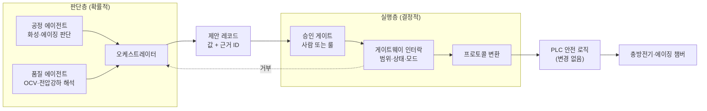
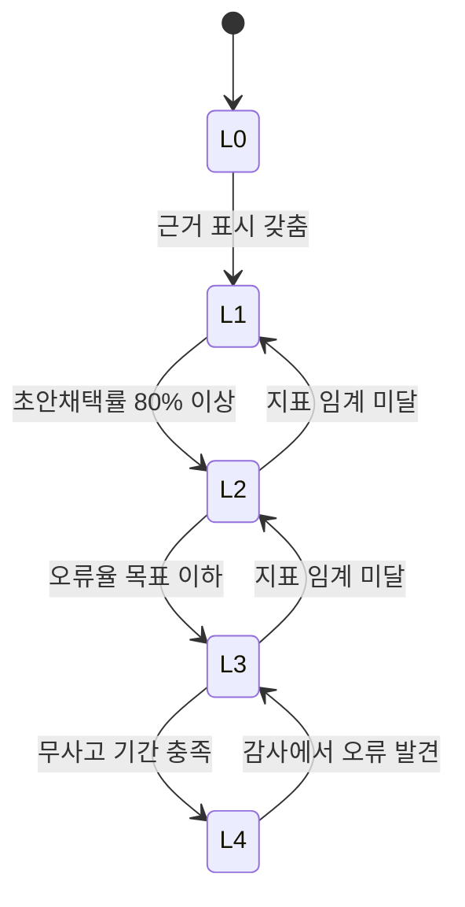

## 위험물 라인에서 AI 출력이 설비로 직행하면

리튬이온 셀 제조의 후공정에는 화성(formation)과 에이징(aging)이 있다. 화성은 조립이 끝난 셀에 처음으로 충전을 거는 공정이다. 이때 음극 표면에 SEI(solid electrolyte interphase, 전해액 분해물로 생기는 얇은 보호막)가 만들어진다. 공개 특허들은 첫 충전을 0.05C~0.1C 수준으로 느리게 걸어 SEI를 안정적으로 만드는 방식을 기술하고, 화성 뒤 60 °C 이상에서 12~48시간 고온 에이징을 거친 뒤 상온 에이징으로 넘어가는 절차도 적는다. 에이징 끝에는 전압 강하를 재서 기준을 넘는 셀을 저전압 불량으로 걸러낸다. 한 특허의 예시로는 양품 10 mV에 비해 20 mV가 떨어진 셀을 불량으로 판정한다.

이 구간이 위험한 이유는 세 가지가 겹치기 때문이다.

| 위험 요소 | 무엇이 일어나는가 | 확인한 출처 |
|---|---|---|
| 가스 발생 | 화성·에이징 중 부반응으로 CO, CO2, 탄화수소가 생겨 내압이 오르고 셀이 부푼다 | 미국 특허 US 12057552, US 12095070 |
| 전해액 | LiPF6는 수분과 반응해 HF(불산)를 만든다. 고온에서는 HF, PF5, POF3 같은 불소 가스가 나온다 | 미국 매사추세츠주 독성 문서, 미국 특허 US 7727669 |
| 열폭주 | 100 % SOC 셀을 가열하면 상온~150 °C 열폭주 시작, 150~180 °C 벤팅과 가속 발열, 180 °C 이상 폭발적 분해(화염)로 진행한다 | Sandia National Laboratories 발표(2008) |

수천 개의 셀이 충전된 채 랙에 적재되는 곳이 화성·에이징 구역이다. 설비 업체 자료도 이 구역의 위험을 훈소, 가스 방출, 열폭주로 나누고 아주 이른 감지와 빠른 대응을 요구한다고 적는다.

이런 라인에 멀티에이전트(여러 AI 에이전트가 역할을 나눠 협업하는 구조)를 붙인다고 하자. 에이전트가 "에이징 챔버 온도를 2도 올리면 SEI 안정화가 빨라진다"는 판단을 내릴 수 있다. 이 판단이 맞는지와 별개로, 그 출력이 그대로 챔버 컨트롤러에 써지는 구조라면 LLM의 확률적 오류가 곧 설비 사고가 된다. 그래서 나는 설계의 첫 줄을 이렇게 둔다.

> **AI는 판단과 제안까지만 한다. 설비에 쓰는 일은 승인과 인터락을 통과한 결정적 코드만 한다.**

## 판단층과 실행층을 나누는 선

이 원칙을 구조로 옮기면 두 층이 생긴다. 판단층은 데이터를 읽고 근거를 붙여 제안 레코드를 만든다. 실행층은 그 제안을 받아 승인 여부, 허용 범위, 설비 상태, 운전 모드를 검사한 뒤에만 프로토콜로 변환해 설비에 보낸다. PLC(설비 제어기)의 안전 로직은 손대지 않는다.



*그림. 판단층은 제안 레코드까지만 만들고, 설비에 닿는 경로는 실행층과 PLC만 지난다.*

이 선을 왜 PLC 앞에서 한 번 더 끊는가. 기능안전 표준 체계에서 IEC 61508은 전기·전자·프로그래머블 전자 안전 관련 시스템 전반을 다루고 SIL 1~4를 정의한다. 기계 분야의 IEC 62061은 그 틀 안에서 기계용 안전 관련 제어 시스템의 설계·통합·검증 요구사항을 정한다. 이 표준들이 요구하는 설계·검증 절차를 같은 입력에 다른 답을 낼 수 있는 LLM에 적용할 방법을 나는 찾지 못했다. 그래서 그 경로 안에 LLM을 넣지 않고, 바깥에서 요청만 만들게 하는 쪽을 택했다. AI는 운전 보조로 두고, 안전 기능은 기존 PLC와 인터락이 그대로 맡는다.

## 금기는 프롬프트가 아니라 코드로 막는다

"설정값을 허용 범위 밖으로 바꾸지 마라"를 시스템 프롬프트에 백 번 적어도 가끔은 샌다. 모델을 바꾸거나 양자화하면 지켜지던 규칙이 다시 깨지기도 한다. 그래서 규칙을 두 종류로 나눈다.

| 규칙의 성격 | 예 | 구현 위치 |
|---|---|---|
| 지켜지면 좋은 것 | 보고서 문체, 설명 순서, 강조 방식 | 프롬프트, 스킬 |
| 어기면 안 되는 것 | 설정값 허용 범위, 운전 중 금지 명령, 쓰기 권한 범위, 외부 발송 | 도구 서버와 게이트웨이의 코드 검사기 |

코드 검사기의 첫 관문은 도구 스키마다. 아래는 다른 업종 라인을 위해 정리해 둔 설정값 변경 도구 스키마를 배터리 후공정에 옮겨 본 예시다. 이 스키마를 보이는 목적은 "변경" 도구가 실제로는 "요청 생성" 도구라는 점을 보여 주는 데 있다.

```json
{
  "name": "equipment.request_setpoint_change",
  "description": "설정값 변경 요청을 생성한다. 즉시 적용하지 않으며 승인과 인터락 검사 후 게이트웨이가 실행한다",
  "inputSchema": {
    "type": "object",
    "properties": {
      "equipment_id": {"type": "string", "enum": ["AGING-CH-01", "FORM-RACK-03"]},
      "parameter":    {"type": "string", "enum": ["chamber_temp", "formation_current"]},
      "target_value": {"type": "number"},
      "unit":         {"type": "string", "enum": ["degC", "A"]},
      "reason_evidence_ids": {"type": "array", "items": {"type": "string"}, "minItems": 1},
      "request_id":   {"type": "string"}
    },
    "required": ["equipment_id", "parameter", "target_value", "unit", "reason_evidence_ids", "request_id"]
  }
}
```

핵심은 세 줄이다. `enum`은 존재하지 않는 설비 ID나 파라미터 이름을 원천 차단한다. `reason_evidence_ids`의 `minItems: 1`은 근거 없는 요청을 스키마 단계에서 거부한다. `request_id`는 재시도로 같은 요청이 두 번 실행되는 것을 막는 멱등성(같은 요청을 여러 번 보내도 결과가 한 번과 같음) 키다. 허용 범위는 스키마와 게이트웨이 양쪽에서 다시 검사하고, 운전 모드가 자동 운전 중이면 게이트웨이가 명령 자체를 받지 않는다.

## 자율성은 측정한 뒤에 올린다

처음부터 "AI가 알아서 조정한다"를 약속하지 않는다. 업무 단위로 자율성 단계를 매기고, 오류율이 데이터로 증명된 구간만 한 단계씩 올린다.

| 단계 | 이름 | AI가 하는 것 | 사람이 하는 것 | 올라가는 조건 |
|---|---|---|---|---|
| L0 | 조회 | 자료 찾기 | 판단과 작성 전부 | - |
| L1 | 초안 | 초안과 근거 제시 | 검토, 수정, 승인 | 도입 시 기본값 |
| L2 | 승인실행 | 승인되면 자동 실행 | 승인만 | L1 초안채택률 80 % 이상 |
| L3 | 조건부자동 | 조건 충족분 자동, 예외만 상신 | 예외 처리 | L2 오류율 목표 이하 |
| L4 | 완전자동 | 전부 자동, 사후 샘플 감사 | 감사 | L3 무사고 기간 충족 |



*그림. 승격은 지표로만 하고, 운영 중 지표가 임계 아래로 떨어지면 자동으로 한 단계 내린다.*

현장 실증도 같은 순서를 밟는다. 섀도 모드에서는 에이전트가 제안만 남기고 실제 운전은 기존 방식대로 간다. 제안과 실제 운전자 결정을 나란히 쌓아 채택률을 잰다. 그 다음이 승인 모드, 마지막이 일부 업무만 자율로 돌리는 부분 자율 모드다. 위험물 라인이라면 에이징 데이터 요약이나 전압 강하 불량 후보 정리는 L2~L3까지 갈 수 있다. 충방전 전류나 챔버 온도 같은 설정값 변경은 L2에서 멈추게 두는 편이 낫다고 나는 판단한다.

## 근거 없는 출력은 산출물로 인정하지 않는다

승인자가 제안 하나를 30초 안에 검토하려면 제안 옆에 근거 원문의 위치가 붙어 있어야 한다. 그래서 근거 표시를 화면의 본체로 두고, 근거를 수치로 관리한다.

| 지표 | 정의 | 목표 예시 |
|---|---|---|
| 근거정합률 | 산출 문장 중 근거가 실제로 뒷받침하는 비율 | 95 % 이상 |
| 무근거생성률 | 근거 없이 만든 진술의 비율 (환각) | 1 % 이하 |
| 지시준수율 | 금칙·형식 규칙 위반이 없는 비율 | 99 % 이상 |
| 재시도율 | 검증 실패로 다시 수행한 비율 | 15 % 이하 |
| 에스컬레이션 정확도 | 사람에게 넘긴 건이 실제로 넘길 만했던 비율 | 90 % 이상 |

운영 규칙도 여기에 맞춘다. 수치는 도구 출력에서만 가져온다. 검색 결과가 없으면 "모름"을 반환한다. 별도의 검증 에이전트가 수치와 인용을 원본과 대조한다. 마지막 지표인 에스컬레이션 정확도는 사람 개입을 실패로만 세지 않기 위해 넣는다. 위험물 라인에서 넘길 만한 건을 사람에게 넘기는 것은 안전장치가 제대로 작동한 결과다.

## 오케스트레이터와 Fail-safe

여러 에이전트를 묶는 오케스트레이터는 다른 업종 라인에서 설계해 본 구조를 그대로 옮겨 볼 수 있다. 그 설계는 네 층이었다. 이벤트를 받는 입력 계층, LangGraph State Graph로 정의한 워크플로에 따라 작업을 분해·배분하는 오케스트레이션 계층, 승인된 지시만 상위 시스템에 넘기는 실행 계층, 그리고 관측·제어 계층이다. 마지막 층에 두 가지 장치가 있다. 에이전트 장애 시 3회 재시도 후 기존 운영규칙으로 자동 전환하는 Fail-safe, 그리고 상태를 PostgresSaver 체크포인트로 저장해 중단 지점에서 재개하는 장치다.

배터리 후공정에 옮기면 "기존 운영규칙"은 에이전트 도입 전에 쓰던 고정 레시피와 고정 판정 기준이다. 에이전트가 응답하지 않으면 라인은 AI 없이 원래대로 돈다. 위험물 라인에서 Fail-safe의 목적지는 사람이 이미 검증해 온 상태여야 한다.

이 구조를 LangGraph로 적으면 아래와 같다. 이 코드를 보이는 목적은 재시도와 대체 경로가 그래프 정의 안에 들어가 있어 실행 경로가 고정된다는 점을 보여 주는 데 있다.

```python
from langgraph.graph import StateGraph, END
from langgraph.types import RetryPolicy
from langgraph.checkpoint.postgres import PostgresSaver

builder = StateGraph(LineState)
# 판단 노드: 최대 3회 시도 (첫 시도 포함)
builder.add_node("aging_judge", aging_judge, retry_policy=RetryPolicy(max_attempts=3))
builder.add_node("rule_fallback", apply_fixed_recipe)   # 기존 운영규칙으로 전환
builder.add_node("propose", write_proposal_record)      # 제안 레코드만 생성
builder.add_conditional_edges("aging_judge", route_on_result,
                              {"ok": "propose", "failed": "rule_fallback"})
builder.add_edge("propose", END)
builder.add_edge("rule_fallback", END)
builder.set_entry_point("aging_judge")

# 매 단계 상태를 체크포인트로 저장, thread_id 단위로 재개
graph = builder.compile(checkpointer=PostgresSaver(conn))
graph.invoke(event, {"configurable": {"thread_id": "rack-03-lot-1021"}})
```

LangGraph 공식 문서 기준으로 체크포인터를 붙여 컴파일하면 그래프 상태가 스레드 단위로 저장되고, `thread_id`가 그 스레드를 가리키는 키가 된다. 같은 `thread_id`로 다시 호출하면 저장된 지점에서 이어 간다. 사람 승인 중단점도 이 체크포인트 위에서 동작한다. 실행 이력은 trace 단위로 남기고, 각 span에 에이전트 ID, 모델 버전, 프롬프트 버전을 붙인다. 문제가 생겼을 때 "어떤 모델이 어떤 근거로 무엇을 제안했고 누가 승인했는가"를 거꾸로 따라갈 수 있어야 하기 때문이다.

여기서 하나 확인할 것이 있었다. 원래 설계 문서는 "3회 재시도 후 Fail-safe"라고 적었다. 그런데 LangGraph 문서의 `RetryPolicy`에서 `max_attempts`의 기본값 3은 첫 시도를 포함한 횟수다. 즉 기본값 그대로 쓰면 재시도는 2회다. 문서의 "3회 재시도"를 지키려면 `max_attempts=4`로 적어야 한다. 둘 중 무엇이 의도인지는 사람이 정할 문제다. 정한 뒤에는 문서와 코드의 숫자를 같은 정의로 맞춘다.

## 장애주입으로 Fail-safe를 증명한다

Fail-safe는 "있다"고 적는 것으로 끝나지 않는다. 일부러 고장을 내서 작동하는지 본다. 같은 설계 문서는 Fail-safe 작동률 100 %, E2E 과업 성공률 95 % 이상, 워크플로 라우팅 정확도 95 % 이상을 목표로 두고, 장애주입(fault injection) 시나리오를 반복해 검증하도록 했다. 배터리 후공정에 맞춰 시나리오를 짜면 이렇다.

| 주입하는 장애 | 기대 동작 | 판정 기준 |
|---|---|---|
| 판단 에이전트 응답 지연·예외 | 재시도 상한 후 고정 레시피로 전환 | 전환 누락 0건 |
| 허용 범위 밖 설정값 제안 | 게이트웨이 인터락이 거부, 사유 기록 | 설비 도달 0건 |
| 근거 ID 없는 제안 | 스키마 단계에서 거부 | 승인 화면 도달 0건 |
| 게이트웨이·망 단절 | 로컬 버퍼에 저장 후 회복 시 재전송, 중복 제거 | 데이터 손실 0건 |
| 오케스트레이터 프로세스 종료 | 같은 `thread_id`로 마지막 체크포인트에서 재개 | 중복 실행 0건 |

현장에 가기 전에는 시뮬레이션에서 같은 시나리오를 돌린다. 진입 조건은 "시뮬레이션 상 KPI를 악화시키는 지시 0건, 안전 위반 0건"이다. 이 조건을 통과해야 섀도 모드로 넘어간다.

## 도구가 한 일과 내가 정의·검증한 일

이 글의 구조와 표는 여러 프로젝트에서 쌓아 둔 설계 메모에서 왔다. 공개 자료 조사와 초안 정리는 Claude Code가 맡았다. 화성·에이징 공정의 사실관계, LangGraph의 체크포인트와 재시도 정책, 기능안전 표준의 범위를 찾아 출처와 함께 가져온 것도 도구다.

내가 한 일은 두 가지로 모인다. 먼저 경계를 정의했다. 어디서 권한을 끊을지(제안 레코드까지), 무엇을 코드로 막을지(범위·상태·모드·근거 필수), 어느 지표가 몇이면 한 단계 올릴지(채택률 80 %)는 도구가 정해 줄 수 없는 결정이다. 다음은 검증이다. "3회 재시도"라는 한 줄이 라이브러리의 `max_attempts=3`과 같은 뜻인지 확인하는 일, Fail-safe가 실제로 작동하는지 장애를 넣어 보는 일은 결과를 받아 든 사람의 몫으로 남는다. 위험물이 있는 라인일수록 이 두 일의 비중이 커진다.

## 참고

- 미국 특허 US 12025673, 화성 SOC 범위: <https://image-ppubs.uspto.gov/dirsearch-public/print/downloadPdf/12025673>
- 미국 특허 US 12057552, 첫 충전 전압과 가스 발생: <https://image-ppubs.uspto.gov/dirsearch-public/print/downloadPdf/12057552>
- 미국 특허 US 12095070, 고온 에이징 조건과 전압 강하 판정: <https://image-ppubs.uspto.gov/dirsearch-public/print/downloadPdf/12095070>
- Leadintelligent, 화성 공정 설명(저율 첫 충전, 디개싱): <https://www.leadintelligent.com/en/?p=5115>
- E. Peter Roth, "Abuse Tolerance Improvement", Sandia National Laboratories, DOE Vehicle Technologies Peer Review, 2008: <https://www.energy.gov/sites/prod/files/2014/03/f12/merit08_roth.pdf>
- Massachusetts, "Toxicology of the Lithium-Ion Battery Fire": <https://www.mass.gov/doc/toxicology-of-the-lithium-ion-battery-fire/download>
- 미국 특허 US 7727669, LiPF6 가수분해와 HF: <https://image-ppubs.uspto.gov/dirsearch-public/print/downloadPdf/7727669>
- Siemens, Fire safety in formation, aging and beyond: <https://www.siemens.com/en-us/industries/batteries/fire-safety-formation-aging-beyond/>
- IEC 62061 Consolidated version (IEC Webstore): <https://webstore.iec.ch/en/publication/59927>
- Control Design, "IEC 61508 Drives Functional Safety of Machinery": <https://www.controldesign.com/home/article/11369961/industrial-functional-safety-iec-61508-drives-functional-safety-of-machinery-control-design>
- LangGraph Persistence: <https://docs.langchain.com/oss/python/langgraph/persistence>
- LangGraph Fault tolerance (RetryPolicy): <https://docs.langchain.com/oss/python/langgraph/fault-tolerance>
