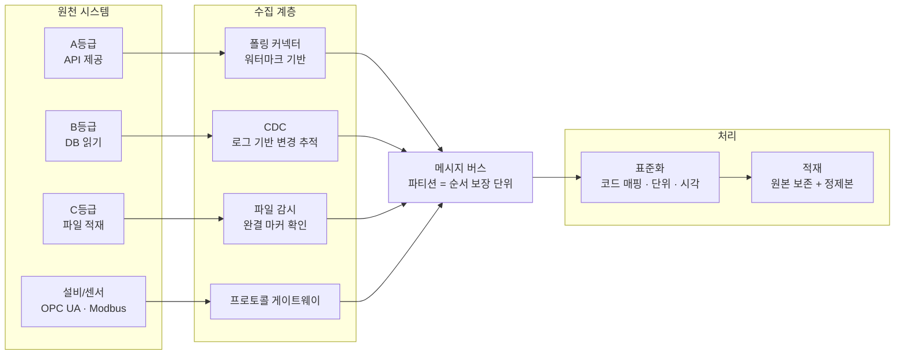

## "통합"이라는 단어가 감추는 것

문서에 "개별 시스템 34개를 연계하여 통합 플랫폼을 구축한다"고 한 줄 적히면, 읽는 사람은 대개 화면 하나에 여러 시스템 데이터가 모이는 그림을 떠올린다. 그 그림은 결과이지 설계가 아니다. 설계는 34번을 반복하는 다음 질문들의 답이다.

- 이 시스템에서 데이터를 **어떻게 꺼내는가**. API가 있는가, DB를 직접 읽어야 하는가, 야간에 파일로 떨구는 방법밖에 없는가
- 그 경로가 **망을 넘는가**. 넘는다면 어느 방향으로 세션을 여는가
- 원천이 값을 **고쳤을 때** 그걸 어떻게 아는가
- 같은 설비를 두 시스템이 **다른 코드로** 부르고 있으면 어느 쪽을 정본으로 삼는가
- 중간에 끊겼다가 다시 붙었을 때 **어디부터 다시** 가져오는가

이 다섯 개를 34번 답하면 그게 연계 설계다. 답하지 않으면 통합은 문서에만 존재한다.

> **연계 설계의 90%는 프로토콜 선택이 아니라 "이 시스템에 우리가 무엇을 할 수 있는가"를 등급으로 확정하는 일이다.**

## 1단계 - 접근성 등급을 먼저 매긴다

프로토콜부터 고르면 안 된다. 원천 시스템이 우리에게 허락하는 범위가 먼저다. 나는 이걸 네 등급으로 나눈다.

| 등급 | 원천이 허락하는 것 | 가능한 수집 방식 | 대표 위험 |
|---|---|---|---|
| A | 조회용 API 제공 | REST/SOAP 폴링, 웹훅 | 레이트 리밋, 스펙 변경 |
| B | 읽기 전용 DB 계정 발급 | 증분 쿼리, CDC | 운영 DB 부하, 스키마 변경 통보 없음 |
| C | 지정 경로에 파일 적재 | SFTP 배치, 파일 감시 | 지연, 인코딩, 부분 파일 |
| D | 화면 조회만 가능 | (수집 불가) 별도 협의 대상 | 사업 범위 밖으로 밀려남 |

이 표가 왜 먼저냐면, **등급이 곧 일정과 리스크이기 때문이다.** A등급 8개와 C등급 20개인 사업과, 그 반대인 사업은 같은 "34개 연계"라도 전혀 다른 사업이다. C등급이 많으면 실시간이라는 단어를 요구사항에서 지워야 하고, D등급이 하나라도 있으면 그건 기술 문제가 아니라 협의 항목으로 올려야 한다.

등급을 매기는 시점도 중요하다. 요구사항 문서를 읽는 단계에서 매겨야 한다. 구축을 시작한 뒤에 "이 시스템은 DB 계정을 못 준답니다"를 알게 되면 설계를 다시 한다.

## 2단계 - 수집 방식을 등급에 매핑한다

*그림. 접근 등급이 수집 방식을 정하고, 그 뒤는 공통 경로로 합류한다.*

### 폴링 (A·B등급)

가장 흔하고 가장 자주 틀리는 방식이다. 마지막으로 가져온 지점을 기억했다가 그 이후만 요청한다. 이 "기억하는 지점"이 워터마크다.

워터마크를 `updated_at` 타임스탬프로 잡을 때 함정이 세 가지다.

1. **경계 중복**: `updated_at > 마지막값`으로 조회하면 같은 초에 들어온 건을 놓친다. `>=`로 잡고 중복은 멱등 적재로 흡수하는 편이 안전하다
2. **미래 날짜**: 원천에 잘못 입력된 2099년 데이터 하나가 들어오면 워터마크가 그리로 튀어 그 뒤 모든 데이터를 못 가져온다. 워터마크 갱신에 상한(예: 현재시각 + 1일)을 건다
3. **시간대**: 원천이 KST 로컬 타임인지 UTC인지, DB 세션 타임존이 무엇인지 확인 없이 넘어가면 9시간짜리 구멍이 생긴다

증분 키가 없는 테이블은 폴링으로 변경을 잡을 수 없다. 이때가 CDC로 넘어가는 지점이다.

### CDC (B등급, 변경 추적이 필요할 때)

CDC(Change Data Capture)는 애플리케이션이 아니라 **DB의 트랜잭션 로그**를 읽어 변경을 잡는다. 조회 쿼리를 날리지 않으므로 운영 DB의 부하가 폴링보다 작고, 삭제(DELETE)도 잡힌다. 폴링은 삭제된 행을 영원히 알 수 없다.

| 도구 | 성격 | 지원 원천 |
|---|---|---|
| Debezium | 오픈소스, Kafka Connect 기반 | MySQL binlog, PostgreSQL logical replication, Oracle LogMiner·XStream, SQL Server CDC, MongoDB oplog 등 |
| Oracle GoldenGate | 상용 | Oracle 중심, 이기종 복제 |
| AWS DMS | 관리형 | 클라우드 마이그레이션·복제 |

CDC 도입의 실제 장벽은 기술이 아니다. **원천 DB의 로그 설정을 바꿔야 한다는 것**이다. MySQL은 `binlog_format=ROW`, PostgreSQL은 `wal_level=logical`, Oracle은 supplemental logging이 필요하다. 남의 운영 DB 설정을 바꾸는 일이므로 이건 기술 결정이 아니라 협의 항목이다. 요구사항 분석 단계에서 이걸 "사전 확보 항목"으로 올려 두지 않으면 구축 중반에 막힌다.

### 파일 배치 (C등급)

가장 자주 만나고 가장 낮게 평가되는 방식인데, 실제로는 여기서 사고가 제일 많이 난다.

- **부분 파일**: 원천이 쓰는 중인 파일을 읽으면 잘린 데이터가 들어온다. 원천에 `.done` 마커 파일을 같이 떨궈 달라고 요청하거나, 임시 확장자로 쓰고 완료 시 rename 하도록 규약을 잡는다. rename은 같은 파일시스템 안에서 원자적이다
- **인코딩**: 국내 레거시가 내리는 텍스트는 CP949(EUC-KR 확장)인 경우가 많다. UTF-8로 읽으면 깨지고, 깨진 채로 적재되면 나중에 복구가 어렵다. 수집 시점에 인코딩을 명시하고 실패 시 적재를 중단시킨다
- **재전송**: 같은 파일이 다시 올라올 수 있다. 파일명이 아니라 내용 해시로 중복을 판정한다

### 설비 프로토콜

현장 설비에서 직접 값을 읽어야 하면 프로토콜 게이트웨이가 하나 더 붙는다. 산업 표준은 OPC UA(IEC 62541)이고, 구형 설비는 Modbus TCP(기본 포트 502)를 쓰는 경우가 많다. 이 계층은 IT 네트워크가 아니라 OT 네트워크에 있어서, 뒤에 나올 망 분리 이야기가 여기서 가장 첨예해진다.

## 3단계 - 망을 넘는 방향을 정한다

공공·금융·산업 환경에서 연계 설계를 가르는 결정적 제약이 망 분리다. 핵심은 단순하다. **보안 정책은 대개 안쪽으로 들어오는 세션을 막는다.**

이 한 줄이 설계를 뒤집는다. 원천 시스템이 우리 쪽으로 데이터를 밀어 주는(push) 구조는 방화벽 정책 신청 대상이 되고 대개 거절된다. 그래서 실제로 통과하는 구조는 이쪽이다.

| 원하는 구조 | 실제로 통과하는 구조 |
|---|---|
| 원천이 우리 API로 push | 우리가 원천 쪽으로 outbound 세션을 열어 pull |
| 실시간 양방향 웹소켓 | 주기 폴링 또는 단방향 전송 |
| 통합 DB에 직접 write | 중계 구간에 파일·큐를 두고 각자 자기 방향으로만 접근 |

가장 엄격한 구간에는 물리적으로 한 방향으로만 흐르는 장비(데이터 다이오드)가 들어간다. 이 구간에서는 TCP의 ACK조차 역방향으로 못 가므로 **응답을 전제로 한 모든 프로토콜이 무효**가 된다. REST도 JDBC도 못 쓴다. 파일이나 UDP 기반 단방향 전송으로 설계해야 하고, 전송 성공 여부를 반대편에서 확인할 방법이 없으므로 순번과 체크섬을 데이터 안에 넣어 수신 측이 스스로 결손을 판정하게 만든다.

방화벽 정책 신청 자체도 일정이다. 34개 시스템이면 신청 건이 34건이 아니라 (출발지, 목적지, 포트) 조합만큼 나오고, 기관에 따라 승인에 주 단위가 걸린다. 이걸 일정표에 안 넣으면 개발이 끝나고 연동 테스트를 못 한다.

## 4단계 - 표준화, 진짜 어려운 부분

기술 연계가 끝나도 데이터는 아직 합쳐지지 않는다. 시스템마다 같은 것을 다르게 부르기 때문이다.

- **식별자**: 차량 시스템의 `VEH_ID`와 정비 시스템의 `EQUIP_NO`가 같은 물리 자산을 가리키는데 형식이 다르다. 이걸 이어 주는 매핑 테이블이 없으면 통합 조회가 성립하지 않는다. 매핑 테이블은 코드가 아니라 데이터이고, 유지 주체를 정해야 한다
- **코드값**: 상태 코드가 한쪽은 `01/02/03`, 다른 쪽은 `NORMAL/WARN/FAIL`이다. 표준 코드를 새로 정의하고 원천별 변환 규칙을 둔다. 원천에 없는 값이 들어왔을 때 버릴지 미분류로 적재할지도 규칙으로 적어 둔다
- **시각**: 시간대, 정밀도(초/밀리초), 그리고 그 시각이 **발생 시각인지 수집 시각인지 적재 시각인지**. 이벤트 시간과 처리 시간을 구분하지 않으면 나중에 지연 분석을 할 수 없다. 세 개를 다 저장하는 편이 낫다
- **단위**: 온도가 섭씨인지 화씨인지, 압력이 bar인지 kPa인지. 원천 문서에 안 적혀 있는 경우가 많다

여기서 원칙 하나. **원본을 지우지 않는다.** 수집한 원문을 그대로 보존하는 계층과 표준화된 계층을 나눠서 적재한다. 표준화 규칙은 반드시 틀리고, 틀렸을 때 원본이 남아 있어야 다시 만들 수 있다. 원본을 버리고 변환본만 남기면 규칙이 틀린 순간 그 기간 데이터가 영구히 손상된다.

## 5단계 - 끊겼다 붙었을 때를 설계한다

연계는 반드시 끊긴다. 원천이 점검하고, 네트워크가 흔들리고, 우리 쪽이 재배포된다. 설계의 품질은 정상 동작이 아니라 복구 동작에서 갈린다.

| 항목 | 설계 결정 |
|---|---|
| 멱등성 | 같은 메시지를 두 번 처리해도 결과가 같아야 한다. 업무 키 기준 UPSERT를 기본으로 두고, 자연키가 없으면 원천 PK와 원천 코드를 조합해 인공 키를 만든다 |
| 순서 | 전역 순서는 비싸다. 같은 자산 단위로만 순서를 보장한다. Kafka는 파티션 안에서만 순서를 보장하므로 파티션 키를 자산 ID로 잡는 방식이 여기에 대응한다 |
| 재처리 | 특정 기간을 다시 가져오는 보정 모드를 처음부터 만든다. 나중에 반드시 필요해지고, 그때 급히 만들면 운영 데이터를 망친다 |
| 실패 격리 | 변환에 실패한 메시지는 파이프라인을 막지 않고 별도 저장소(dead letter)로 보낸다. 다만 거기 쌓이는 걸 아무도 안 보면 없느니만 못하므로 건수 알림을 붙인다 |
| 대사 | 원천의 건수와 우리 쪽 건수를 주기적으로 맞춰 본다. 파이프라인이 조용히 멈추는 사고는 에러 로그가 아니라 건수 대사에서 잡힌다 |

마지막 항목을 강조하고 싶다. 데이터 파이프라인의 가장 무서운 장애는 에러를 내며 죽는 것이 아니라 **에러 없이 0건을 가져오는 것**이다. 대시보드는 정상이고 로그도 깨끗한데 데이터만 안 들어온다. 원천 건수와의 대사, 그리고 "마지막 수신 이후 경과 시간" 감시가 이걸 잡는 유일한 장치다.

## 인터페이스 정의서에 반드시 들어가야 하는 항목

34개를 관리하려면 시스템마다 같은 양식으로 적어야 한다. 최소 항목은 이렇다.

- 원천 시스템명, 담당 부서, 기술 담당자
- 접근 등급(A~D)과 그 근거
- 수집 방식, 주기, 예상 건수·용량
- 연결 정보(호스트·포트·인증 방식)와 방화벽 정책 신청 상태
- 대상 테이블·필드 목록, 각 필드의 의미·단위·널 허용 여부
- 증분 키와 워터마크 필드
- 코드값 목록과 표준 코드 매핑
- 장애 시 연락 체계와 재처리 가능 범위
- 원천 스키마 변경 시 통보 경로

마지막 항목이 실무에서 제일 자주 비어 있고 제일 자주 사고를 낸다. 원천이 컬럼 하나를 말없이 바꾸면 우리 파이프라인이 조용히 틀린 값을 넣기 시작한다.

## 도구가 커넥터를 짜 주는 시대에 남는 일

이 글에 나온 것 중 코드로 구현해야 하는 부분은 이제 대부분 도구가 짠다. "PostgreSQL에서 updated_at 워터마크 기반 증분 수집기를 만들고 재처리 모드를 붙여라"라고 지시하면 Claude Code가 골격을 만든다. 미래 날짜 상한이나 경계 중복 처리 같은 함정도, 알고 지시하면 반영된다.

도구가 못 하는 건 그 앞이다.

34개 시스템의 접근 등급을 실제로 확인하는 일, DB 로그 설정 변경을 협의 항목으로 올리는 일, 방화벽 신청 리드타임을 일정에 반영하는 일, 두 시스템의 자산 코드가 같은 물건을 가리키는지 판정하는 일. 이건 전부 코드 밖에 있다. 그리고 이 판단이 틀리면 아무리 잘 짠 커넥터도 쓸 데가 없다.

> **연계 설계에서 사람이 하는 일은 프로토콜을 고르는 게 아니라, 각 시스템이 우리에게 무엇을 허락하는지 확정하고 그 제약을 일정과 아키텍처에 반영하는 것이다.**

도구가 코드를 짜 줄수록 통합 사업의 난이도는 구현에서 **제약 확인과 규칙 정의**로 옮겨간다. 34개를 붙이는 일은 34개의 코드를 짜는 일이 아니라, 34번의 협의 결과를 설계로 옮기는 일이다.

---

## 참고

- Apache Kafka 문서 (파티션과 순서 보장), <https://kafka.apache.org/documentation/>
- Debezium 문서 (원천별 CDC 요구 설정), <https://debezium.io/documentation/>
- Apache NiFi 문서 (흐름 기반 라우팅·백프레셔), <https://nifi.apache.org/documentation/>
- OPC Foundation, OPC UA (IEC 62541), <https://opcfoundation.org/about/opc-technologies/opc-ua/>

*※ 접근성 등급 A~D 구분, 워터마크 함정 세 가지, 인터페이스 정의서 항목 목록은 표준 용어가 아니라 내가 실무에서 쓰는 정리 방식이다. CDC 도구별 원천 요구 설정(binlog_format, wal_level, supplemental logging)과 Modbus TCP 기본 포트 502, Kafka의 파티션 단위 순서 보장은 각 공식 문서 기준이다.*
