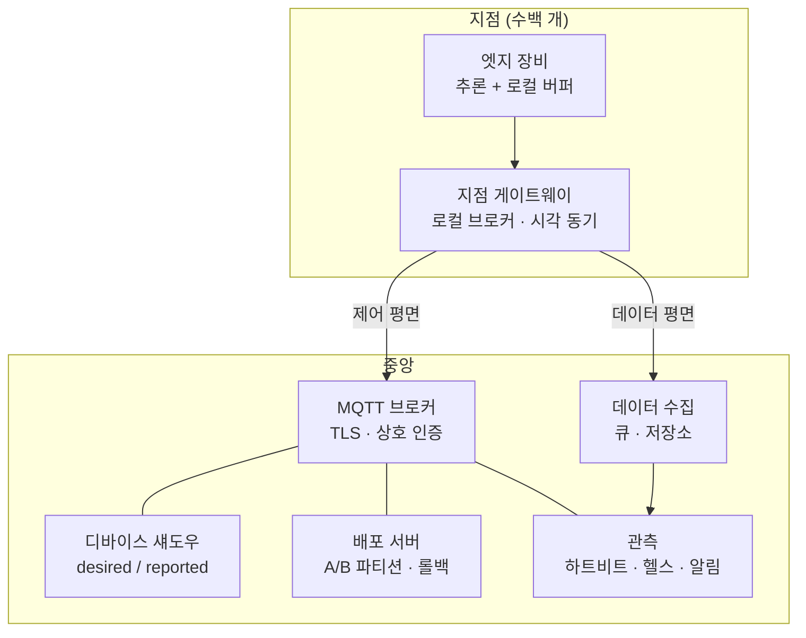

## 1대에서 되는 것과 300대에서 되는 것

현장에 놓을 장비를 하나 만들어 책상에서 돌리면 대개 잘 된다. 카메라가 붙고, 모델이 돌고, 결과가 서버로 올라간다. 이 상태로 사업 계획서에 "전국 300개 지점에 설치"라고 쓰면 그때부터 전혀 다른 문제가 시작된다.

바뀌는 건 이런 것들이다.

- 장비 300대에 **각각 다른 신원**을 어떻게 넣을 것인가. 설치 기사가 노트북을 들고 다니며 설정 파일을 복사할 것인가
- 지점 인터넷이 **끊긴 3시간** 동안 그 장비는 무엇을 하는가. 데이터를 버리는가, 쌓는가, 쌓으면 어디에 얼마나
- 모델을 바꿔야 할 때 300대에 **어떻게 배포**하는가. 그중 5대가 업데이트 중에 정전되면
- 어제부터 47번 지점이 데이터를 안 보낸다는 걸 **누가 언제 아는가**

이 네 가지 답이 없으면 정확도가 아무리 좋아도 운영이 안 된다. 그리고 이 넷은 모델 성능과 무관한 시스템 설계 문제다.

> **엣지 프로젝트가 실패하는 지점은 대개 인식 정확도가 아니라, 장비가 말을 안 들을 때 사람이 손을 못 대는 구조다.**

## 제어 평면과 데이터 평면을 분리한다

첫 번째 설계 결정은 두 종류의 트래픽을 섞지 않는 것이다.

| 구분 | 제어 평면 | 데이터 평면 |
|---|---|---|
| 흐름 | 중앙 to 장비 (설정·명령·펌웨어) + 장비 to 중앙 (상태·하트비트) | 장비 to 중앙 (측정값·추론 결과·이벤트) |
| 양 | 적다 | 많다 |
| 지연 요구 | 즉시성보다 신뢰성 | 지연 허용, 대신 유실 최소화 |
| 끊겼을 때 | 재연결 후 마지막 의도를 반영 | 로컬에 쌓았다가 재전송 |

이걸 섞으면 데이터가 밀릴 때 명령이 같이 밀린다. 장비가 이상해서 원격으로 재시작시키려는데, 그 장비가 밀린 데이터를 토해 내느라 명령을 못 받는 상황이 실제로 생긴다. 제어는 별도 채널(또는 최소한 별도 우선순위)로 둔다.

*그림. 지점 게이트웨이가 장비를 모으고, 중앙은 제어와 데이터를 나눠 받는다.*

## 신원 - 300대에 어떻게 이름을 붙일 것인가

가장 자주 저지르는 실수는 모든 장비에 같은 자격 증명을 넣는 것이다. 편하다. 그리고 한 대가 털리면 전부 털린다. 게다가 한 대만 폐기할 방법이 없다.

제대로 하려면 장비마다 고유한 X.509 클라이언트 인증서를 넣고 브로커와 상호 TLS로 붙인다. 이때 결정할 것이 셋이다.

1. **키를 언제 어디서 만드나**: 이상적으로는 장비 안에서 개인키를 생성하고 밖으로 내보내지 않는다. 하드웨어 보안 요소(TPM, ATECC608 같은 보안 칩)가 있으면 거기에 넣는다. 없으면 최소한 파일 권한과 디스크 암호화를 건다
2. **인증서를 언제 발급하나**: 제조·초기 설정 단계에서 부트스트랩 인증서로 붙어 정식 인증서를 받는 제로터치 방식이 300대 규모에서는 사실상 필수다. 설치 기사가 장비마다 설정하는 방식은 100대를 넘기면 오류율이 올라간다
3. **폐기 경로**: 장비를 도난·교체할 때 그 인증서를 무효화하는 절차. CRL이나 브로커 측 허용 목록 관리. 이걸 안 만들면 폐기된 장비가 계속 붙는다

장비 ID와 물리적 설치 위치의 매핑도 데이터다. 시리얼 번호와 "몇 번 지점 몇 번 냉장고"의 연결을 사람이 엑셀로 관리하기 시작하면 반드시 틀어진다. 등록 절차에 포함시켜야 한다.

## 통신 - MQTT와 섀도우

엣지 플릿 제어의 사실상 표준은 MQTT다. OASIS 표준이고 v3.1.1과 v5.0이 널리 쓰인다. 평문 1883, TLS 8883이 관례 포트다. 이 프로토콜이 이 용도에 맞는 이유는 세 가지 기능 때문이다.

- **QoS 레벨**: 0(최대 한 번), 1(최소 한 번), 2(정확히 한 번). 대부분의 실무는 QoS 1에 멱등 처리를 붙이는 조합으로 간다. QoS 2는 왕복이 늘어 비용 대비 이득이 작다
- **LWT(Last Will and Testament)**: 장비가 접속할 때 "내가 갑자기 사라지면 이 메시지를 대신 발행해 달라"고 브로커에 맡긴다. 정상 종료가 아닌 단절을 브로커가 대신 알려 주는 장치다. 하트비트 타임아웃을 기다리지 않고 즉시 이상을 감지할 수 있다
- **retained 메시지**: 마지막 상태를 브로커가 들고 있다가 새로 구독하는 쪽에 즉시 준다. 관제 화면을 열자마자 전체 장비 상태가 보이게 하는 데 쓴다

명령을 보내는 방식은 "요청/응답"이 아니라 **원하는 상태와 보고된 상태의 대조**로 짜는 편이 낫다. AWS IoT Core는 이걸 Device Shadow, Azure IoT Hub는 Device Twin이라고 부른다. 구조는 같다.

| 필드 | 의미 |
|---|---|
| desired | 중앙이 원하는 상태 (예: 모델 버전 v7, 촬영 주기 30초) |
| reported | 장비가 실제로 보고한 상태 |
| delta | 둘의 차이. 장비는 재접속하면 delta를 보고 스스로 맞춘다 |

이 구조가 좋은 이유는 **명령이 유실돼도 복구되기 때문**이다. 장비가 꺼져 있는 동안 보낸 "모델 바꿔" 명령은 사라지지만, desired 상태는 남아 있으므로 장비가 켜지는 순간 차이를 보고 따라온다. 명령형 대신 선언형으로 짜는 것이 오프라인이 잦은 환경의 기본이다.

## 오프라인 내성 - 끊긴 3시간 동안

지점 인터넷은 끊긴다. 설계는 끊김을 예외가 아니라 정상 상태 중 하나로 다뤄야 한다.

**로컬 버퍼링.** 추론 결과를 메모리에만 두면 재부팅에 날아간다. 디스크에 쌓되 무한정 쌓으면 저장장치가 찬다. 링 버퍼로 상한을 정하고, 넘치면 무엇을 먼저 버릴지 정책을 정한다. 대개는 원본 이미지를 먼저 버리고 판정 결과와 메타데이터를 남긴다. SQLite 파일 하나로 큐를 구현하는 방식이 소형 장비에서 충분히 잘 동작한다.

용량 계산은 설계 시점에 해 둔다. 예를 들어 판정 이벤트가 200바이트이고 지점당 분당 1건이면, 72시간 단절은 200 x 60 x 72 = 약 864KB다. 별것 아니다. 그런데 원본 이미지를 200KB씩 같이 남기면 같은 조건에서 864MB가 된다. 이 차이가 저장장치 사양과 단가를 정한다.

**시각.** 오프라인 장비의 가장 골치 아픈 문제다. 네트워크가 없으면 NTP 동기가 안 되고, 배터리 없는 보드는 재부팅하면 시계가 초기화된다. 그러면 쌓아 둔 데이터의 타임스탬프가 전부 1970년이 된다. 대응은 두 가지다. RTC 배터리를 다는 것, 그리고 장비가 붙인 시각과 서버가 받은 시각을 **둘 다 저장**해서 나중에 보정할 수 있게 하는 것. 후자는 비용이 0이므로 무조건 한다.

**재접속.** 300대가 동시에 끊겼다가 동시에 붙으면 브로커가 죽는다. 재접속 간격에 지수 백오프와 무작위 지터를 넣는다. 이건 코드 한 줄 차이인데 안 넣으면 정전 복구 때 전체 시스템이 한 번 더 죽는다. 밀린 데이터를 토해 낼 때의 전송 속도에도 상한을 건다.

## 배포 - 300대를 바꾸는 일

모델이나 펌웨어를 바꾸는 절차는 별도의 글에서 다뤘으므로 여기서는 플릿 관점의 결정만 적는다.

- **단계적 배포**: 전체에 한 번에 밀지 않는다. 1대(카나리아) → 10% → 전체 순서로 가고, 각 단계에서 자동 판정 기준(부팅 성공률, 하트비트 복귀율, 추론 오류율)을 통과해야 다음으로 넘어간다
- **롤백**: A/B 파티션 방식으로 이전 버전을 남겨 두고, 새 버전이 정해진 시간 안에 정상 신호를 못 보내면 부트로더가 자동으로 이전 파티션으로 되돌린다. Mender와 balena가 이 방식을 제공한다. 롤백이 없으면 원격 업데이트는 원격 벽돌 만들기가 될 수 있다
- **버전 파편화 허용**: 300대의 버전이 항상 같을 수는 없다. 오프라인이 길었던 장비는 뒤처진다. 서버는 여러 버전이 동시에 붙는 상황을 정상으로 받아야 하고, 그래서 메시지 스키마에 버전 필드가 필요하다

## 관측 - 47번 지점이 조용한 걸 언제 아나

앞 글에서도 강조했지만 여기서도 같다. 가장 위험한 장애는 에러가 아니라 **침묵**이다.

최소한 이 세 가지는 본다.

| 신호 | 의미 | 임계 예시 |
|---|---|---|
| 마지막 수신 이후 경과 시간 | 장비가 살아 있는가 | 하트비트 주기의 3배 초과 시 경고 |
| 건수 추이 | 붙어는 있는데 일을 안 하는가 | 전일 동시간 대비 50% 미만 |
| 장비 헬스 | 곧 죽을 것인가 | 디스크 사용률, 온도, 재부팅 횟수 |

두 번째가 특히 중요하다. 장비가 연결은 유지하면서 카메라만 죽는 경우, 첫 번째 신호는 정상이고 두 번째만 이상하다.

원격 로그를 전부 중앙으로 끌어오고 싶은 유혹이 있는데, 이건 회선 비용과 저장 비용을 동시에 잡아먹는다. 평시에는 요약 지표만 올리고 문제가 생긴 장비만 상세 로그를 요청해 받아 오는 구조가 낫다. 이것도 desired 상태로 켜고 끄면 된다.

## 하드웨어 선택이 이 설계를 바꾼다

플릿 설계는 장비 사양과 분리되지 않는다.

| 선택 | 영향 |
|---|---|
| 저장장치가 SD 카드인가 eMMC/SSD인가 | SD 카드는 쓰기 수명이 짧다. 로컬 버퍼를 많이 쓰는 설계면 수명이 운영 비용이 된다 |
| RTC 배터리 유무 | 오프라인 타임스탬프의 신뢰도 |
| 보안 칩 유무 | 개인키를 장비 밖으로 내보내지 않을 수 있는가 |
| 셀룰러인가 유선인가 | 셀룰러면 전송량이 곧 요금이다. 위 용량 계산이 설계 제약이 된다 |
| 전원 | 상시 전원이 아니면 예기치 않은 종료가 잦다. 파일시스템 손상 대비(읽기 전용 루트 + 쓰기 영역 분리)가 필요해진다 |

라즈베리파이 계열 SBC로 시작해 물량이 늘면 산업용 보드로 넘어가는 경로가 흔한데, 이때 위 항목들이 한꺼번에 바뀌므로 소프트웨어가 하드웨어 가정에 강하게 묶여 있으면 다시 만들어야 한다. 시각 소스, 저장 경로, 네트워크 인터페이스는 설정으로 빼 둔다.

## 도구가 관제 서버를 짜 주는 시대에 남는 일

MQTT 브로커를 띄우고, 섀도우 구조를 만들고, 단계적 배포 스크립트를 짜는 일은 지시하면 도구가 만든다. 나도 이런 구성의 골격을 Claude Code에게 만들게 한다. 재접속 백오프에 지터를 넣는 것 같은 세부도, 알고 지시하면 들어간다.

도구가 대신 못 하는 건 이런 결정이다.

원본 이미지를 얼마나 오래 들고 있을 것인가. 그 결정이 저장장치 사양을 바꾸고 단가를 바꾼다. 셀룰러 요금 안에서 하루에 몇 번 보고할 수 있는가. 인증서를 제조 시점에 넣을 것인가 설치 시점에 넣을 것인가, 그러면 설치 절차서가 어떻게 달라지는가. 롤백 판정 기준을 무엇으로 삼을 것인가.

이건 전부 **현장 제약을 숫자로 바꾸는 일**이고, 그 숫자가 있어야 도구가 만들 코드의 요구사항이 정해진다.

> **엣지 시스템에서 사람의 일은 장비를 고르는 것도 모델을 고르는 것도 아니라, 끊기고 밀리고 되돌려야 하는 상황을 미리 숫자로 정의하는 것이다.**

300대를 운영한다는 건 300번의 정상 동작이 아니라, 한 번은 반드시 일어나는 300가지 비정상을 미리 정해 둔다는 뜻이다.

---

## 참고

- OASIS, MQTT Version 5.0 명세, <https://docs.oasis-open.org/mqtt/mqtt/v5.0/mqtt-v5.0.html>
- AWS IoT Core, Device Shadow 서비스 문서, <https://docs.aws.amazon.com/iot/latest/developerguide/iot-device-shadows.html>
- Azure IoT Hub, Device Twin 문서, <https://learn.microsoft.com/azure/iot-hub/iot-hub-devguide-device-twins>
- Mender 문서 (A/B 파티션 업데이트와 롤백), <https://docs.mender.io/>
- balena 문서 (플릿 관리·컨테이너 배포), <https://docs.balena.io/>

*※ MQTT의 QoS 3단계·LWT·retained 메시지·포트(1883/8883), 섀도우의 desired/reported/delta 구조, A/B 파티션 롤백은 위 공식 문서 기준이다. 용량 계산 예시(200바이트·72시간·864KB 및 이미지 포함 시 864MB), 관측 임계 예시, 접근 단계 구분은 내가 설계 기준으로 쓰는 값이며 현장 조건에 따라 달라진다.*
