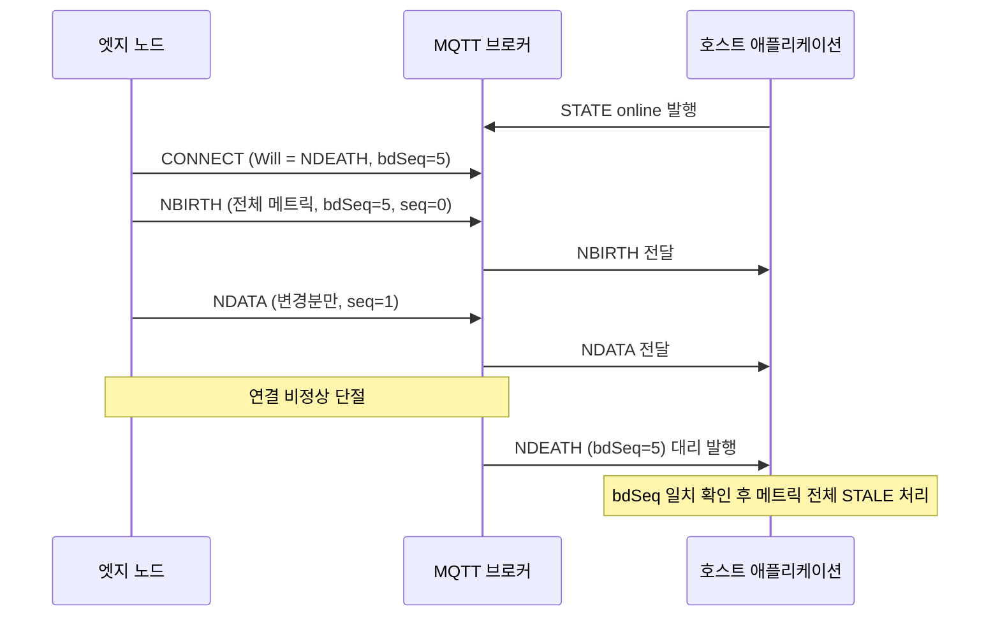
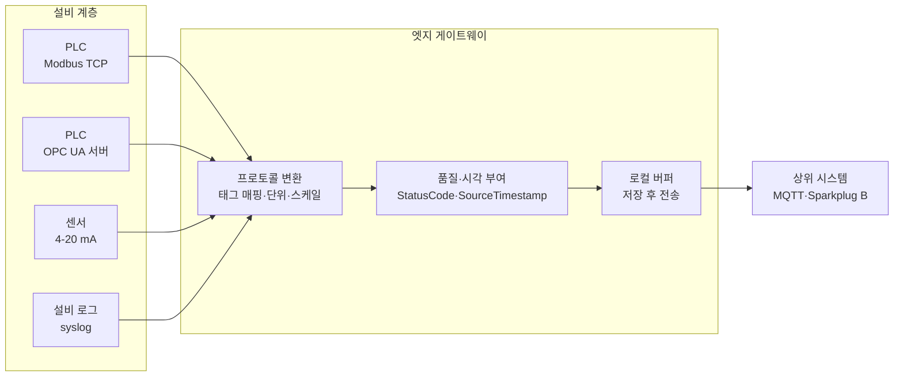

## 시리즈 안내와 이 글의 범위

"현장 데이터에서 학습 데이터까지" 시리즈는 다섯 편으로 구성한다. 1편은 엣지에서 데이터를 읽는 방법, 2편은 현장 서버에서 데이터를 밖으로 내보내는 경로와 저장 구조, 3편은 센서 데이터 정제, 4편은 이미지 학습 데이터 구축, 5편은 학습 데이터 준비 파이프라인이다. 이 글은 표준 문서와 논문을 읽으며 정리한 스터디 노트다.

범위는 설비 옆에서 값이 처음 디지털 레코드가 되는 순간까지다. 장비 플릿의 인증서·섀도우·오프라인 버퍼는 [장비 1대는 되는데 300대는 안 되는 이유](/posts/arch-02-edge-fleet-control/)에서, 업무 시스템 연계는 [시스템 34개를 하나로 묶는다는 말의 실제](/posts/arch-01-legacy-integration/)에서 다뤘다.

수집 단계의 결정은 뒤에서 되돌리기 어렵다. 1초 주기로 읽은 진동값에서 100 Hz 성분을 복원할 방법은 없다. 그래서 수집 설계는 네 질문으로 정리된다. 무엇을, 어떤 프로토콜로, 얼마나 자주 읽는가. 그 값의 시각과 신뢰도를 어떻게 남기는가.

> **수집 단계에서 버린 정보는 정제 단계에서 되살릴 수 없다. 주기, 시각, 품질은 읽는 순간에 정해야 한다.**

## 데이터 원천은 네 갈래로 나눈다

| 원천 | 형태 | 주기 결정 주체 | 시각을 붙이는 쪽 | 품질 정보 |
|---|---|---|---|---|
| PLC 태그 | 레지스터·변수 (비트, 16비트 워드, 구조체) | 수집기 폴링 또는 PLC 측 발행 설정 | 수집기, 또는 OPC UA 서버의 SourceTimestamp | 프로토콜에 따라 있음 또는 없음 |
| 센서 아날로그 신호 | 4-20 mA 전류, 전압 | ADC 샘플링 주기 | ADC 보드 또는 수집기 | 신호 범위 밖 값으로 고장 표시 |
| 설비 로그 | 텍스트·이벤트 레코드 | 이벤트 발생 시점 | 설비 자체 시계 | 심각도 등급 정도 |
| 카메라 | 이미지 프레임 | 트리거 또는 프레임 레이트 | 카메라 또는 수집 PC | 별도 판정 필요 |

PLC 태그는 제어 프로그램이 이미 가공한 값이다. Modbus 사양의 데이터 모델은 단일 비트 두 표(Discretes Input, Coils)와 16비트 워드 두 표(Input Registers, Holding Registers)뿐이다. 그래서 32비트 실수를 두 레지스터에 나눠 담는 순서, 스케일, 단위는 사양 밖의 약속이고, 태그 목록 문서에 적혀 있지 않으면 값의 의미를 확정할 수 없다.

아날로그 신호는 4-20 mA 전류 루프가 흔하다. 4 mA를 영점으로 삼아 단선과 측정값 0을 구분한다. NAMUR NE 43 권고는 3.6 mA 미만과 21 mA 초과를 센서 고장 신호 수준으로 쓰므로, 이 범위의 값은 품질 플래그로 기록한다.

설비 로그는 이벤트 단위다. syslog(RFC 5424)는 심각도 0(Emergency)~7(Debug)과 RFC 3339 기반 TIMESTAMP를 정해 두지만, 설비마다 자체 형식인 경우도 많다. 카메라는 4편에서 다루고, 여기서는 프레임에도 다른 신호와 같은 시각 기준을 붙여야 한다는 점만 짚는다.

## 산업 프로토콜 비교

아래 특성은 모두 공식 사양이나 표준 단체 문서에서 확인했다.

| 프로토콜 | 통신 모델 | 전송 계층 | 데이터 모델 | 대표 수치 |
|---|---|---|---|---|
| Modbus RTU | 요청·응답 (마스터가 폴링) | RS-485 직렬 | 비트·16비트 워드 4표 | 프레임 최대 256바이트, 프레임 사이 3.5문자 시간 이상 무신호 |
| Modbus TCP | 요청·응답 | TCP, 포트 502 | 위와 동일 | ADU 최대 260바이트 (PDU 253 + MBAP 7) |
| OPC UA | 클라이언트·서버, PubSub | TCP (UA 바이너리), UDP·이더넷·MQTT (PubSub) | 노드·참조로 된 주소 공간, 타입 정의 | StatusCode 32비트, SourceTimestamp·ServerTimestamp |
| EtherNet/IP | 명시적 메시지 (요청·응답), 암시적 I/O 연결 | 명시적은 TCP, 암시적은 UDP 멀티캐스트 | CIP 객체 모델 | 2001년 도입 |
| PROFINET | 주기적 실시간 I/O | RT는 TCP/IP를 거치지 않는 이더넷 프레임 (EtherType 0x8892) | 주기 I/O 데이터 | RT 주기 250 µs ~ 512 ms, IRT 최저 31.25 µs·지터 1 µs 미만 |
| MQTT | 발행·구독, 브로커 경유 | TCP, 포트 1883 (평문)·8883 (TLS) | 페이로드 자유 (Sparkplug B가 규약 추가) | QoS 0·1·2, Keep Alive 1.5배 초과 시 연결 종료 |

Modbus(1979년부터 쓰인 요청·응답 프로토콜)의 RTU 모드는 프레임 사이에 3.5문자 시간 이상 무신호를 요구하고, 문자 사이가 1.5문자 시간을 넘게 비면 프레임을 버린다. 한 직렬 버스에 장비가 많을수록 장비당 읽기 주기가 길어지는 이유다. 값에 시각도 품질도 없으므로 둘 다 수집기가 붙인다.

EtherNet/IP(상위 계층 CIP)는 설정·진단을 TCP 명시적 메시지로, 주기 I/O를 UDP 멀티캐스트로 나눈다. PROFINET IRT는 모든 장치의 공통 시계와 Conformance Class C 인증을 요구한다.

수집 쪽 표준 후보는 OPC UA와 MQTT인데 층이 다르다. OPC UA는 의미(정보모델)와 품질까지, MQTT는 운반만 정의한다. 그래서 OPC UA PubSub이 MQTT를 전송 수단으로 쓸 수 있다.

## OPC UA: 정보모델과 PubSub

### 주소 공간과 타입

OPC UA 서버는 데이터를 주소 공간(AddressSpace)으로 노출한다. Part 1은 이를 "참조(Reference)로 연결된 노드(Node)의 집합"으로 설명한다. 노드는 객체·변수·메서드 등의 클래스로 나뉘고, Part 3은 서버가 객체와 변수의 타입 정의를 제공하도록 요구한다. 잘 알려진 타입은 서버가 달라도 공통이어서 클라이언트가 인스턴스를 바로 해석할 수 있다.

이 타입 체계 위에 동반 사양(companion specification)이 올라간다. OPC UA for Machinery(OPC 40001-1)의 MachineIdentificationType은 제조사(Manufacturer), 일련번호(SerialNumber), 수명 주기 동안 바뀌지 않는 식별자(ProductInstanceUri) 같은 명판 정보를 담는다. Modbus와 달리 의미가 주소 공간 안에 있으므로 태그 매핑 작업이 줄어든다.

### 클라이언트·서버 구독과 PubSub

클라이언트·서버 모델에서는 Read 서비스로 매번 묻거나, 구독(Subscription)에 모니터링 항목(MonitoredItem)을 걸어 변화를 통지받는다. 샘플링 간격 0을 요청하면 서버는 가장 빠른 실용 주기를 쓰고, 서버가 0으로 확정해 돌려주면 그 항목은 변화 시에만 보고하는 예외 기반이다.

PubSub(Part 14)은 요청·응답도, 발행자와 구독자 사이의 연결 수립도 없고, 발행자 부하가 구독자 수와 무관하다(Part 1). 브로커 없는 방식은 UDP 멀티캐스트 같은 네트워크 인프라가 전달하는데, Part 14는 OPC UA UDP에 적시성·전달·순서·중복 방지 보장이 없다고 명시한다. 브로커 방식은 MQTT나 AMQP 브로커가 중계한다. 인코딩은 이진 UADP와 JSON이다.

Gundall과 Schotten(2021)은 상용 PLC 두 기종의 개방 인터페이스를 측정했다. 신형 PLC에서 OPC UA Read 서비스로 폴링한 최소 갱신 시간은 값 1개 9.11 ms, 10개 30.35 ms, 100개 246.1 ms였고, UDP 기반 PubSub은 값 1개 약 1.02 ms, 10개 1.26 ms였다. 원인은 메타데이터 오버헤드로, 값 1개를 쓰는 WriteRequest가 234바이트라 효율이 1% 미만이었다. 다만 Read는 PLC 설정을 바꾸지 않고 바로 붙을 수 있고, PubSub은 PLC에 WriterGroup과 DataSetWriter를 설정해야 한다. 기존 설비에 손대지 않고 수십 개 태그를 초 단위로 읽는다면 구독으로 충분하고, 수백 개 태그를 밀리초 단위로 받거나 소비자가 여럿이면 PubSub을 검토한다.

## MQTT와 Sparkplug B

MQTT는 토픽 이름, 페이로드, 장비 생존 확인 방법을 정하지 않는다. Eclipse Sparkplug는 이 부분을 규약으로 고정한다. 아래는 Sparkplug 3.0.0 사양(2022-11-16)에서 확인한 내용이다.

토픽 구조는 `namespace/group_id/message_type/edge_node_id/[device_id]`이고, Sparkplug B의 namespace 값은 `spBv1.0`이다. 메시지 유형은 아홉 가지다.

| 유형 | 의미 |
|---|---|
| NBIRTH / DBIRTH | 엣지 노드·장치의 출생 인증서. 모든 메트릭의 현재값과 정의를 담는다 |
| NDEATH / DDEATH | 엣지 노드·장치의 사망 인증서 |
| NDATA / DDATA | 값이 바뀐 메트릭만 담은 데이터 메시지 |
| NCMD / DCMD | 엣지 노드·장치로 보내는 명령 |
| STATE | 호스트 애플리케이션의 온라인·오프라인 상태 |

상태 관리는 MQTT의 Will 메시지를 쓴다. 엣지 노드는 CONNECT 패킷에 NDEATH를 Will 메시지로 등록하고 페이로드에 `bdSeq`(INT64)를 넣는다. 연결이 비정상으로 끊기면 브로커가 NDEATH를 대신 발행하고, 호스트는 bdSeq가 직전 NBIRTH와 일치하면 그 노드의 모든 메트릭을 STALE로 바꾸고 수신 시각을 기록한다. 노드가 끊기 직전 NDEATH를 직접 보냈다면 뒤따르는 Will 메시지는 bdSeq 중복이므로 무시한다.

데이터 메시지에는 0~255를 순환하는 `seq`가 붙는다. 호스트가 1, 2, 4를 받으면 재정렬 타이머(Reorder Timeout)를 시작하고, 시간 안에 3이 오지 않으면 출생 인증서 재발행(Rebirth Request)을 요청한다. 사양은 이 타임아웃이 일반 환경에서 몇 초면 된다고 적는다.


*그림. Sparkplug B 세션의 출생·데이터·사망 흐름과 bdSeq 대조.*

Sparkplug는 값이 바뀔 때만 보내는 RBE(Report by Exception)를 권고한다(SHOULD). 출생 인증서가 전체 현재값을 이미 보냈고 세션이 끊기면 사망 인증서가 도착하므로 RBE가 성립한다. 세션 상태를 모르는 RBE는 "값이 안 바뀐 것"과 "장비가 죽은 것"을 구분하지 못한다.

반대 방향으로 호스트는 `spBv1.0/STATE/sparkplug_host_id` 토픽에 온라인·오프라인을 알린다. 사양은 1차 호스트가 오프라인인 동안 엣지가 데이터를 저장했다가 호스트가 돌아오면 이력 데이터를 내보낼 수 있다고 설명한다. 저장 후 전송의 표준 신호다.

## 폴링 대 이벤트·구독

폴링은 수집기가 정한 주기로 묻는다. Modbus는 폴링밖에 없다. 주기가 확정적인 대신 값이 안 바뀌어도 비용을 내고, 폴링 주기보다 짧은 펄스는 보이지 않는다.

이벤트·구독(OPC UA 모니터링 항목, Sparkplug RBE)은 변화가 있을 때만 보낸다. 아날로그 값은 잡음 때문에 매 샘플이 조금씩 다르므로 "변화"를 정의하지 않으면 폴링보다 메시지가 많아진다. OPC UA는 DataChangeFilter의 데드밴드(없음·절대·퍼센트)로 이를 다룬다. 절대 데드밴드는 "|마지막으로 큐에 넣은 값 - 현재값| > AbsoluteDeadband"일 때만 통지한다.

```python
# 절대 데드밴드: 마지막으로 보낸 값과의 차이가 임계를 넘을 때만 보낸다
def deadband_filter(samples, deadband):
    sent = []
    last = None
    for ts, v in samples:
        if last is None or abs(last - v) > deadband:  # OPC UA Part 4 7.22.2의 판정식
            sent.append((ts, v))
            last = v  # 기준값은 '직전 샘플'이 아니라 '마지막으로 보낸 값'
    return sent

# 0.1 단위로 흔들리는 온도를 데드밴드 0.5로 거르면 큰 변화만 남는다
```

기준을 직전 샘플로 잡으면 느린 드리프트는 영원히 보고되지 않는다.

| 상황 | 권장 방식 | 이유 |
|---|---|---|
| 느리게 변하는 공정값 (온도, 압력) | 구독 + 데드밴드 | 메시지 수를 줄이고 변화는 놓치지 않는다 |
| 상태·알람 비트 | 구독 (변화 시 보고) | 짧은 상태 변화를 폴링 주기 사이에 놓치지 않는다 |
| 진동·전류 파형 | 엣지에서 고속 샘플링 후 묶음 전송 | 파형 단위로 의미가 있다 |
| 학습용 기준 데이터 | 고정 주기 | 시계열 모델은 균일 간격을 가정하는 경우가 많다 |

마지막 행은 데드밴드와 충돌한다. 데드밴드로 줄인 데이터는 불균일 간격이라 다시 채워야 하고, 그때 "변화 없음"과 "통신 두절"을 가르는 근거가 품질 정보다. 3편에서 다시 다룬다.

## 샘플링 주기: 나이퀴스트와 앨리어싱

### 표본화 정리

Shannon(1949)의 Theorem 1은 이렇다. 함수 f(t)가 W Hz보다 높은 주파수를 포함하지 않으면 1/(2W)초 간격의 표본값만으로 완전히 결정된다. 논문은 이 사실이 통신 분야에 이미 알려져 있었고 Nyquist도 같은 방향을 지적했다고 밝힌다. 2W를 나이퀴스트 율이라 부른다. 전제는 W 위 성분이 전혀 없어야 한다는 것인데, 실제 센서 신호에는 잡음과 고조파가 있어 이 전제가 저절로 성립하지 않는다.

### 앨리어싱

표본화 주파수 fs로 신호를 찍으면, fs/2를 넘는 주파수 f 성분은 사라지지 않고 |f - k·fs| (k는 정수) 위치의 낮은 주파수로 접혀 들어온다. 예를 들어 fs = 1000 Hz로 찍은 신호에 950 Hz 성분이 있으면 표본 위에서는 |950 - 1000| = 50 Hz로 보인다. 표본만 보고는 진짜 50 Hz 성분과 구분할 수 없다.

```python
import numpy as np

fs = 1000                      # 표본화 주파수 1 kHz
t = np.arange(0, 1, 1 / fs)    # 1초 분량의 표본 시각
x_950 = np.sin(2 * np.pi * 950 * t)
x_50 = np.sin(2 * np.pi * 50 * t)
# 950 Hz 신호의 표본은 위상이 뒤집힌 50 Hz 신호의 표본과 같다
print(np.allclose(x_950, -x_50))   # True
```

표본화 이후에는 되돌릴 수 없다. 50 Hz를 지우면 진짜 50 Hz 성분도 같이 지워진다.

### 안티앨리어싱 필터와 주기 선정

해결책은 표본화 전에 아날로그 저역통과 필터(안티앨리어싱 필터)로 fs/2 위 성분을 줄이는 것이다. 실제 필터는 차단 주파수에서 완만하게 감쇠하므로 관심 대역 상한(Fmax)의 정확히 두 배로 찍으면 감쇠 구간 성분이 접혀 들어온다. 그래서 여유를 둔다. 진동 분석 특허(Leigh, 2010)는 표본화 주파수를 Fmax의 2.56배로 정하고, 2.56은 업계에서 흔한 값으로 나이퀴스트와 필터 요구를 함께 만족시키려고 고른 것이라고 설명한다.

주기를 정하는 순서는 이렇다.

1. 보고 싶은 현상의 최고 주파수(Fmax)를 정한다. 베어링 결함 주파수인지 탱크 온도의 분 단위 변화인지에 따라 몇 자릿수가 달라진다
2. 표본화 주파수를 Fmax의 2배보다 넉넉하게(예: 2.56배) 잡는다
3. 신호 경로에 그 주파수에 맞는 안티앨리어싱 필터가 있는지 확인한다
4. 고속 파형은 저장·전송 용량을 보고 엣지에서 특징량(RMS, 피크 등)으로 줄일지 정한다

PLC 태그를 1초마다 폴링하는 것은 PLC가 이미 표본화한 값을 다시 표본화하는 것이다. 앞 단계에서 안티앨리어싱 없이 찍혔다면 수집 주기를 올려도 앨리어싱은 이미 들어가 있다. 고주파 현상은 별도 센서와 고속 ADC 경로로 봐야 한다.

## 시간 동기: NTP와 PTP

컨베이어가 초속 1 m로 움직일 때 카메라와 근접 센서의 시각이 10 ms 어긋나면 위치로 1 cm 차이다. 필요한 시각 정밀도는 이렇게 공정 속도에서 거꾸로 계산한다.

NTP(RFC 5905)는 왕복 메시지의 네 시각 T1~T4로 시계 오프셋을 추정한다.

θ = ½ [(T2 - T1) + (T3 - T4)],  δ = (T4 - T1) - (T3 - T2)

θ는 오프셋, δ는 왕복 지연이다. 가는 길과 오는 길의 지연이 같다고 가정하므로 경로가 비대칭인 만큼 오차가 생긴다. PTP(IEEE 1588)도 같은 왕복 원리를 쓰지만 정밀도가 다르다. 차이를 만드는 주된 요소는 하드웨어 타임스탬프다. Kirdan 외(2023)는 Linux PTP 도구(ptp4l, phc2sys)와 IEEE 802.1AS 지원 NIC(Intel I210)의 하드웨어 타임스탬프로 나노초 수준 정밀도를 얻을 수 있다고 설명한다. 소프트웨어 스택의 지연 변동을 NIC에서 시각을 찍어 피하는 방식이다.

| 방식 | 공식 문서의 정밀도 서술 | 필요 조건 | 맞는 용도 |
|---|---|---|---|
| NTP (RFC 5905) | 1차 서버 수십 µs, 빠른 LAN의 2차 서버·클라이언트 수백 µs, 폴링 36시간까지 늘리면 수십 ms | 일반 네트워크 | 로그, 분 단위 공정값, 이벤트 정렬 |
| PTP (IEEE 1588-2019) | 마이크로초 미만, 잘 설계된 망에서 나노초 미만 시각 전달 | 하드웨어 타임스탬프 지원 NIC | 다중 센서 파형 정렬, 고속 공정 |

누가 시각을 붙였는지도 기록한다. OPC UA Part 4의 TimestampsToReturn은 SOURCE, SERVER, BOTH, NEITHER 중 무엇을 받을지 고르는 열거형이다. 원천 시각(SourceTimestamp)과 서버 수신 시각(ServerTimestamp)을 둘 다 저장해 두면 원천 시계가 틀어진 구간을 나중에 찾을 수 있다.

## 엣지 게이트웨이의 역할

엣지 게이트웨이는 설비 프로토콜과 상위 시스템 사이에 놓인다.


*그림. 엣지 게이트웨이는 변환, 품질·시각 부여, 버퍼링을 차례로 수행한다.*

프로토콜 변환은 레지스터 주소를 태그 이름으로 바꾸고, 두 레지스터를 32비트 실수로 합치고, 스케일과 단위를 적용하는 일이다. 출력은 Sparkplug B처럼 규약이 정해진 형식 하나로 맞춘다.

품질·시각 부여는 Modbus처럼 품질 정보가 없는 원천을 위한 단계다. 통신 결과(무응답, 예외 응답)와 값 범위 검사(NE 43 고장 전류 등)로 품질을 판정하고, 게이트웨이가 읽은 시각을 붙이되 원천 시각이 있으면 둘 다 남긴다.

버퍼링은 상위 연결이 끊긴 동안 쌓았다가 복구 후 보내는 일이다. 용량 계산과 재접속 백오프는 [엣지 플릿 관제 글](/posts/arch-02-edge-fleet-control/)에서 다뤘다. 수집 관점에서 덧붙일 규칙은 하나다. 나중에 보낸 이력 데이터에는 실시간 데이터와 구분되는 표시를 단다. 그렇지 않으면 하류의 실시간 판정 로직이 과거 값에 반응한다.

## 데이터 품질 플래그

값만 저장하고 품질을 버리면 정제 단계에서 "이 0은 실제 0인가, 통신 두절인가"를 판정할 근거가 없다. 품질은 수집 시점에만 정확히 알 수 있다.

OPC UA의 StatusCode는 32비트 부호 없는 정수다. 최상위 두 비트(30:31)가 심각도로, 00은 Good(결과를 써도 됨), 01은 Uncertain(일부 용도에 맞지 않을 수 있음), 10은 Bad(쓰면 안 됨)다. 16:27 비트의 하위 코드가 사유를 나타내고, Part 8(Data Access)이 현장용 코드를 정의한다.

| 코드 | Part 8 정의 (요지) | 수집 단계에서의 의미 |
|---|---|---|
| Bad_SensorFailure | 값을 만드는 센서에 고장이 있음 | 4-20 mA 고장 전류 범위 검출 시 |
| Bad_DeviceFailure | 값을 만드는 장치·데이터 원천에 고장 | 설비 자체 진단 이상 |
| Bad_NoCommunication | 원천 통신이 정의됐으나 수립되지 않음 | 장비 무응답, 마지막 값도 없음 |
| Bad_OutOfService | 데이터 원천이 동작하지 않음 | 설비 정지·점검 중 |
| Uncertain_LastUsableValue | 값을 갱신하던 주체가 갱신을 멈춤 | 통신 두절 후 마지막 값을 유지 중 |
| Uncertain_SensorNotAccurate | 값이 센서 한계에 있음 | 측정 범위 상·하한에 붙은 값 |
| Uncertain_EngineeringUnitsExceeded | 값이 이 파라미터의 정의 범위 밖 | 설정 범위 초과 |

Sparkplug는 메트릭 속성 Quality 하나에 0(BAD), 192(GOOD), 500(STALE) 세 값만 둔다. 이 속성은 GOOD이 아닐 때만 넣는 선택 사항이다. OPC UA의 세분된 사유를 Sparkplug로 넘기면 세 값으로 뭉개지므로, 사유가 필요하면 별도 메트릭으로 함께 보낸다.

품질 체계가 원천마다 다르므로 엣지 내부 레코드 형식을 하나로 정해 둔다.

```python
from dataclasses import dataclass

@dataclass
class Reading:
    tag: str              # 태그 이름 (레지스터 주소가 아니라 의미 있는 이름)
    value: float | None   # Bad 품질이면 None 허용
    unit: str
    source_ts: str | None # 원천이 붙인 시각 (없으면 None)
    gateway_ts: str       # 게이트웨이가 읽은 시각, 항상 존재
    quality: str          # "good" / "uncertain" / "bad"
    reason: str           # 하위 사유 코드 (예: "sensor_failure", "no_communication")
    replayed: bool        # 저장 후 전송된 이력 데이터인지 표시
```

OPC UA 원천이면 StatusCode를 옮기고, Modbus 원천이면 게이트웨이가 판정해 채운다.

## 도구에 맡길 수 있는 것과 사람이 정해야 하는 것

Modbus 읽기 루프, OPC UA 구독 설정, Sparkplug 페이로드 인코딩, 데드밴드 필터는 Claude Code 같은 코딩 에이전트에게 지시하면 골격이 나온다. bdSeq 증가 규칙처럼 사양이 정해 둔 부분도 사양을 근거로 주면 맞게 구현한다.

도구가 대신 정할 수 없는 것은 숫자와 기준이다.

- 태그마다 보고 싶은 현상의 최고 주파수. 이것이 표본화 주기와 필터 사양을 정한다
- 데드밴드 값. 0.5 °C로 잡을지 0.05 °C로 잡을지는 공정이 어느 변화를 의미 있게 보는지에 달려 있다
- 시각 정밀도 요구. 공정 속도에서 거꾸로 계산해 NTP로 충분한지 PTP가 필요한지 정한다
- 품질 판정 규칙. 몇 번 무응답이면 Bad로 볼지, 측정 범위 상한에 몇 초 붙어 있으면 Uncertain으로 볼지
- 레지스터 매핑 문서. 두 레지스터의 순서, 스케일, 단위는 설비 문서와 현장 확인으로만 확정된다

이 값들이 비어 있으면 도구는 그럴듯한 기본값을 넣은 코드를 만들고, 그 기본값이 공정과 맞는지는 아무도 확인하지 않은 상태로 남는다. 검증 방법도 사람이 정한다. 알려진 주파수 신호를 넣어 앨리어싱을 보고, 통신선을 뽑아 품질 플래그가 바뀌는지 보고, 두 원천에 같은 이벤트를 넣어 시각 차이를 잰다.

> **수집 코드는 도구가 쓴다. 무엇을 얼마나 자주, 어느 시계로, 어떤 기준의 품질로 읽을지는 사람이 숫자로 정한다.**

---

## 참고

- Shannon, C. E. (1949). Communication in the Presence of Noise. Proceedings of the IRE, 37(1), 10-21 (Proceedings of the IEEE, 86(2), 1998 재수록본 열람). <https://web.cs.miami.edu/home/burt/learning/Csc524.092/docs/shannonpaper.pdf>
- Gundall, M., Schotten, H. D. (2021). Assessing Open Interfaces and Protocols of PLCs for Computation Offloading at Field Level. 17th IEEE International Conference on Factory Communication Systems (WFCS). <https://arxiv.org/abs/2106.04517>
- Kirdan, E., Rezabek, F., Mühlbauer, N., Carle, G., Pahl, M.-O. (2023). Real-Time Performance of OPC UA. arXiv:2310.17052. <https://arxiv.org/abs/2310.17052>
- Eclipse Sparkplug Contributors (2022). Sparkplug Specification Version 3.0.0. Eclipse Foundation. <https://sparkplug.eclipse.org/specification/version/3.0/documents/sparkplug-specification-3.0.0.pdf>
- OPC Foundation (2025). OPC 10000-1 Part 1: Overview and Concepts, v1.05.06. <https://reference.opcfoundation.org/Core/Part1/v105/docs/>
- OPC Foundation. OPC 10000-3 Part 3: Address Space Model, v1.05. <https://reference.opcfoundation.org/Core/Part3/v105/docs/4.6.1>
- OPC Foundation. OPC 10000-4 Part 4: Services, v1.05 (5.13.1.2, 7.22.2, 7.38, 7.39). <https://reference.opcfoundation.org/Core/Part4/v105/docs/>
- OPC Foundation. OPC 10000-8 Part 8: Data Access, v1.05 (7.3.2). <https://reference.opcfoundation.org/Core/Part8/v105/docs/7.3.2>
- OPC Foundation (2025). OPC 10000-14 Part 14: PubSub, v1.05.06. <https://reference.opcfoundation.org/Core/Part14/v105/docs/>
- OPC Foundation. OPC 40001-1 OPC UA for Machinery Part 1: Basic Building Blocks. <https://reference.opcfoundation.org/specs/OPC-40001-1/full>
- Modbus Organization (2012). MODBUS Application Protocol Specification V1.1b3. <https://modbus.org/modbus-specifications>
- Modbus Organization. MODBUS over Serial Line Specification and Implementation Guide V1.02. <https://modbus.org/modbus-specifications>
- Modbus Organization. MODBUS Messaging on TCP/IP Implementation Guide V1.0b. <https://modbus.org/modbus-specifications>
- ODVA (2024). EtherNet/IP: CIP on Ethernet Technology, PUB00138R8. <https://www.odva.org/wp-content/uploads/2024/04/PUB00138R8_Ethernet.pdf>
- PROFINET (PI North America). PROFINET RT: Real-Time Performance. <https://us.profinet.com/profinet-rt-real-time-performance/>
- PROFINET (PI North America). PROFINET IRT: Isochronous Real Time. <https://us.profinet.com/?p=19941>
- OASIS (2019). MQTT Version 5.0, OASIS Standard. <https://docs.oasis-open.org/mqtt/mqtt/v5.0/os/mqtt-v5.0-os.html>
- Mills, D., Martin, J., Burbank, J., Kasch, W. (2010). Network Time Protocol Version 4: Protocol and Algorithms Specification. RFC 5905. IETF. <https://www.rfc-editor.org/rfc/rfc5905>
- IEEE (2019). IEEE 1588-2019, IEEE Standard for a Precision Clock Synchronization Protocol for Networked Measurement and Control Systems (초록). <https://standards.ieee.org/ieee/1588/6825/>
- NIST. Introduction to IEEE 1588. <https://www.nist.gov/el/intelligent-systems-division-73500/introduction-ieee-1588>
- Gerhards, R. (2009). The Syslog Protocol. RFC 5424. IETF. <https://www.rfc-editor.org/rfc/rfc5424>
- Leigh, N. (2010). Vibration analysis. US Patent 7805281B2. <https://patents.google.com/patent/US7805281B2/en>
- Texas Instruments. AFE782H1, AFE882H1 Data Sheet (SLASF43). <https://ti.com/document-viewer/AFE882H1/datasheet/GUID-0EB0D283-B3DA-4517-859D-DA20A442BBED>
