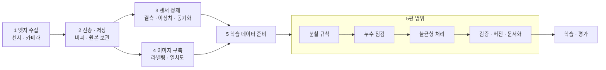
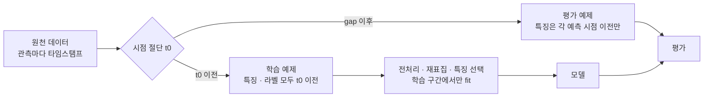

## 정제가 끝났는데 아직 학습을 못 하는 이유

"현장 데이터에서 학습 데이터까지" 시리즈의 마지막 편이다. 1~4편이 수집, 저장, 센서 정제, 이미지 구축을 다뤘고, 이 글은 정제된 데이터를 학습용 데이터셋으로 바꾸는 단계를 정리한 스터디 노트다.

`train_test_split` 한 줄로 끝날 것 같지만 정할 것이 많다. 어떤 단위로 나눌지, 예측 시점에 알 수 없는 정보가 섞이지 않았는지, 희귀 클래스를 어떻게 다룰지, 학습 때 만든 특징을 추론 때도 똑같이 만들 수 있는지, 석 달 뒤에 같은 데이터셋을 다시 꺼낼 수 있는지. 이 결정이 기록되지 않으면 성능 수치가 무엇을 잰 것인지 설명할 수 없다.


*그림. 시리즈 1~5편이 이어지는 파이프라인. 5편은 정제된 데이터와 학습 사이의 결정을 다룬다.*

## 데이터 중심 AI라는 관점

Zha 등(2023)의 서베이는 데이터 중심 AI를 "AI 시스템을 위해 데이터를 개발하고 반복 개선하고 유지하는 프레임워크"로 정의하고, 목표를 셋으로 나눈다. 학습 데이터 개발(수집, 라벨링, 준비, 축소, 증강), 추론 데이터 개발(분포 내 평가, 분포 밖 평가, 프롬프트 엔지니어링), 데이터 유지(이해, 품질 보증, 저장과 검색)다. 모델 중심 접근은 데이터를 거의 고정해 두고 더 나은 모델을 찾는다. 이 글의 분할, 누수 점검, 불균형 처리는 첫 번째 목표의 "데이터 준비"에, 검증과 버전 관리는 세 번째 목표에 속한다.

데이터 품질이 모델 선택을 뒤집는 사례도 있다. Northcutt 등(2021)은 널리 쓰이는 10개 데이터셋의 시험 세트에서 평균 최소 3.3%, ImageNet 검증 세트에서 최소 6%의 라벨 오류를 찾았다. 라벨을 고친 ImageNet에서는 원래 오라벨 예제의 비중이 6%만 늘어도 ResNet-18이 ResNet-50을 앞선다. 라벨 설계와 일치도는 [그라운드 트루스 설계](/ax/arch-03-ground-truth-design/)에서 다뤘으므로 여기서는 라벨 확정 이후만 본다.

> **정제된 데이터는 재료이고, 학습 데이터셋은 그 재료에 분할 규칙, 시점 규칙, 버전, 설명서가 붙은 결과물이다.**

## 분할 전략: 무엇을 "처음 보는 것"으로 칠 것인가

분할은 평가 질문을 정하는 일이다. "처음 보는 샘플"에 대한 성능인지, "처음 보는 설비"인지, "다음 달 데이터"인지에 따라 나누는 방법이 다르다. scikit-learn 문서는 i.i.d. 가정이 실제로는 거의 성립하지 않는다고 적고, 시간 의존 과정에서 나온 데이터면 시계열용 교차검증을, 피험자·실험·측정 장비 같은 그룹 구조가 있으면 그룹 단위 교차검증을 쓰는 편이 안전하다고 권한다.

| 분할 방식 | 대표 도구 | 답하는 질문 | 위험 |
|---|---|---|---|
| 무작위 | `KFold` | 같은 분포의 새 샘플 | 같은 설비·로트가 양쪽에 들어가면 성능이 부풀려진다 |
| 층화 | `StratifiedKFold` | 위와 같되 클래스 비율 유지 | 그룹·시간 구조는 여전히 무시 |
| 그룹 (설비, 로트, 라인) | `GroupKFold`, `StratifiedGroupKFold` | 처음 보는 설비·로트 | 그룹 수가 적으면 폴드 간 편차가 크다 |
| 시간순 | `TimeSeriesSplit` (`gap`) | 과거로 학습해 미래를 맞히는가 | 학습 구간이 짧아지고 계절성에 좌우된다 |
| 시간 + 그룹 | 직접 구현 | 신규 설비의 미래 | 쓸 수 있는 데이터가 가장 적다 |

`GroupKFold`는 같은 그룹이 학습과 시험에 동시에 들어가지 않게 한다. 문서의 예시는 피험자당 샘플이 여러 개인 의료 데이터인데, 설비 데이터로 옮기면 피험자가 설비 ID, 로트 번호, 생산 라인이 된다. `StratifiedGroupKFold`는 그룹을 묶으면서 클래스 비율도 최대한 맞춘다.

`TimeSeriesSplit`은 k번째 분할에서 앞의 k개 폴드로 학습하고 k+1번째로 시험한다. 0.24 버전에 추가된 `gap` 인자는 학습 세트 끝에서 지정한 샘플 수를 빼 둔다. 라벨이 "앞으로 2시간 안 고장"이면 학습 구간 끝 샘플의 라벨은 시험 구간의 사건으로 계산되므로, 최소한 라벨 지평만큼 비워야 겹침이 끊긴다.

아래 코드는 설비 단위 분할과 시간순 분할이 어떻게 다른지 보이기 위한 최소 예시다.

```python
# split_demo.py : 설비 단위 분할과 시간순 분할 비교
from sklearn.model_selection import GroupKFold, TimeSeriesSplit

df = df.sort_values("ts")                      # 시간순 분할은 정렬이 전제
X, y = df[features], df["label"]

# 1) 설비 단위: 같은 설비가 학습/시험 양쪽에 들어가지 않는다
for tr, te in GroupKFold(n_splits=5).split(X, y, groups=df["equipment_id"]):
    assert set(df.equipment_id.iloc[tr]).isdisjoint(df.equipment_id.iloc[te])

# 2) 시간순: 과거로 학습, 미래로 시험. gap은 라벨 지평만큼 비운다
horizon = 120                                  # 라벨이 앞으로 120샘플을 본다면
for tr, te in TimeSeriesSplit(n_splits=5, gap=horizon).split(X):
    assert df.ts.iloc[tr].max() < df.ts.iloc[te].min()
```

## 데이터 누수의 정의와 분류

### Kaufman 등의 정의: 정당성과 learn-predict 분리

Kaufman, Rosset, Perlich(KDD 2011)는 누수를 "데이터 마이닝 대상(타깃)에 대한 정보 중 마이닝에 정당하게 쓸 수 없어야 하는 정보가 들어오는 것"으로 정의한다. 이들은 누수를 두 갈래로 나눈다. 하나는 특징이 새는 경우(leaking features), 다른 하나는 학습 예제가 새는 경우(leakage in training examples)다.

특징 누수의 대표 규칙은 논문이 "no-time-machine requirement"라 부르는 것으로, 정당한 모델은 타깃보다 이른 시점의 정보만 쓴다. 논문이 정리한 KDD Cup 2008 유방암 탐지 데이터에서는 대부분의 참가자가 무시한 "Patient ID"의 예측력이 매우 높았다. 여러 출처를 합치며 출처별로 연속 ID를 붙였고, 일부 출처는 환자 상태를 미리 알고 모집단을 꾸린 것으로 추정됐다.

해법은 두 단계다. 수집 때 모든 관측에 정당성 태그를 붙이고, 학습과 예측을 분리한다(learn-predict separation). 시간 기준 문제라면 태그는 충분한 정밀도의 타임스탬프이고, 분리는 시점 절단이다. 논문은 레코드 갱신 시각이 따로 남지 않고 레코드 전체에 타임스탬프 하나만 붙는 관행을 누수의 근원으로 지목한다. 3편의 정제 단계가 원본 시각과 갱신 시각을 버리지 말아야 하는 이유다.

수집을 통제할 수 없을 때는 의외로 강한 예측 변수, 기대보다 지나치게 좋은 성능, 현장 시험에서의 성능 괴리로 탐지하며, 모두 도메인 지식을 요구한다.


*그림. learn-predict 분리. 전처리 통계와 재표집도 절단선 왼쪽에서만 계산한다.*

### Kapoor와 Narayanan의 8유형 분류

Kapoor와 Narayanan(2022, arXiv v1)은 ML을 도입한 연구 분야를 조사해 17개 분야에서 329편의 논문이 오류의 영향을 받았다고 정리하고, 누수를 8가지 유형으로 분류했다. 아래 표의 오른쪽 열은 공장·설비 데이터에 대입해 본 예시로, 논문의 사례가 아니라 내가 덧붙인 해석이다.

| 코드 | 유형 (논문) | 설비 데이터에 대입하면 |
|---|---|---|
| L1.1 | 시험 세트 없음 | 학습 정확도를 성능으로 보고 |
| L1.2 | 학습·시험 전체에 전처리 (대치, 과·소표집) | 전체 기간 평균으로 결측 보간, 분할 전 SMOTE |
| L1.3 | 학습·시험 전체로 특징 선택 | 전체 데이터 상관분석으로 센서 채널 선택 |
| L1.4 | 중복 | 재전송으로 중복 적재된 레코드 |
| L2 | 정당하지 않은 특징 (타깃의 대리 변수) | 고장 후에 기록되는 정비 작업 코드 |
| L3.1 | 시간 누수 | 무작위 분할한 시계열 |
| L3.2 | 학습·시험 비독립 (같은 사람·단위) | 같은 설비·로트가 양쪽에 |
| L3.3 | 시험 분포의 표본 편향 | 한 공장 데이터로 시험하고 전 공장 성능이라 주장 |

L2는 정당성 판단이 도메인 지식에 달려 있고 문제마다 달라 하위 유형을 두지 않았다. L3.2의 대응으로는 블록 교차검증을 든다.

사례 연구는 내전(civil war) 예측 분야다. 코드와 데이터를 공개한 12편을 재현하자 4편에서 오류가 나왔고, 그 4편이 정확히 복잡한 ML 모델이 로지스틱 회귀보다 낫다고 주장한 논문이었다. 오류를 고치자 우위가 사라졌고, 예외인 Wang(2019)에서도 AUC 차이가 0.14에서 0.01로 줄었다. 원인은 학습·시험 데이터를 함께 대치한 것(L1.2), 대치된 데이터셋의 잘못된 재사용, 타깃의 대리 변수 사용(L2)이었다. 저자들은 이 오류가 논문을 읽어서는 잡히지 않지만 자신들이 제안한 모델 정보 시트(model info sheet)로는 모두 탐지된다고 주장한다.

## 클래스 불균형 처리

평가 지표(재현율, PR-AUC)는 [그라운드 트루스 설계](/ax/arch-03-ground-truth-design/)에서, 운영 경보 임계값은 [위험도 점수를 만든다는 것](/ax/arch-04-risk-scoring-design/)에서 다뤘다. 여기서는 학습 데이터 쪽 기법만 비교한다.

| 기법 | 원리 | 피할 때 | 도구 |
|---|---|---|---|
| 무작위 소표집 | 다수 클래스를 줄인다 | 데이터가 적어 버릴 여유가 없을 때 | `RandomUnderSampler` |
| 무작위 과표집 | 소수 클래스를 복제한다 | 복제로 과적합이 생길 때 | `RandomOverSampler` |
| SMOTE | 소수 클래스 이웃 사이를 보간해 합성 | 범주형 특징, 보간 결과가 물리적으로 말이 안 되는 시계열 윈도 | `SMOTE` |
| 클래스 가중치 | 소수 클래스 오류에 더 큰 손실 | 출력 확률을 그대로 써야 할 때 | `class_weight` |
| 임계값 조정 | 학습은 그대로, 판정 기준만 이동 | 점수 순위 자체가 나쁠 때 | `TunedThresholdClassifierCV` |

SMOTE(Chawla 등, 2002)는 소수 클래스 샘플마다 같은 클래스의 k개 최근접 이웃 중 필요한 수만큼 무작위로 골라, 그 사이 선분 위에 합성 샘플을 만든다. 식으로는 `x_new = x_i + λ · (x_nn - x_i)`, λ는 0과 1 사이 난수다. 원 논문 구현은 이웃 5개를 쓰고, 과표집 200%면 그중 2개를 골라 방향마다 하나씩 만든다. 복제 대신 "특징 공간"에서 합성하므로 소수 클래스의 결정 영역이 더 넓게 학습된다는 것이 논문의 설명이다. 실험의 유방촬영 데이터는 다수 클래스 10,923개, 소수 클래스 260개였다.

scikit-learn의 `class_weight="balanced"`는 `n_samples / (n_classes * np.bincount(y))`로 계산한다. 정상 9,900개, 불량 100개면 가중치는 약 0.505와 50이다. 이진 분류의 기본 임계값은 확률 0.5이고, `TunedThresholdClassifierCV`는 내부 교차검증으로 지정 지표를 최대화하는 임계값을 찾는다. 기본 지표가 balanced accuracy이므로 용도에 맞는 지표를 직접 골라야 한다.

가장 흔한 실수는 분할 전에 전체를 재표집하는 것(L1.2)이다. imbalanced-learn 문서의 예시에서 재표집 없는 기준선은 교차검증 balanced accuracy 0.609, 남겨 둔 데이터 0.628이었다. 전체를 먼저 재표집하면 교차검증은 0.724로 올랐지만 남겨 둔 데이터에서는 0.698이었다. 파이프라인으로 학습 폴드만 재표집하면 0.732와 0.727로 두 값이 가까웠다.

```python
# imbalance_pipeline.py : 재표집을 학습 폴드 안에 가둔다
from imblearn.pipeline import make_pipeline        # sklearn이 아닌 imblearn의 Pipeline
from imblearn.over_sampling import SMOTE
from sklearn.preprocessing import StandardScaler
from sklearn.linear_model import LogisticRegression
from sklearn.model_selection import StratifiedGroupKFold, cross_val_score

pipe = make_pipeline(
    StandardScaler(),                 # 평균/표준편차는 학습 폴드에서만 계산
    SMOTE(k_neighbors=5),             # 합성 샘플도 학습 폴드에서만 생성
    LogisticRegression(max_iter=1000),
)
cv = StratifiedGroupKFold(n_splits=5)
scores = cross_val_score(pipe, X, y, groups=equipment_id,
                         cv=cv, scoring="average_precision")  # PR-AUC 계열
```

## 특징 생성과 학습/추론 일관성

학습 때 만든 특징을 추론 때 똑같이 만들지 못하면 운영 성능이 평가 성능과 달라진다. Google의 Rules of ML은 학습-서빙 스큐를 "학습 중 성능과 서빙 중 성능의 차이"로 정의하고 원인을 셋으로 든다. 학습과 서빙 파이프라인의 데이터 처리 차이, 학습 시점과 서빙 시점 사이의 데이터 변화, 모델과 알고리즘 사이의 피드백 루프다.

Breck 등(MLSys 2019)은 Google 운영 파이프라인 경험을 바탕으로 스큐를 세 가지로 나눈다.

- 특징 스큐: 같은 예제의 특징 값이 학습과 서빙에서 다르다. 논문이 "time travel"이라 부르는 경우가 대표적이다. 광고 노출의 클릭 수를 데이터베이스에서 조회하면 나중에 만든 학습 데이터에는 노출 이후의 클릭까지 들어가 값이 커진다
- 분포 스큐: 서빙 데이터를 표본 추출해 학습에 쓸 때 추출 방식의 결함으로 분포가 달라진다
- 점수/서빙 스큐: 점수를 매긴 것 중 일부만 노출되어 나머지는 라벨 없이 학습에서 빠진다

time travel은 no-time-machine 위반과 같은 구조다. 센서 특징을 정비 이력 테이블과 조인할 때 기준이 예측 시점이 아니라 테이블 최신 상태면 같은 문제가 생긴다. Rules of ML의 규칙 #29는 서빙 때 쓴 특징을 로그로 남겨 학습에 쓰고, 전부가 어려우면 일부라도 남겨 일관성을 확인하라고 한다. 규칙 #32는 학습과 서빙 파이프라인의 코드를 가능한 한 재사용하라고 한다. 특징 계산을 함수 하나로 만들고 학습 배치와 추론 서비스가 같은 함수를 호출하게 하는 형태다.

## 데이터 검증 자동화

Breck 등이 설명하는 Google의 데이터 검증 시스템은 TFX의 일부로, 수백 개 제품 팀이 하루 수 페타바이트의 운영 데이터를 검증하는 데 쓴다. 중심은 특징의 타입, 값 범위, 필수 여부 같은 기대를 기록한 스키마다. 수천 개 특징을 사람이 처음부터 쓰기 어려우므로 시스템이 통계에서 초기 스키마를 추론하고 사람이 검토해 고치며, 스키마는 버전 관리 시스템에 저장한다.

1억 개의 N(0,1) 표본 중 1만 개(0.01%)를 N(0,2)로 바꾸고 카이제곱 검정을 10번 돌리자 유의수준 1%에서 7번 경보가 울렸다. 표본이 크면 검정이 사소한 차이에도 민감해진다. 그래서 논문은 값별 확률 차이의 최댓값 `d∞(p, q) = max_i |p_i - q_i|`를 쓴다. "값 하나의 비율 변화가 1%를 넘으면 경보"처럼 임계값을 정하기 쉽고, 가장 크게 변한 값이 함께 나와 조사 출발점이 된다. 값 '-1'의 비율이 튀어 백엔드 장애로 기본값이 채워진 것을 찾은 사례를 든다.

이 시스템의 공개 구현이 TensorFlow Data Validation(TFDV)이다. `infer_schema`로 스키마를 추론하고 `validate_statistics`로 대조하며, 서빙 통계를 함께 넘기면 스큐를, 전날 통계를 넘기면 드리프트를 검사한다. 문서는 L∞ 거리가 범주형 특징의 스큐만 잡으므로 수치형까지 보려면 `jensen_shannon_divergence` 임계값을 지정하라고 적는다. Great Expectations는 "데이터에 대한 검증 가능한 단언"인 Expectation(`expect_column_values_to_not_be_null` 등)을 사람이 Suite로 묶고 Checkpoint로 운영에서 실행하는 방식이다.

```python
# validate_demo.py : 학습 통계로 스키마를 만들고 서빙 데이터와 비교
import tensorflow_data_validation as tfdv

train_stats = tfdv.generate_statistics_from_dataframe(train_df)
schema = tfdv.infer_schema(train_stats)                 # 추론 결과는 반드시 사람이 검토
tfdv.get_feature(schema, "alarm_code").skew_comparator.infinity_norm.threshold = 0.01

serve_stats = tfdv.generate_statistics_from_dataframe(serve_df)
anomalies = tfdv.validate_statistics(train_stats, schema,
                                     serving_statistics=serve_stats)  # 스큐 검사
```

## 데이터와 라벨의 버전 관리

석 달 뒤에 "그 모델을 학습시킨 데이터"를 꺼낼 수 없으면 재현이 안 된다. DVC에서 `dvc add data/data.xml`을 실행하면 데이터는 해시 기반 경로의 캐시로 옮겨지고, 작업 공간에는 MD5 해시와 경로만 담긴 `data.xml.dvc` 파일이 생긴다. Git에는 이 파일만 커밋하고 원본은 `.gitignore`에 들어간다. `dvc push`와 `dvc pull`로 원격 저장소와 주고받고, 과거 버전은 `git checkout`으로 `.dvc` 파일을 되돌린 뒤 `dvc checkout`으로 맞춘다.

파이프라인은 `dvc.yaml`에 단계별 `cmd`, `deps`, `params`, `outs`를 적고, `dvc.lock`에 의존성과 산출물의 내용 해시와 파라미터 값이 기록된다. 단계 정의나 의존성이 바뀌면 그 단계는 다시 실행할 대상이 된다. 분할 스크립트와 분할 파라미터(절단 시점, gap, 그룹 키)를 한 단계로 두면 분할 결과도 해시로 묶인다.

라벨은 지침 개정이나 재검수로 바뀌므로 원본과 섞지 않는 편이 추적하기 쉽다. 원본 스냅숏, 라벨 파일, 라벨링 지침을 각각 버전 관리하고 모델 메타데이터에 세 버전을 함께 기록한다.

## 데이터셋 문서화

Gebru 등의 Datasheets for Datasets는 데이터셋마다 질문지 형태의 설명서를 붙이자고 제안한다. 질문은 데이터셋 생애주기의 단계에 맞춰 동기, 구성, 수집 과정, 전처리·정제·라벨링, 용도, 배포, 유지보수로 묶여 있다. 이 글과 직접 닿는 질문은 "권장 데이터 분할이 있는가, 있다면 설명하고 근거를 밝히라"와 "전처리된 데이터와 별도로 원본을 저장했는가"다.

Google의 Data Cards(Pushkarna 등, 2022)는 20개 넘는 Data Card를 배포한 경험을 정리했고, 템플릿을 31개 일반 주제로 구성했다. 질문은 깊이에 따라 셋이다. 텔레스코프는 "민감한 인적 속성을 포함하는가" 같은 개요 질문, 페리스코프는 크기·출처·통계 요약처럼 자동화할 수 있는 세부 질문, 마이크로스코프는 데이터를 만든 사람의 결정·가정·정책을 묻는 질문이다. 논문은 마이크로스코프가 암묵지를 말로 풀어야 해서 가장 답하기 어려웠다고 적는다.

학습 데이터셋이라면 페리스코프(행 수, 클래스 비율, 결측률)는 검증 통계로 채우고, 마이크로스코프(왜 설비 단위로 나눴나, 어떤 특징을 왜 뺐나)는 사람이 쓴다. 앞의 모델 정보 시트도 같은 자리의 문서다.

## 재현성 체크리스트

학습 직전에 확인할 항목이다. 오른쪽 열은 막는 누수 유형이다.

| 항목 | 확인 내용 | 관련 유형 |
|---|---|---|
| 평가 질문 | "처음 보는 샘플 / 설비 / 기간" 중 무엇인지 문장으로 적었다 | L3.3 |
| 분할 규칙 | 그룹 키, 시점 절단, gap, 시드를 파라미터 파일에 기록했다 | L3.1, L3.2 |
| 중복 제거 | 분할 전에 중복 레코드를 제거했다 | L1.4 |
| 특징 정당성 | 특징마다 "예측 시점에 이 값을 알 수 있는가"를 확인했다 | L2 |
| 시점 조인 | 다른 테이블과의 조인을 예측 시점 기준으로 했다 | L2, 특징 스큐 |
| fit 범위 | 대치, 스케일링, 특징 선택, 재표집을 학습 구간 안에서만 fit했다 | L1.2, L1.3 |
| 시험 세트 봉인 | 모델·하이퍼파라미터 선택에 시험 세트를 쓰지 않았다 | 설계 결정 누수 (Kaufman) |
| 특징 코드 | 학습과 추론이 같은 특징 함수를 호출한다 | 특징 스큐 |
| 스키마 | 검토된 스키마로 학습·서빙 데이터를 검증했다 | 분포 스큐 |
| 버전 | 원본 해시, 라벨 버전, 지침 버전, 분할 파라미터를 모델과 함께 저장했다 | 재현성 |
| 문서 | 데이터시트에 분할 근거와 제외한 특징의 사유를 적었다 | 전 유형 |

## 도구에 맡길 수 있는 것과 사람이 정할 것

분할 함수, imbalanced-learn 파이프라인, TFDV 스키마 추론, DVC 단계 정의, 데이터시트의 통계 칸은 요청하면 도구가 바로 만든다.

도구가 정하지 못하는 것은 규칙이다. 평가 질문이 신규 설비인지 다음 달인지, gap을 몇 시간으로 둘지, 정비 작업 코드가 예측 시점에 알 수 있는 값인지, 추론된 스키마의 허용 범위와 L∞ 임계값을 얼마로 둘지는 사람이 정한다. 앞의 두 누수 논문도 누수 탐지와 특징 정당성 판단이 도메인 지식에 달려 있다고 결론짓는다.

> **분할 규칙과 정당성 판단을 사람이 문장으로 적어 두면 나머지는 도구가 코드로 옮긴다. 그 문장이 없으면 도구는 무작위 분할을 기본값으로 쓴다.**

시리즈 전체에서 수집 주기, 정제 규칙, 라벨 지침, 분할 규칙은 사람이 정의하고 검증하는 기준이었고, 그 기준을 실행하는 코드는 도구의 몫이었다. 합격 기준을 사람이 정하는 문제는 [에이전트를 어떻게 믿나](/building-with-ai/agent-05-eval-observability/)에서도 같은 관점으로 다뤘다.

---

## 참고

- Kaufman, S., Rosset, S., Perlich, C. (2011). Leakage in Data Mining: Formulation, Detection, and Avoidance. KDD '11 (학회판을 읽음. Stitelman이 추가된 2012년 ACM TKDD 확장판은 열람하지 못함). <https://www.cs.umb.edu/~ding/history/470_670_fall_2011/papers/cs670_Tran_PreferredPaper_LeakingInDataMining.pdf>
- Kapoor, S., Narayanan, A. (2022). Leakage and the Reproducibility Crisis in ML-based Science. arXiv:2207.07048v1. <https://arxiv.org/abs/2207.07048>
- Chawla, N. V., Bowyer, K. W., Hall, L. O., Kegelmeyer, W. P. (2002). SMOTE: Synthetic Minority Over-sampling Technique. Journal of Artificial Intelligence Research 16, 321-357. <https://arxiv.org/abs/1106.1813>
- Breck, E., Polyzotis, N., Roy, S., Whang, S. E., Zinkevich, M. (2019). Data Validation for Machine Learning. Proceedings of the 2nd SysML Conference. <https://proceedings.mlsys.org/paper_files/paper/2019/file/928f1160e52192e3e0017fb63ab65391-Paper.pdf>
- Zha, D., Bhat, Z. P., Lai, K.-H., Yang, F., Jiang, Z., Zhong, S., Hu, X. (2023). Data-centric Artificial Intelligence: A Survey. arXiv:2303.10158v3. <https://arxiv.org/abs/2303.10158>
- Northcutt, C. G., Athalye, A., Mueller, J. (2021). Pervasive Label Errors in Test Sets Destabilize Machine Learning Benchmarks. NeurIPS 2021 Track on Datasets and Benchmarks. <https://arxiv.org/abs/2103.14749>
- Gebru, T., Morgenstern, J., Vecchione, B., Vaughan, J. W., Wallach, H., Daumé III, H., Crawford, K. (2021). Datasheets for Datasets. arXiv:1803.09010v8. <https://arxiv.org/abs/1803.09010>
- Pushkarna, M., Zaldivar, A., Kjartansson, O. (2022). Data Cards: Purposeful and Transparent Dataset Documentation for Responsible AI. arXiv:2204.01075. <https://arxiv.org/abs/2204.01075>
- scikit-learn. Cross-validation: evaluating estimator performance. <https://scikit-learn.org/stable/modules/cross_validation.html>
- scikit-learn. TimeSeriesSplit. <https://scikit-learn.org/stable/modules/generated/sklearn.model_selection.TimeSeriesSplit.html>
- scikit-learn. LogisticRegression (class_weight). <https://scikit-learn.org/stable/modules/generated/sklearn.linear_model.LogisticRegression.html>
- scikit-learn. Tuning the decision threshold for class prediction. <https://scikit-learn.org/stable/modules/classification_threshold.html>
- imbalanced-learn. Common pitfalls and recommended practices. <https://imbalanced-learn.org/stable/common_pitfalls.html>
- TensorFlow. Get started with TensorFlow Data Validation. <https://www.tensorflow.org/tfx/data_validation/get_started>
- Great Expectations. Expectation. <https://docs.greatexpectations.io/docs/reference/learn/terms/expectation/>
- DVC. Get Started: Data Versioning. <https://doc.dvc.org/start>
- DVC. dvc.yaml files. <https://doc.dvc.org/user-guide/project-structure/dvcyaml-files>
- Google for Developers. Rules of Machine Learning. <https://developers.google.com/machine-learning/guides/rules-of-ml>
